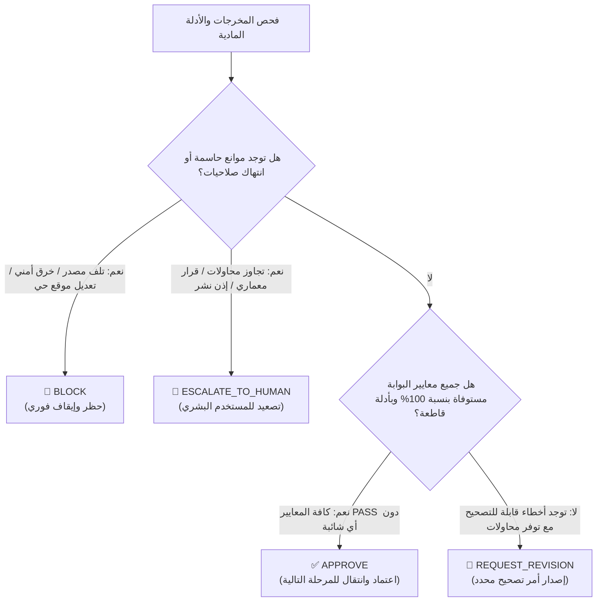

# ⚖️ سياسة القرارات والتصعيد (SECOD Decision & Escalation Policy)

تحدد هذه السياسة المنطق الحاكم لقرارات الوكيل الإشرافي (`secod-supervisor`)، ومصفوفة الخطورة، وإجراءات التصعيد للمستخدم البشري داخل منصة **SECOD**.

---

## 1. محرك القرارات الرباعي (The 4 Decision Archetypes)

يتخذ المشرف حصراً واحداً من أربعة قرارات عند تقييم أي بوابة أو تسليم:



---

## 2. تفصيل القرارات وإجراءاتها التشغيلية

### أولاً: قرار الاعتماد (`APPROVE`)
- **المعنى والهدف:** الإقرار الرسمي باستيفاء المرحلة لكافة معايير الجودة والأدلة المادية، والتصريح بفتح المرحلة التالية.
- **شروط الإصدار الإلزامية:**
  1. وجود كافة ملفات المخرجات على القرص بمساراتها المحددة وأحجامها القياسية.
  2. حصول 100% من معايير البوابة على تصنيف `PASS` المستند إلى دليل مادي موثق.
  3. انعدام أي ملاحظة من فئة `FAIL` أو `NOT VERIFIED`.
  4. عدم تجاوز حدود الصلاحيات أو المساس بالملفات المحمية.
- **الإجراءات التشغيلية المترتبة:**
  1. تسجيل وثيقة `Gate Review Report` معتمدة داخل سجل التدقيق `audit-log.md`.
  2. تحديث `workflow-state.json` بوضع البوابة كـ `APPROVED` وتحديد المرحلة التالية.
  3. إصدار أمر استدعاء وتكليف للمنسق (`secod-orchestrator`) بالانتقال للمرحلة التالية مع تزويده بالمدخلات المعتمدة.

---

### ثانياً: قرار طلب التصحيح (`REQUEST_REVISION`)
- **المعنى والهدف:** رصد أخطاء أو نواقص قابلة للمعالجة، وتوجيه أمر تصحيح ملزم ومحدد للوكيل المسؤول عبر المنسق.
- **شروط الإصدار الإلزامية:**
  1. وجود عيوب أو أخطاء مصنفة `HIGH` أو `MEDIUM` في المخرجات المفحوصة.
  2. عدم تجاوز الحد الأقصى لمحاولات التصحيح المسموح بها (عدد المحاولات السابقة < 2).
  3. قابلية الخلل للإصلاح دون تغيير في نطاق المشروع أو معمارية المنصة.
- **الإجراءات التشغيلية المترتبة:**
  1. إنشاء بطاقة أمر تصحيح مهيكلة بصيغة YAML (`revision_request.md`).
  2. زيادة عداد المحاولات (`attempt_count = attempt_count + 1`).
  3. تحديث حالة سير العمل في `workflow-state.json` إلى `REWORK`.
  4. إحالة البطاقة إلى المنسق لإلزام الوكيل المعني بتنفيذ المطلوب وإعادة التسليم.

---

### ثالثاً: قرار الحظر والإيقاف (`BLOCK`)
- **المعنى والهدف:** تجميد فوري لخط الإنتاج بسبب وجود عائق هندسي أو مصدري يمنع الاستمرار بصورة آمنة وموثوقة.
- **شروط الإصدار الإلزامية:**
  1. تلف ملف المصدر الخام، عدم إمكانية استخراج نصوصه، أو كونه فارغاً.
  2. فقدان ملف إدخال أساسي تعتمد عليه المرحلة.
  3. رصد هلوسة فجة أو مراجع وهمية غير قابلة للإثبات في المعايير الدولية.
  4. محاولة تعديل ملفات الموقع الحية أو انتهاك حظر الأطر البرمجية الخارجية.
- **الإجراءات التشغيلية المترتبة:**
  1. تجميد فوري لسير العمل وتحويل الحالة إلى `HALTED` / `BLOCKED`.
  2. تسجيل الدليل القاطع على سبب الحظر في سجل التدقيق لمنع التلاعب.
  3. حظر المنسق من إصدار أي تكليفات جديدة حتى زوال سبب الحظر.

---

### رابعاً: قرار التصعيد للمستخدم البشري (`ESCALATE_TO_HUMAN`)
- **المعنى والهدف:** تسليم زمام القرار للمستخدم البشري المالك للنظام في المسائل المصيرية التي تتجاوز الصلاحيات الذاتية للوكلاء.
- **حالات التصعيد الإلزامية:**
  1. **تجاوز حد التصحيح:** فشل معالجة العيوب بعد جولتي تصحيح كاملتين (محاولة 3).
  2. **تعديل الملفات المحمية:** الحاجة لتعديل ملفات في `assets/`, `components/`, أو ملفات موقع قائمة.
  3. **الدمج والنشر النهائي:** اعتماد المرحلة السابعة ونقل المحاضرة للإنتاج (`GATE-07`).
  4. **تغيير النطاق والمعمارية:** طلب إضافة تقنيات جديدة أو تغيير هيكلية المنهج المعتمد.
  5. **النزاع الأكاديمي:** وجود تناقض علمي حاد بين المرجع المعتمد وشريحة الأستاذ الجامعي.
- **الإجراءات التشغيلية المترتبة:**
  1. تحويل حالة سير العمل إلى `HUMAN_REVIEW` وتعيين مؤشر `waiting_for_user: true`.
  2. إنشاء حزمة تصعيد متكاملة في التقرير توضح: (الخلل، الأدلة الميدانية، الخيارات الممكنة، والقرار المطلوب).

---

## 3. مصفوفة تصنيف الخطورة (Defect Severity Matrix)

| مستوى الخطورة | المعيار والوصف | القرار التلقائي المقترن |
|:---|:---|:---:|
| **CRITICAL** | تلف المصدر، هلوسة مرجعية، خرق أمني، تعديل ملفات حية، تكرار فشل التصحيح > 2. | `BLOCK` أو `ESCALATE_TO_HUMAN` |
| **HIGH** | نقص شريحة في التحليل، خطأ رياضي في وحدة قياس، كسر بنية الكويز الـ 10 أسئلة، انهيار Mermaid. | `REQUEST_REVISION` |
| **MEDIUM** | غموض في صياغة تفسير، نقص مصطلح إنجليزي مقابل، ضعف في تباين لوني غير حرج. | `REQUEST_REVISION` |
| **LOW** | تحسينات تنسيقية طفيفة، ملاحظات بيداغوجية اختيارية لا تؤثر على سلامة المحتوى. | `APPROVE` مع توثيق الملاحظة |

---

## 4. نموذج حزمة التصعيد للمستخدم (Escalation Packet Format)

عند صدور قرار `ESCALATE_TO_HUMAN`، يتم تضمين الكتلة التالية للمستخدم في واجهة المحادثة:

```markdown
<!-- SECOD_HUMAN_ESCALATION_START -->
### 🚨 مذكرة تصعيد للمستخدم البشري (Human Escalation Required)

- **معرف الحالة (Escalation ID):** `ESC-[COURSE]-[LEC]-[TIMESTAMP]`
- **البوابة المعنية (Source Gate):** `GATE-[XX]`
- **سبب التصعيد المباشر:** [تجاوز حد التصحيح / نزاع علمي / طلب تعديل ملفات حية / إذن نشر]
- **البيانات والأدلة الميدانية:**
  - الملفات المتأثرة: `path/to/affected/file`
  - عدد محاولات التصحيح المستنفدة: [2/2]
  - جذر المشكلة المثبت: [شرح دقيق للمشكلة مع الشواهد]
- **الخيارات الهندسية المتاحة أمام المستخدم:**
  1. **الخيار الأول:** [تجاوز يدوي مع توجيه محدد]
  2. **الخيار الثاني:** [إلغاء المهمة أو إعادة تعيين مرحلة التحليل]
  3. **الخيار الثالث:** [اعتماد تعديل النطاق]
- **القرار المطلوب:** بانتظار توجيهات المستخدم المكتوبة قبل اتخاذ أي إجراء إضافي.
<!-- SECOD_HUMAN_ESCALATION_END -->
```
