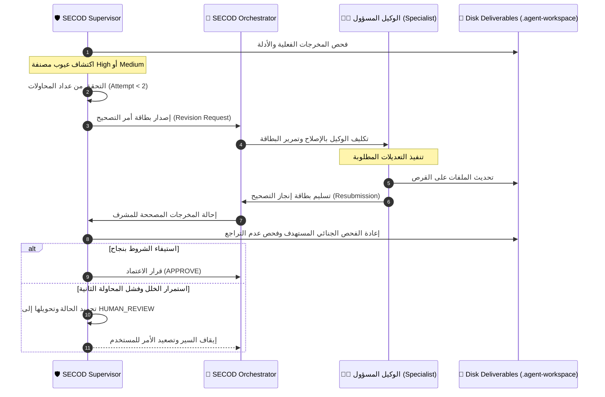

# 🔄 بروتوكول التصحيح وإعادة المراجعة (SECOD Revision & Remediation Protocol)

يحدد هذا البروتوكول الآلية الهندسية المعتمدة لمعالجة العيوب، وتوجيه أوامر التصحيح، ومتابعة إعادة الفحص، وضمان عدم الدخول في حلقات تصحيح لانهائية (Anti-Infinite-Loop) داخل منصة **SECOD**.

---

## 1. دورة حياة جولة التصحيح (Revision Lifecycle)



---

## 2. مصفوفة توجيه التكليف حسب نوع العيب (Remediation Routing Matrix)

عند اكتشاف عيب في أي مرحلة، يُلزم المشرف المنسق بتوجيه أمر التصحيح حصراً إلى الوكيل المختص وفق الجدول التالي:

| تصنيف العيب | الوكيل المسؤول عن الإصلاح | الملفات المتأثرة |
|:---|:---|:---|
| إسقاط شريحة، نقص في بنية الشجرة، أهداف بلوم غير دقيقة، خلط بين نصوص المصدر والتحليل | `academic-analyst` | `01-analysis/lecture-analysis.md` |
| غياب معيار رسمي، خطأ رياضي في معادلة، دراسة حالة ضعيفة، ادعاء غير موثق | `academic-researcher` | `02-research/research-report.md` |
| تلخيص مخل، نقص في المحاور العشرة، صياغة مضللة للاستقلالية، ضعف في المصطلحات | `academic-writer` | `03-content/lecture-content.md` |
| خلل في كائن `quizData` (أقل/أكثر من 10 أسئلة)، خطأ تركيبي في Mermaid، تصميم تفاعلي غير متوافق | `instructional-designer` | `04-instructional-design/instructional-design.md` |
| ألوان صلبة (Non-tokens)، كسر التجاوب، استخدام أطر ممنوعة، أخطاء برمجية في الـ JS | `secod-frontend` | `05-implementation/implementation-report.md` |
| فحص غير مكتمل للأركان الثلاثة، مفاتيح إجابات كويز متناقضة مع الشرح، غياب أدلة فحص | `academic-qa` | `06-qa/qa-report.md` |

---

## 3. الهيكل المعياري لأمر التصحيح (Standardized Revision Request Format)

يجب أن يصاغ كل أمر تصحيح وفق بنية YAML الدقيقة التالية، مع حفظه في مسار المرحلة تحت اسم `revision-order-[REV_ID].md`:

```yaml
revision_id: REV-[COURSE]-[LEC]-[GATE]-[ATTEMPT]
workflow_id: SEC-[COURSE]-[LEC]
source_gate: GATE-[XX]
assigned_agent: [اسم الوكيل المنفذ]
severity: [CRITICAL | HIGH | MEDIUM | LOW]

affected_files:
  - path/to/file.md

findings:
  - finding_id: FIND-001
    description: "الوصف الدقيق للمشكلة المكتشفة"
    evidence: "الموضع المحدد بالسطر والاقتباس أو الفحص الرياضي"
    expected_state: "الحالة المعيارية المتوافقة مع قواعد المنصة"
    required_action: "الإجراء التقني المحدد والمباشر المطلوب تنفيذه"

acceptance_criteria:
  - "معيار التحقق الصريح 1"
  - "معيار التحقق الصريح 2"

attempt: 1
max_allowed_attempts: 2
status: PENDING
timestamp: "2026-11-16T11:00:00+03:00"
```

---

## 4. قواعد مكافحة الحلقات اللانهائية (Anti-Infinite-Loop Rules)

1. **الحد الأقصى للمحاولات الآلية (2 Revisions Max):**
   - يُسمح فقط بدورتي تصحيح آليتين (`Attempt 1` و `Attempt 2`) لكل بوابة.
   - إذا استمر العيب بعد إعادة فحص المحاولة الثانية، تُعتبر الحالة `Attempt 3 Failure`.
2. **الحظر الفوري للإعادة التلقائية:**
   - عند بلوغ `Attempt 3 Failure`، **يُمنع منعاً باتاً** على المشرف أو المنسق إصدار أمر تصحيح ثالث أو إعادة التكليف آلياً.
3. **تجميد خط الإنتاج والتصعيد للبشر:**
   - تتحول حالة سير العمل فوراً إلى `HUMAN_REVIEW`.
   - لا يُستأنف العمل إلا بعد صدور قرار مكتوب وتوجيه صريح من المستخدم البشري.

---

## 5. بروتوكول إعادة الفحص والتحقق من عدم التراجع (Regression Re-Check)

عند استلام النسخة المصححة من الوكيل عبر المنسق:
1. **الفحص المستهدف (Targeted Verification):**
   - التحقق بالدليل القاطع من تنفيذ كافة البنود الواردة في حقل `required_action` واستيفاء `acceptance_criteria`.
2. **فحص عدم التراجع (Zero Regression Check):**
   - التحقق من أن التعديل الجديد لم يتسبب في حذف أقسام أخرى كانت مستوفية، ولم يُدخل أخطاء جديدة في الملفات أو الروابط.
3. **تسجيل النتيجة في سجل التدقيق:**
   - توثيق نجاح أو فشل جولة التصحيح في `audit-log.md` وتحديث `workflow-state.json`.
