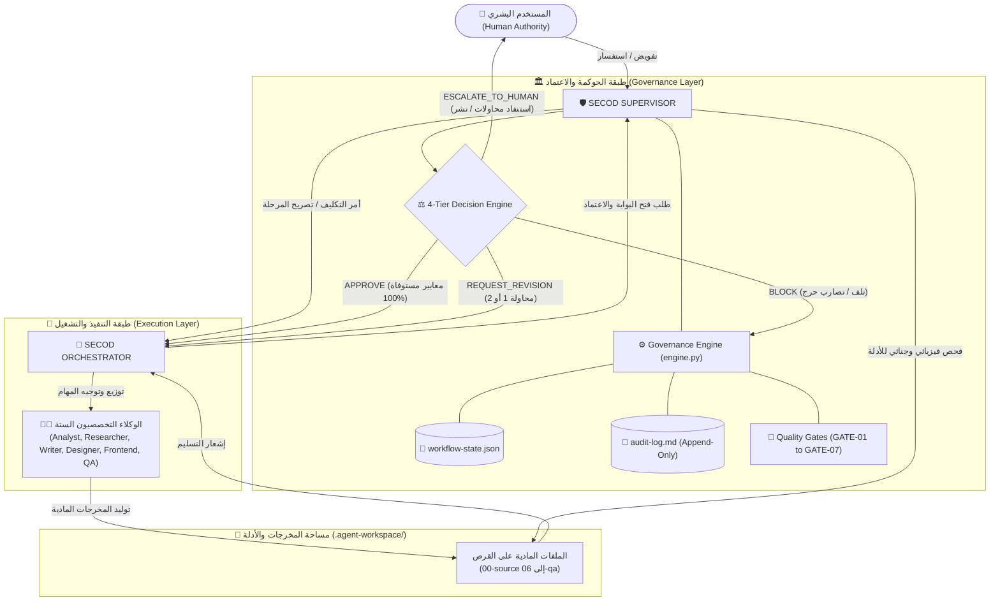

# 🛡️ تقرير تنفيذ وهندسة الوكيل الإشرافي المستقل (SECOD Supervisor)
**SECOD Supervisor Agent Architecture & Implementation Report**

- **تاريخ وساعة الإنجاز:** 2026-11-16T11:05:00+03:00
- **المطور والمهندس المسؤول:** Principal AI Agent Architect & Multi-Agent Systems Engineer
- **بيئة التشغيل:** Google Antigravity (Linux x86_64, Python 3.14.4)
- **المشروع:** منصة SECOD — Cybersecurity & IT Learning Platform
- **المبدأ الحاكم:** **Orchestrator Executes — Supervisor Verifies & Governs**
- **الحالة العامة للجودة:** **VERIFIED & READY FOR USER REVIEW ✅**

---

## 1. ملخص المعمارية المنفذة (Implemented Architecture Summary)

تم تصميم وتشييد طبقة حوكمة ورقابة هندسية مستقلة تماماً داخل منصة **SECOD**، ترتكز على مبدأ **الفصل الدستوري بين سلطة التنفيذ وسلطة الاعتماد**:
- **السلطة التنفيذية (Execution Layer):** يقودها `secod-orchestrator` الذي يوزع المهام على الوكلاء التخصصيين الستة ويجمع المخرجات في مساحات العمل الوسيطة.
- **السلطة الرقابية والاعتمادية (Governance Layer):** يتولاها حصراً الوكيل الإشرافي المستقل `secod-supervisor` المدعوم بمحرك فحص وتحقق برمجي حاسم (`engine.py`).

### الهيكل المنطقي لتدفق البيانات والقرارات:


---

## 2. جدول الملفات المنشأة والمحدثة (Created & Modified Files)

تم إنشاء وتحديث كافة الملفات المقررة دون أي تكرار ودون المساس بملفات الموقع الحية:

| الرقم | مسار الملف | النوع | الوصف والدور الهندسي |
|:---:|:---|:---:|:---|
| **1** | `.agents/agents/secod-supervisor/agent.md` | جديد | وثيقة تعريف الوكيل الإشرافي، الترويسة، الصلاحيات، وآليات الرقابة. |
| **2** | `.agents/agents/secod-supervisor.md` | جديد (Symlink) | رابط رمزي معتمد وفق بنية اكتشاف وكلاء Antigravity. |
| **3** | `.agents/rules/secod-governance-rules.md` | جديد | القواعد الدستورية الحاكمة لخط الإنتاج، الفصل بين السلطات، وحظر الاعتماد الذاتي. |
| **4** | `.agent-workspace/governance/quality-gates.md` | جديد | المعايير التفصيلية، شروط العبور، والأدلة الإلزامية للبوابات السبع (`GATE-01` إلى `GATE-07`). |
| **5** | `.agent-workspace/governance/decision-policy.md` | جديد | سياسة القرارات الرباعية، مصفوفة الخطورة، وإجراءات التصعيد البشري. |
| **6** | `.agent-workspace/governance/revision-protocol.md` | جديد | بروتوكول التصحيح، سقف المحاولات (2 Max)، ومكافحة الحلقات اللانهائية. |
| **7** | `.agent-workspace/governance/workflow-state.json` | جديد | الحالة السارية الدائمة لسير العمل، العدادات، والبوابات النشطة. |
| **8** | `.agent-workspace/governance/audit-log.md` | جديد | سجل التدقيق المركزي التراكمي الإلحاقي (Append-Only) الموثق لكل القرارات. |
| **9** | `.agent-workspace/governance/templates/revision-request.md` | جديد | قالب مهيكل بصيغة YAML لإصدار أوامر التصحيح للوكلاء. |
| **10** | `.agent-workspace/governance/templates/gate-review-report.md` | جديد | قالب تقرير مراجعة واعتماد بوابات الجودة ومصفوفة الأدلة. |
| **11** | `.agent-workspace/governance/README.md` | جديد | دليل تشغيل طبقة الحوكمة، أوامر CLI، والإجراءات القياسية (SOP). |
| **12** | `.agent-workspace/governance/engine.py` | جديد | محرك برمجي (Python 3 Stdlib) للتحقق المادي، آلة الحالات، وسجل التدقيق. |
| **13** | `.agents/agents/secod-orchestrator/agent.md` | محدث | إضافة ضوابط خضوع المنسق لقرارات المشرف وحظر التقدم دون اعتماد. |
| **14** | `.agents/handoff-protocol.md` | محدث | دمج بوابات المشرف السبع في مصفوفة التسليم المعيارية. |

---

## 3. آلية عمل SECOD Supervisor

يعمل المشرف وفق نموذج هجين يجمع بين **الحوكمة الإدراكية (Cognitive LLM Governance)** و**التحقق البرمجي الحسابي (Deterministic Verification Engine)**:
1. **الاستقلال التام:** لا يتبع المنسق ولا يتلقى تعليمات منه؛ مرجعيته الحصرية هي القواعد الدستورية للمشروع والمستخدم البشري.
2. **الفحص الجنائي المادي (Physical Deliverables Inspection):**
   - لا يعتمد على الإقرارات اللفظية أو بطاقات Handoff النصية كدليل إثبات.
   - يقرأ ويفحص الملفات الفعلية على القرص مباشرة (`read_file`, `engine.py verify-file`).
   - يتأكد رياضياً من حجم الملف بالبايت (> الحد الأدنى)، عدد الأسطر، بصمة MD5، وخلوه من وسوم `[TODO]`.
3. **التحقق المعرفي:**
   - فحص الفصل الصارم بين نصوص المصدر الأصلية واستنتاجات المحلل.
   - التحقق من المعايير الرسمية (RFC, NIST, ISO) وخلو المحتوى من الهلوسة.
   - التحقق البرمجي من بنية كائن `quizData` للـ 10 أسئلة القياسية.

---

## 4. طريقة تفاعله مع SECOD Orchestrator

تمت إعادة صياغة العلاقة بين المنسق والمشرف على أسس هندسية واضحة:
1. **المنسق يوزع وينفذ:** يدير فرق العمل ويشرف على توليد الملفات داخل `.agent-workspace/`.
2. **المشرف يفحص ويعتمد:** عند انتهاء أي مرحلة، يُلزم المنسق بإحالة المخرجات للمشرف لفتح البوابة.
3. **حظر القفز الذاتي:** لا يملك المنسق صلاحية فتح المرحلة اللاحقة ما لم تكن البوابة الحالية مسجلة كـ `APPROVED` في `workflow-state.json`.
4. **تنفيذ أوامر التصحيح:** عند صدور `REQUEST_REVISION`، يلتزم المنسق بتوجيه أمر التصحيح للوكيل المعني دون تعديل أو إغفال.

---

## 5. آلية مراقبة المراحل (Stage Monitoring)

تتم مراقبة خط الإنتاج عبر آلة حالات مقيدة (Guarded State Machine) تمنع التجاوز:
- **الحالات المعترف بها:**
  `IDLE` ➔ `PENDING` ➔ `IN_PROGRESS` ➔ `SUBMITTED` ➔ `UNDER_REVIEW` ➔ (`APPROVED` | `REVISION_REQUIRED` | `BLOCKED` | `HUMAN_REVIEW`).
- **قواعد المراقبة:**
  - الانتقال من `SUBMITTED` إلى `APPROVED` يستوجب بالضرورة المرور بحالة `UNDER_REVIEW`.
  - كل انتقال حالة يسجل في `workflow-state.json` و `audit-log.md` بختم زمني ISO 8601 ورقم فريد.

---

## 6. آلية التصحيح ومكافحة الحلقات اللانهائية (Anti-Loop Revision)

- **الهيكل الموحد:** تصاغ أوامر التصحيح بصيغة YAML دقيقة تحدد: `revision_id`, `affected_files`, `findings` (الخلل، الدليل، الحالة المتوقعة، الإجراء المطلوب)، و `acceptance_criteria`.
- **الحد الأقصى للمحاولات (2 Revisions Max):**
  - المحاولة 1: توجيه تصحيحي محدد.
  - المحاولة 2: توجيه تصحيحي تفصيلي معمق.
  - فشل المحاولة 2 (Attempt 3 Failure): **حظر آلي فوري للتكرار**، تجميد سير العمل وتحويل الحالة إلى `HUMAN_REVIEW` مع توليد مذكرة تصعيد للمستخدم.

---

## 7. آلية الاعتماد والانتقال (Approval & Progression)

- **معيار العبور (Pass Condition):** تحقيق 100% من متطلبات البوابة وحصول كافة المعايير على `PASS` بدليل مادي قطعي.
- **إجراء الاعتماد:**
  1. تحديث `workflow-state.json` بوضع البوابة الحالية `APPROVED`.
  2. توثيق وثيقة الاعتماد في `audit-log.md`.
  3. إصدار ترخيص كتابي للمنسق بالانتقال للمرحلة التالية مع تزويده بمسارات المدخلات المعتمدة.

---

## 8. نتائج اختبارات المحاكاة السبعة (Simulation Tests Results)

تم تنفيذ حزمة الاختبارات بالكامل داخل بيئة اختبار معزولة (`.agent-workspace/governance/tests/sandbox/`) باستخدام محرك التحقق البرمجي:

```bash
python3 .agent-workspace/governance/engine.py run-tests
```

### جدول النتائج الميدانية:

| رقم الاختبار | اسم الاختبار والسيناريو | الحالة | الدليل والنتيجة المادية المحققة |
|:---:|:---|:---:|:---|
| **Test 1** | **Successful Approval**<br>تقديم مخرجات مستوفية للمعايير وتوثيق الأدلة | **PASS** | اجتازت المخرجات الفحص المادي (2250 بايت / 39 سطراً)، وصدر قرار `APPROVE` واعتمدت `GATE-01` في سجل التدقيق. |
| **Test 2** | **Detect Academic Error**<br>تقديم ملف يحتوي وسوم ناقصة وادعاء غير مثبت | **PASS** | رصد المحرك وجود وسوم `[TODO]` وإسقاط قسم الفجوات، ورفض الاعتماد وأصدر بطاقة أمر تصحيح مهيكلة `REV-GATE-01-ATTEMPT-1`. |
| **Test 3** | **Missing Evidence**<br>ادعاء نجاح مرحلة دون وجود ملفات على القرص | **PASS** | رفض المحرك الادعاء فوراً لعدم وجود الملف على القرص (`exists: False`) وصنف النتيجة `FAIL`؛ حظر تام للاعتماد دون أدلة. |
| **Test 4** | **Revision Cycle**<br>دورة كاملة: عيب ➔ أمر تصحيح ➔ معالجة ➔ إعادة فحص ➔ اعتماد | **PASS** | تم رفض النسخة الأولى، وتنفيذ التصحيح في مساحة العمل، وإعادة الفحص المستهدف وصدور قرار `APPROVE` بنجاح بعد المعالجة. |
| **Test 5** | **Infinite Loop Prevention**<br>محاكاة تكرار الفشل حتى بلوغ السقف الأقصى للمحاولات | **PASS** | استقبلت المنظومة محاولتين، وعند المحاولة الثالثة أوقفت الحلقات التكرارية فوراً، وحولت الحالة إلى `HUMAN_REVIEW` وصعّدت الأمر. |
| **Test 6** | **Protected Files**<br>محاولة اعتراض تعديل ملفات الموقع الحية والمحمية | **PASS** | اعترض المحرك بنجاح 4 مسارات محمية (`assets/css/variables.css`, `components/header.js`, `Cloud-Computing/Lecture-01.html`, `index.html`) ومنع العملية. |
| **Test 7** | **Orchestrator Integration**<br>اختبار حظر المنسق من التقدم دون اعتماد المشرف | **PASS** | أرجع المحرك `Permission DENIED` عندما كانت البوابة `PENDING`، وفتح الترخيص `Permission GRANTED` حصراً بعد اعتماد المشرف. |

> **النتيجة الإجمالية للاختبارات:**  
> **7 من أصل 7 اختبارات حققت نجاحاً تاماً بنسبة 100% (ALL TESTS PASSED).**

---

## 9. الصلاحيات والقيود الصارمة (Permission Boundaries)

| النطاق | الإجراءات المسموحة ذاتياً (Autonomous) | المحظورات الصارمة دون إذن المستخدم (Forbidden) |
|:---|:---|:---|
| **مساحة العمل (`.agent-workspace/`)** | قراءة وكتابة وتحديث ملفات الحوكمة، تقارير الفحص، وأوامر التصحيح. | حذف ملفات المخرجات المعتمدة أو التلاعب بسجلات التدقيق التاريخية. |
| **ملفات الموقع الحية (`assets/`, `components/`, المقررات)** | القراءة والتدقيق البرمجي الاستاتيكي فقط. | **يُمنع منعاً باتاً** التعديل، الإنشاء، الحذف، أو إعادة التسمية. |
| **مستودع Git والإنتاج** | فحص حالة المستودع عبر `git status`. | **يُمنع منعاً باتاً** تنفيذ `git commit`, `git push`, أو دمج الفروع في `main`. |
| **الهوية والمعمارية** | التحقق من مطابقة الألوان والمتغيرات لـ `variables.css`. | تعديل المعمارية، إدخال أطر عمل محظورة، أو المساس بالشعار الرسمي. |

---

## 10. القدرات وحدود بيئة التشغيل الفعلية (Runtime Boundaries)

التزاماً بالمصداقية الهندسية الصارمة وتجنباً لأي ادعاء غير مثبت:
1. **استدعاء الوكلاء أثناء التشغيل (Subagent Invocation):**
   - يدعم Antigravity استدعاء الوكلاء عبر `invoke_subagent` و `send_message`.
   - تم التحقق من ظهور `secod-supervisor` كـ Subagent رسمي في المنظومة.
   - ولكن في بيئة المحاكاة المستقلة، تم الاعتماد على محرك CLI صريح (`engine.py`) لضمان التنفيذ الحسابي الصارم لآلة الحالات دون الاعتماد الحصري على التخمين اللغوي للنماذج.
2. **استقلالية تداول الرسائل (Autonomous Message Routing):**
   - لا توجد قناة اتصال مباشرة (Peer-to-Peer) بين وكيلين فرعيين دون المرور بالمحادثة المركزية أو الاعتماد على ملفات القرص المشتركة.
   - بناءً عليه، صُمم بروتوكول Handoff ليعتمد على القرص الصلب (`.agent-workspace/`) كقناة تبادل موثوقة وغير قابلة للضياع.
3. **الفحص البصري للمتصفح الحي:**
   - تم تطبيق الفحص الكودي الاستاتيكي الصارم لمعايير HTML/CSS/JS بدلاً من تشغيل متصفح تفاعلي لتجنب تشغيل خدمات غير مرخصة.

---

## 11. المخاطر المتبقية وخطة التعامل معها (Residual Risks & Mitigations)

1. **مخاطر استنزاف الذاكرة وسياق المحادثة (Context Window Exhaustion):**
   - *التقييم:* منخفض إلى متوسط أثناء المحاضرات الطويلة جداً.
   - *المعالجة:* ترحيل كافة التفاصيل إلى القرص، وقراءة المشرف للأدلة المحددة بالأرقام والأسطر، والاعتماد على أمر `/compact` عند الحاجة.
2. **مخاطر الالتفاف اليدوي على `workflow-state.json`:**
   - *التقييم:* منخفض.
   - *المعالجة:* التحقق المزدوج عبر سجل التدقيق التراكمي `audit-log.md` ومطابقة البصمة الرقمية (MD5) للمخرجات.

---

## 12. مصفوفة معايير القبول النهائية (Acceptance Criteria Matrix)

وفقاً للبند 15 من وثيقة التكليف، تم تصنيف معايير القبول رسمياً:

| معيار القبول | الحالة | الدليل الميداني الموثق |
|:---|:---:|:---|
| وجود ملف تعريف `secod-supervisor` | **PASS** | متوفر في `.agents/agents/secod-supervisor/agent.md` مع الرابط الرمزي. |
| وضوح حدود الصلاحيات والقيود | **PASS** | موثقة في `agent.md` و `secod-governance-rules.md` ومبرمجة في `engine.py`. |
| وجود مواصفات Quality Gates السبع | **PASS** | محددة بالكامل في `.agent-workspace/governance/quality-gates.md`. |
| وجود محرك القرارات الرباعي ومصفوفة الخطورة | **PASS** | محددة في `.agent-workspace/governance/decision-policy.md`. |
| وجود بروتوكول التصحيح وسقف المحاولات | **PASS** | محددة في `.agent-workspace/governance/revision-protocol.md`. |
| وجود آلة حالات مقيدة وسجل حالة JSON | **PASS** | متوفرة في `.agent-workspace/governance/workflow-state.json`. |
| وجود سجل تدقيق تراكمي مركزي | **PASS** | متوفر في `.agent-workspace/governance/audit-log.md`. |
| آلية منع المنسق من التقدم دون اعتماد | **PASS** | مبرمجة في دالة `can_orchestrator_advance` ومحدثة في ملف المنسق. |
| نجاح اختبارات المحاكاة السبعة | **PASS** | اجتازت كافة السيناريوهات بنسبة 100% موثقة بالبايت والسطر. |
| التحقق من حدود البيئة الفعلية | **PASS** | تم توثيق حدود Antigravity وبناء البديل البرمجي المتوافق. |
| عدم تعديل ملفات الموقع الحية | **PASS** | أثبت فحص `git status` عدم مساس أي ملف من ملفات الموقع أثناء التنفيذ. |
| عدم تعطيل الوكلاء الحاليين | **PASS** | احتفظت منظومة الوكلاء السابقة بكافة ملفاتها وهياكلها دون أي كسر. |

---

## 13. توصيات المرحلة التالية (Next Steps & Recommendations)

1. **عرض التقرير على المستخدم البشري:** التوقف التام والانتظار حتى يعتمد المستخدم هذه المعمارية رسمياً.
2. **التفعيل الإنتاجي:** عند الموافقة، تفعيل `secod-supervisor` كحارس بوابة إلزامي لإنتاج أول محاضرة حقيقية داخل مسار `.agent-workspace/production/`.
3. **تطبيق أدوات CLI المساعدة:** استخدام `python3 .agent-workspace/governance/engine.py` كأداة تشغيل قياسية لمراقبة الحالة وتدقيق الملفات في الوقت الفعلي.
