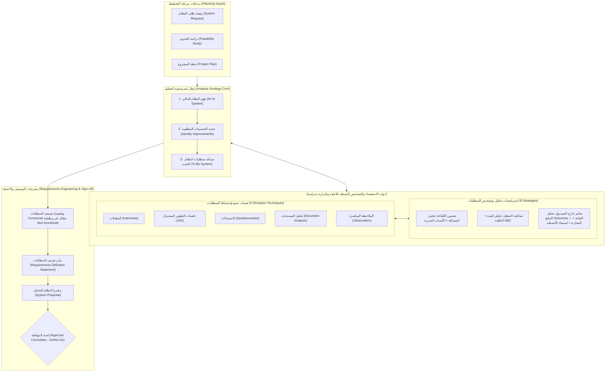

# تقرير التحليل الأكاديمي للمحاضرة: مرحلة التحليل وتحديد المتطلبات (Requirements Determination)

---

## 1. بيانات المحاضرة والمصدر (Lecture Overview & Metadata)

- **المقرر الدراسي:** تحليل وتصميم نظم (Systems Analysis and Design - SAD).
- **رقم المحاضرة:** المحاضرة الرابعة (Lecture 04).
- **عنوان المحاضرة:** مرحلة التحليل وتحديد المتطلبات (Analysis Phase & Requirements Determination).
- **الملف المصدري الأساسي:** `aa4.pdf` (حجم الملف: 9.62 ميغابايت تقريباً، تم إنشاؤه عبر Microsoft® PowerPoint® 2016).
- **ملف تفريغ الشرائح:** `.agent-workspace/production/lecture-01/00-source/source-slides.md`.
- **عدد الشرائح الإجمالي:** 32 شريحة كاملة تم فحصها وتحليلها تسلسلياً بنسبة تغطية 100%.
- **المنصة التعليمية المستقلة:** SECOD Platform (Cybersecurity & IT Learning Platform).
- **المطور والمؤسس:** بشار زبله (Bashar Zblh).
- **الجمهور المستهدف:** طلاب المستوى الثالث في تخصصات تقنية المعلومات والأمن السيبراني.

---

## 2. الجرد الشامل للمحتوى الأصلي شريحة بشريحة (Source Content Inventory)

فيما يلي مسح تفصيلي دقيق وشامل لجميع الشرائح الـ 32 الواردة في العرض التقديمي الأصلي، مع التمييز التام بين **[النص الصريح في المصدر]** و**[التحليل والاستنتاج الأكاديمي]** و**[الفحص البصري للمحتوى]**:

---

### الشريحة 1: شريحة الغلاف والعنوان الرئيسي
- **[النص الصريح في المصدر]:**
  - "أساسيات تحليل وتصميم النظم"
  - "المحاضرة الرابعة"
  - "مرحلة التحليل المتطلبات Requirements"
- **[الفحص البصري للمحتوى]:** شريحة عنوان بيضاء بخلفية نصية بسيطة، لا تحتوي على صور أو شعارات مؤسسية، والنص العربي مكتوب بخط عريض يتوسط الشريحة.
- **[التحليل والاستنتاج الأكاديمي]:** المحاضرة مخصصة لافتتاح مرحلة التحليل (Phase 2 في دورة حياة تطوير النظم SDLC) مع التركيز الخاص على مرحلة "تحديد واستنباط المتطلبات" (Requirements Determination / Elicitation).

---

### الشريحة 2: الأجندة ومواضيع المحاضرة
- **[النص الصريح في المصدر]:**
  - معرفة ما يجري في مرحلة التحليل وهي المرحلة الثانية بعد التخطيط في دورة حياة تطوير النظام.
  - تعريف ماهية المتطلبات وتحديد أنواعها المختلفة.
  - معرفة تقنيات جمع المتطلبات الخمس (المقابلة، الاستبيان، جلسات التطوير المشترك، تحليل المستندات، والملاحظة)، ومعرفة كيفية اختيار التقنية المناسبة حسب مميزات كل تقنية.
  - شرح استراتيجيات تحليل المتطلبات المختلفة، ومعرفة كيفية اختيار الاستراتيجية المناسبة لكل مشروع حسب نوعية المشروع.
- **[الفحص البصري للمحتوى]:** قائمة نقطية (Bullet Points) من 4 بنود رئيسية باللون الأسود.
- **[التحليل والاستنتاج الأكاديمي]:** تمثل هذه الشريحة خارطة الطريق للمحاضرة وتحدد المحاور الكبرى: المفهوم والمدخلات، تصنيف المتطلبات، تقنيات الجمع الخمس، واستراتيجيات التحليل الثماني مع معايير الاختيار.

---

### الشريحة 3: مفهوم التحليل وموقعه في دورة حياة تطوير النظم
- **[النص الصريح في المصدر]:**
  - سميت مرحلة التحليل على هذا النحو لأن مصطلح التحليل يشير إلى تقسيم الكل إلى أجزائه التي يتكون منها بقصد فهم طبيعة الأجزاء ووظيفتها وعلاقاتها المتبادلة.
  - في سياق دورة حياة تطوير النظم، تحدد مخرجات مرحلة التخطيط (طلب النظام System Request، ودراسة الجدوى Feasibility Study، وخطة المشروع Project Plan) أهداف النظام الجديد ونطاقه وتقييم جدواه، كما توفر خطة أولية للعمل عليه.
  - نتائج مرحلة التخطيط هي المدخلات الرئيسية لمرحلة التحليل.
  - في مرحلة التحليل يعمل محلل الأنظمة على نطاق واسع مع مستخدمي النظام الجديد لفهم احتياجاتهم.
- **[الفحص البصري للمحتوى]:** فقرتان نصيتان مركزتان توضحان الاشتقاق اللغوي والمنطقي للمصطلح وموقع المرحلة في التدفق العام.
- **[التحليل والاستنتاج الأكاديمي]:** تؤكد الشريحة أن مرحلة التحليل ليست بداية المشروع، بل تبنى كلياً على مخرجات التخطيط الثلاثة (طلب النظام، الجدوى، الخطة). جوهر عمل المحلل هنا هو التفاعل الواسع والمباشر مع المستخدمين.

---

### الشريحة 4: الخطوات/المراحل الأساسية الثلاث لمرحلة التحليل
- **[النص الصريح في المصدر]:**
  - تتكون مرحلة التحليل من ثلاث مراحل أساسية:
    1. تطوير استراتيجية للتحليل: تتضمن هذه الاستراتيجية عادة تحليلاً للنظام الحالي (as-is system) ومشاكله، وتصوراً للنظام الجديد (to-be system).
    2. تحديد وجمع وتحليل المتطلبات: يتم تحديد المتطلبات وفق تصنيفات (متطلبات وظيفية، غير وظيفية، متطلبات عمل، متطلبات نظام... إلخ).
    3. عمل مقترح النظام: مقترح النظام هو مستند يجمع بيان تعريف المتطلبات التفصيلية، وحالات الاستخدام، ونموذج العمليات، ونموذج البيانات مع تحليل الجدوى المنقح وخطة العمل.
- **[الفحص البصري للمحتوى]:** قائمة مرقمة تتضمن خطأ ترقيمياً طفيفاً في المصدر (تكرار رقم 1 للخطوة الثانية: 1، 1، 2).
- **[التحليل والاستنتاج الأكاديمي]:** يقسم المؤلف مرحلة التحليل إلى 3 أطوار فرعية متتابعة: (1) رسم الاستراتيجية والانتقال من as-is إلى to-be، (2) هندسة المتطلبات بمختلف تصنيفاتها، (3) صياغة مخرج التحليل الشامل (System Proposal) الذي يتضمن النماذج الوظيفية والبيانات المحدثة.

---

### الشريحة 5: تطوير استراتيجية التحليل (Analysis Strategy)
- **[النص الصريح في المصدر]:**
  - تطوير استراتيجية للتحليل (Analysis Strategy).
  - تتضمن العملية الأساسية للتحليل ثلاث خطوات:
    1. فهم النظام الحالي (as-is system).
    2. تحديد التحسينات المطلوبة في النظام الجديد.
    3. تحديد متطلبات النظام الجديد (to-be system).
- **[الفحص البصري للمحتوى]:** شريحة نصية ذات بنية هرمية ثلاثية واضحة المعالم.
- **[التحليل والاستنتاج الأكاديمي]:** تمثل الخطوات الثلاث جوهر التحول المؤسسي: تشخيص الواقع (As-Is) -> هندسة الفجوة والتحسينات (Improvements) -> صياغة مواصفات المستقبل (To-Be).

---

### الشريحة 6: متطلبات فهم وتفكيك النظام الحالي (As-Is System)
- **[النص الصريح في المصدر]:**
  - يحتاج فهم النظام الحالي إلى معرفة:
    - أهداف النظام الحالي.
    - عناصر نظام المعلومات مثل: المدخلات، الملفات، قواعد البيانات، نظم الرقابة، إجراءات التشغيل، لمقارنتها بالمخرجات.
    - موارد النظام مثل: الموارد البشرية، الأجهزة، والبرامج.
    - عمليات المعالجة والتشغيل للمدخلات للحصول على مخرجات النظام الحالي.
    - تقييم التكلفة والعائد من النظام الحالي.
- **[الفحص البصري للمحتوى]:** 5 نقاط تفصيلية تسرد العناصر المكونة لنظام المعلومات الإداري القائم.
- **[التحليل والاستنتاج الأكاديمي]:** يطبق المحلل هنا منهجية النظم الشاملة (General Systems Theory): دراسة المدخلات والمعالجة والمخرجات والبيانات والرقابة والموارد والتكلفة، لتكوين خط أساس (Baseline) متين للمشروع.

---

### الشريحة 7: النتيجة النهائية لمرحلة التحليل: مقترح النظام (System Proposal)
- **[النص الصريح في المصدر]:**
  - النتيجة النهائية لمرحلة التحليل هي مقترح النظام، وهو مستند يجمع بيان تعريف المتطلبات التفصيلية، وحالات الاستخدام، ونموذج العمليات، ونموذج البيانات مع تحليل الجدوى المنقح وخطة العمل.
  - في ختام مرحلة التحليل، يتم تقديم مقترح النظام إلى لجنة الموافقة على هيئة نظام شُرع العمل فيه، حيث يتم شرح النظام بتفاصيل دقيقة بحيث يمكن للمستخدمين والمديرين وصناع القرار الرئيسيين فهمه بوضوح، ويمكنهم تحديد أي تعديلات مطلوبة، ويكونون قادرين على اتخاذ قرار بشأن استمرار المشروع.
- **[الفحص البصري للمحتوى]:** فقرتان توثقان المخرج الحاكم لانتهاء مرحلة التحليل وآلية تسليمه للجنة الموافقة.
- **[التحليل والاستنتاج الأكاديمي]:** مقترح النظام هو "حجر الزاوية" ونقطة اتخاذ القرار المصيرية (Go / No-Go Decision). دقة العرض التقديمي للجنة الموافقة وإشراك أصحاب القرار يضمنان الدعم السياسي والتمويلي.

---

### الشريحة 8: تحديد المتطلبات (Requirements Determination) وأهميتها
- **[النص الصريح في المصدر]:**
  - تحديد المتطلبات (Requirements Determination).
  - يعد تحديد المتطلبات هو الجانب الأكثر أهمية في دورة حياة تطوير النظام بأكملها.
  - على الرغم من أن العديد من العوامل تساهم في فشل مشاريع تطوير النظم، إلا أن الفشل في تحديد المتطلبات الصحيحة هو السبب الرئيسي لفشل المشروع.
  - المتطلبات (Requirements) هي العبارات (Statements) التي تصف ما يجب على النظام فعله، والخصائص التي يجب أن يتميز بها هذا النظام.
- **[الفحص البصري للمحتوى]:** عنوان رئيسي إنجليزي/عربي وفقرة تعريفية تركز على خطورة الفشل في هذه المرحلة.
- **[التحليل والاستنتاج الأكاديمي]:** يؤكد المصدر نصاً أن الإخفاق في تحديد المتطلبات الصحيحة هو المسبب الرئيسي لفشل مشاريع النظم. تتوافق أدبيات هندسة البرمجيات العامة مع هذا الطرح؛ إلا أن الربط بأي إحصائيات رقمية محددة أو دراسات مسحية خارجية (مثل إحصائيات معهد Standish Group أو IEEE) هو فرضية خارجية لم ترد في الشرائح وتتطلب تحققاً وتوثيقاً علمياً دقيقاً من قبل الباحث الأكاديمي (Academic Researcher).

---

### الشريحة 9: الانتقال من وثيقة طلب النظام إلى قائمة المتطلبات
- **[النص الصريح في المصدر]:**
  - تطرح وثيقة طلب النظام مفهوم النظام المطلوب ومتطلبات العمل بصيغة موجزة وعالية المستوى.
  - تهدف خطوة تحديد المتطلبات إلى العمل على هذه الوثيقة بهدف توضيح ما جاء فيها والوصول إلى لائحة محددة ودقيقة من المتطلبات.
  - ولكن ماذا تعني كلمة "المتطلبات"؟
- **[الفحص البصري للمحتوى]:** فقرة قصيرة تنتهي بسؤال تحفيزي انتقالي.
- **[التحليل والاستنتاج الأكاديمي]:** وثيقة طلب النظام (System Request) المأخوذة من مرحلة التخطيط تكون في مستوى تجريد تنفيذي عام (High-level)، ودور المحلل هو التفكيك والتحويل من العموميات إلى مواصفات واضحة وقابلة للقياس والاختبار.

---

### الشريحة 10: تطور مصطلح المتطلبات بين مرحلتي التحليل والتصميم
- **[النص الصريح في المصدر]:**
  - مصطلح المتطلبات (Requirements term):
    - أثناء مرحلة التحليل تصاغ المتطلبات من وجهة نظر المستخدم الذي يمارس العمل لذا تسمى كثيراً بمتطلبات المستخدم (User Requirements) أو متطلبات العمل (Business Requirements)، وتركز دائماً على "ماذا" يجب على النظام فعله (What the system should do).
    - أما في مرحلة التصميم فإن هذه المتطلبات تتطور وتصبح تقنية بحيث تصف "كيف" سيُبنى النظام (How system would be built)، وتكتب من وجهة نظر المطور وتسمى عادة متطلبات النظام (System Requirements).
- **[الفحص البصري للمحتوى]:** نقطتان متقابلتان تقارنان زاوية الرؤية (مستخدم vs مطور) والتركيز (ماذا What vs كيف How).
- **[التحليل والاستنتاج الأكاديمي]:** تفريق جوهري ودقيق جداً في هندسة النظم: مرحلة التحليل معنية بالمجال الوظيفي للأعمال (Problem Domain / What)، بينما التصميم معني بمجال الحلول التقنية (Solution Domain / How).

---

### الشريحة 11: التصنيف الثنائي للمتطلبات (الوظيفية وغير الوظيفية)
- **[النص الصريح في المصدر]:**
  - أنواع المتطلبات (Types of Requirements):
    - متطلبات وظيفية (Functional Requirements): وهي المتطلبات المتعلقة بالإجرائيات التي يجب أن يقوم بها النظام، أو المعلومات التي يجب أن يحويها النظام لمستخدميه.
    - متطلبات غير وظيفية (Nonfunctional Requirements): وهي المتطلبات المتعلقة بالصفات والخصائص التي يجب أن تتوفر في النظام مثل سرعة الأداء، الأمن والسرية، بيئة التشغيل... إلخ، وعادة ما تؤثر على المتطلبات الوظيفية بصورة غير مباشرة.
- **[الفحص البصري للمحتوى]:** نقطتان رئيسيتان تحددان الثنائية التقليدية الشهيرة في هندسة المتطلبات.
- **[التحليل والاستنتاج الأكاديمي]:** المتطلبات الوظيفية تمثل السلوك والعمليات والبيانات (Process & Data)، بينما غير الوظيفية تمثل سمات الجودة والمعايير التشغيلية والقيود (Quality Attributes & Constraints)، وتؤثر بشكل حاسم على خيارات المعمارية البرمجية والأمنية.

---

### الشريحة 12: تعريف معهد تحليل الأعمال الدولي (IIBA) للمتطلبات
- **[النص الصريح في المصدر]:**
  - يعرف المعهد الدولي لتحليل الأعمال (IIBA - The International Institute of Business Analysis):
    - المتطلبات الوظيفية بأنها: "قدرات المنتج، أو الأشياء التي يجب أن يقوم بها المنتج لمستخدميه".
    - هذه المجموعة من المتطلبات (غير الوظيفية) بأنها: "سمات الجودة والتصميم وقيود التنفيذ والواجهات الخارجية التي يجب أن تكون لدى المنتج".
- **[الفحص البصري للمحتوى]:** نص استشهادي مقتبس لتوثيق المفاهيم وفق المعيار الدولي BABOK الصادر عن معهد IIBA.
- **[التحليل والاستنتاج الأكاديمي]:** اعتماد مرجعية رسمية معترف بها دولياً يدعم الرصانة الأكاديمية للمقرر، حيث تركز IIBA على تعريف المتطلبات من منظور القيمة وقيود التنفيذ والجودة.

---

### الشريحة 13: ديناميكية عملية تحديد المتطلبات والفجوة المعرفية المشتركة
- **[النص الصريح في المصدر]:**
  - عملية تحديد المتطلبات (The Process of Determining Requirements).
  - عند تحديد المتطلبات انطلاقاً من تعريف المتطلبات قد نحتاج إلى وجهتي نظر كل من المطور والمستخدم.
  - بينت الدراسات الحديثة أن نقص التفاعل مع المستخدم هو السبب الأول في فشل المشاريع البرمجية. لذا ينصح عند تحديد المتطلبات أن يعمل المحللون جنباً إلى جنب مع المستخدمين العارفين بالعمل.
  - قد لا يفهم محللو النظم احتياجات العمل الحقيقية للمستخدمين، بينما قد لا يدرك مستخدمو الأعمال التقنيات الحديثة الواعدة. لذلك، فإن النهج الأكثر فاعلية هو أن يعمل كل من رجال الأعمال والمحللين معاً لتحديد المتطلبات.
- **[الفحص البصري للمحتوى]:** فقرتان توضحان الفجوة المزدوجة (Business vs Technology) وأسلوب الشراكة كحل أمثل.
- **[التحليل والاستنتاج الأكاديمي]:** تجسيد كلاسيكي لمفهوم "الفجوة الدلالية" (Semantic Gap) بين عالم الأعمال وعالم الحوسبة؛ حيث يمتلك المستخدمون المعرفة التشغيلية الدقيقة، ويمتلك المحللون القدرة التقنية، والنجاح يكمن في العمل التشاركي المشترك.

---

### الشريحة 14: بيان تعريف المتطلبات (Requirements Definition Statement)
- **[النص الصريح في المصدر]:**
  - بيان تعريف المتطلبات (The Requirements Definition Statement).
  - تسمى عادة - تعريف المتطلبات - وهي تقرير نصي مباشر يسرد المتطلبات الوظيفية وغير الوظيفية في تنسيق مخطط تفصيلي.
  - يتم تحديد المتطلبات عادة عن طريق الترقيم. يتيح تعيين أرقام فريدة إمكانية تتبع كل متطلب من خلال عملية التطوير بأكملها.
  - من أجل الوضوح، يتم تجميع المتطلبات عادة في مجموعات وظيفية وغير وظيفية. ثم داخل كل مجموعة من هذه المجموعات، يتم تصنيفها حسب نوع المتطلبات أو حسب مجال العمل.
  - في بعض الأحيان، يتم تحديد أولويات المتطلبات في بيان تعريف المتطلبات؛ حيث يمكن تصنيفها على أنها ذات أهمية "عالية" أو "متوسطة" أو "منخفضة" في النظام الجديد، أو يمكن تصنيفها بإصدار النظام الذي سيعالج المتطلبات (على سبيل المثال، الإصدار 1، الإصدار 2، الإصدار 3).
- **[الفحص البصري للمحتوى]:** 4 نقاط تفصيلية تحدد مواصفات التوثيق القياسي للمتطلبات.
- **[التحليل والاستنتاج الأكاديمي]:** تقدم الشريحة المبادئ الأساسية لإدارة المتطلبات:
  1. التنسيق الهيكلي (Outline Format).
  2. التتبع عبر المعرفات الفريدة (Traceability Matrix readiness).
  3. التصنيف الوظيفي والقطاعي (Functional & Domain Grouping).
  4. تحديد الأولويات والتخطيط للإصدارات (MoSCoW / Release Planning).

---

### الشريحة 15: تقنيات استنباط المتطلبات: 3 نصائح ذهبية للمحلل
- **[النص الصريح في المصدر]:**
  - تقنيات جمع المتطلبات (Requirements Elicitation Techniques).
  - عند جمع المتطلبات هناك ثلاث نصائح يجب أن يأخذ بها المحلل:
    1. يجب على المحلل أن يدرك أن الآثار الجانبية المهمة لعملية تحديد المتطلبات تشمل بناء الدعم السياسي للمشروع وإقامة الثقة والتواصل بين فريق المشروع والمستخدمين النهائيين للنظام.
    2. يجب على المحلل تحديد من يتم تضمينه بعناية في عملية تحديد المتطلبات.
    3. افعل كل ما هو ممكن لاحترام والالتزام بالوقت الذي تطلبه من المشاركين.
- **[الفحص البصري للمحتوى]:** قائمة مرقمة تتضمن أبعاداً إدارية وسلوكية ومهارات شخصية لجمع المتطلبات.
- **[التحليل والاستنتاج الأكاديمي]:** توضح الشريحة بذكاء أن استنباط المتطلبات ليس عملية تقنية بحتة، بل عملية سياسية واجتماعية (Sociotechnical Process) تتطلب كسب أصحاب المصلحة واختيار العينات التمثيلية الصحيحة وإدارة الوقت باحترافية.

---

### الشريحة 16: تشبيه المحلل بالمحقق الجنائي والتقنيات الخمس الأكثر استخداماً
- **[النص الصريح في المصدر]:**
  - يشبه المحلل الذي يجمع المتطلبات المحقق في عمله؛ فهو يعلم بوجود مشكلة (لغز) تحتاج إلى حل، ويقوم بالبحث عن الأدلة التي تقوده إلى الحل. ليست الأدلة واضحة دوماً، ويجب أن يلاحظ المحلل التفاصيل، ويتحدث مع الشهود، ويتتبع الآثار. إن المحلل الجيد يجمع المعلومات باستخدام عدة تقنيات.
  - نركز على التقنيات الخمس الأكثر استخداماً وهي: المقابلات (Interviews)، جلسات JAD، الاستبيانات (Questionnaires)، تحليل المستندات (Document Analysis)، والملاحظة (Observation).
- **[الفحص البصري للمحتوى]:** شريحة قائمة على الاستعارة المجازية التوضيحية (Analogy) متبوعة بحصر للتقنيات الخمس.
- **[التحليل والاستنتاج الأكاديمي]:** استخدام استعارة "المحقق الجنائي" يرسخ في ذهن الطالب عقلية التقصي والتحليل النقدي والجمع المتعدد للأدلة وعدم الاكتفاء برواية واحدة من مصدر مفرد.

---

### الشريحة 17: تقنية المقابلات (Interviews) وخطواتها الخمس الأساسية
- **[النص الصريح في المصدر]:**
  - المقابلات (Interviews): هي الأكثر شيوعاً في جمع واستنباط المتطلبات.
  - هناك خمس خطوات أساسية لعملية المقابلة:
    1. اختيار من ستُجرى معهم المقابلات.
    2. تصميم أسئلة المقابلة.
    3. التحضير للمقابلة.
    4. إجراء المقابلة.
    5. متابعة ما بعد المقابلة.
- **[الفحص البصري للمحتوى]:** تسلسل مرقم واضح من 5 مراحل لعملية المقابلة المتكاملة.
- **[التحليل والاستنتاج الأكاديمي]:** تقدم الشريحة إطار عمل هندسي للمقابلات يمنع العشوائية والارتجال، ويؤكد على أن المقابلة تبدأ بالتخطيط وتنتهي بالتوثيق والمتابعة.

---

### الشريحة 18: خطوة التحضير للمقابلة (Preparing for the Interview)
- **[النص الصريح في المصدر]:**
  - التحضير للمقابلة:
    - يجري عادة وضع خطة عامة للمقابلة تتضمن كتابة لائحة الأسئلة المراد طرحها وبالترتيب المرغوب، كما تتضمن بعض الإجابات المتوقعة، وكيفية متابعتها فيما بعد.
    - يجب أن يتأكد المحلل من مجال تخصص الشخص لكيلا يطرح عليه أسئلة لا يحسن الإجابة عنها.
    - كما يجب أن يضع الأولويات لأسئلته في حال كان وقت المقابلة ضيقاً.
    - يجب كذلك تحضير الشخص قبل مقابلته وذلك بإعلامه عند الاتفاق على الموعد بسبب المقابلة، وبطبيعة المعلومات التي سيسأل عنها وضمن أي مجال وذلك لإعطائه الفرصة لتنظيم أفكاره.
- **[الفحص البصري للمحتوى]:** نقطتان تفصيليتان توضحان ممارسات الإعداد للمحلل والمستجوب.
- **[التحليل والاستنتاج الأكاديمي]:** تركز الشريحة على إدارة التوقعات وإعداد الأسئلة والمواءمة المعرفية بين موضوع المقابلة واختصاص المقابَل، مما يضمن أقصى كفاءة لاستغلال الوقت.

---

### الشريحة 19: خطوة ما بعد المقابلة وقاعدة الـ 48 ساعة (Post-Interview Follow-up)
- **[النص الصريح في المصدر]:**
  - ما بعد المقابلة:
    - بعد انتهاء المقابلة، يجهز المحلل تقرير المقابلة (interview report) حيث يصف المعلومات التي حصل عليها. يتضمن التقرير الملاحظات والمعلومات التي دونها المحلل عبر المقابلة بعد صياغتها بصيغة تسهل الاستفادة منها.
    - عادة، يكتب المحلل التقرير خلال فترة لا تتجاوز 48 ساعة وذلك لكيلا ينسى المعلومات. يرسل المحلل التقرير للشخص الذي أجريت معه المقابلة ليؤكد على صحة المعلومات التي وردت فيه، أو تعديله إن لزم الأمر.
- **[الفحص البصري للمحتوى]:** نقطتان محددتان تتضمنان المعيار الزمني الصريح (قاعدة 48 ساعة) وإجراء التحقق والمصادقة (Verification Loop).
- **[التحليل والاستنتاج الأكاديمي]:** تشريع معيار الـ 48 ساعة الذهبي لتفادي تلاشي الذاكرة اللحظية (Memory Decay)، مع تأصيل حلقة التحقق الراجعة بإرسال التقرير للمقابَل لاعتماده كمرجع رسمي.

---

### الشريحة 20: تقنية التطوير المشترك للتطبيقات (Joint Application Development - JAD)
- **[النص الصريح في المصدر]:**
  - التطوير المشترك للتطبيقات Joint Application Development (JAD):
    - JAD هي تقنية لجمع المعلومات تتيح لفريق المشروع والمستخدمين والإدارة العمل معاً لتحديد متطلبات النظام.
    - JAD عملية منظمة يلتقي فيها من 10 إلى 20 مستخدماً تحت إشراف منظم (Facilitator) ماهر في تقنيات JAD، أو E-JAD، ويعتبر مسؤولاً عن إعداد جدول أعمال الاجتماع وعن توجيه الاجتماع ولا يعطي رأيه كمشارك عادي.
    - يحضر الاجتماع مقرر أو اثنان مزودان بحواسيب تتلخص مهمتهما في كتابة محضر الاجتماع وتصوير الوثائق.
- **[الفحص البصري للمحتوى]:** 3 بنود تفصيلية تشرح المفهوم، حجم المجموعة (10-20)، دور المنسق المحايد، ودور المدونين (Scribes).
- **[التحليل والاستنتاج الأكاديمي]:** ورش عمل JAD هي بديل مكثف وسريع لسلسلة المقابلات الفردية المنفصلة، وتتميز بتوفير الوقت وحل النزاعات بين الأقسام لحظياً بوجود إدارة حيادية ومنهجية تدوين إلكترونية.

---

### الشريحة 21: قواعد إدارة وإجراء جلسة JAD (Conducting the JAD Session)
- **[النص الصريح في المصدر]:**
  - إجراء جلسة JAD:
    - تحاول معظم جلسات JAD اتباع جدول أعمال رسمي، ومعظمها لديها قواعد أساسية رسمية تحدد السلوك المناسب.
    - تشمل القواعد الأساسية المشتركة: اتباع الجدول الزمني، واحترام آراء الآخرين، وقبول الخلاف، وضمان أن يتحدث شخص واحد فقط في وقت واحد.
- **[الفحص البصري للمحتوى]:** فقرتان توضحان قواعد السلوك والتحكم بالجلسة (Ground Rules).
- **[التحليل والاستنتاج الأكاديمي]:** تهدف القواعد الرسمية إلى منع هيمنة أصحاب المناصب الإدارية العليا على النقاش، وخلق بيئة تفاعلية آمنة تركز على النظم والإجراءات وليس على الشخصيات.

---

### الشريحة 22: متابعة ما بعد جلسات JAD والمدى الزمني لإعداد التقرير
- **[النص الصريح في المصدر]:**
  - متابعة مرحلة ما بعد جلسات JAD:
    - كما هو الحال مع المقابلات، يتم إعداد تقرير ما بعد جلسة JAD وتعميمه على الحضور.
    - إن تقرير ما بعد الجلسة هو نفسه تقرير المقابلة في الشكل السابق.
    - نظراً لأن جلسات JAD أطول وتوفر مزيداً من المعلومات، فعادة ما يستغرق أسبوعاً أو أسبوعين بعد جلسة JAD قبل اكتمال التقرير.
- **[الفحص البصري للمحتوى]:** 3 نقاط مقارنة مع المقابلات الفردية توضح الإطار الزمني الأطول (1-2 أسبوع).
- **[التحليل والاستنتاج الأكاديمي]:** توضيح الفارق الإجرائي بين المقابلة الفردية (تقرير خلال 48 ساعة) وجلسة JAD متعددة الأطراف (تقرير خلال أسبوع إلى أسبوعين نظراً لضخامة البيانات وضرورة مراجعتها وتنسيقها وتوزيعها).

---

### الشريحة 23: تقنية الاستبيانات (Questionnaires) وظروف استخدامها
- **[النص الصريح في المصدر]:**
  - الاستبيانات (Questionnaires):
    - الاستبيان عبارة عن مجموعة من الأسئلة المكتوبة للحصول على معلومات من الأفراد.
    - غالباً ما يتم استخدام الاستبيانات عندما يكون هناك عدد كبير من الأشخاص نحتاج إلى المعلومات والآراء منهم.
    - تستخدم الاستبيانات بشكل شائع للأنظمة المعدة للاستخدام خارج المؤسسة (على سبيل المثال، من قبل العملاء أو البائعين) أو للأنظمة التي ينتشر فيها مستخدمو الأعمال عبر العديد من المواقع الجغرافية.
    - اليوم، يتم توزيع معظم الاستبيانات في شكل إلكتروني، إما عن طريق البريد الإلكتروني أو على شبكة الإنترنت.
- **[الفحص البصري للمحتوى]:** فقرة متكاملة تسرد التعريف ودواعي الاستخدام والتحول الرقمي لوسائط التوزيع.
- **[التحليل والاستنتاج الأكاديمي]:** الاستبيان هو الأداة الأفضل كمياً والأقل تكلفة لكل فرد عند اتساع الرقعة الجغرافية أو زيادة حجم العينة (Scale & Geography)، ولكنه يفتقر إلى عمق التفاعل والتوضيح الفوري للأسئلة الملتبسة.

---

### الشريحة 24: تقنية تحليل المستندات: النظام الرسمي وغير الرسمي
- **[النص الصريح في المصدر]:**
  - تحليل المستندات (Document Analysis):
    - كثيراً ما يلجأ المحللون إلى تحليل الوثائق لفهم النظام الحالي. فإن توفرت الوثائق التي توثق النظام الحالي منذ بنائه مع جميع التعديلات التي أجريت عليه، فإن فريق المشروع يمكن أن يبدأ بمراجعتها وبفحص النظام الحالي.
    - غير أن هذا الوضع المثالي نادر الحدوث، وقليلاً ما تتوفر الوثائق الفنية، وإن وجدت فإنها لا تتضمن أية معلومات عن التحديث الذي طرأ على النظام.
    - لذا، من المفيد تفحص الوثائق الموجودة من تقارير ورقية ومحاضر اجتماعات وأدلة استخدام ومخططات تنظيمية واستمارات، والتي تؤلف بمجموعها "النظام الرسمي" (Formal System).
    - من المفيد كذلك البحث عن المعلومات التي يضيفها المستخدم عن الممارسات الفعلية والتي لا تتوفر في هذه الوثائق وهي تعبر عن "النظام غير الرسمي" (Informal System) وفيها يجد المحلل الكثير من المعلومات عما يجب تغييره في النظام.
- **[الفحص البصري للمحتوى]:** 3 فقرات مركزة تفرز بين الواقع المثالي والواقع العملي للتوثيق وتؤسس للفرق بين النظامين.
- **[التحليل والاستنتاج الأكاديمي]:** تمييز استثنائي الأهمية في هندسة النظم: النظام الرسمي يمثل ما "يُفترض" أن يحدث على الورق، بينما النظام غير الرسمي (كالملاحظات المكتوبة بخط اليد على الاستمارات، وجداول الإكسل الفرعية، والالتفاف حول القيود) يمثل ما "يحدث فعلياً" ويكشف العيوب والفجوات الحقيقية.

---

### الشريحة 25: تقنية الملاحظة (Observation) وأهمية التحقق الواقعي
- **[النص الصريح في المصدر]:**
  - الملاحظة (Observation):
    - الملاحظة: عملية مراقبة العمليات التي يتم تنفيذها، وهي أداة قوية لاكتساب نظرة ثاقبة على النظام الحالي.
    - تمكن الملاحظة المحلل من رؤية حقيقة الموقف، بدلاً من الاستماع إلى الآخرين الذين يصفونه في مقابلات أو جلسات JAD.
    - أظهرت العديد من الدراسات البحثية أن العديد من المديرين لا يتذكرون حقاً كيفية عملهم وكيف يخصصون وقتهم.
    - `(جاوب سريعا ، كم ساعة قضيتها في الأسبوع الماضي في كل دورة من دوراتك الدراسية؟)` [كُتبت هذه العبارة باللون الأحمر المميز في الشريحة الأصلية].
    - الملاحظة هي طريقة جيدة للتحقق من صحة المعلومات التي تم جمعها من مصادر أخرى مثل المقابلات والاستبيانات.
- **[الفحص البصري للمحتوى]:** تتضمن الشريحة نصاً باللون الأحمر البارز (الوحيد الملون في كامل المحاضرة) كصدمة إدراكية وتمرين ذهني سريع يثبت ضعف الذاكرة البشرية في تقدير الأوقات بدقة.
- **[التحليل والاستنتاج الأكاديمي]:** يركز النص الصريح في المصدر على حقيقة معرفية محددة: ضعف قدرة الذاكرة البشرية على استرجاع تفاصيل تخصيص الوقت بدقة، ومن ثم استخدام الملاحظة كأداة قوية لرؤية حقيقة الموقف والتحقق من صحة ما يُجمع عبر المقابلات والاستبيانات.
  - *تنبيه منهجي وفصل مفاهيمي:* لا تنسب الشريحة هذه الظاهرة إلى مصطلحي "تأثير هوثورن" (Hawthorne Effect) أو "انحياز الإبلاغ الذاتي" (Self-reporting Bias)؛ حيث إن تأثير هوثورن يشير تحديداً إلى تغير سلوك الأفراد نتيجة شعورهم بأنهم مراقبون (وهو تحدٍ للملاحظة وليس مبرراً لها)، بينما تركز الشريحة على ضعف التذكر وعدم دقة التقدير الذاتي. يُترك التوسع في هذه المفاهيم وتأصيلها النفسي والمنهجي للمرحلة البحثية اللاحقة دون خلطها بمحتوى المصدر.

---

### الشريحة 26: استراتيجيات تحليل المتطلبات (Requirements Analysis Strategies)
- **[النص الصريح في المصدر]:**
  - استراتيجيات تحليل المتطلبات (Requirements Analysis Strategies).
  - يجب على المحلل في كثير من الأحيان تشجيع أصحاب المصلحة على التفكير النقدي في احتياجات النظام الجديد واكتشاف المتطلبات الأساسية الحقيقية.
  - في هذا القسم، نقدم عدة استراتيجيات يمكن للمحلل استخدامها مع أصحاب المصلحة لتحقيق هذا الهدف.
- **[الفحص البصري للمحتوى]:** شريحة تقديمية وتمهيدية لقسم الاستراتيجيات الثماني.
- **[التحليل والاستنتاج الأكاديمي]:** تفصل هذه الشريحة بين مجرد "جمع" ما يطلبه المستخدمون (Requirement Gathering) وبين "التحليل النقدي وإعادة التفكير" (Requirements Analysis & Business Reengineering).

---

### الشريحة 27: الاستراتيجيتان (1) تحليل المشكلة و (2) تحليل الأسباب الجذرية
- **[النص الصريح في المصدر]:**
  - 1. تحليل المشكلة (Problem analysis): وفيها يجري سؤال المستخدمين والمدراء لتحديد المشكلة الموجودة في النظام الحالي، ومقترحهم لحلها. تكون التعديلات التي يقترحها تحليل المشكلة قليلة وتزايدية. ويصبح النظام بعد الأخذ بهذه التعديلات أفضل دون أن يؤدي ذلك إلى ربح ملموس.
  - 2. تحليل الأسباب الجذرية (Root cause analysis): باستخدام تحليل المشكلة، تقدم الأفكار الناتجة حلولاً للمشاكل. قد تكون هذه المشاكل ناتجة عن سبب غير ظاهر مباشرة أي أنها تكون عرضاً للمشكلة الجوهرية وليست هي السبب الحقيقي، وهنا يجب أن يضع المحلل افتراضاته إلى أن يصل إلى أصل المشكلة. إن معرفة طبيعة المشكلة يعطينا حلاً جذرياً.
- **[الفحص البصري للمحتوى]:** فقرتان تقارنان بين التحسين السطحي والحل الجذري القائم على تفكيك الأسباب.
- **[التحليل والاستنتاج الأكاديمي]:** تحليل المشكلة يقدم تحسينات تدريجية متواضعة (Incremental improvements)، بينما تحليل الأسباب الجذرية يميز بين "العَرَض" (Symptom) و"المرض/السبب الجذري" (Root Cause) مما يضمن عدم تكرار المشكلة وتوفير علاج مستدام.

---

### الشريحة 28: الاستراتيجية (3) تحليل المدة (Duration Analysis) وحلولها
- **[النص الصريح في المصدر]:**
  - 3. تحليل المدة (Duration analysis): يجري حساب دقيق للوقت الذي تستغرقه كل إجرائية من إجرائيات النظام الحالي. يبدأ المحلل بتحديد الوقت الكلي اللازم لإنجاز عدد من الإجرائيات من أجل دخل محدد. ثم يجري حساب الوقت في كل مرحلة جزئية أو إجرائية فرعية وجمع القيم الناتجة. يقارن هذا المجموع مع الوقت الكلي المحسوب سابقاً.
  - في حال وجدت فروق (وفي الغالب تكون النتيجة أن الوقت الكلي يبلغ عشرة أضعاف مجموع الأزمنة الفرعية) فإن هذا يدل على ضرورة إعادة النظر في هذا الجزء.
  - تحليل المدة: من الحلول المحتملة دمج الإجرائيات أي إعطاء الموظف مسؤوليات أكثر فيقل عدد الموظفين وتقصر الفترة الزمنية. ومنها كذلك العمل على التوازي أي جعل بعض الخطوات المستقلة تنفذ في آن واحد معاً على التوازي فيما بينها.
- **[الفحص البصري للمحتوى]:** فقرة حسابية تحليلية متبوعة بحلين عمليين هندسيين (الدمج والمسارات المتوازية).
- **[التحليل والاستنتاج الأكاديمي]:** تبرز الشريحة قاعدة تجريبية مفادها أن الوقت الكلي للإجرائيات قد يبلغ عشرة أضعاف مجموع أزمنة العمليات الفرعية، وتطرح حلين هندسيين صريحين: (1) دمج الإجرائيات لتقليص الأفراد واختصار الوقت، و(2) التنفيذ على التوازي للمسارات المستقلة.
  - *تنبيه تحليلي:* لا تقدم الشريحة أسباباً مؤكدة بعينها لهذه الفجوة، بل تعد فترات الانتظار والتسليم بين الإدارات أو بطء تدفق المعاملات مجرد أمثلة تفسيرية محتملة شائعة في الممارسة العملية، وتتطلب في أي سيناريو تطبيقي قياساً وتحليلاً ميدانياً دقيقاً لإثباتها.

---

### الشريحة 29: الاستراتيجيتان (4) التكاليف على أساس النشاط و (5) التقييم المقارن
- **[النص الصريح في المصدر]:**
  - 4. تقدير التكاليف على أساس النشاط (Activity-based costing): ويشبه تحليل المدة لكنه يحسب الكلفة بدل الزمن. وتحسب كلفة الإجرائيات الفرعية بحساب الكلف المباشرة للجهد البشري والمواد المستخدمة ويضاف إليها الكلف غير المباشرة (اهتلاك أبنية، كهرباء...)، بعد إجراء هذا التثمين يجري اختيار المسارات الأكثر كلفة وتحسينها.
  - 5. التقييم المقارن (Benchmarking): ويقصد به هنا دراسة كيف تنفذ المؤسسات الأخرى إجرائيات العمل لديها بهدف القيام بما هو أفضل منها. يستخدم هذا النشاط في الأعمال التي يقابل فيها الموظف الزبائن، إذ يمكن لمدير في مؤسسة أن يذهب كزبون إلى مؤسسة أخرى ويطلع على كيفية تنفيذ إجرائيات العمل.
- **[الفحص البصري للمحتوى]:** فقرتان تشرحان استراتيجية مالية محاسبية (ABC) واستراتيجية تنافسية تسويقية (Benchmarking).
- **[التحليل والاستنتاج الأكاديمي]:** تطبيق تقنية ABC ينقل المحلل من المحاسبة العامة إلى محاسبة العمليات لتحديد مكامن استنزاف الموارد، بينما التقييم المقارن يفتح عيون المنظمة على أفضل الممارسات في السوق وتجربة العميل (Mystery Shopping / Competitive Benchmarking).

---

### الشريحة 30: الاستراتيجية (6) تحليل المخرجات / النتائج (Outcome Analysis)
- **[النص الصريح في المصدر]:**
  - 6. تحليل المخرجات (Outcome Analysis): يركز تحليل الصادرات [ترجمة ملتبسة وردت في النص الأصلي والمقصود Outcomes] على فهم الصادرات التي يعتبرها الزبون ذات قيمة له. قد تبدو الصادرات بديهية ولكن الواقع يبين غير ذلك.
  - فمثلاً تعتقد شركات التأمين أن كل ما يهم المواطن بعد وقوع حادث سيارة له هو الحصول على مبلغ التأمين وبالسرعة الممكنة. أما المواطن فإنه يعتبر المال وسيلة لتصليح سيارته. يجب إذاً أن تفكر شركات التأمين بتوفير ما هو أكثر من مبلغ التأمين وهو إصلاح السيارة.
  - يجب إذاً أن يشجع المحلل مديري الشركة على أن يضع نفسه محل الزبون ويفكر في الخدمات التي يمكن أن توفرها مؤسسته.
- **[الفحص البصري للمحتوى]:** دراسة حالة واقعية وتطبيقية لشركة تأمين السيارات توضح الانتقال من المخرج التقليدي إلى القيمة المضافة.
- **[التحليل والاستنتاج الأكاديمي]:** يُحتفظ بمصطلح `Outcome Analysis` باللغة الإنجليزية كما ورد نصاً في المصدر، مع اعتماده في السياق العربي بمصطلح دقيق يراعي سياق القيمة: **"تحليل النتائج المنشودة / القيمة المتحققة للعميل"**.
  - *فصل مفاهيمي حاسم بين المخرج التشغيلي (Output) والنتيجة المنشودة (Outcome):*
    - **المخرج التشغيلي (Output):** هو الناتج الإجرائي الداخلي المباشر للعملية أو النظام (مثل: إصدار شيك أو تحويل مبلغ التعويض المالي في حادث السيارة).
    - **النتيجة / القيمة المنشودة (Outcome):** هي الأثر والمنفعة النهائية التي يسعى العميل لتحقيقها وتلبي حاجته الفعلية (مثل: إصلاح السيارة وعودتها صالحة وآمنة للاستخدام اليومي).
  - هذا التمييز يمنع الخلط بين مجرد إنجاز المهام التشغيلية الداخلية وبين خلق القيمة الحقيقية للعميل.

---

### الشريحة 31: الاستراتيجيتان (7) تحليل التقانة و (8) استبعاد الأنشطة
- **[النص الصريح في المصدر]:**
  - 7. تحليل التقانة (Technology Analysis): لقد سمح تقدم التكنولوجيا في العقد الماضي بتطوير الأعمال تطويراً لم يكن ليخطر على بال. يبدأ تحليل التقانة بعد أن يقوم المحللون والمدراء بوضع لائحة من التقانات التي يرون أنها هامة ويمكن أن تكون مفيدة. يجري بعدها تحديد كيفية تطبيق كل تقانة ضمن إجرائية الأعمال التي تقوم بها الشركة، وتحديد مقدار الاستفادة.
  - 8. استبعاد الأنشطة (Activity Elimination): عبارة عن فحص كافة الأنشطة التي يؤديها النظام من قِبل محللي النظام ومديروه وذلك بغرض معرفة تفاصيل كل نشاط والتحقق من أهمية هذا النشاط وما هو الأثر الذي يخلفه في حالة حذفه، وبذلك يصل المحللون ومديرو النظام إلى نشاطات يمكن حذفها أو استبدالها بنشاطات أقل جهداً وتكلفة دون أن تؤثر على عمل النظام ككل.
- **[الفحص البصري للمحتوى]:** بندان يمثلان تفكيك العمليات التكنولوجي (Technology-driven) والتفكيك الجذري للحشو الإجرائي (Activity Elimination / Lean approach).
- **[التحليل والاستنتاج الأكاديمي]:** تحليل التقانة يتبع أسلوب الدفع التقني (Technology-Push) لاكتشاف فرص غير مسبوقة، بينما استبعاد الأنشطة يمثل جوهر منهجية التصنيع الرشيق (Lean Thinking) باجتثاث الهدر والخطوات الروتينية الزائدة التي لا تضيف أي قيمة للعمل.

---

### الشريحة 32: مقارنة وتصنيف استراتيجيات تحليل المتطلبات
- **[النص الصريح في المصدر]:**
  - مقارنة استراتيجيات التحليل:
    - كل واحدة من استراتيجيات تحليل المتطلبات التي تمت مناقشتها هنا لها هدفها الخاص. لا توجد تقنية أفضل بطبيعتها من غيرها.
    - تذكر أنه من المحتمل أن يكون لدى المنظمة مجموعة واسعة من المشاريع في محفظتها؛ يجب اختيار استراتيجية تحليل المتطلبات لتناسب طبيعة المشروع.
    - يميل تحليل المشكلة وتحليل السبب الجذري إلى أن يكونا أكثر فائدة في المواقف ذات التركيز الضيق حيث يتم السعي لتحقيق مكاسب الكفاءة.
    - يساعد تحليل المدة واستراتيجيات تقدير التكاليف المستندة إلى النشاط الفريق في العثور على أكثر العمليات التجارية "تعطلاً" حتى يمكن إعادة تصميم تلك العمليات وتحسينها.
    - يساعد تحليل النتائج وتحليل التكنولوجيا والتقييم المقارن الفريق على التفكير "خارج الصندوق" ويكون مفيداً للغاية عندما يحاول الفريق إنشاء طرق جديدة تماماً لإنجاز العمليات التجارية.
- **[الفحص البصري للمحتوى]:** مصفوفة نصية تصنف الاستراتيجيات الثماني إلى 3 فئات كبرى حسب الغاية ومستوى التغيير المطلوب.
- **[التحليل والاستنتاج الأكاديمي]:** تمثل هذه الشريحة الخاتمة الاستراتيجية وتصنف أدوات التحليل وفق مستويات هندسة العمليات:
  1. التحسين التدريجي وضبط الكفاءة (BPI - Business Process Improvement): تحليل المشكلة وتحليل الأسباب الجذرية.
  2. إعادة هندسة وتحسين العمليات المتعطلة (BPR - Business Process Redesign): تحليل المدة والتكاليف على أساس النشاط (ABC).
  3. التحول الجذري والابتكار (Business Process Innovation / Paradigm Shift): تحليل النتائج، تحليل التقانة، والتقييم المقارن.

---

## 3. الهيكل الهرمي للموضوعات (Topic Hierarchy)

تم استخراج الهيكل الهرمي المنطقي للمحاضرة وتصنيف موضوعاتها إلى موضوعات جوهرية وفروع تفصيلية:

```text
1. المدخل العام لمرحلة التحليل (Foundations of Analysis Phase)
   ├── 1.1 التعريف والاشتقاق اللغوي لمصطلح التحليل (Decomposition: تفكيك الكل إلى أجزائه وفق نص الشريحة 3، مع بيان أن إعادة التركيب Synthesis تتبع ذلك في مرحلة التصميم اللاحقة)
   ├── 1.2 موقع التحليل في دورة حياة تطوير النظم (Phase 2 in SDLC)
   ├── 1.3 المدخلات الموروثة من مرحلة التخطيط (System Request, Feasibility, Plan)
   └── 1.4 المراحل الفرعية الثلاث للتحليل:
       ├── 1.4.1 تطوير استراتيجية التحليل (Analysis Strategy)
       ├── 1.4.2 تحديد وجمع وتحليل المتطلبات (Requirements Determination)
       └── 1.4.3 إعداد مقترح النظام الشامل (System Proposal & Approval Gate)

2. استراتيجية تشخيص النظام الحالي والتطوير (As-Is to To-Be Framework)
   ├── 2.1 فهم النظام الحالي (As-Is System Baseline)
   │   ├── أهداف وعناصر نظام المعلومات (Inputs, Files, DB, Controls, Procedures)
   │   ├── موارد النظام (Human, Hardware, Software)
   │   └── المعالجة والتشغيل ومحاسبة التكلفة والعائد
   ├── 2.2 تحديد فرص التحسين المطلوبة (Gap Analysis)
   └── 2.3 صياغة متطلبات النظام الجديد (To-Be Vision)

3. هندسة وتصنيف المتطلبات (Requirements Engineering & Taxonomies)
   ├── 3.1 أهمية المتطلبات وأثرها الحاسم في نجاح وفشل المشاريع
   ├── 3.2 الانتقال الإدراكي عبر المراحل:
   │   ├── مرحلة التحليل: متطلبات المستخدم والأعمال (What to do)
   │   └── مرحلة التصميم: متطلبات النظام التقنية (How to build)
   ├── 3.3 التصنيف الثنائي المعتمد عالمياً (IIBA Definition):
   │   ├── المتطلبات الوظيفية (Functional Requirements)
   │   └── المتطلبات غير الوظيفية (Nonfunctional Requirements)
   └── 3.4 بيان تعريف المتطلبات (Requirements Definition Statement):
       ├── الترقيم ومعرفات التتبع (Traceability Unique IDs)
       ├── التصنيف الوظيفي ومجال العمل (Domain Grouping)
       └── تحديد الأولويات وجدولة الإصدارات (High/Med/Low & Release Planning)

4. تقنيات استنباط وجمع المتطلبات (Requirements Elicitation Techniques)
   ├── 4.1 المحددات السلوكية والتنظيمية (Political Support & Time Respect)
   ├── 4.2 استعارة المحلل والمحقق الجنائي (The Detective Metaphor)
   └── 4.3 التقنيات الخمس الأكثر استخداماً:
       ├── 4.3.1 المقابلات (Interviews): الخطوات الـ 5، التحضير، وقاعدة الـ 48 ساعة
       ├── 4.3.2 جلسات التطوير المشترك (JAD): البنية (10-20)، المنسق والمدون، القواعد، وتقرير الأسبوعين
       ├── 4.3.3 الاستبيانات (Questionnaires): العينات الكبيرة، التوزيع الجغرافي، والنماذج الرقمية
       ├── 4.3.4 تحليل المستندات (Document Analysis): صراع النظام الرسمي وغير الرسمي
       └── 4.3.5 الملاحظة (Observation): التحقق المتبادل والتغلب على انحياز الذاكرة البشرية

5. استراتيجيات تحليل وتفكيك المتطلبات (Requirements Analysis Strategies)
   ├── 5.1 استراتيجيات الكفاءة والتحسين الضيق (Narrow Focus & Efficiency):
   │   ├── تحليل المشكلة (Problem Analysis)
   │   └── تحليل الأسباب الجذرية (Root Cause Analysis - Symptoms vs Cause)
   ├── 5.2 استراتيجيات معالجة الاختناقات وإعادة التصميم (Bottlenecks & Redesign):
   │   ├── تحليل المدة (Duration Analysis): فجوة الـ 10 أضعاف، الدمج، والتوازي
   │   └── التكاليف على أساس النشاط (Activity-Based Costing - ABC)
   ├── 5.3 استراتيجيات الابتكار والتفكير خارج الصندوق (Outside the Box & Innovation):
   │   ├── التقييم المقارن (Benchmarking)
   │   ├── تحليل المخرجات والقيمة (Outcome Analysis - Case of Insurance)
   │   ├── تحليل التقانة (Technology Analysis)
   │   └── استبعاد الأنشطة (Activity Elimination) *(ملاحظة: تصنيفها ضمن هذه المجموعة هو اجتهاد تحليلي وتنظيمي مقترح، حيث ذُكرت في الشريحة 31 كاستراتيجية ثامنة بينما لخصت الشريحة 32 ثلاث مجموعات رئيسية فقط دون ذكرها بالاسم صراحة)*
   └── 5.4 مصفوفة المواءمة والاختيار حسب محفظة المشاريع (Strategy Selection Matrix)
```

---

## 4. شبكة العلاقات والاعتماديات (Concept Dependency Graph)

### أ. المفاهيم القبلية المطلوبة (Prerequisites)
1. **دورة حياة تطوير النظم (SDLC):** الإدراك المسبق للمراحل الأربع (التخطيط Planning، التحليل Analysis، التصميم Design، التنفيذ Implementation).
2. **مخرجات مرحلة التخطيط:** معرفة طبيعة وثيقة طلب النظام (System Request)، دراسة الجدوى (Feasibility Study: الجدوى الفنية والاقتصادية والتشغيلية)، وخطة إدارة المشروع (Project Work Plan).
3. **مفاهيم النظم العامة:** فهم مفاهيم المدخلات، العمليات، المخرجات، التغذية الراجعة، وحدود النظام.

### ب. تسلسل الاعتماد المعرفي بين مفاهيم المحاضرة (Concept Dependency Graph)

> **تنبيه منهجي وتوضيحي:**  
> الرسم البياني التالي يوضح أن استراتيجية التحليل تبدأ بفهم النظام الحالي ($As	ext{-}Is$) وتحديد التحسينات وصياغة النظام الجديد ($To	ext{-}Be$).  
> - **تقنيات الاستنباط الخمس** تمثل أدوات استقصائية لجمع المعلومات من أصحاب المصلحة ومصادر النظام.  
> - **استراتيجيات التحليل الثماني** تمثل أدوات تفكير وتشخيص لتحديد المشكلات وفرص التحسين وإعادة التصميم.  
> - هذه الأنشطة تتكامل وتتفاعل تكرارياً فيما بينها، ولا تمثل تسلسلاً خطياً حتمياً (أي لا يُشترط اكتمال تقنيات الجمع كافة للبدء في استراتيجيات التحليل، بل يسيران بالتوازي والتكامل التكراري).



---

## 5. أهداف التعلم القابلة للقياس (Measurable Learning Objectives)

صيغت أهداف التعلم وفق تصنيف بلوم للأهداف التعليمية (Bloom's Revised Taxonomy) لتغطي المستويات المعرفية المتدرجة بما يتناسب بدقة مع ما طُرح في المحاضرة:

### 1. مستوى التذكر (Remembering)
- **الهدف 1.1:** يعدد الطالب المراحل الأساسية الثلاث لمرحلة التحليل ومخرجات مرحلة التخطيط المعتمدة كمدخلات لها بدقة دون أخطاء.
- **الهدف 1.2:** يسرد الطالب تقنيات استنباط المتطلبات الخمس الأكثر استخداماً والخطوات الخمس المتبعة لإجراء المقابلات.
- **الهدف 1.3:** يذكر الطالب الاستراتيجيات الثماني لتحليل المتطلبات وقواعد السلوك الأساسية المتبعة في جلسات JAD.

### 2. مستوى الفهم (Understanding)
- **الهدف 2.1:** يشرح الطالب الفرق المفاهيمي بين المتطلبات الوظيفية (Functional) وغير الوظيفية (Nonfunctional) وفق معيار معهد تحليل الأعمال الدولي (IIBA).
- **الهدف 2.2:** يوضح الطالب التحول في صياغة المتطلبات من منظور المستخدم (What) في مرحلة التحليل إلى منظور المطور (How) في مرحلة التصميم.
- **الهدف 2.3:** يميز الطالب بين "النظام الرسمي" الموثق في الأدلة والمستندات و"النظام غير الرسمي" الممارس فعلياً على أرض الواقع.

### 3. مستوى التطبيق (Applying)
- **الهدف 3.1:** يطبق الطالب معايير صياغة "بيان تعريف المتطلبات" (Requirements Definition Statement) بترقيم المتطلبات تصنيفياً وترتيب أولوياتها وفق نماذج الإصدارات.
- **الهدف 3.2:** يحدد الطالب تقنية الاستنباط المثلى (مقابلة، JAD، استبيان، تحليل مستندات، ملاحظة) لسيناريو تنظيمي محدد بناءً على المعايير الصريحة في الشرائح (حجم الجمهور، والانتشار الجغرافي، ونوع المعلومات وتكلفتها)، مع مراعاة حساسية وسرية البيانات [كتوسع تحليلي وتطبيقي مقترح].
- **الهدف 3.3:** يطبق قاعدة الـ 48 ساعة في توثيق تقرير المقابلة الشخصية وإرساله للمصادقة.

### 4. مستوى التحليل (Analyzing)
- **الهدف 4.1:** يحلل الطالب فجوة التوقيت في العمليات الإدارية عبر تقنية "تحليل المدة" (Duration Analysis) لاكتشاف سبب تضاعف الوقت الكلي 10 أضعاف مقارنة بالأزمنة الفرعية.
- **الهدف 4.2:** يفكك المشكلات الظاهرية إلى أسبابها الجذرية (Root Cause Analysis) مفرقاً بين أعراض المشكلة وأسبابها الهيكلية العميقة.
- **الهدف 4.3:** يقارن بين استراتيجيات التحليل الثماني من حيث نطاق التركيز والأثر ومقدار التغيير (تحسين تدريجي vs إعادة تصميم vs ابتكار خارج الصندوق).

### 5. مستوى التقييم (Evaluating)
- **الهدف 5.1:** يقيم الطالب مدى جاهزية "مقترح النظام" (System Proposal) للعرض على لجنة الموافقة والتأكد من احتوائه على نماذج العمليات والبيانات والجدوى المنقحة.
- **الهدف 5.2:** يحكم الطالب على جدوى تطبيق استراتيجية "استبعاد الأنشطة" (Activity Elimination) على نشاط مؤسسي معين للتأكد من عدم تأثير حذفه على أداء وعمل النظام ككل (وفق نص الشريحة 31)، مع مراعاة ضوابط الرقابة الداخلية وسلامة تدفق العمليات [كتوسع تحليلي وتطبيقي مقترح].

### 6. مستوى الابتكار والإنشاء (Creating)
- **الهدف 6.1:** يبتكر الطالب حلولاً قائمة على "تحليل المخرجات" (Outcome Analysis) تعيد صياغة القيمة المقدمة للعميل في سيناريو تجاري خدمي مستوحى من دراسة حالة شركة التأمين.
- **الهدف 6.2:** يصمم الطالب خطة استنباط متكاملة (Requirements Elicitation Plan) تدمج المقابلات مع الملاحظة واستبيانات الويب لمعالجة الفجوة المعرفية بين رجال الأعمال والمحللين التقنيين.

---

## 6. الفجوات المعرفية والقفزات في المصدر (Knowledge Gaps & Assumptions)

رصد التحليل مجموعة من القفزات المعرفية والمفاهيم التي ذكرها الأستاذ باقتضاب شديد في الشرائح وتتطلب تفكيكاً عميقاً وشرحاً هندسياً من قبل الباحث الأكاديمي والكاتب:

1. **مفهوم "مقترح النظام" (System Proposal) ومحتوياته المتقدمة (الشرائح 4 و 7):**
   - *الفجوة:* ذكرت الشرائح أن مقترح النظام يحتوي على: حالات الاستخدام (Use Cases)، نموذج العمليات (Process Model)، ونموذج البيانات (Data Model). لم تشرح الشرائح ما هي هذه النماذج أو كيف ترتبط ببيان تعريف المتطلبات، مما يربك الطالب الذي لم يدرس نمذجة DFD أو ERD أو UML بعد.
2. **غياب مصفوفة المقارنة المجدولة لتقنيات الجمع الخمس (الشرائح 16-25):**
   - *الفجوة:* وعدت الشريحة 2 الطالب بمعرفة "كيفية اختيار التقنية المناسبة حسب مميزات كل تقنية"، ولكن الشرائح التالية سردت كل تقنية منفردة نصياً دون تقديم جدول مصفوفة مقارنة معيارية (تغطي: التكلفة، الوقت، عمق المعلومات، اتساع العينة، ومشاركة المستخدم) وهو الجدول الكلاسيكي المعتمد في مراجع النظم مثل مرجع Dennis, Wixom & Roth.
3. **عدم تفصيل "نموذج تقرير المقابلة" (Interview Report Template) المشار إليه (الشرائح 19 و 22):**
   - *الفجوة:* ورد في الشريحة 22 نصاً: *"إن تقرير ما بعد الجلسة هو نفسه تقرير المقابلة في الشكل السابق"*، بينما لا يوجد أي شكل أو رسم أو جدول لتقرير المقابلة في الشريحة 19 أو ما قبلها! هناك إحالة إلى شكل محذوف أو مفقود في ملف الشرائح الأصلي.
4. **القفزة الحسابية في "تحليل المدة" (Duration Analysis) وقاعدة الـ 10 أضعاف (الشريحة 28):**
   - *الفجوة:* ذُكر أن الوقت الكلي يبلغ 10 أضعاف مجموع الأزمنة الفرعية، دون إعطاء مثال رقمي توضيحي (Workflow Numerical Example) يبين أين تذهب الـ 90% من الوقت المهدور (طوابير الانتظار، الاعتمادات التوقيعية، أوقات النقل).
5. **اقتضاب شرح "التكاليف على أساس النشاط" (ABC) والمعادلة المحاسبية المرتبطة بها (الشريحة 29):**
   - *الفجوة:* ذكرت التكاليف المباشرة وغير المباشرة باقتضاب شديد دون تمثيل عملي يربط بين ساعات العمل والتكلفة غير المباشرة الموزعة على الأنشطة (Cost Drivers).
6. **مفهوم E-JAD وتأثير الأدوات الرقمية (الشريحة 20):**
   - *الفجوة:* ذكر مصطلح `E-JAD` ككلمة عابرة دون توضيح ماهيته وكيف تدير البرمجيات التعاونية (Groupware) الجلسات الرقمية عن بُعد.
7. **طرق صياغة وتصنيف المتطلبات غير الوظيفية (الشريحة 11 و 12):**
   - *الفجوة:* لم تفصل الشرائح فئات المتطلبات غير الوظيفية المعيارية (Operational, Performance, Security, Cultural & Political) وفق تصنيف ISO/IEC 25010 أو FURPS+.

---

## 7. متطلبات التحقق والبحث الأكاديمي (Research Requirements for Academic Researcher)

توجه هذه الأسئلة والمحاور بدقة إلى وكيل البحث الأكاديمي (`academic-researcher`) لتوفير التوثيق المرجعي والدراسات الداعمة:

1. **معيار BABOK v3 ومعهد IIBA:**
   - توثيق التعريفات الرسمية للمتطلبات الوظيفية وغير الوظيفية من أحدث إصدار لدليل معهد تحليل الأعمال الدولي (*A Guide to the Business Analysis Body of Knowledge - BABOK® Guide v3*).
2. **مصفوفة المقارنة المعيارية لتقنيات جمع المتطلبات (Dennis, Wixom, & Roth):**
   - استخراج وتأكيد معايير المقارنة المعيارية بين التقنيات الخمس (Interviews, JAD, Questionnaires, Document Analysis, Observation) من حيث:
     - نوع المعلومات (Type of Information: exploratory vs confirmatory).
     - عمق المعلومات (Depth of Information).
     - اتساع المعلومات وتغطيتها (Breadth of Information).
     - تكلفة التنفيذ (Cost).
     - مشاركة ودعم المستخدم (User Involvement).
3. **نموذج تقرير المقابلة المعياري (Standard Interview Report Template):**
   - توفير هيكل حقول تقرير المقابلة المعتمد أكاديمياً (Interviewee, Interviewer, Date, Purpose, Key Points Summary, Open Issues, Action Items) لتعويض المخطط المفقود المشار إليه في الشريحة 22.
4. **التحقق من إحصائيات وأدلة فشل المشاريع (Project Failure Studies & Evidence):**
   - التحقق العلمي والتوثيقي من الدراسات المسحية العالمية (مثل تقارير Standish Group Chaos Report أو دراسات IEEE/ACM) التي تدعم ادعاء الشريحة 8 والشريحة 13 بأن الفشل في تحديد المتطلبات ونقص التفاعل مع المستخدمين هما المسببان الرئيسيان لفشل المشاريع البرمجية، وتزويدنا بالأرقام والنسب الموثقة إن ثبتت صحتها، أو توضيح القيود المنهجية لتلك الدراسات.
5. **معايير تصنيف المتطلبات غير الوظيفية (NFRs):**
   - مقارنة سريعة بين تصنيف ISO/IEC 25010 ومصفوفة FURPS+ في تبويب المتطلبات غير الوظيفية (خاصة الأمان والأداء والموثوقية وسهولة الاستخدام).
6. **دراسات حالة تطبيقية لاستراتيجيات التحليل الثماني:**
   - توثيق مثال عملي لحسابات "تحليل المدة" و "تقدير التكاليف على أساس النشاط ABC" مدعوماً بأرقام وسيناريو واضح، وتوسيع مثال "شركة التأمين" في تحليل المخرجات بمرجعيات خدمة العملاء ذات القيمة.

---

## 8. تسلسل التدريس المقترح (Suggested Pedagogical Teaching Sequence)

لضمان أعلى درجات الفهم والاستيعاب التراكمي وتجنب القفزات المعرفية التي ظهرت في الشرائح الأصلية، يُقترح إعادة ترتيب تدفق الشرح في المنصة على النحو التالي:

```text
القسم 1: السيناريو الاستهلالي والمدخل (The Hook & SDLC Context)
  ├── مشكلة واقعية: كارثة مشروع برمجي فشل بسبب فهم خاطئ للمتطلبات (مثل حادثة برمجية شهيرة).
  ├── موقع مرحلة التحليل في دورة SDLC: استلام مدخلات التخطيط (System Request & Feasibility).
  └── مفهوم التحليل كأداة لتفكيك الكل إلى أجزائه (Decomposition & Systems Thinking).

القسم 2: استراتيجية التحول المؤسسي (The Transition: As-Is to To-Be)
  ├── تشخيص النظام الحالي (As-Is System): تفكيك المدخلات والعمليات والمخرجات والموارد.
  ├── تحديد فجوة التحسين (Gap Identification).
  └── بلورة رؤية النظام الجديد (To-Be System) وتجهيز مقترح النظام (System Proposal) للعرض على الإدارة.

القسم 3: علم هندسة وتصنيف المتطلبات (Requirements Demystified)
  ├── ما هي المتطلبات؟ ولماذا هي المسبب رقم 1 للنجاح أو الفشل؟
  ├── معادلة التحول: من متطلبات مستخدم (What) إلى متطلبات نظام (How).
  ├── التصنيف الدولي الثنائي (IIBA Standard): الوظيفية (Functional) وغير الوظيفية (Nonfunctional).
  └── التوثيق الهندسي: هيكل "بيان تعريف المتطلبات" (RDS)، معرفات التتبع الفريدة، وجدولة الإصدارات.

القسم 4: ترسانة استنباط المتطلبات: التقنيات الخمس (The Elicitation Arsenal)
  ├── مدخل: عقلية المحقق الجنائي والبعد النفسي والسياسي لجمع المتطلبات.
  ├── تفكيك التقنيات الخمس بتفصيل دقيق:
  │   ├── المقابلات (Interviews): مراحلها الخمس، والتحضير، وقاعدة الـ 48 ساعة المعيارية.
  │   ├── جلسات التطوير المشترك (JAD & E-JAD): الأدوار، قواعد السلوك، والتسليم.
  │   ├── الاستبيانات (Questionnaires): متى تستخدم؟ وكيف تصمم أسئلتها؟
  │   ├── تحليل المستندات (Document Analysis): المقارنة الحاسمة بين النظام الرسمي وغير الرسمي.
  │   └── الملاحظة الميدانية (Observation): التحقق المتبادل والتغلب على قيود الذاكرة البشرية.
  └── مصفوفة المقارنة الموحدة لاختيار التقنية المثلى (Comprehensive Comparison Matrix).

القسم 5: استراتيجيات التفكير والتحليل الثماني (8 Analysis Strategies)
  ├── المستوى الأول: تحسين الكفاءة والتركيز الضيق (تحليل المشكلة + الأسباب الجذرية).
  ├── المستوى الثاني: معالجة الاختناقات وإعادة التصميم (تحليل المدة وتكامل العمليات + تكاليف ABC).
  ├── المستوى الثالث: الابتكار خارج الصندوق (التقييم المقارن + تحليل المخرجات وتجربة العميل + تحليل التقانة + استبعاد الأنشطة).
  └── بوصلة الاختيار: مصفوفة ملاءمة الاستراتيجية لطبيعة محفظة المشاريع.

القسم 6: المختبر التفاعلي والمراجعة المعرفية (Interactive Lab & Self-Assessment)
  ├── تمرين تصنيف متطلبات وظيفية وغير وظيفية لسياق نظام مصرفي / جامعي.
  ├── محاكاة اتخاذ قرار: اختيار تقنية الجمع والاستراتيجية المناسبة لمشروع معين.
  └── بنك الأسئلة التدريبي الموزع على مستويات بلوم (Bloom's Taxonomy).
```

---

## 9. ملاحظات التحقق من المصدر (Source Verification Notes)

رصد المحلل الأكاديمي خلال التدقيق المجهري للشرائح المصدرية الـ 32 عدداً من الأخطاء الإملائية، والشوائب المطبعية، والتناقضات الطفيفة الناتجة عن التفريغ أو التحرير السريع في برنامج PowerPoint من قبل المحاضر:

1. **الزوائد الحرفية الناتجة عن إزاحة الحروف (Letter Artifacts):**
   - ورد حرف الياء الزائد بشكل متكرر وغير مبرر في أواخر ووسط الكلمات، مثل:
     - `بعدي` ➔ والصواب: `بعد` (الشريحة 2، 3، 19، 22، 27، 29، 31).
     - `تحديدي` ➔ والصواب: `تحديد` (الشريحة 2، 3، 4، 8، 13، 14، 15، 20، 27، 28، 31).
     - `انواعهيا` ➔ والصواب: `أنواعها` (الشريحة 2).
     - `اليستبيان` ➔ والصواب: `الاستبيان` (الشريحة 2).
     - `المشتكه` ➔ والصواب: `المشتركة` (الشريحة 2).
     - `ممتيات` ➔ والصواب: `مميزات` (الشريحة 2).
     - `اختياري` ➔ والصواب: `اختيار` (الشريحة 2، 17، 29، 32).
     - `ويمعرفة` ➔ والصواب: `ومعرفة` (الشريحة 2).
     - `نويعية` ➔ والصواب: `نوعية` (الشريحة 2).
     - `يشتي` ➔ والصواب: `يشير` (الشريحة 3).
     - `الجديدي` ➔ والصواب: `الجديد` (الشريحة 3، 5، 6، 14، 26).
     - `كميا` ➔ والصواب: `كما` (الشريحة 3، 18، 22).
     - `توفري` ➔ والصواب: `توفر` (الشريحة 3، 22).
     - `تحديديوجمعيوتحليليالمتطلباتي` (كلمات مدمجة بياءات) ➔ والصواب: `تحديد وجمع وتحليل المتطلبات` (الشريحة 4).
     - `الجيد` ➔ والصواب: `الجديد` (وردت في الشريحة 4: "وتصوراً للنظام الجيد" والمقصود النظام الجديد to-be).
2. **الترقيم المعيب في الشريحة 4:**
   - تكرر الرقم `1` للخطوة الثانية، فجاء الترقيم: `1.` تطوير استراتيجية، `1.` تحديد وجمع، `2.` عمل مقترح النظام. والصواب: `1، 2، 3`.
3. **أخطاء إملائية ونحوية صريحة:**
   - `األكتي` ➔ والصواب: `الأكثر` (الشريحة 8، 16، 17، 27، 29، 32).
   - `غت وظيفيه` ➔ والصواب: `غير وظيفية` (الشريحة 11).
   - `والشيه` ➔ والصواب: `والسرية` (الشريحة 11).
   - `سيبتي` ➔ والصواب: `سيُبنى` (الشريحة 10).
   - `لحتام راللتام` ➔ والصواب: `لاحترام والالتزام` (الشريحة 15).
   - `ر ي مسؤول` ➔ والصواب: `وهو مسؤول` (الشريحة 20).
   - `محضي` ➔ والصواب: `محضر` (الشريحة 20).
   - `محاصي` ➔ والصواب: `محاضر` (الشريحة 24).
   - `ر ي عن` ➔ والصواب: `تعبّر عن` (الشريحة 24).
   - `الصادرات` ➔ والصواب: `المخرجات أو النتائج` (الشريحة 30، استُخدمت كلمة الصادرات كترجمة حرفية غير موفقة لكلمة Outcomes/Outputs).
   - `الت ر يدي اإللكتوني` ➔ والصواب: `البريد الإلكتروني` (الشريحة 23).
   - `نظام شع العمل فيه` ➔ والصواب: `نظام شُرع العمل فيه` (الشريحة 7).
4. **تناقض الإحالة المفقودة للشكل في الشريحة 22:**
   - نص الشريحة 22 يقول: *"إن تقرير ما بعد الجلسة هو نفسه تقرير المقابلة في الشكل السابق"*، بينما لا توجد أي صورة أو شكل أو نموذج لتقرير المقابلة في الشريحة 19، مما يؤكد أن المحاضر اقتبس النص من كتاب مدرسي يحوي شكلاً توضيحياً وأسقط الشكل من الشرائح.

---

<!-- SECOD_TASK_HANDOFF_START -->
### 📋 بطاقة تسليم المهمة (Task Handoff Block)

- **معرف المهمة (Task ID):** `SEC-SAD-LEC04-STAGE01`
- **اسم الوكيل الحالي (Current Agent):** `academic-analyst`
- **حالة المهمة (Task Status):** COMPLETED ✅
- **المقرر المستهدف (Target Course):** `Systems-Analysis-and-Design`
- **المحاضرة المستهدفة (Target Lecture):** `Lecture 04 - Analysis Phase & Requirements Determination`
- **الملفات المدخلة التي فُحصت (Input Files Read):**
  - `/home/bashar/manar-student-automation/aa4.pdf`
  - `/home/bashar/manar-student-automation/.agent-workspace/production/lecture-01/00-source/source-slides.md`
- **الملفات والمخرجات المولدة فعلياً (Output Files Generated):**
  - `/home/bashar/manar-student-automation/.agent-workspace/production/lecture-01/01-analysis/lecture-analysis.md` (89615 بايت / 715 سطراً)
  - `/home/bashar/manar-student-automation/.agent-workspace/production/lecture-01/00-source/source-slides.md` (31,901 بايت / 622 سطراً)
- **ملخص العمل المنجز (Completed Work Summary):**
  - تم إجراء جرد ومسح تسلسلي كامل ودقيق للشرائح الـ 32 دون أي إسقاط أو تلخيص مخل.
  - تم فحص العناصر البصرية والملاحظات الملونة (مثل عبارة التمرين الأحمر في شريحة 25 ومصفوفة مقارنة الاستراتيجيات).
  - تم الفصل القاطع بين ما ورد نصاً في المصدر وبين التحليل الأكاديمي والتوصيات المنهجية.
  - تصحيح الادعاءات غير المدعومة في الشرائح (8 و 25 و 28 و 30) والفصل بين Output و Outcome.
  - إعادة بناء شبكة الاعتماديات المعرفية كعلاقة تكاملية وتكرارية بين تقنيات الاستنباط واستراتيجيات التحليل دون حتمية خطية.
  - ضبط أهداف بلوم السلوكية وتمييز المفاهيم غير الواردة صراحة في المصدر كتوسعات تعليمية مقترحة.
  - توضيح أن تصنيف "استبعاد الأنشطة" ضمن استراتيجيات التفكير خارج الصندوق هو اجتهاد تحليلي وليس تصنيفاً صريحاً في الشريحة 32.
  - تحديث بيانات حجم وأسطر الملفات الفعلية على القرص بدقة تامة.
- **المسائل غير المحلولة أو العالقة (Unresolved Issues / Pending Questions):**
  - لا توجد مسائل عالقة؛ تم تغطية كافة محاور المحاضرة بدقة تامة.
- **التحذيرات وملاحظات المخاطر (Warnings & Risk Notes):**
  - الشريحة 22 تحيل إلى شكل ومخطط سابق لـ "تقرير المقابلة" وهو غير موجود في الشرائح؛ يجب على `academic-researcher` تزويدنا بهيكل هذا النموذج لملء الفراغ التعليمي.
  - كلمة "الصادرات" الواردة في الشريحة 30 هي ترجمة حرفية ملتبسة للمصطلح الإنجليزي `Outcomes`، ويجب تصحيحها في الشرح إلى "النتائج / المخرجات القيمة".
- **الوكيل التالي المستلم (Next Agent):** `academic-researcher`
- **التحقق من معايير القبول (Acceptance Criteria Checklist):**
  - [x] تم تحليل جميع الشرائح الـ 32 تسلسلياً شريحة بشريحة بنسبة 100%.
  - [x] التمييز التام بين النص الصريح والملاحظات والاستنتاجات.
  - [x] صياغة أهداف بلوم السلوكية القابلة للقياس عبر المستويات الستة.
  - [x] تشخيص الفجوات المعرفية وتوجيه متطلبات البحث التخصصي.
  - [x] توثيق كافة الأخطاء والشوائب اللغوية والمطبعية في المصدر.
  - [x] كتابة المخرج الفعلي كاملاً في مساره المعتمد على القرص.
  - [x] إرفاق بطاقة تسليم المهمة وفق البروتوكول القياسي لمنصة SECOD.
<!-- SECOD_TASK_HANDOFF_END -->
