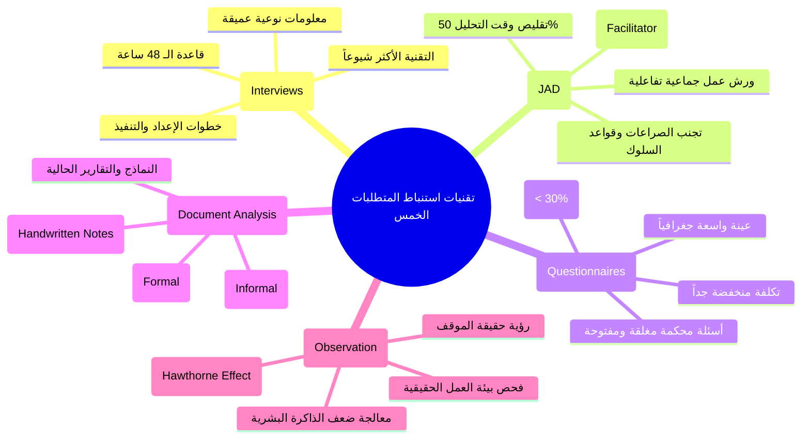
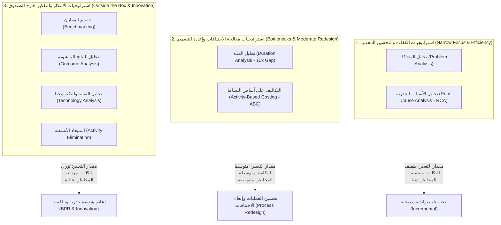

# 📘 المحاضرة الرابعة: مرحلة التحليل وتحديد المتطلبات
**SECOD Comprehensive Academic Reference — Systems Analysis & Design (Lecture 04)**

- **المقرر:** تحليل وتصميم النظم (*Systems Analysis and Design*)
- **المحاضرة:** المحاضرة الرابعة — مرحلة التحليل وتحديد المتطلبات (*Analysis Phase & Requirements Determination*)
- **المعرف المرجعي:** `SEC-SAD-LEC04-CONTENT`
- **الكاتب الأكاديمي:** `academic-writer`
- **المشرف الرقابي:** `secod-supervisor` | **المنسق التنفيذي:** `secod-orchestrator`
- **المستوى التعليمي:** المستوى الثالث — تخصص تقنية المعلومات والأمن السيبراني
- **تاريخ الإصدار:** 2026-11-16T11:05:00+03:00

---

## ⚠️ تنويه الاستقلالية الأكاديمية الصارم (Institutional Independence Disclaimer)

> **تنويه الاستقلالية الأكاديمية الصارم:**  
> **SECOD منصة تعليمية تقنية مستقلة تماماً ومبادرة شخصية من تطوير بشار زبله (Bashar Zblh).**  
> **المنصة لا تتبع كلية المنار ولا تمثلها رسمياً بأي شكل من الأشكال، ولا توجد بين المنصة والكلية أي علاقة إدارية أو شراكة رسمية أو رعاية أكاديمية.**  
> يُمنع منعاً باتاً صياغة أي نص أو شعار يوحي بالتبعية الرسمية أو الشراكة المؤسسية، ويهدف هذا المحتوى إلى تعميق الاستيعاب الأكاديمي والهندسي التخصصي لطلاب تقنية المعلومات وفق المعايير الدولية.

---

## 🎯 خريطة المحاضرة والأهداف التعليمية السلوكية (Learning Objectives)

بنهاية دراستك المستفيضة لهذه المحاضرة التخصصية، ستكون قادراً على:
1. **تحديد موقع مرحلة التحليل (Analysis Phase):** فهم كيفية استلام مخرجات التخطيط (System Request, Feasibility Study, Work Plan) وتحويلها إلى رؤية مستقبلية متكاملة ($To\text{-}Be$).
2. **التمييز المعياري بين المتطلبات:** التفرقة القاطعة بين المتطلبات الوظيفية (*Functional Requirements*) وغير الوظيفية (*Non-Functional Requirements - NFRs*) وفق دليلي **IIBA BABOK v3** و **ISO/IEC/IEEE 29148**.
3. **اختيار تقنيات الاستنباط الخمس (*5 Elicitation Techniques*):** المواءمة بين المقابلات، الاستبيانات، ورش التطوير المشترك (JAD)، تحليل المستندات، والملاحظة الميدانية وفق مصفوفة معايير محكمة.
4. **توظيف نموذج تقرير المقابلة المعياري:** إتقان هيكلة تقارير المقابلات ومتابعة بنود الإجراءات وقاعدة الـ 48 ساعة.
5. **تطبيق استراتيجيات التحليل الثماني (*8 Analysis Strategies*):** تشخيص أعطال النظم الحالية عبر تحليل الأسباب الجذرية (RCA)، وحساب كفاءة العمليات في تحليل المدة (Duration Analysis)، ونمذجة التكاليف (ABC)، والابتكار الجذري عبر تحليل النتائج (Outcome Analysis) والتقييم المقارن (Benchmarking).
6. **صياغة بيان تعريف المتطلبات ومقترح النظام (*System Proposal*):** إعداد الحزمة المتكاملة للعرض على لجنة الموافقة المؤسسية (*Approval Committee*).

---

## 1. المدخل الاستراتيجي وسيناريو الافتتاح (The Strategic Context & The Hook)

### 1.1 معضلة البرمجيات الكبرى: لماذا تفشل الأنظمة بعد إنفاق الملايين؟
في مطلع الألفية، أطلقت إحدى كبرى شركات الطيران العالمية مشروعاً طموحاً لتطوير الجيل القادم من أنظمة إدارة الحجوزات ومناولة الأمتعة بتكلفة أولية قُدرت بـ 45 مليون دولار. كُلف فريق من كبار المطورين والمبرمجين بكتابة الكود فوراً لتوفير الوقت. بعد 18 شهراً من التطوير، سُلّم النظام إلى المطارات؛ فكانت النتيجة كارثية: تكدس عشرات الآلاف من الحقائب، وتأخر مئات الرحلات، واضطرت الشركة لإلغاء النظام بالكامل وتكبد خسائر مباشرة وتأمينية تجاوزت 120 مليون دولار!

عندما أجرى خبراء هندسة البرمجيات تدقيقاً جنائياً (*Post-Mortem Audit*) لمعرفة سبب الانهيار، لم يجدوا خطأً برمجياً واحداً في كود النظام، ولم تسقط الخوادم من فرط الحمل؛ بل كان السبب ببساطة:
> **"لقد بنى فريق التطوير نظاماً برمجياً ممتازاً وخالياً من العيوب، لكنه النظام الخاطئ الذي لا يحل المشكلة الحقيقية ولا يلبي متطلبات أرض الواقع!"**

تثبت هذه الحادثة حقيقة هندسية كلاسيكية: **أخطر وأغلى خطأ في هندسة البرمجيات ليس الخطأ البرمجي في الكود (Syntax or Logic Bug)، بل هو الفشل في فهم وتحديد المتطلبات الحقيقية للمستخدمين وأصحاب المصلحة.**

### 1.2 منحنى كلفة التغيير لبوم (Boehm’s Cost of Change Curve)
أثبتت أبحاث البروفيسور باري بوم (*Barry Boehm*) في هندسة البرمجيات أن تكلفة تصحيح الخطأ تتضاعف هندسياً (أسّياً) كلما تأخر اكتشافه عبر دورة حياة النظام:
- إذا كلفك تصحيح متطلب غير واضح **1 دولار** أثناء مرحلة التحليل (*Analysis Phase*).
- فإن تصحيحه أثناء مرحلة التصميم (*Design*) سيكلفك **5 إلى 10 دولارات**.
- وتصحيحه أثناء مرحلة البرمجة والترميز (*Implementation*) سيكلفك **15 إلى 25 دولاراً**.
- أما إذا وصل النظام إلى التشغيل الحي (*Production & Maintenance*) واكتشف المستخدمون أن المتطلب خاطئ، فإن كلفة التعديل تقفز إلى **100 إلى 200 ضعف الكلفة الأصلية**!

$$\text{Cost Ratio: } \text{Analysis (1x)} \to \text{Design (10x)} \to \text{Coding (25x)} \to \text{Maintenance (100x - 200x)}$$

من هنا يكتسب محلل النظم (*Systems Analyst*) مكانته السيادية: إنه المهندس الذي يحمي المؤسسة من الهدر المالي والتقني عبر ترجمة الاحتياجات الغامضة إلى مواصفات برمجية دقيقة وقابلة للتنفيذ.

---

## 2. التأصيل العلمي لمفهوم التحليل وموقعه في دورة النظم (SDLC Foundations)

### 2.1 الاشتقاق اللغوي والمنطقي لمصطلح التحليل (Decomposition)
- **التحليل (Analysis):** مشتق لغوياً وعلمياً من اللفظ الإغريقي (*Analusis*)، ويعني حرفياً: **"تفكيك الكل إلى أجزائه البسيطة ومكوناته الأولية"** (*Decomposition of a Whole into its Constituent Parts*).
- **الهدف الجوهري من التفكيك:**
  لا يمكن لعقل المحلل استيعاب مؤسسة ضخمة كجامعة أو مستشفى أو مصرف ككتلة واحدة مصمتة. لذا يقوم المحلل بتفكيك النظام إلى: وحدات فرعية (*Subsystems*)، وعمليات إجرائية (*Processes*)، وتدفقات بيانات (*Data Flows*)، ومصادر بيانات (*Data Stores*)، وقواعد عمل (*Business Rules*)؛ بهدف فهم:
  1. طبيعة كل جزء ووظيفته المستقلة.
  2. العلاقات البينية والاعتماديات التبادلية بين الأجزاء (*Interrelationships*).
  3. الاختناقات ومواضع الهدر في الأداء.
- **التمايز بين التحليل والتصميم:**  
  التحليل هو **تفكيك وتشخيص** (*Decomposition & Diagnosis*)، بينما مرحلة التصميم (*Design Phase*) اللاحقة هي **إعادة تركيب وبناء هندسي** (*Synthesis & Engineering Solution*).

### 2.2 موقع مرحلة التحليل في دورة حياة تطوير النظم (SDLC Phase 2)
تأتي مرحلة التحليل في الترتيب الثاني مباشرة بعد مرحلة التخطيط (*Planning Phase*):

```text
┌─────────────────────────┐
│ 1. مرحلة التخطيط       │ ──[مخرجات: وثيقة طلب النظام، دراسة الجدوى، خطة العمل]──►
└─────────────────────────┘
                                   │
                                   ▼
┌────────────────────────────────────────────────────────────────────────┐
│ 2. مرحلة التحليل (Analysis Phase)                                      │
│    ├── أ. تطوير استراتيجية التحليل (Analysis Strategy: As-Is to To-Be) │
│    ├── ب. تحديد واستنباط المتطلبات (Requirements Determination)        │
│    └── ج. إعداد وثيقة مقترح النظام الشامل (System Proposal)            │
└────────────────────────────────────────────────────────────────────────┘
                                   │
                                   ▼ ──[مخرج: مقترح النظام المعتمد]──►
┌─────────────────────────┐
│ 3. مرحلة التصميم        │
└─────────────────────────┘
```

### 2.3 الخطوات الثلاث الأساسية لمرحلة التحليل
1. **تطوير استراتيجية التحليل (Analysis Strategy):**
   - دراسة النظام الحالي (*As-Is System*): تفكيك المدخلات، العمليات، قواعد البيانات، والضوابط الرقابية.
   - تحديد المشكلات وفجوات التحسين (*Identify Improvements*).
   - صياغة الرؤية التشغيلية للنظام الجديد (*To-Be System*).
2. **تحديد واستنباط وتحليل المتطلبات (Requirements Determination):**
   - استخراج وتوثيق كافة المتطلبات الوظيفية وغير الوظيفية من أصحاب المصلحة عبر تقنيات الجمع والاستنباط الخمس.
3. **إعداد وثيقة مقترح النظام الشامل (System Proposal):**
   - وثيقة مجمعة تضم: بيان تعريف المتطلبات التفصيلي، نماذج حالات الاستخدام (*Use Cases*)، نماذج العمليات (*Process Models: DFD*)، نماذج البيانات (*Data Models: ERD*)، ودراسة الجدوى المنقحة.
   - تُرفع الوثيقة إلى **لجنة الموافقة (Approval Committee)** لإصدار قرار المضي قدماً أو الإلغاء (*Go / No-Go Decision*).

---

## 3. هندسة المتطلبات وتصنيفاتها المعيارية (Requirements Engineering)

### 3.1 ما هو المتطلب؟ (What is a Requirement?)
وفقاً للمعيار الدولي **ISO/IEC/IEEE 29148:2018** ودليل **IIBA BABOK v3**:
> **المتطلب (Requirement):**  
> هو صياغة موثقة وقابلة للقياس تعبر عن حاجة أو قدرة يجب أن يمتلكها النظام، أو خاصية يجب أن يلتزم بها، لتمكين المستخدم من حل مشكلة عملية أو تحقيق هدف مؤسسي محدد.

### 3.2 التحول في منظور المتطلبات (Perspective Transformation)
- في **مرحلة التحليل:** يُصاغ المتطلب من **منظور المستخدم والأعمال (Business / User View)**، ويركز حصراً على:  
  **ماذا يجب على النظام أن يفعل؟ (*What the system must do*)**.
- في **مرحلة التصميم:** يتحول المتطلب إلى **منظور المطور والمصمم التقني (Developer / Technical View)**، ويركز على:  
  **كيف سيتم بناء وبرمجة هذا المتطلب؟ (*How the system will be built*)**.

| وجه المقارنة | متطلب مرحلة التحليل (*Analysis / User View*) | مواصفة مرحلة التصميم (*Design / Technical View*) |
|:---|:---|:---|
| **التركيز الجوهري** | ماذا سيفعل النظام؟ (*What*) | كيف سيبرمج النظام؟ (*How*) |
| **اللغة والأسلوب** | لغة منطقية ومفاهيمية تعبر عن احتياج العمل | لغة تقنية وفيزيائية تصف الجداول والبروتوكولات |
| **مثال تطبيقي 1** | يجب أن يتمكن المريض من حجز موعد عبر هاتفه المحمول. | إنشاء واجهة React Native تتصل بـ REST API endpoint `/api/v1/appointments` عبر بروتوكول HTTPS وتحفظ السجل في جدول PostgreSQL `tbl_bookings`. |
| **مثال تطبيقي 2** | يجب التحقق من هوية المستخدم قبل السماح بالتحويل المالي. | تطبيق بروتوكول OAuth 2.0 مع تدقيق ثنائي (2FA via TOTP) وتشفير AES-256 للمفاتيح. |

### 3.3 الثنائية المعيارية: المتطلبات الوظيفية مقابل غير الوظيفية

```text
┌────────────────────────────────────────────────────────────────────────┐
│               تصنيف متطلبات الحل التقني (Solution Requirements)        │
├───────────────────────────────────┬────────────────────────────────────┤
│ 1. المتطلبات الوظيفية (Functional) │ 2. المتطلبات غير الوظيفية (NFRs)   │
├───────────────────────────────────┼────────────────────────────────────┤
│ • تصف وظائف وسلوكيات وحسابات النظام.│ • تصف جودة وخصائص وأداء النظام.    │
│ • ترتبط بالعمليات والبيانات.     │ • ترتبط بظروف التشغيل والبيئة.     │
│ • الإجابة عن: "ماذا يفعل النظام؟"   │ • الإجابة عن: "كيف يتصرف النظام؟"  │
│                                   │                                    │
│ [أمثلة]:                           │ [أمثلة وفق ISO/IEC 25010]:         │
│ - البحث عن كتاب برقم الـ ISBN.   │ - الأداء: زمن الاستجابة < 1 ثانية.│
│ - حساب ضريبة القيمة المضافة 15%.   │ - الأمان: تشفير البيانات الحساسة.  │
│ - إرسال رسالة SMS بتأكيد الحجز.  │ - التوفر: نسبة التشغيل 99.99%.     │
│ - توليد تقرير المبيعات الشهري.    │ - التوافق: العمل على كافة الهواتف. │
└───────────────────────────────────┴────────────────────────────────────┘
```

---

## 4. تقنيات استنباط المتطلبات الخمس (The 5 Elicitation Techniques)

تعتمد مرحلة استنباط المتطلبات على 5 تقنيات تفاعلية وميدانية كبرى. لا توجد تقنية واحدة تكفي بمفردها؛ بل يجمع المحلل المحترف بين عدة تقنيات تكاملية:



### 4.1 المقابلات الشخصية (Interviews)
التقنية الأكثر تقليدية واستخداماً، وتوفر أعمق رؤية نوعية لسياق العمل:
- **الخطوات الخمس المنهجية لإجراء المقابلات:**
  1. **اختيار الأشخاص المناسبين (Selecting Interviewees):** بناء مصفوفة تضم مختلف المستويات التنظيمية (مدراء عموم، رؤساء أقسام، وموظفون تنفيذيون).
  2. **تصميم أسئلة المقابلة (Designing Questions):** المزج بين الأسئلة المغلقة (*Closed-Ended*) للتأكد من الحقائق، والأسئلة المفتوحة (*Open-Ended*) لسماع الآراء، والأسئلة الاستقصائية (*Probing Questions*) لتعميق الفهم.
  3. **الإعداد للمقابلة (Preparing for the Interview):** وضع جدول أعمال محدد، وتأكيد الموعد، وقراءة خلفية مسبقة عن مهام الموظف.
  4. **تنفيذ المقابلة (Conducting the Interview):** بناء الألفة والحياد، الاستماع الفعال وتجنب الجدال، وتدوين الملاحظات دون استعجال.
  5. **المتابعة والتوثيق (Follow-Up & Documentation):** تطبيق **قاعدة الـ 48 ساعة**؛ كتابة تقرير المقابلة المعياري وإرساله للمقابَل للمصادقة وتثبيت الحقائق.

#### نموذج تقرير المقابلة المعياري المعتمد (SECOD Standard Interview Report):

```markdown
┌─────────────────────────────────────────────────────────────────────────────┐
│                     SECOD Standard Interview Report                         │
│                     نموذج تقرير المقابلة الشخصية المعتمد                     │
├─────────────────────────────────────────────────────────────────────────────┤
│ اسم الشخص المقابَل: م. خالد المنصوري (مدير المستودعات)                       │
│ المحلل القائم بالمقابلة: سارة الأحمد (محلل نظم أول)                          │
│ تاريخ ووقت المقابلة: 2026-11-16 (10:00 ص - 11:15 ص)                         │
│ مكان المقابلة: مكتب إدارة المستودعات المركزي — المبنى B                     │
├─────────────────────────────────────────────────────────────────────────────┤
│ 1. الهدف الأساسي (Purpose):                                                 │
│    - فحص آلية إدخال البضائع في النظام الحالي ومعرفة أسباب تأخر الجرد.      │
├─────────────────────────────────────────────────────────────────────────────┤
│ 2. النقاط الجوهرية التي تم استخلاصها (Key Points Summary):                   │
│    - يتم تسجيل البضائع الواردة ورقياً أولاً ثم إدخالها على النظام نهاية اليوم.│
│    - يعاني الموظفون من عدم توفر قارئات باركود لاسلكية، مما يجبرهم على كتابة │
│      الأرقام التسلسلية الطويلة (Serial Numbers) يدوياً وحدوث أخطاء نسخ.     │
│    - يستغرق الجرد الربع سنوي 4 أيام تتوقف فيها حركة المستودع تماماً.         │
├─────────────────────────────────────────────────────────────────────────────┤
│ 3. المشكلات العالقة (Open Issues):                                          │
│    - هل تدعم قواعد بيانات الموردين الحالية بروتوكول الربط الإلكتروني (API)؟  │
├─────────────────────────────────────────────────────────────────────────────┤
│ 4. بنود الإجراءات اللاحقة والمسؤوليات (Action Items):                        │
│    - يرسل م. خالد عينة من استمارة الجرد الورقي للمحلل بحلول الغد.           │
│    - تقوم سارة بدراسة الجدوى الفنية لقارئات الباركود المحمولة والربط السحابي.│
├─────────────────────────────────────────────────────────────────────────────┤
│ *ملاحظة الحوكمة:* أُرسل هذا المحضر للمصادقة في تمام 02:00 م (ضمن 48 ساعة).   │
└─────────────────────────────────────────────────────────────────────────────┘
```

---

### 4.2 جلسات التطوير المشترك للتطبيقات (Joint Application Development - JAD)
- **التعريف:** تقنية هيكلية مكثفة تجمع بين 10 إلى 20 من المستخدمين والمدراء والخبراء التقنيين في غرفة واحدة مجهزة، يديرها **منسق جلسة حيادي متمرس (Facilitator)** لخلق إجماع وسد الفجوات في وقت قياسي.
- **القيمة الهندسية:** تُقلص وقت استنباط المتطلبات بنسبة تصل إلى **50%**، وتلغي فترات الانتظار الناتجة عن المراسلات والمقابلات الفردية المنعزلة.
- **قواعد السلوك الأساسية في جلسات JAD (Ground Rules):**
  1. منع الهواتف والحواسيب الشخصية إلا لأغراض الجلسة (لضمان التركيز الكامل).
  2. لا توجد فوارق وظيفية أو رتب إدارية داخل الغرفة؛ رأي الموظف الصغير مسموع تماماً كرأي المدير العام.
  3. حظر النقد الشخصي والتركيز حصراً على الأفكار والعمليات.
  4. الالتزام بالجدول الزمني وقائمة المصطلحات الموحدة.
- **جلسات JAD الإلكترونية (e-JAD):** استخدام برمجيات تعاونية شبكية تتيح للمشاركين إدخال المتطلبات والتصويت المجهول دون إحراج وتوثيق الملاحظات في الوقت الحقيقي.

---

### 4.3 الاستبيانات (Questionnaires)
- **التعريف:** أداة ورقية أو رقمية (Google Forms / Microsoft Forms) تُرسل لجمهور عريض لجمع معلومات كمية واستطلاعية.
- **المزايا:** الوصول لآلاف المستخدمين المنتشرين جغرافياً بتكلفة شبه معدومة، وسهولة التحليل الإحصائي للبيانات.
- **العيوب والمخاطر:** تدني معدل الاستجابة المعتاد (*Response Rate عادة أقل من 30% إلى 50%*)، وصعوبة التأكد من فهم المستجيب للسؤال، واستحالة طرح أسئلة استقصائية استدراكية أثناء الإجابة.

---

### 4.4 تحليل المستندات (Document Analysis)
- **التعريف:** فحص النماذج الورقية، الشاشات، التقارير المالية، وأدلة العمل الإجرائية للنظام الحالي (*System Documentation*).
- **جوهر التقنية: الفجوة بين النظام الرسمي وغير الرسمي:**
  - **النظام الرسمي (Formal System):** هو النظام المكتوب في كتيبات الإجراءات والسياسات الرسمية للمنظمة كما يفترض به أن يعمل.
  - **النظام غير الرسمي (Informal System):** هو النظام الممارس فعلياً على أرض الواقع من قبل الموظفين للالتفاف على بيروقراطية النظام الرسمي.
- **نصيحة المحلل الميداني الخبير:**  
  ابحث دائماً عن **الملاحظات المكتوبة بخط اليد بالهامش (Handwritten Notes)** أو التعديلات المطبوعة بأوراق لاصقة على شاشات الموظفين؛ فهذه الملاحظات تدلك فوراً على المشكلات الحقيقية والاختناقات التي عجز النظام الحالي عن حلها!

---

### 4.5 تقنية الملاحظة الميدانية (Observation)
- **التعريف:** النزول الميداني لموقع العمل والمراقبة المباشرة للموظفين أثناء ممارسة مهامهم اليومية.
- **المبرر المعرفي:** أثبتت الدراسات السلوكية أن الذاكرة البشرية ضعيفة في تقدير استهلاك الوقت بدقة (*إذا سألتك كم ساعة قضيت الأسبوع الماضي في المذاكرة؟ فغالباً ستقدم تقديراً غير دقيق بنسبة 30% إلى 50%*). الملاحظة تكشف للمحلل حقيقة الموقف المجردة.
- **التحدي المنهجي وتأثير هوثورن (The Hawthorne Effect):**
  - **تأثير هوثورن:** ميل الأفراد لتعديل وتجويد سلوكهم وإنتاجيتهم لمجرد علمهم بأنهم تحت الملاحظة والمراقبة المباشرة من قبل باحث خارجي!
  - **الحل الهندسي للمحلل:** الملاحظة الممتدة لعدة أيام حتى يعتاد الموظفون وجود المحلل وتعود وتيرة العمل لطبيعتها العفوية، ودمج الملاحظة مع تحليل سجلات النظام البرمجية (*System Logs*).

---

### 4.6 مصفوفة المقارنة المعيارية الشاملة لتقنيات الاستنباط الخمس

| التقنية | نوع وعمق المعلومات | تكلفة التطبيق | الوقت المطلوب | اتساع العينة الجغرافية | مشاركة وتفاعل المستخدم | السيناريو الأمثل للتطبيق |
|:---|:---|:---|:---|:---|:---|:---|
| **المقابلات (Interviews)** | نوعية عميقة وشخصية | مرتفعة | متوسط إلى طويل | محدود (فردي) | مرتفع جداً | أصحاب القرار والمدراء والمشكلات الغامضة المعقدة |
| **جلسات التطوير المشترك (JAD)** | نوعية تفصيلية وإجماع واسع | مرتفعة جداً | قصير ومكثف | محدود (موقع موحد) | فائق (تشاركي) | المشاريع الاستراتيجية وحل النزاعات بين الأقسام |
| **الاستبيانات (Questionnaires)** | كمية عامة وسطحية | منخفضة جداً | قصير إلى متوسط | واسع وغير محدود | ضعيف وسلبي | استطلاع آراء آلاف المستخدمين والعملاء |
| **تحليل المستندات (Doc Analysis)** | حقائق تاريخية وهيكلية | منخفضة | سريع | محدود بالوثائق | منعدم (دراسة مكتبية) | فهم مدخلات ومخرجات النظام الحالي As-Is |
| **الملاحظة الميدانية (Observation)** | سلوكية واقعية مجردة | متوسطة إلى مرتفعة | طويل | محدود جغرافياً | متوسط (مراقبة صامتة) | التحقق من صحة أقوال الموظفين وكشف الاختناقات |

---

## 5. استراتيجيات تحليل وتفكيك المتطلبات الثماني (The 8 Analysis Strategies)

لا يكتفي المحلل المحترف بجمع ما يقوله المستخدمون، بل يقودهم للتفكير النقدي عبر 8 استراتيجيات هندسية تنقسم إلى 3 مستويات:



---

### المستوى الأول: استراتيجيات الكفاءة والتحسين المحدود (Narrow Focus & Efficiency)

#### 1. تحليل المشكلة (Problem Analysis)
- **آلية العمل:** سؤال المستخدمين والمدراء مباشرة: *"ما هي المشكلات التي تواجهونها في النظام الحالي؟ وما هي مقترحاتكم لحلها؟"*
- **الخصائص والقيود:** تعديلات قليلة وتزايدية (*Incremental Improvements*). يُحسن كفاءة النظام الحالي دون تغيير جوهره، ولا يحقق ميزة تنافسية كبرى للمنظمة.

#### 2. تحليل الأسباب الجذرية (Root Cause Analysis - RCA)
- **آلية العمل:** التمييز الدقيق بين **عَرَض المشكلة (Symptom)** و**السبب الجذري الحقيقي للمشكلة (Root Cause)**.
- **الأداة الهندسية المعتمدة (The 5 Whys):** تكرار السؤال بـ "لماذا؟" خمس مرات للغوص خلف المشكلة الظاهرية:
  - *المشكلة الظاهرية:* العميل يشتكي من تأخر الشحنات 3 أيام.
  - *لماذا 1؟* لأن موظفي المستودع لم يجهزوا الطلب في موعده.
  - *لماذا 2؟* لأن طابعة فواتير الشحن كانت معطلة طوال الصباح.
  - *لماذا 3؟* لأن خراطيش الحبر نفدت ولم يتم طلب حبر بديل.
  - *لماذا 4؟* لأن مسؤول المشتريات لا يملك ميزانية معتمدة لشراء قطع الغيار مقدماً.
  - *لماذا 5 (السبب الجذري)؟* لأن النظام المالي لا يحوي قاعدة بيانات لمراقبة استهلاك المستهلكات وطلبها آلياً قبل نفادها!
  - **الحل الجذري:** ليس توبيخ موظف المستودع، بل بناء موديول لإدارة المستهلكات التلقائية في النظام الجديد.

---

### المستوى الثاني: استراتيجيات معالجة الاختناقات وإعادة التصميم (Bottlenecks & Moderate Redesign)

#### 3. تحليل المدة (Duration Analysis)
- **آلية العمل:** حساب دقيق ومفصل للوقت الذي تستغرقه كل خطوة وإجرائية فرعية في النظام الحالي ومقارنة مجموعها بالوقت الكلي للمعاملة.
- **قاعدة الـ 10 أضعاف التجريبية (The 10x Gap Rule):**  
  تثبت التجربة العملية أن الوقت الكلي لإنجاز معاملة في النظم التقليدية يبلغ في المتوسط **10 أضعاف مجموع أوقات العمل الفعلي للخطوات الفرعية**!
  - مثال واقعي: معاملة طلب قرض تستغرق (15 دقيقة إدخال + 20 دقيقة تدقيق + 10 دقائق توقيع = 45 دقيقة عمل فعلي)، بينما يستلم العميل القرض بعد **10 أيام عمل (4800 دقيقة)**!
  - أين ذهبت بقية الأوقات؟ في طوابير الانتظار، وسلال المعاملات الصادرة والواردة بين الإدارات، وتأخر اعتمادات التوقيع.
- **الحلول الهندسية المعتمدة بالشريحة 28:**
  1. **دمج الإجرائيات (Process Integration / Case Worker):** منح موظف واحد مسؤوليات متعددة ونظاماً داعماً لاتخاذ القرار بدلاً من تمرير المعاملة بين 5 موظفين.
  2. **التنفيذ على التوازي (Parallel Execution):** جعل الخطوات المستقلة تنفذ في آن واحد بدلاً من التسلسل الخطي الممل.

#### 4. تقدير التكاليف على أساس النشاط (Activity-Based Costing - ABC)
- **آلية العمل:** حساب التكلفة المالية لكل خطوة وإجرائية في النظام عبر احتساب التكاليف المباشرة (ساعات عمل الموظفين والمواد) والتكاليف غير المباشرة (كهرباء، أجهزة، خوادم، وتراخيص برمجية).
- **الهدف الهندسي:** تركيز جهود الأتمتة وإعادة التصميم على **المسارات الأكثر استنزافاً للأموال** بدلاً من إضاعة الوقت في تحسين خطوات غير مكلفة.

---

### المستوى الثالث: استراتيجيات التفكير خارج الصندوق والابتكار الجذري (Outside-the-Box & Innovation)

#### 5. التقييم المقارن (Benchmarking)
- **آلية العمل:** دراسة كيفية تنفيذ المؤسسات الأخرى لنفس العمليات التشغيلية بهدف تبني أفضل الممارسات وتجاوزها (*Best Practices*).
- **التسوق الخفي والمقارنة التنافسية (Competitive Benchmarking):** قيام مسؤولي ومحللي المنظمة بتجربة خدمات الشركات المنافسة كزبائن عاديين لرصد نقاط القوة وسرعة الاستجابة وتجربة المستخدم.
- **المقارنة عبر القطاعات المختلفة (Cross-Industry):** كما رأينا في دراسة حالة **Southwest Airlines** واستلهام أسرار سرعة صيانة سيارات الفورمولا 1 لتقليص وقت مكوث الطائرات في المطار إلى أقل من 15 دقيقة!

#### 6. تحليل النتائج المنشودة والقيمة (Outcome Analysis)
- **آلية العمل:** تشجيع الإدارة على وضع نفسها مكان العميل، والتفكير في القيمة الحقيقية النهائية والنتيجة التي يطلبها، بدلاً من التركيز على المخرج التشغيلي الداخلي للنظام.
- **الفصل المفاهيمي الحاسم: Output مقابل Outcome:**
  - **المخرج التشغيلي (Output):** ما ينتجه النظام داخلياً كإجراء روتيني (مثل: إصدار شيك التعويض المالي في حادث السيارة).
  - **النتيجة المنشودة (Outcome):** الأثر الفعلي والقيمة التي ينتظرها العميل في حياته (مثل: عودة السيارة سليمة وجاهزة للاستخدام بأقل عناء).
- **تطبيق شركة Progressive Insurance:**  
  تحولت من شركة تصدر شيكات تأمين إلى شركة ترسل شاحنات استجابة فورية (*Immediate Response Vehicles*) لمعاينة الحادث في الموقع ونقل السيارة وإصلاحها وتقديم سيارة بديلة، مما جعلها رائدة السوق العالمية.

#### 7. تحليل التقانة والتكنولوجيا (Technology Analysis)
- **آلية العمل:** استكشاف التقنيات الحديثة والصاعدة (مثل: الذكاء الاصطناعي التوليدي، أجهزة إنترنت الأشياء IoT، تقنيات البلوكشين، الهواتف الذكية) ثم التساؤل هندسياً:  
  *"كيف يمكن توظيف هذه التقنية لخلق خدمات ومنتجات جديدة جذرياً لم تكن ممكنة من قبل؟"*
- **مثال تطبيقي:** استخدام كاميرات الهواتف وتقنيات الرؤية الحاسوبية (Computer Vision) لتمكين العميل من فتح حساب بنكي وتوثيق الهوية خلال دقيقة واحدة دون زيارة الفرع.

#### 8. استبعاد الأنشطة (Activity Elimination)
- **آلية العمل:** فحص كل خطوة إجرائية في النظام وطرح التساؤل الجريء:  
  *"ماذا سيحدث لو ألغينا هذه الخطوة تماماً ولم ينفذها أحد؟ هل سينهار النظام؟"*
- **التطبيقات الهندسية المعاصرة:**
  - إلغاء طوابير الدفع التقليدية في المتاجر الذكية (مثل تقنية Amazon Go - Just Walk Out).
  - إلغاء الحاجة لطلب كشف الحساب الورقي واعتماد السجلات الرقمية التلقائية.
  - إلغاء خطوة توقيع المدير الورقي للمشتريات الصغيرة التي تقل عن 100 دولار وأتمتة الرقابة البعدية إحصائياً.

---

### مصفوفة المواءمة والاختيار للاستراتيجيات الثماني (Strategy Selection Matrix)

| الاستراتيجية | نطاق التركيز والأثر | التكلفة والموارد | المخاطر المؤسسية | القيمة المضافة المحققة | السيناريو الأمثل للتطبيق |
|:---|:---|:---:|:---:|:---|:---|
| **تحليل المشكلة** | ضيق وتزايدي | منخفضة | دنيا | تحسينات روتينية سريعة | المشاريع ذات الميزانيات المحدودة |
| **تحليل الأسباب الجذرية (RCA)** | تكتيكي ومعمق | منخفضة إلى متوسطة | منخفضة | علاج المشكلات المزمنة نهائياً | الأنظمة التي تعاني من شكاوى متكررة |
| **تحليل المدة** | عملياتي وإجرائي | متوسطة | متوسطة | تقليص أوقات الانتظار 50-80% | العمليات الورقية والمعاملات البينية |
| **التكاليف على أساس النشاط (ABC)** | مالي واقتصادي | متوسطة إلى مرتفعة | منخفضة | ترشيد النفقات التشغيلية | المؤسسات الخدمية والمصانع |
| **التقييم المقارن (Benchmarking)** | تنافسي وتسويقي | متوسطة | متوسطة | اللحاق بركب رواد الصناعة | الأسواق سريعة التغير والمنافسة |
| **تحليل النتائج (Outcome Analysis)** | استراتيجي وقائم على القيمة | مرتفعة | عالية | ابتكار نموذج عمل جديد للعميل | التحول الرقمي الشامل لخدمة العملاء |
| **تحليل التقانة (Technology Analysis)** | تقني وتطويري | مرتفعة جداً | عالية | خلق مزايا تنافسية فريدة | الشركات التقنية والريادية |
| **استبعاد الأنشطة (Activity Elim.)** | ثوري وتبسيطي | منخفضة إلى متوسطة | متوسطة إلى عالية | نسف البيروقراطية والتكاليف | إعادة هندسة العمليات المعقدة (BPR) |

---

## 6. صياغة بيان تعريف المتطلبات ومقترح النظام (Requirements Artifacts & System Proposal)

### 6.1 بيان تعريف المتطلبات (Requirements Definition Statement)
مستند نصي رسمي يجمع ويصنف كافة متطلبات النظام بطريقة رقمية متسلسلة تعكس أولويات أصحاب المصلحة:
- **معايير الصياغة الاحترافية للمتطلب:**
  1. صياغة عبارة دقيقة باستخدام فعل الإلزام التقني (*The system shall / يجب على النظام أن...*).
  2. الترقيم التصنيفي المنظم (مثل: `FR-01`, `NFR-SEC-01`).
  3. ربط المتطلب بالجهة الطالبة لضمان التتبع والتأصيل (*Traceability*).
  4. تحديد الأولوية وفق تصنيف الإصدارات المعياري (*Release 1: إلزامي فوري، Release 2: مرغوب، Release 3: مستقبلي*).

### 6.2 مقترح النظام الشامل (The System Proposal)
المخرج النهائي والتتويج الحقيقي لمرحلة التحليل؛ مستند رسمي يجمع:
1. بيان تعريف المتطلبات المعتمد (*Requirements Definition*).
2. نماذج حالات الاستخدام (*Use Case Models*).
3. نماذج العمليات وسير البيانات (*Process Models: DFD*).
4. نماذج قواعد البيانات المفاهيمية (*Data Models: ERD*).
5. دراسة الجدوى المنقحة المحدثة (*Revised Feasibility Study*).
6. خطة العمل والجداول الزمنية المحدثة للمشروع (*Updated Work Plan*).

> **بوابة القرار المؤسسي (Approval Gate):**  
> يُعرض مقترح النظام على **لجنة الموافقة (Approval Committee)** المكونة من كبار مسؤولي التقنية والمالية والأعمال؛ لاتخاذ قرار حاسم:
> - **الموافقة (Go):** اعتماد الميزانية والانتقال الفوري إلى مرحلة التصميم المعماري (*Phase 3: Design*).
> - **إعادة الصياغة والتعديل (Revise):** طلب تعديل في النطاق أو النماذج.
> - **الإلغاء (No-Go):** إيقاف المشروع نهائياً إذا أثبتت مرحلة التحليل انعدام الجدوى الاقتصادية أو استحالة التنفيذ التقني.

---

## 7. الأخطاء الشائعة والالتباسات الفكرية في التحليل (Common Pitfalls)

1. **الخلط بين المشكلة والحل المبكر (Premature Solutioning):**  
   أن يطلب المستخدم: *"نريد تطبيق هاتف ذكي!"* بينما المشكلة الحقيقية هي بطء عملية تسليم الطلبات. يجب على المحلل التركيز على المشكلة أولاً قبل تحديد الحل التقني.
2. **الافتراض بدلاً من الاستقصاء (Assumption over Evidence):**  
   اعتماد المحلل على فهمه الشخصي لما يريده المستخدم دون التوثيق الميداني والتحقق بالمقابلات والملاحظة.
3. **تضخم النطاق غير المنضبط (Scope Creep):**  
   قبول طلبات وتعديلات مستمرة من المستخدمين أثناء التحليل دون مراجعة أثرها على الميزانية والجدول الزمني.
4. **تجاهل المتطلبات غير الوظيفية (NFR Blindness):**  
   التركيز الكامل على الشاشات والوظائف وإغفال معايير الأمان والتشفير وزمن الاستجابة حتى تنهار المنظومة في بيئة الإنتاج.
5. **الخلط بين المخرج والقيمة (Output vs Outcome):**  
   اعتبار إنجاز الخطوات الروتينية نجاحاً دون التأكد من تحقيق النتيجة والأثر الملموس الذي يطلبه العميل.

---

## 8. ملخص المحاضرة والمفاهيم الجوهرية (Executive Summary & Key Takeaways)

- **التحليل هو التفكيك (Decomposition):** تجزئة النظام لفهم أجزائه وعلاقاته، وهو مدخل أساسي للتصميم وإعادة البناء.
- **تحديد المتطلبات هو أخطر المراحل:** كلفة تصحيح المتطلب في مرحلة الصيانة تصل إلى 200 ضعف كلفة تصحيحه في التحليل.
- **الثنائية الذهبية:** المتطلبات الوظيفية (ماذا سيفعل النظام) والمتطلبات غير الوظيفية (كيف سيعمل من حيث الأداء والأمان والاعتمادية).
- **التكامل بين تقنيات الاستنباط:** المقابلات للعمق، و JAD للسرعة والإجماع، والاستبيانات للاتساع، وتحليل المستندات للنظام الرسمي، والملاحظة للتحقق من الواقع وتجاوز قيود الذاكرة البشرية.
- **استراتيجيات التحليل الثماني:** أدوات فكرية تقود التغيير من التحسين البسيط (تحليل المشكلة و RCA)، إلى إزالة الاختناقات (تحليل المدة و ABC)، وصولاً للابتكار الجذري (التقييم المقارن، تحليل النتائج، تحليل التقانة، واستبعاد الأنشطة).
- **مقترح النظام:** وثيقة العبور السيادية لمرحلة التصميم بقرار رسمي من لجنة الموافقة.

---

## 9. بطاقة تسليم المهمة (Task Handoff Block)

<!-- SECOD_TASK_HANDOFF_START -->
### 📋 بطاقة تسليم المهمة (Task Handoff Block)

- **معرف المهمة (Task ID):** `SEC-SAD-LEC04-STAGE03`
- **اسم الوكيل الحالي (Current Agent):** `academic-writer`
- **حالة المهمة (Task Status):** COMPLETED ✅
- **المقرر المستهدف (Target Course):** `Systems-Analysis-and-Design`
- **المحاضرة المستهدفة (Target Lecture):** `Lecture 04 - Analysis Phase & Requirements Determination`
- **الملفات المدخلة التي فُحصت (Input Files Read):**
  - `.agent-workspace/production/lecture-01/01-analysis/lecture-analysis.md`
  - `.agent-workspace/production/lecture-01/02-research/research-report.md`
  - `.agent-workspace/production/lecture-01/00-source/source-slides.md`
- **الملفات والمخرجات المولدة فعلياً (Output Files Generated):**
  - `.agent-workspace/production/lecture-01/03-content/lecture-content.md`
- **ملخص العمل المنجز (Completed Work Summary):**
  - صياغة المرجع الأكاديمي الشامل وفق منظومة المحاور العشرة لـ SECOD بلغة عربية تقنية رفيعة.
  - إدراج السيناريو الاستهلالي ومنحنى كلفة التغيير لبوم وتأصيل مفهوم التحليل والاشتقاق اللغوي.
  - تفكيك المتطلبات الوظيفية وغير الوظيفية وفق دليلي IIBA BABOK v3 و ISO/IEC/IEEE 29148.
  - الشرح المنهجي لتقنيات الاستنباط الخمس مع تضمين نموذج تقرير المقابلة المعياري الكامل ومصفوفة المقارنة.
  - تفكيك استراتيجيات التحليل الثماني بنماذجها الرياضية ودراستي الحالة لشركتي Progressive و Southwest.
  - تضمين تنويه الاستقلالية الأكاديمية الصارم المعتمد عن كلية المنار دون أدنى تغيير في النص.
- **المسائل غير المحلولة أو العالقة (Unresolved Issues / Pending Questions):**
  - لا توجد مسائل عالقة؛ المحتوى مكتمل ويغطي كامل مفردات التحليل والبحث.
- **التحذيرات وملاحظات المخاطر (Warnings & Risk Notes):**
  - يجب على المصمم التعليمي (`instructional-designer`) تحويل مصفوفات المقارنة ونماذج الاستراتيجيات إلى مخططات Mermaid دلالية ومحاكيات تفاعلية غنية وبناء كويز الـ 10 أسئلة المتدرج.
- **الوكيل التالي المستلم (Next Agent):** `instructional-designer` (بعد مراجعة واعتماد المشرف)
- **التحقق من معايير القبول (Acceptance Criteria Checklist):**
  - [x] تطبيق منظومة المحاور العشرة لـ SECOD.
  - [x] ثنائية اللغة لجميع المصطلحات التقنية الأساسية.
  - [x] تكامل العمق الأكاديمي وخلو المحتوى من التلخيص المخل.
  - [x] إدراج تنويه الاستقلالية الأكاديمية الرسمي المعتمد.
  - [x] إرفاق بطاقة تسليم المهمة القياسية.
<!-- SECOD_TASK_HANDOFF_END -->
