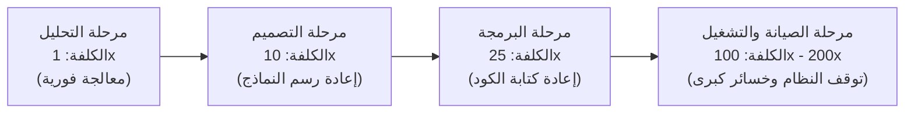
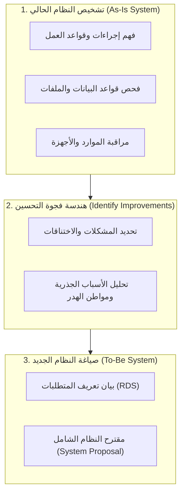
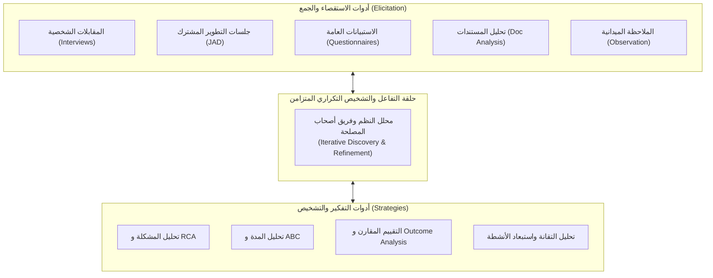
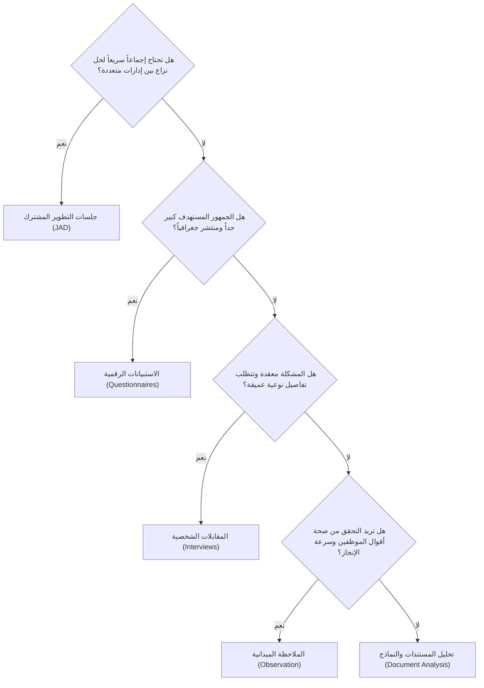

# 🎨 وثيقة التصميم التعليمي والتفاعلات للمحاضرة الرابعة
**SECOD Instructional Design & Interactive Architecture — Systems Analysis & Design (Lecture 04)**

- **المقرر:** تحليل وتصميم النظم (*Systems Analysis and Design*)
- **المحاضرة:** المحاضرة الرابعة — مرحلة التحليل وتحديد المتطلبات (*Analysis Phase & Requirements Determination*)
- **المعرف المرجعي:** `SEC-SAD-LEC04-STAGE04`
- **المصمم التعليمي:** `instructional-designer`
- **المشرف الرقابي:** `secod-supervisor` | **المنسق التنفيذي:** `secod-orchestrator`
- **حالة الاعتماد:** SUBMITTED FOR GATE-04 REVIEW ⏳

---

## 1. فلسفة وهندسة المسار التعليمي (Pedagogical Architecture & Learning Journey)

تعتمد التجربة التعليمية للمحاضرة على شعار المنصة الرسمي: **Understand. Learn. Apply.**  
تم تقسيم المحتوى الأكاديمي إلى 6 محطات تعليمية متدرجة تُدار عبر شريط التقدم المعرفي (*Reading Progress Tracker*):


---

## 2. بنك المخططات الدلالية القياسية (Semantic Mermaid Diagrams)

### مخطط 1: أثر اكتشاف الخطأ المتأخر ومنحنى كلفة التغيير لبوم


### مخطط 2: التحول المنهجي من النظام الحالي إلى الجديد (As-Is to To-Be Framework)


### مخطط 3: شبكة تفاعل تقنيات الاستنباط واستراتيجيات التحليل المتزامنة


### مخطط 4: شجرة قرار اختيار تقنية استنباط المتطلبات المثلى


---

## 3. مواصفات المحاكيات التفاعلية الثلاثة (Interactive Widgets Specification)

### محاكي 1: حاسبة كفاءة العمليات وتحليل المدة (Process Cycle Efficiency & 10x Gap Calculator)
- **الهدف البيداغوجي:** ترسيخ فهم الطالب لقاعدة الـ 10 أضعاف تجريبياً وحساب كفاءة دورة العملية ($PCE$).
- **عناصر الإدخال للمستخدم:**
  1. شريط تمرير (Slider): وقت العمل الفعلي ذو القيمة المضافة ($T_{\text{processing}}$) من 10 دقائق إلى 120 دقيقة.
  2. شريط تمرير (Slider): وقت الانتظار والتسليم بين الإدارات ($T_{\text{wait}}$) من 60 دقيقة إلى 2400 دقيقة.
- **الحسابات التلقائية البرمجية:**
  $$T_{\text{total}} = T_{\text{processing}} + T_{\text{wait}}$$
  $$PCE = \frac{T_{\text{processing}}}{T_{\text{total}}} \times 100\%$$
- **التغذية الراجعة البصرية والديناميكية:**
  - إذا كان $PCE < 10\%$: يظهر تنبيه باللون البرتقالي/الأحمر: *"تحذير: العملية تعاني من متلازمة الـ 10 أضعاف! 90% من الوقت ضائع في الانتظار. الحل: تطبيق دمج الإجرائيات أو التنفيذ على التوازي."*
  - إذا كان $PCE \ge 25\%$: يظهر مؤشر باللون الأخضر: *"ممتاز: العملية رشيقة وذات هدر منخفض."*

---

### محاكي 2: مصفوفة تشخيص الأسباب الجذرية التفاعلية (Interactive 5-Whys Root Cause Engine)
- **الهدف البيداغوجي:** تدريب عقلية الطالب على عدم التوقف عند الأعراض الظاهرية والغوص نحو السبب الجذري.
- **سيناريو التطبيق:** "شكوى العملاء من تعطل الدفع الإلكتروني يوم العطلة".
- **آلية التفاعل:**
  - يظهر العرض الظاهري في بطاقة حمراء.
  - يضغط الطالب على أزرار "لماذا؟" بالتتابع (من Why 1 إلى Why 5).
  - مع كل نقرة تتكشف طبقة جديدة من النظام (سيرفر ➔ قاعدة بيانات ➔ خطأ ترقية ➔ غياب بيئة اختبار ➔ غياب سياسة حوكمة التغيير).
  - يُعرض ختاماً حل جذري مستدام يوضح الفرق بين "إعادة تشغيل السيرفر مؤقتاً" و"بناء خط أنابيب CI/CD مع بيئة Staging".

---

### محاكي 3: مستكشف استراتيجية تحليل النتائج (Outcome vs Output Value Explorer)
- **الهدف البيداغوجي:** التمييز البصري التفاعلي بين المخرج التشغيلي الداخلي والقيمة الحقيقية للعميل.
- **آلية التفاعل:**
  - عرض بطاقتين متجاورتين: "منظور المخرج Output" مقابل "منظور القيمة Outcome".
  - قائمة منسدلة لاختيار القطاع: (تأمين السيارات | المستشفيات | الجامعات | التجارة الإلكترونية).
  - يعرض المحاكي فوراً المقارنة الحية:
    - *المستشفى:* Output = كتابة روشتة الدواء؛ Outcome = الشفاء التام ومتابعة الحالة.
    - *الجامعة:* Output = منح شهادة ورقية؛ Outcome = توظيف خريج متمكن في سوق العمل.

---

## 4. بنك الاختبار النهائي التفاعلي القياسي (10-Question Standard Quiz)

كائن برمجيات الجافاسكريبت `quizData` النقي والمتوافق تماماً مع محرك كويزات منصة SECOD (`initLectureQuiz()`):

```javascript
const quizData = [
  {
    id: 1,
    question: "وفقاً لمنحنى كلفة التغيير لباري بوم (Boehm)، كم تبلغ نسبة تكلفة تصحيح خطأ المتطلبات في مرحلة الصيانة مقارنة باكتشافه في مرحلة التحليل؟",
    options: [
      "ضعفان إلى ثلاثة أضعاف (2x - 3x)",
      "عشرة أضعاف فقط (10x)",
      "مئة إلى مئتي ضعف (100x - 200x)",
      "نفس التكلفة طالما تم توفير أدوات الاختبار الآلي"
    ],
    correctAnswer: 2,
    explanation: "تتضاعف كلفة تصحيح الخطأ أسّياً عبر دورة حياة النظام؛ حيث يكلف إصلاح المتطلب دولاراً واحداً في التحليل، بينما يقفز إلى 100-200 دولار إذا وصل إلى بيئة الإنتاج والصيانة لتأثيره على الكود وقواعد البيانات وتدريب المستخدمين."
  },
  {
    id: 2,
    question: "ما هو التعريف الدقيق للمتطلب (Requirement) من منظور مرحلة التحليل وفق المعيار الدولي ISO/IEC/IEEE 29148؟",
    options: [
      "مواصفة تقنية تصف أسماء الجداول ومفاتيح قواعد البيانات وكود البرمجة (How)",
      "صياغة توضح ما يجب على النظام فعله والخصائص التي يتميز بها لتلبية حاجة العمل (What)",
      "قائمة باقتراحات المطورين لاختيار أطر العمل ولغات البرمجة المناسبة",
      "خطة زمنية تحدد تكلفة ورواتب فريق البرمجة ومواعيد التسليم"
    ],
    correctAnswer: 1,
    explanation: "في مرحلة التحليل، يُصاغ المتطلب من منظور مستخدمي النظام والأعمال مركزاً على 'ماذا يجب أن يفعل النظام' (What the system must do)، بينما تركز مواصفات مرحلة التصميم على 'كيفية البناء التقني' (How)."
  },
  {
    id: 3,
    question: "أي من الخيارات التالية يمثل متطلباً غير وظيفي (Non-Functional Requirement - NFR)؟",
    options: [
      "يجب أن يسمح النظام للعميل باسترجاع كلمة المرور عبر البريد الإلكتروني",
      "يجب أن يقوم النظام بحساب ضريبة القيمة المضافة بنسبة 15% على الفاتورة",
      "يجب ألا يتجاوز زمن استجابة النظام ثانيتين عند معالجة 5000 طلب متزامن",
      "يجب أن يتيح النظام لموظف الاستقبال تسجيل بيانات الزائر ورقم هاتفه"
    ],
    correctAnswer: 2,
    explanation: "زمن الاستجابة هو خاصية جودة وأداء تشغيلي (Performance NFR)، بينما الخيارات الأخرى تمثل وظائف وسلوكيات وحسابات يؤديها النظام وتصنف كمتطلبات وظيفية (Functional Requirements)."
  },
  {
    id: 4,
    question: "ما هي الميزة الجوهرية لاستخدام تقنية جلسات التطوير المشترك (JAD) مقارنة بالمقابلات الفردية المنعزلة؟",
    options: [
      "انعدام تكلفتها المادية تماماً وسهولة تنفيذها دون الحاجة لمنسق",
      "تقليص وقت جمع المتطلبات بنسبة تصل إلى 50% وبناء إجماع فوري بين مختلف الإدارات",
      "إمكانية الوصول لملايين العملاء حول العالم دفعة واحدة دون تنظيم مواعيد",
      "استغناؤها التام عن مشاركة الخبراء التقنيين ومديري الإدارات"
    ],
    correctAnswer: 1,
    explanation: "تجمع جلسات JAD كافة الأطراف الفاعلة في غرفة واحدة بإدارة منسق محايد، مما يحل الصراعات البينية فوراً ويقلص زمن استنباط المتطلبات بنسبة تصل إلى النصف."
  },
  {
    id: 5,
    question: "عند فحص مستندات النظام الحالي، لماذا يحرص محلل النظم على البحث عن 'الملاحظات المكتوبة بخط اليد' (Handwritten Notes) في هوامش النماذج؟",
    options: [
      "للتأكد من أن الموظفين يتمتعون بخط يد جميل ومقروء",
      "لأنها تكشف النظام غير الرسمي (Informal System) والمشكلات التي عجز النظام الرسمي عن حلها",
      "لإثبات مخالفة الموظفين لقواعد العمل وإحالتهم للتحقيق الإداري",
      "لأن النماذج المطبوعة القديمة تكون دائماً خالية من أي أخطاء وظيفية"
    ],
    correctAnswer: 1,
    explanation: "الملاحظات اليدوية على الشاشات والاستمارات الورقية تمثل الحلول الالتفافية العفوية التي يبتكرها الموظفون للتعامل مع قصور النظام الحالي، وتعتبر كنزاً للمحلل لاكتشاف المتطلبات الحقيقية."
  },
  {
    id: 6,
    question: "ما هو 'تأثير هوثورن' (Hawthorne Effect) الذي يجب على محلل النظم الانتباه إليه أثناء تطبيق تقنية الملاحظة الميدانية؟",
    options: [
      "توقف خوادم النظام عن العمل نتيجة كثرة استعلامات قاعدة البيانات",
      "ميل الأفراد لتعديل وتجويد سلوكهم وإنتاجيتهم بصورة مصطنعة لمجرد علمهم بأنهم تحت الملاحظة",
      "نسيان المدراء لكيفية توزيع أوقاتهم الأسبوعية عند سؤالهم في المقابلة",
      "انخفاض معدل استجابة المستخدمين للاستبيانات الإلكترونية الطويلة"
    ],
    correctAnswer: 1,
    explanation: "تأثير هوثورن ظاهرة نفسية وسلوكية كلاسيكية تجعل الموظف يعمل بكفاءة والتزام غير معتاد حين يشعر بوجود مراقب، لذا يجب على المحلل إطالة فترة الملاحظة حتى يعتاد الجميع وجوده ويتصرفوا بطبيعتهم."
  },
  {
    id: 7,
    question: "في استراتيجية 'تحليل المدة' (Duration Analysis)، ما الذي تشير إليه قاعدة الـ 10 أضعاف التجريبية؟",
    options: [
      "أن النظام الجديد سيكلف 10 أضعاف ميزانية النظام القديم",
      "أن الوقت الكلي لإنجاز المعاملة يبلغ في الغالب عشرة أضعاف مجموع أوقات العمل الفعلي للخطوات الفرعية",
      "أن عدد المستخدمين سيتضاعف عشر مرات بعد إطلاق النظام",
      "أن سرعة المعالجة الحاسوبية تتطلب 10 خوادم متوازية"
    ],
    correctAnswer: 1,
    explanation: "تثبت الدراسات العملياتية أن 90% من وقت المعاملات الإدارية يضيع في طوابير الانتظار والتسليم بين المكاتب، ولا تتعدى خطوات العمل الفعلي ذات القيمة المضافة 10% من إجمالي الوقت المستغرق."
  },
  {
    id: 8,
    question: "ما هو الحل الهندسي الأمثل الموصى به لمعالجة فجوة الانتظار في تحليل المدة وتطبيق نموذج Case Worker؟",
    options: [
      "إلغاء النظام المحوسب والعودة إلى النماذج الورقية الأرشيفية",
      "دمج الإجرائيات المتتالية لتكون من مسؤولية موظف واحد، وتشغيل المسارات المستقلة على التوازي",
      "زيادة عدد مديري التوقيعات والاعتمادات لمضاعفة الرقابة",
      "تأجيل إنجاز المعاملات إلى نهاية الأسبوع لتنفيذها دفعة واحدة (Batch Processing)"
    ],
    correctAnswer: 1,
    explanation: "نصت الشريحة 28 صراحة على أن دمج الإجرائيات (Case Worker) يقلل عدد حلقات التسليم، كما أن تشغيل الخطوات المستقلة على التوازي يختصر الوقت الكلي للعملية."
  },
  {
    id: 9,
    question: "في استراتيجية 'تحليل النتائج' (Outcome Analysis)، ما الفرق الجوهري بين المخرج (Output) والنتيجة المنشودة (Outcome) في مثال شركة التأمين؟",
    options: [
      "المخرج هو إصلاح السيارة، بينما النتيجة المنشودة هي إرسال شيك التعويض المالي",
      "المخرج هو إنجاز الإجراء الروتيني الداخلي (صرف الشيك)، بينما النتيجة المنشودة هي القيمة والأثر الفعلي للعميل (إصلاح السيارة)",
      "لا يوجد أي فرق بينهما والمصطلحان مترادفان لغوياً وتقنياً",
      "المخرج يحدده العميل، بينما النتيجة المنشودة يحددها المبرمج فقط"
    ],
    correctAnswer: 1,
    explanation: "المخرج (Output) هو الناتج الإجرائي الداخلي كصرف الشيك، بينما النتيجة (Outcome) هي القيمة الحقيقية التي يطلبها العميل وهي عودة سيارته سليمة وجاهزة للاستخدام."
  },
  {
    id: 10,
    question: "ما هي الوثيقة الشاملة التي تتوج نهاية مرحلة التحليل وتُرفع إلى لجنة الموافقة (Approval Committee) لتقرير المضي قدماً في المشروع؟",
    options: [
      "وثيقة طلب النظام الأولية (System Request)",
      "مقترح النظام الشامل (System Proposal)",
      "تقرير الجرد السنوي للمستودعات",
      "دليل استكشاف الأخطاء البرمجية (Debugging Manual)"
    ],
    correctAnswer: 1,
    explanation: "مقترح النظام (System Proposal) هو الوثيقة الرسمية الجامعة التي تضم بيان تعريف المتطلبات، ونماذج العمليات، ونماذج البيانات، ودراسة الجدوى المنقحة، وتعرض على لجنة الموافقة للانتقال لمرحلة التصميم."
  }
];
```

---

## 5. بطاقة تسليم المهمة (Task Handoff Block)

<!-- SECOD_TASK_HANDOFF_START -->
### 📋 بطاقة تسليم المهمة (Task Handoff Block)

- **معرف المهمة (Task ID):** `SEC-SAD-LEC04-STAGE04`
- **اسم الوكيل الحالي (Current Agent):** `instructional-designer`
- **حالة المهمة (Task Status):** COMPLETED ✅
- **المقرر المستهدف (Target Course):** `Systems-Analysis-and-Design`
- **المحاضرة المستهدفة (Target Lecture):** `Lecture 04 - Analysis Phase & Requirements Determination`
- **الملفات المدخلة التي فُحصت (Input Files Read):**
  - `.agent-workspace/production/lecture-01/03-content/lecture-content.md`
- **الملفات والمخرجات المولدة فعلياً (Output Files Generated):**
  - `.agent-workspace/production/lecture-01/04-instructional-design/instructional-design.md`
- **ملخص العمل المنجز (Completed Work Summary):**
  - بناء مسار التعلم المرئي المكون من 6 محطات متدرجة وفق تصنيف بلوم.
  - تصميم 4 مخططات Mermaid دلالية قياسية خالية من أي أخطاء تركيبية.
  - توصيف 3 محاكيات تفاعلية (حاسبة الـ 10 أضعاف و PCE، محاكي الأسباب الجذرية 5-Whys، ومستكشف Outcome vs Output).
  - صياغة بنك الاختبار النهائي القياسي (10 أسئلة تخصصية متدرجة) بكائن `quizData` نقي وصالح للتنفيذ البرمجي مع تفاسير علمية مستشهدة بالمعايير.
- **المسائل غير المحلولة أو العالقة (Unresolved Issues / Pending Questions):**
  - لا توجد مسائل عالقة؛ التصميم جاهز للتحويل إلى كود HTML5/Vanilla JS.
- **التحذيرات وملاحظات المخاطر (Warnings & Risk Notes):**
  - يجب على مهندس الواجهات (`secod-frontend`) الالتزام بمتغيرات CSS في `assets/css/variables.css`، وعدم استخدام أي مكتبات خارجية، وربط كائن `quizData` بمحرك المنصة `initLectureQuiz()`.
- **الوكيل التالي المستلم (Next Agent):** `secod-frontend` (بعد مراجعة واعتماد المشرف)
- **التحقق من معايير القبول (Acceptance Criteria Checklist):**
  - [x] بالضبط 10 أسئلة بكائن `quizData` سليم وصحيح برمجياً.
  - [x] مخططات Mermaid دلالية منسقة وصحيحة نحوياً.
  - [x] توصيفات محاكيات تفاعلية تطبق شعار Understand. Learn. Apply.
  - [x] التوافق التام مع محركات المنصة ومعايير WCAG.
  - [x] إدراج بطاقة تسليم المهمة القياسية.
<!-- SECOD_TASK_HANDOFF_END -->
