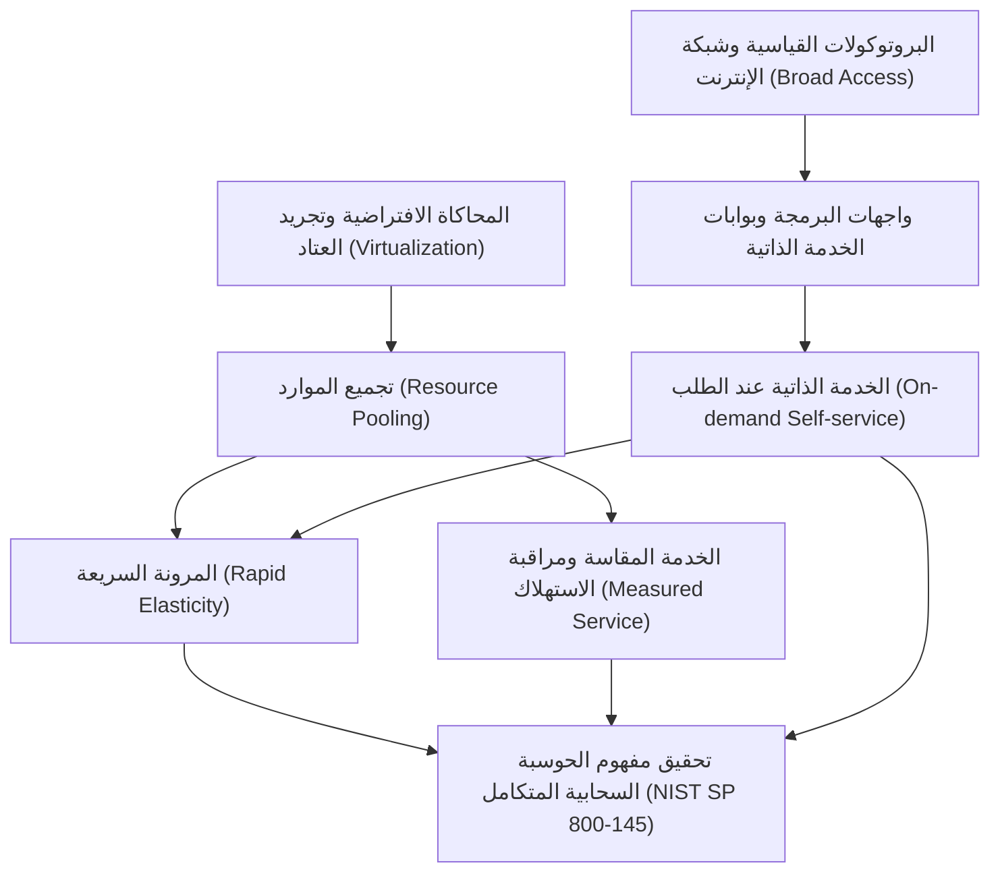

# تقرير التحليل الأكاديمي للمحاضرة: مفهوم الحوسبة السحابية (Cloud Computing Foundations)

---

## 1. بيانات المحاضرة والمصدر (Lecture Overview & Metadata)

- **المقرر المستهدف:** أساسيات الحوسبة السحابية (Cloud Computing Foundations - Test Run Course)
- **رقم المحاضرة:** المحاضرة 01 (Lecture 01)
- **عنوان المحاضرة المصدري:** مفهوم الحوسبة السحابية (Cloud Computing Foundations)
- **اسم الملف المصدري:** `mock-sample.txt`
- **المسار الكامل للمصدر:** `/home/bashar/manar-student-automation/.agent-workspace/test-run/00-source/mock-sample.txt`
- **عدد الشرائح / الأقسام المحللة:** شريحة واحدة تمهيدية (Slide 1)
- **تاريخ التحليل الأكاديمي:** 14 نوفمبر 2026
- **المحلل الأكاديمي المسؤول:** `academic-analyst` (Academic Lecture Analyst)

---

## 2. الجرد الشامل للمحتوى الأصلي (Source Content Inventory)

تم إجراء جرد حرفي وموضوعي دقيق لكامل النص والبيانات الواردة في ملف المصدر الأصلي، وجاءت محتوياته على النحو التالي:

### محتويات الشريحة 1 (Slide 1):
1. **العنوان المصدري:** 
   - النص الوارد: "ما هي الحوسبة السباحية؟" *(يرجى مراجعة قسم 9 لرصد الخطأ المطبعي في كلمة "السباحية")*.
2. **التعريف النصي الصريح:**
   - "نموذج لتوفير وصول شبكي ملائم وعند الطلب إلى مجمع مشترك من موارد الحوسبة القابلة للتهيئة (مثل الشبكات، الخوادم، وسائط التخزين، التطبيقات، والخدمات)."
3. **المعيار المرجعي الموثق:**
   - الإشارة الصريحة للمعيار: وثيقة المعهد الوطني الأمريكي للمعايير والتقنية **NIST SP 800-145** (National Institute of Standards and Technology - Special Publication 800-145).
4. **الخصائص الأساسية الخمس (Essential Characteristics):**
   - 1. **الخدمة الذاتية عند الطلب** (*On-demand self-service*).
   - 2. **الوصول العريض للشبكة** (*Broad network access*).
   - 3. **تجميع الموارد** (*Resource pooling*).
   - 4. **المرونة السريعة** (*Rapid elasticity*).
   - 5. **الخدمة المقاسة** (*Measured service*).

---

## 3. الهيكل الهرمي للموضوعات (Topic Hierarchy)

تفكيك المعرفة وبناء هيكل شجري تدريجي ينقل الطالب من المفاهيم التأسيسية الكبرى إلى التفاصيل الهندسية الدقيقة:

```text
1. مدخل ومفهوم الحوسبة السحابية (Introduction to Cloud Computing)
   ├── 1.1 السياق التاريخي ونشأة الفكرة (Genesis & Drivers)
   │     ├── 1.1.1 تحديات مراكز البيانات التقليدية ونموذج الإنفاق الرأسمالي (CapEx)
   │     └── 1.1.2 الانتقال نحو نموذج التكاليف التشغيلية (OpEx) وتجريد العتاد
   ├── 1.2 التعريف المعياري المعتمد (The NIST Standard Definition - SP 800-145)
   │     ├── 1.2.1 التوفير عند الطلب (On-demand Provisioning)
   │     ├── 1.2.2 مجمع الموارد القابلة للتهيئة المشتركة (Configurable Shared Resources Pool)
   │     └── 1.2.3 التوفير السريع بأقل تدخل إداري (Minimal Management Effort)
   └── 1.3 الخصائص الجوهرية الخمس (The 5 Essential Characteristics)
         ├── 1.3.1 الخدمة الذاتية عند الطلب (On-demand Self-service)
         │     ├── آليات طلب الموارد بدون تدخل بشري لمزود الخدمة (Automated Portals & APIs)
         │     └── زمن الاستجابة الفوري للطلب
         ├── 1.3.2 الوصول العريض عبر الشبكة (Broad Network Access)
         │     ├── البروتوكولات والمعايير الشبكية القياسية (Standard Protocols)
         │     └── استقلالية المنصة والتنوع الطرفي (Heterogeneous Client Platforms)
         ├── 1.3.3 تجميع الموارد (Resource Pooling)
         │     ├── مفهوم تعدد المستأجرين (Multi-tenancy Architecture)
         │     ├── استقلالية الموقع الجغرافي للمورد الحوسبي (Location Independence)
         │     └── العزل المنطقي والافتراضي بين المستأجرين (Logical Isolation)
         ├── 1.3.4 المرونة السريعة (Rapid Elasticity)
         │     ├── التوسع والانكماش التلقائي مع الحمل (Auto-scaling In/Out, Up/Down)
         │     └── إدراك الموارد ككمية غير محدودة من منظور العميل (Perception of Infinite Supply)
         └── 1.3.5 الخدمة المقاسة (Measured Service)
               ├── آليات المراقبة والتحكم في الاستهلاك (Resource Metering & Telemetry)
               ├── وحدات القياس (CPU-seconds, Storage-GB/month, Egress Bandwidth)
               └── الشفافية والفوترة الحسابية الدقيقة (Transparent Billing & Chargeback)
```

---

## 4. شبكة العلاقات والاعتماديات (Concept Relationships & Prerequisites)

### أ. المتطلبات المعرفية القبلية (Prerequisites):
- **أساسيات الشبكات (Networking Fundamentals):** فهم بروتوكولات الإنترنت (IP, TCP, HTTP/HTTPS)، وعرض النطاق الترددي (Bandwidth)، ومفهوم نموذج العميل/الخادم (Client-Server Architecture).
- **مبادئ أنظمة التشغيل والعتاد (OS & Hardware Basics):** وحدات المعالجة المركزية (CPU)، الذاكرة العشوائية (RAM)، وسائط التخزين الكتلية (Block Storage).
- **المفهوم الأولي للمحاكاة الافتراضية (Virtualization Concept):** إدراك أن الخادم الفيزيائي يمكن تقسيمه منطقياً إلى آلات افتراضية (VMs) متعددة تعمل باستقلالية.

### ب. خريطة الاعتماد المعرفي بين المفاهيم (Concept Dependency Graph):



- **تفسير تدفق الاعتماد:**
  1. لا يمكن تحقيق **الخدمة الذاتية عند الطلب (Self-service)** دون وجود واجهات تحكم موحدة تعتمد على **الوصول العريض عبر الشبكة (Broad Network Access)**.
  2. لا يمكن إتاحة **المرونة السريعة والتوسع اللحظي (Rapid Elasticity)** ما لم تكن هناك بنية تحتية تعتمد **تجميع الموارد (Resource Pooling)** وتعدد المستأجرين بنجاح.
  3. تتكامل مخرجات التجميع المشترك مع نظم القياس لتوليد **الخدمة المقاسة (Measured Service)** التي تمكن المؤسسات من حساب استهلاك كل عميل بمصداقية وشفافية.

---

## 5. أهداف التعلم القابلة للقياس (Measurable Learning Objectives)

صيغت هذه الأهداف بدقة وفق المستويات المعرفية المتقدمة لـ **تصنيف بلوم (Bloom's Taxonomy)**:

1. **مستوى التذكر والاستيعاب (Remembering & Understanding):**
   - يُعرّف الطالب الحوسبة السحابية استناداً إلى تعريف المعهد الوطني للمعايير والتقنية (NIST SP 800-145) بدقة دون إغفال أي من مكوناته الثلاثة (الوصول، التوفير عند الطلب، ومجمع الموارد).
   - يشرح باللغتين العربية والإنجليزية الخصائص الخمس الجوهرية ودور كل خاصية في التمييز بين البيئة السحابية والبيئة التقليدية.

2. **مستوى التحليل والمقارنة (Analyzing & Comparing):**
   - يحلل الفرق المعماري بين مفهومي **"المرونة" (Elasticity)** و **"قابلية التوسع" (Scalability)**، موضحاً الفرق بين التوسع الأفقي (Horizontal Scaling) والرأسي (Vertical Scaling).
   - يميز تقنياً بين استضافة الخوادم الافتراضية التقليدية (VPS Hosting) والحوسبة السحابية الحقيقية بالاستناد إلى خاصيتي "الخدمة الذاتية عند الطلب" و"الخدمة المقاسة".

3. **مستوى التطبيق والتقييم (Applying & Evaluating):**
   - يكتشف ويشخص ظاهرة **"الخداع التسويقي السحابي" (Cloud Washing)** من خلال إخضاع أي خدمة برمجية أو استضافة مقترحة لاختبار الخصائص الخمس لـ NIST.
   - يحدد المقاييس الرياضية والهندسية (Metrics) المناسبة لحساب استهلاك موارد الحوسبة، التخزين، وشبكة الاتصال لكل خدمة سحابية معينة.

---

## 6. الفجوات المعرفية والقفزات في المصدر (Knowledge Gaps & Assumptions)

رصد المحلل عدداً من القفزات المعرفية الكبيرة في الشريحة المقتضبة التي تتطلب تفكيكاً عميقاً لضمان اكتمال الاستيعاب:

1. **فجوة السياق المرجعي لمعيار NIST:**
   - ذكرت الشريحة الرمز `NIST SP 800-145` دون بيان ما هي جهة NIST وما هي أهمية هذا المستند لمهندس تكنولوجيا المعلومات، ولماذا أصبح معياراً دولياً ملزماً تعتمده كبرى الشركات والمؤسسات.
2. **غموض مفهوم "تجميع الموارد" (Resource Pooling):**
   - لم تشرح الشريحة الميكانيزم التقني الذي يسمح لعدة عملاء بمشاركة نفس العتاد المادي بأمان تام دون تداخل في البيانات، وهو ما يستدعي تفكيك مبدأ **تعدد المستأجرين (Multi-tenancy)** والعزل المنطقي.
3. **الخلط الشائع بين المرونة السريعة (Elasticity) والتوسع (Scalability):**
   - الشريحة تكتفي بذكر المصطلح الإنجليزي وترجمته، بينما يخلط غالبية الطلاب بين التوسع اليدوي طويل الأجل وبين المرونة التلقائية الآنية (Auto-scaling).
4. **غياب السيناريو الافتتاحي والمشكلة الواقعية (Problem Statement):**
   - دخلت الشريحة مباشرة في التعريف والخصائص بصيغة تجريدية صامتة دون طرح التحدي الهندسي والاقتصادي الذي استدعى ابتكار الحوسبة السحابية (مشكلة صيانة السيرفرات، هدر الطاقة، تكلفة الشراء، والانهيار عند طفرات الزيارات).
5. **تجريد خاصية "الخدمة المقاسة" (Measured Service):**
   - لم يتم تقديم أمثلة على المعايير الفعلية التي تُقاس في البيئة السحابية (مثل: عدد العمليات في الثانية IOPS، الساعات الحاسوبية vCPU Hours، أو كمية البيانات الصادرة Egress Data).

---

## 7. متطلبات التحقق والبحث الأكاديمي (Research Requirements)

أسئلة وتكليفات بحثية دقيقة موجهة إلى وكيل البحث الأكاديمي (`academic-researcher`):

1. **التوثيق الحرفي من NIST SP 800-145:**
   - استخراج النص الإنجليزي الأصلي المعتمد لكل خاصية من الخصائص الخمس مع رقم الفقرة في الوثيقة الرسمية، مع التحقق من المعايير والمصطلحات المقابلة لها في معيار ISO/IEC 17788 إن وجدت.
2. **التمييز الهندسي الدقيق:**
   - تزويدنا بالمراجع الأكاديمية التي تفصل بين `Scalability` و `Elasticity` وتقديم معادلات أو رسومات بيانية تفسر مفهوم التوسع مع تغير الأحمال الزمنية.
3. **دراسة حالة صناعية واقعية (Real-World Case Study):**
   - توفير دراسة حالة موثقة لشركة عالمية (مثل Netflix أو منصات التجارة الإلكترونية خلال عروض Black Friday) توضح كيف أنقذت ميزة "المرونة السريعة" وتجميع الموارد المنصة من الانهيار، ومقارنة ذلك بما كان سيحدث في خوادم مراكز البيانات التقليدية.
4. **مصفوفة فحص الخداع السحابي (Cloud Washing Matrix):**
   - جمع معايير صناعية تمكن الطالب من الحكم على منتج يدعي أنه "سحابي" بينما يفتقر لإحدى خصائص NIST الخمس.

---

## 8. تسلسل التدريس المقترح (Suggested Pedagogical Teaching Sequence)

لتحقيق أقصى استيعاب ذهني وبيداغوجي لدى الطالب، يقترح المحلل إعادة هيكلة تدفق الشرح في المحاضرة على النحو التالي:

1. **الخطاف الافتتاحي (The Hook): سيناريو سقوط المتجر الإلكتروني:**
   - بدء المحاضرة بقصة واقعية لمتجر إلكتروني استثمر مئات الآلاف في خوادم خاصة به لكنها انهارت في أول دقيقة من موسم التخفيضات بسبب طفرة الحمل، لتوليد التساؤل: *كيف يمكن استئجار قدرة حاسوبية هائلة لدقائق فقط ثم إرجاعها؟*
2. **الجذور والمقارنة الاقتصادية (The Genesis & Economics):**
   - شرح مفهوم CapEx (النفقات الرأسمالية) مقابل OpEx (النفقات التشغيلية).
3. **التفكيك المعماري لتعريف NIST:**
   - عرض التعريف كلمة بكلمة وتفكيك المصطلحات الجوهرية (على الطلب، مجمع الموارد، سهولة الإدارة).
4. **التشريح التفصيلي للخصائص الخمس (The Five Characteristics In-Depth):**
   - تناول كل خاصية بترتيب منطقي:
     - أ. الخدمة الذاتية (كيف يطلب المهندس مورداً بنفسه دون رفع تذكرة دعم وانتظار أيام).
     - ب. الوصول العريض (الوصول من أي مكان عبر الويب أو الطرفية CLI).
     - ج. تجميع الموارد (كيف يتشارك الملايين نفس السيرفرات دون علم أحدهم بالآخر وبأمان كامل).
     - د. المرونة السريعة (كيف تتنفس السحابة تلقائياً صعوداً وهبوطاً مع الحمل).
     - هـ. الخدمة المقاسة (كيف تشبه السحابة عداد الكهرباء والماء).
5. **مختبر كشف الخداع السحابي (Cloud Washing Detective Lab):**
   - تمرين تطبيقي تفاعلي: عرض 3 سيناريوهات لخدمات تجارية ومطالبة الطالب بتحديد ما إذا كانت سحابة حقيقية أم لا ولماذا.
6. **الملخص، التقييم الذاتي، وتأكيد الفهم:**
   - أسئلة فحص متدرجة وفق بلوم لترسيخ المفاهيم ومراجعة المصطلحات الثنائية (عربي/إنجليزي).

---

## 9. ملاحظات التحقق من المصدر (Source Verification Notes)

1. **خطأ مطبعي في العنوان المصدري الأصلي:**
   - ورد في الشريحة 1 العنوان: *"ما هي الحوسبة السباحية؟"* (بحرف الباء). 
   - **التصحيح المعتمد:** "ما هي الحوسبة **السحابية**؟" (*Cloud Computing*). يجب تصحيح هذا الخطأ في المادة التعليمية وتوثيق ذلك دون تحريف في الجرد المصدري.
2. **اكتمال معيار NIST SP 800-145:**
   - تجدر الإشارة إلى أن وثيقة NIST SP 800-145 تتألف من ثلاثة أجزاء رئيسية:
     - 1. الخصائص الأساسية الخمس (وهي الجزء الوحيد الذي ركزت عليه الشريحة).
     - 2. نماذج الخدمة الثلاث (SaaS, PaaS, IaaS).
     - 3. نماذج النشر الأربعة (Public, Private, Hybrid, Community).
   - يُوصى بالتنويه في متن المحاضرة إلى أن الشريحة تمثل الركيزة الأولى من أركان التعريف الثلاثة، تمهيداً للتوسع في المحاضرات القادمة.

---

<!-- SECOD_TASK_HANDOFF_START -->
### 📋 بطاقة تسليم المهمة (Task Handoff Block)

- **معرف المهمة (Task ID):** `SEC-TEST-LEC01-01-ANALYSIS`
- **اسم الوكيل الحالي (Current Agent):** `academic-analyst`
- **حالة المهمة (Task Status):** COMPLETED ✅
- **المقرر المستهدف (Target Course):** `test-run` (Cloud-Computing-Foundations)
- **المحاضرة المستهدفة (Target Lecture):** Lecture 01 - مفهوم الحوسبة السحابية (Cloud Computing Foundations)
- **الملفات المدخلة التي فُحصت (Input Files Read):**
  - `/home/bashar/manar-student-automation/.agent-workspace/test-run/00-source/mock-sample.txt`
  - `/home/bashar/manar-student-automation/.agents/agents/academic-analyst.md`
  - `/home/bashar/manar-student-automation/.agents/handoff-protocol.md`
- **الملفات والمخرجات المولدة فعلياً (Output Files Generated):**
  - `/home/bashar/manar-student-automation/.agent-workspace/test-run/01-analysis/lecture-analysis.md` (21,751 بايت / 220 سطراً)
- **ملخص العمل المنجز (Completed Work Summary):**
  - تفكيك وتحليل محتوى الشريحة التمهيدية لعينة اختبار الحوسبة السحابية بدقة شاملة.
  - استيفاء الأقسام التسعة الإلزامية كاملة (البيانات، الجرد الشامل، الهيكل الهرمي، شبكة الاعتماديات بمخطط Mermaid، أهداف التعلم وفق تصنيف بلوم، الفجوات المعرفية، متطلبات البحث الأكاديمي، تسلسل التدريس المقترح، وملاحظات التحقق من المصدر).
  - رصد الخطأ المطبعي الوارد في أصل الشريحة ("السباحية" بدلاً من "السحابية") وتوثيقه.
  - صياغة أسئلة وتكليفات بحثية موجهة بدقة لوكيل البحث الأكاديمي `academic-researcher`.
- **المسائل غير المحلولة أو العالقة (Unresolved Issues / Pending Questions):**
  - لا توجد أي مسائل عالقة؛ التحليل مكتمل ومستوفٍ لكافة المعايير المعتمدة.
- **التحذيرات وملاحظات المخاطر (Warnings & Risk Notes):**
  - اقتصرت الشريحة على الخصائص الخمس فقط من وثيقة NIST؛ على الوكلاء التاليين مراعاة عدم إقحام نماذج الخدمة (SaaS/PaaS/IaaS) كمتطلب رئيسي في هذه المحاضرة إلا كإشارة سياقية عابرة منعاً لتشتيت أهداف هذه المحاضرة التأسيسية.
- **الوكيل التالي المستلم (Next Agent):** `academic-researcher`
- **التحقق من معايير القبول (Acceptance Criteria Checklist):**
  - [x] تم استيفاء الفحص والاستخراج الشامل للمحتوى المصدري.
  - [x] تم توثيق الهيكل الهرمي وشبكة الاعتماديات بمخطط بصري دقيق.
  - [x] تم تحديد الفجوات والقفزات المعرفية بدقة موضوعية.
  - [x] تم تضمين أهداف تعلم سلوكية قابلة للقياس وفق تصنيف بلوم.
  - [x] تم توفير ملف مخرج فعلي محفوظ على القرص في مساره المحدد بالكامل.
<!-- SECOD_TASK_HANDOFF_END -->
