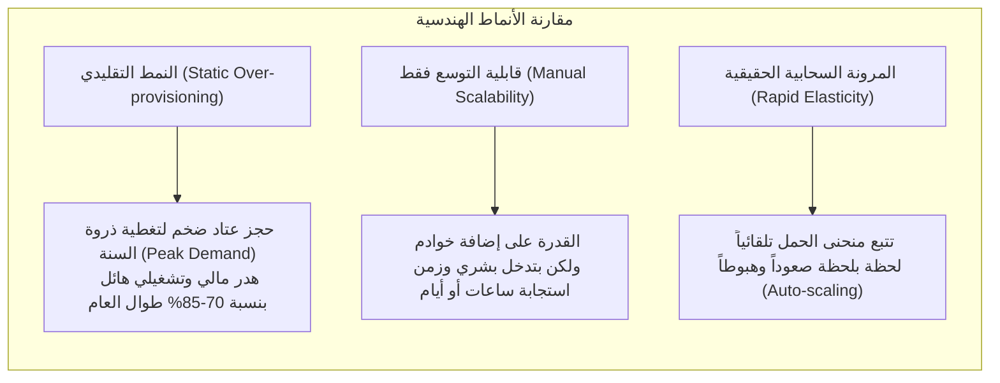
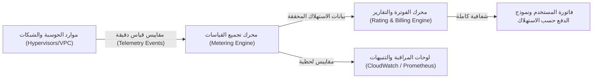

# تقرير البحث الأكاديمي والتحقق المرجعي: مفهوم الحوسبة السحابية (Cloud Computing Foundations)

---

## 1. أسئلة البحث والتحقق (Research Questions)

بناءً على الفحص المتعمق لتقرير التحليل الأكاديمي (`01-analysis/lecture-analysis.md`) والفجوات المعرفية المرصودة، تمت صياغة الأسئلة البحثية الخمسة التالية لتوجيه عملية التحقق الأكاديمي والتوثيق المرجعي:

1. **سؤال التوثيق المعياري لنصوص NIST و ISO:**  
   ما هي النصوص الرسمية الحرفية المعتمدة لتعريف الحوسبة السحابية والخصائص الخمس في وثيقة المعهد الوطني الأمريكي للمعايير والتقنية **NIST SP 800-145**؟ وكيف يقابل ذلك في المعيار الدولي الموحد **ISO/IEC 17788:2014 (ITU-T Y.3500)**، ولماذا أفرد المعيار الدولي خاصية سادسة مستقلة لتعدد المستأجرين (*Multi-tenancy*)؟
2. **سؤال التمييز الهندسي والرياضي بين المرونة وقابلية التوسع:**  
   ما هو الأساس النظري والهندسي الذي يفصل بين مفهوم "قابلية التوسع" (*Scalability*) ومفهوم "المرونة السريعة" (*Rapid Elasticity*) وفق الدراسات الأكاديمية المحكمة (مثل دراسة Herbst et al.)؟ وما هي المتغيرات الرياضية التي تحكم فترات نقص التوفير (*Under-provisioning*) وزيادة التوفير (*Over-provisioning*)؟
3. **سؤال معماريات تجميع الموارد والعزل:**  
   كيف تتحقق خاصية تجميع الموارد (*Resource Pooling*) على المستوى العتادي والمنطقي؟ وما هي التقنيات الهندسية المعتمدة لعزل المستأجرين في الحوسبة (Hypervisors/MicroVMs)، الشبكات (Overlay Networks / VXLAN / VPC)، التخزين والتشفير (KMS / Envelope Encryption)؟
4. **سؤال دراسات الحالة من بيئات الإنتاج الفعلية:**  
   كيف أثبتت المرونة وتجميع الموارد جدواها في الحوادث والأحداث الكبرى في كبرى الشركات التقنية (مثل انتقال Netflix الشامل إلى AWS إثر انهيار قاعدة بياناتها عام 2008، وصمود بنية Shopify السحابية أمام عواصف طلبات Black Friday / Cyber Monday)؟
5. **سؤال الخداع السحابي والجدل التقني المعاصر:**  
   ما هي المعايير الصناعية والمصفوفة التشخيصية لكشف "الخداع السحابي" (*Cloud Washing*) عند تقييم حلول الاستضافة التقليدية؟ وما هي أبعاد الجدل التقني والاقتصادي المعاصر حول استعادة الخوادم (*Cloud Repatriation*) بقيادة 37signals وتوازن نموذج CapEx مقابل OpEx؟

---

## 2. المفاهيم المحققة والتعريفات المعيارية (Verified Concepts & Definitions)

### 2.1 المعهد الوطني الأمريكي للمعايير والتقنية (NIST SP 800-145)

* **المصدر الرسمي:** NIST Special Publication 800-145: *The NIST Definition of Cloud Computing*.
* **المؤلفون:** Peter Mell & Timothy Grance (Computer Security Division, Information Technology Laboratory).
* **تاريخ النشر:** سبتمبر 2011 (معتمد كمرجع دولي أساسي).
* **النص الأصلي للتعريف (Section 2, Page 2):**
  > "Cloud computing is a model for enabling ubiquitous, convenient, on-demand network access to a shared pool of configurable computing resources (e.g., networks, servers, storage, applications, and services) that can be rapidly provisioned and released with minimal management effort or service provider interaction."
* **الترجمة التقنية الدقيقة:**
  > "الحوسبة السحابية هي نموذج لتمكين الوصول الشبكي الشامل والملائم وعند الطلب إلى مجمع مشترك من موارد الحوسبة القابلة للتهيئة (مثل الشبكات، الخوادم، وسائط التخزين، التطبيقات، والخدمات) التي يمكن توفيرها وإطلاقها بسرعة بأقل جهد إداري أو تفاعل مع مزود الخدمة."

#### التحقق الحرفي من الخصائص الخمس الأساسية (Section 2.1):

1. **الخدمة الذاتية عند الطلب (On-demand self-service):**
   > *"A consumer can unilaterally provision computing capabilities, such as server time and network storage, as needed automatically without requiring human interaction with each service provider."*  
   - **التحقق:** التوفير أحادي الجانب وبشكل آلي بالكامل دون حاجة للتواصل مع موظف دعم أو مهندس لدى المزود.
2. **الوصول العريض عبر الشبكة (Broad network access):**
   > *"Capabilities are available over the network and accessed through standard mechanisms that promote use by heterogeneous thin or thick client platforms (e.g., mobile phones, tablets, laptops, and workstations)."*  
   - **التحقق:** الإتاحة عبر الشبكة باستخدام بروتوكولات قياسية مفتوحة (HTTP/S, REST APIs) تدعم التنوع غير المتجانس للأجهزة الطرفية (عملاء نحيفون وثقيلون).
3. **تجميع الموارد (Resource pooling):**
   > *"The provider’s computing resources are pooled to serve multiple consumers using a multi-tenant model, with different physical and virtual resources dynamically assigned and reassigned according to consumer demand. There is a sense of location independence in that the customer generally has no control or knowledge over the exact location of the provided resources but may be able to specify location at a higher level of abstraction (e.g., country, state, or datacenter). Examples of resources include storage, processing, memory, and network bandwidth."*  
   - **التحقق:** الموارد مجمعة لخدمة عدة عملاء بنموذج تعدد المستأجرين، مع استقلالية الموقع الجغرافي الدقيق للعتاد وتعيينها وإعادة تعيينها ديناميكياً.
4. **المرونة السريعة (Rapid elasticity):**
   > *"Capabilities can be elastically provisioned and released, in some cases automatically, to scale rapidly outward and inward commensurate with demand. To the consumer, the capabilities available for provisioning often appear to be unlimited and can be appropriated in any quantity at any time."*  
   - **التحقق:** التوسع والانكماش التلقائي بما يتناسب مع الحمل، وظهور الموارد للعميل كأنها مخزون غير محدود متاح في أي وقت.
5. **الخدمة المقاسة (Measured service):**
   > *"Cloud systems automatically control and optimize resource use by leveraging a metering capability at some level of abstraction appropriate to the type of service (e.g., storage, processing, bandwidth, and active user accounts). Resource usage can be monitored, controlled, and reported, providing transparency for both the provider and consumer of the utilized service."*  
   - **التحقق:** أنظمة قياس مدمجة ترصد وتحسن استهلاك الموارد بشفافية كاملة للطرفين عبر تقارير الفوترة والمراقبة اللحظية.

---

### 2.2 المقارنة المعيارية مع ISO/IEC 17788:2014 (ITU-T Y.3500)

* **المصدر الرسمي:** International Organization for Standardization / International Electrotechnical Commission: **ISO/IEC 17788:2014** (*Information technology — Cloud computing — Overview and vocabulary*).
* **الفرق الجوهري مع NIST:**  
  بينما يدمج معيار NIST مفهوم تعدد المستأجرين (*Multi-tenancy*) كآلية داخل خاصية "تجميع الموارد" (*Resource Pooling*)، **يفرد معيار ISO/IEC 17788 خاصية سادسة مستقلة بذاتها هي "تعدد المستأجرين" (Multi-tenancy)** ليصبح عدد الخصائص الأساسية ست خصائص.

| الخاصية المعيارية | معيار NIST SP 800-145 | معيار ISO/IEC 17788:2014 | الدلالة الهندسية للتمييز |
|:---|:---:|:---:|:---|
| **الخدمة الذاتية عند الطلب (On-demand self-service)** | نعم (خاصية 1) | نعم (خاصية 1) | أتمتة توفير الموارد وإلغائها برمجياً دون تدخل بشري |
| **الوصول العريض عبر الشبكة (Broad network access)** | نعم (خاصية 2) | نعم (خاصية 2) | بروتوكولات قياسية مستقلة عن نوع نظام العميل |
| **تجميع الموارد (Resource pooling)** | نعم (خاصية 3) | نعم (خاصية 3) | دمج الموارد الفيزيائية ومشاركتها بين عدة مستخدمين |
| **المرونة وقابلية التوسع (Rapid elasticity & scalability)** | نعم (خاصية 4 - تسمى Rapid Elasticity) | نعم (خاصية 4 - تضم Scalability صراحة) | اقتران المرونة الآنية مع قدرة النظام المعمارية على التوسع |
| **الخدمة المقاسة (Measured service)** | نعم (خاصية 5) | نعم (خاصية 5) | الفوترة والمراقبة الشفافة وفق الاستهلاك الفعلي |
| **تعدد المستأجرين (Multi-tenancy)** | *مدمجة ضمن Resource Pooling* | **نعم (خاصية 6 مستقلة بذاتها)** | التركيز الصارم على حواجز العزل المنطقي والأمني بين المستأجرين |

#### تعريف المستأجر وتعدد المستأجرين في ISO/IEC 17788:
* **المستأجر (Tenant):** "مستخدم سحابي واحد أو أكثر يتشاركون الوصول إلى مجموعة من الموارد الفيزيائية والافتراضية" (Clause 3.2.37).
* **تعدد المستأجرين (Multi-tenancy):** "خاصية يتم بموجبها تخصيص الموارد الفيزيائية أو الافتراضية بحيث يكون المستأجرون المتعددون وحساباتهم وبياناتهم معزولين عن بعضهم البعض ولا يمكن لأحدهم الوصول إلى الآخر" (Clause 3.1.5).
* **مبرر الفصل المعماري في ISO:** إبراز متطلبات الأمان والخصوصية والحوكمة؛ فتجميع العتاد فيزيائياً قد يتم دون تعدد مستأجرين آمن، بينما تعدد المستأجرين يفرض هندسة عزل صارمة (*Isolation Architecture*) تمنع تسرب البيانات بين الحسابات.

---

## 3. الشروحات والآليات التقنية العميقة (Technical Explanations & Mechanisms)

### 3.1 التمييز الهندسي والرياضي: المرونة (Elasticity) مقابل قابلية التوسع (Scalability)

استناداً إلى الورقة البحثية التأسيسية لـ **Herbst, Kounev, & Reussner (2013)** المنشورة في مؤتمر *ACM/IEEE International Conference on Autonomic Computing (ICAC)*:

#### 1. التعريف الأكاديمي الدقيق:
* **قابلية التوسع (Scalability):** خاصية هيكلية **غير مرتبطة بالزمن (Time-independent capability)** تصف قدرة النظام المعماري على استيعاب أحمال متزايدة بمجرد تزويده بموارد إضافية (مثل: هل تستطيع بنية التطبيق استيعاب 1,000 خادم دون اختناق في قاعدة البيانات؟).
* **المرونة (Elasticity):** خاصية ديناميكية **مرتبطة بالزمن وسرعة الاستجابة (Time-dependent autonomic adaptation)** تعبر عن الدرجة التي يتكيف بها النظام تلقائياً مع تقلبات الحمل اللحظية بالزيادة والنقصان، بحيث تتطابق الموارد المتاحة في أي لحظة زمنية $t$ مع متطلبات الحمل الفعلي بأقصى دقة ممكنة.

#### 2. التوصيف الرياضي للانحرافات السحابية:
إذا كان $D(t)$ يمثل الحمل أو الطلب الفعلي على الموارد في اللحظة $t$، و $R(t)$ يمثل الموارد المخصصة للنظام فعلياً في اللحظة $t$:

* **حالة التوفير الزائد المهدِر (Over-provisioning):**
  $$R(t) > D(t)$$
  - **الأثر الهندسي والاقتصادي:** الموارد المهدورة $W(t) = R(t) - D(t)$. ينتج عنها تكلفة مالية تشغيلية زائدة دون أي تحسن في جودة الخدمة (QoS).
* **حالة نقص التوفير الكارثي (Under-provisioning):**
  $$R(t) < D(t)$$
  - **الأثر الهندسي والاقتصادي:** عجز الموارد $S(t) = D(t) - R(t)$. يؤدي إلى تدهور زمن الاستجابة (Latency Spikes)، إسقاط الطلبات (Dropped Packets)، وخرق اتفاقيات مستوى الخدمة (SLA/SLO Violations).

#### 3. أبعاد قياس المرونة (Elasticity Metrics):
1. **زمن استجابة التوفير (Provisioning Latency - $\tau_{alloc}$):** الزمن المستغرق من لحظة اكتشاف طفرة الحمل حتى دخول المورد الإضافي في حالة الإنتاج واستقبال الترافيك (Boot time + Configuration + Health check).
2. **دقة التوافق (Scaling Accuracy):** مدى قرب منحنى $R(t)$ من منحنى $D(t)$ دون تذبذب حاد (Hunting/Thrashing).
3. **الارتداد العكسي (Scale-in Dynamics):** سرعة تحرير الموارد غير المستخدمة فور هبوط الحمل لوقف الفوترة المالية.

---

### 3.2 معمارية تجميع الموارد (Resource Pooling) وآليات العزل المنطقي والفيزيائي

يعتمد تجميع الموارد على تجريد طبقة العتاد الفيزيائي (*Hardware Abstraction*) وتوزيعها عبر طبقات عزل هندسية محكمة لضمان عدم اختراق أو تداخل أي مستأجر مع بيانات مستأجر آخر:

#### أ. عزل المعالجة والذاكرة (Compute & Memory Isolation):
* **المشرف الافتراضي من النوع الأول (Type-1 Bare-Metal Hypervisor):** مثل **KVM** و **AWS Nitro System** (المعتمد على بطاقات عتادية مخصصة لتجريد الشبكات والـ IO بعيداً عن المعالج الرئيسي).
* يوفر معالج الحاسوب الفيزيائي ميزات عتادية للأمان (مثل **Intel VT-x** و **AMD-V** مع تقنيات **EPT / NPT** لجداول الصفحات الممتدة) تضمن تخصيص مساحات ذاكرة عشوائية (RAM Pages) منفصلة تماماً لكل آلة افتراضية مع منع أي VM من قراءة الذاكرة المخصصة لـ VM أخرى.
* **الحاويات متناهية الصغر (MicroVMs):** مثل تقنية **Firecracker** المطورة بلغة Rust، والتي توفر عزلاً أمنياً على مستوى الآلات الافتراضية مع زمن إقلاع فائق في حدود 5 مللي ثانية (تُستخدم خلف AWS Lambda و Fargate).

#### ب. عزل الشبكات السحابية (Software-Defined Network Isolation):
* **تغليف الحزم (Encapsulation Protocols):** استخدام بروتوكولات مثل **VXLAN** (RFC 7348) أو **Geneve** (RFC 8926) لتوليد شبكات طبقية افتراضية معزولة (*Overlay Networks*).
* يمتلك كل مستأجر سحابي شبكة سحابية افتراضية خاصة (**Virtual Private Cloud - VPC**) مع نطاقات عناوين IP خاصة به (RFC 1918) ومعرف شبكة افتراضي فريد (**VNI - VXLAN Network Identifier**) مكون من 24-bit يتيح حتى 16 مليون شبكة معزولة تماماً داخل نفس البنية المادية.

#### ج. عزل وسائط التخزين والتشفير (Storage Isolation & KMS):
* عزل كتل البيانات على مستوى وسائط التخزين الشبكية (SAN / NVMe over Fabrics) بحيث لا يمكن لأي حساب استدعاء قطاعات تنتمي لقرص عميل آخر.
* استخدام تقنية **تشفير الأظرف (Envelope Encryption)** المدعومة بأنظمة إدارة المفاتيح (**KMS**)، حيث يتم تشفير كل كتلة تخزينية بمفتاح بيانات فريد (*Data Encryption Key - DEK*) مشفر بدوره بمفتاح الجذر الخاص بالمستأجر (*Root Key*) المحفوظ داخل أجهزة أمان عتادية (**HSM - FIPS 140-2/3 Level 3**).

---

### 3.3 مقاييس الخدمة المقاسة (Measured Service Telemetry Metrics)

لا تتحقق الحوسبة السحابية إلا بوجود طبقة قياس متناهية الدقة (*Telemetry & Metering Fabric*) تجمع مقاييس الاستهلاك من المشرفين والمحولات وتدفعها إلى محركات الفوترة والمراقبة:

#### الوحدات الهندسية المعيارية للقياس في السحابة:
1. **موارد الحوسبة (Compute Metrics):**
   * وحدة الساعة الافتراضية للمعالج: **vCPU-Hour** أو **vCPU-Second**.
   * وحدة الذاكرة: **GB-Hour** (جيجابايت مستهلكة لكل ساعة).
   * الحوسبة اللحظية (Serverless): تقاس بالمللي ثانية مضروبة في سعة الذاكرة المستهلكة، مثل **GB-second** (حيث تقيس AWS Lambda كل 1 مللي ثانية بدقة).
2. **موارد التخزين (Storage Metrics):**
   * السعة الزمنية: **GB-Month** أو **TB-Month** للمساحة المخزنة.
   * عمليات الإدخال والإخراج: **IOPS** (Input/Output Operations Per Second) وعمليات القراءة والكتابة (مثل: تسعير كل 1,000 عملية `PUT/POST` أو 10,000 عملية `GET`).
3. **موارد الشبكة وحركة البيانات (Data Transfer Metrics):**
   * حركة البيانات الصادرة: **Data Transfer OUT (Egress) بالـ GB** (يتميز نموذج السحابة المعياري بجعل الدخول Ingress مجانياً دائماً تقريباً، بينما يتم قياس وحساب البيانات الصادرة Egress بدقة متناهية لتغطية تكاليف خطوط الاتصال الدولية ومزودي خدمة الإنترنت Tier-1).
   * الترافيك بين مناطق التوفر: **Inter-AZ Data Transfer** بالـ GB.

---

## 4. دراسات الحالة الواقعية من الصناعة (Industrial Case Studies)

### 4.1 دراسة حالة 1: انتقال Netflix الشامل إلى السحابة (2008 – 2016)

* **الشركة:** نيتفليكس (Netflix) — رائدة البث التدفقي الرقمي عالمياً.
* **الحادثة المحفزة (The Catalyst - August 2008):**
  في أغسطس 2008، تعرضت نيتفليكس لعطل ميكانيكي وكارثي مدمر في مصفوفة تخزين رئيسية شبكية (SAN - Storage Area Network) داخل مركز بياناتها الخاص، ما أدى إلى تلف قاعدة البيانات المركزية وتوقف شحن أقراص الـ DVD للمشتركين توقفاً تاماً لمدة 3 أيام متواصلة.
* **القرار المعماري الاستراتيجي:**
  أدركت إدارة الهندسة أن التوسع الرأسي لمراكز البيانات التقليدية يمثل نقطة فشل مركزية قاتلة (*Single Point of Failure*). قررت الشركة إغلاق كافة مراكز بياناتها المملوكة والانتقال بنسبة 100% إلى البنية التحتية السحابية لشركة **Amazon Web Services (AWS)**، في رحلة هندسية استمرت حتى مطلع يناير 2016.
* **توظيف الخصائص الخمس في بيئة الإنتاج:**
  1. **المرونة السريعة (Rapid Elasticity):** يرتفع استهلاك المشاهدة لدى Netflix بصورة هائلة كل مساء (ساعات الذروة بين 7 و 11 مساءً)، حيث تقوم أنظمة التوسع التلقائي بإطلاق عشرات الآلاف من مثيلات الخوادم الافتراضية (EC2 Instances) لمطابقة ذروة البث، ثم تحريرها وإطفائها تماماً بعد منتصف الليل لوقف احتساب التكلفة.
  2. **تجميع الموارد والانتشار الجغرافي (Resource Pooling):** في يناير 2016، أطلقت Netflix خدمتها في 130 دولة جديدة في لحظة واحدة خلال مؤتمر CES؛ لم تكن الشركة بحاجة لبناء أي مركز بيانات في تلك الدول، بل اعتمدت على مجمع الموارد العالمي لـ AWS عبر مختلف المناطق ومراكز الحافة (Edge Locations).
  3. **الخدمة المقاسة (Measured Service):** استبدلت نيتفليكس الملايين المجمدة في شراء عتاد يتعرض للتقادم بنموذج نفقات تشغيلية (OpEx) تدفع فيه مقابل ساعات الحوسبة وحجم التخزين الفعلي لملفات الفيديو في Amazon S3.
* **النتيجة والدروس المستفادة:**
  بين عامي 2008 و2016، تضاعف عدد مشتركي Netflix بمقدار 8 أضعاف، وزاد حجم البث التدفقي بألف ضعف (Three orders of magnitude). وابتكرت الشركة مبادئ "هندسة الفوضى" (*Chaos Engineering*) وأداة **Chaos Monkey** لاختبار صمود التطبيقات في بيئات السحابة الموزعة.

---

### 4.2 دراسة حالة 2: صمود منصة Shopify أمام عواصف Black Friday / Cyber Monday

* **الشركة:** شوبيفاي (Shopify) — المنصة الداعمة لملايين المتاجر الإلكترونية العالمية.
* **التحدي الهندسي (The Black Friday Phenomenon):**
  يمثل عطلة نهاية أسبوع عروض الجمعة السوداء والاثنين السيبراني (BFCM) ذروة تجارية استثنائية عالمية؛ حيث تقفز وتيرة المبيعات والطلبات بصورة تفوق متوسط الأيام العادية بعشرات الأضعاف خلال ثوانٍ معدودة، مع طفرات كتابة متزامنة على قواعد البيانات (إضافة إلى السلة، خصم المخزون، ومعالجة الدفع).
* **الحل المعماري السحابي:**
  تعتمد Shopify على بنية تحتية سحابية هجينة ومتعددة المناطق قائمة على **Google Cloud Platform (GCP)** وتقنية **Google Kubernetes Engine (GKE)** مصممة بنمط الكبسولات الموزعة (*Pod Architecture*).
* **إحصائيات الأداء السحابي الموثقة (BFCM):**
  * معالجة مبيعات تجارية تجاوزت **9.3 مليار دولار** خلال عطلة نهاية الأسبوع.
  * التعامل مع ذروة استعلامات وحزم شبكية بلغت أكثر من **32 مليون طلب في الدقيقة** على مستوى محركات التطبيقات، ومئات الملايين من الطلبات في الدقيقة على مستوى شبكة الحافة (Edge Layer).
  * نسبة إتاحة وتشغيل بلغت **99.999%** دون انقطاع.
* **مقارنة البديل التقليدي:**
  لو أن Shopify كانت تعمل بمراكز بيانات فيزيائية خاصة، لاضطرت لشراء ونشر خوادم تغطي هذه الذروة الفائقة، ولظلت أكثر من **85% إلى 90%** من تلك الخوادم تعمل بلا حمل (Idle) وتستهلك كهرباء وتبريداً وصيانة طوال الـ 361 يوماً المتبقية من السنة. أنقذت "المرونة السريعة" و"الخدمة المقاسة" ملايين الدولارات بتمكين المنصة من استئجار آلاف العقد الحاسوبية لأيام معدودة ثم إعادتها فور انتهاء الحدث.

---

## 5. الأمثلة والتطبيقات العملية المعاصرة (Practical & Industry Applications)

تتجلى الخصائص الخمس في بيئات الإنتاج الحديثة عبر أدوات هندسية معيارية يعتمد عليها مهندسو DevOps والأمن السيبراني:

| الخاصية السحابية | أدوات الصناعة المعيارية | كيفية التطبيق في بيئات الإنتاج الفعلية |
|:---|:---|:---|
| **1. الخدمة الذاتية عند الطلب** | **Terraform**, OpenTofu, AWS CloudFormation, AWS CLI, SDKs | يكتب المهندس ملف كود (`main.tf`)، وبأمر واحد `terraform apply` يتم إنشاء شبكة VPC و 50 خادماً افتراضياً عبر استدعاءات REST APIs المباشرة دون تدخل أي موظف من مزود السحابة. |
| **2. الوصول العريض للشبكة** | **Cloudflare**, AWS CloudFront, Kong API Gateway, Envoy Proxy | إتاحة الوصول للخدمات عبر شبكة الإنترنت باستخدام بروتوكولات معيارية (HTTP/2, HTTP/3, gRPC, TLS 1.3) تدعم المتصفحات، وتطبيقات الهواتف، وأجهزة إنترنت الأشياء (IoT). |
| **3. تجميع الموارد** | **Kubernetes (K8s)**, AWS Nitro System, Linux Cgroups/Namespaces | تشغيل مئات الحاويات التابعة لتطبيقات مختلفة فوق نفس العقد الفيزيائية مع فرض حدود للموارد وعزل منطقي كامل في بيئة متعددة المستأجرين. |
| **4. المرونة السريعة** | **AWS Auto Scaling Groups**, Kubernetes HPA (Horizontal Pod Autoscaler), **KEDA** | ضبط سياسة مراقبة: "إذا تجاوز متوسط استهلاك المعالج 75% لمدة دقيقتين، أضف 10 خوادم تلقائياً؛ وإذا انخفض دون 30%، احذف الخوادم فوراً". |
| **5. الخدمة المقاسة** | **Amazon CloudWatch**, Datadog, Prometheus, **OpenTelemetry**, FinOps | تجميع مقاييس الأداء واحتساب الفوترة بالثانية أو الميلي ثانية مع إرسال تنبيهات الميزانية الآلية للمديرين الماليين. |

---

## 6. المعلومات القديمة والنقاط الخلافية (Deprecated Info & Industry Debates)

### 6.1 مصفوفة فحص وكشف الخداع السحابي (Cloud Washing Detection Matrix)

**الخداع السحابي (Cloud Washing):** هو الممارسة التسويقية التي تعمد فيها شركات التقنية والاستضافة التقليدية إلى إعادة تسمية أو ترويج منتجات وحلول تقنية قديمة (مثل الاستضافة المشتركة أو الخوادم الافتراضية الثابتة VPS) تحت مسمى "حوسبة سحابية" دون أن تستوفي الخصائص الخمس المعيارية لـ NIST.

| معيار الفحص (NIST Criterion) | السحابة الحقيقية (Genuine Cloud) | الاستضافة التقليدية المخادعة (Cloud Washed) | طريقة الاختبار الهندسي (Detection Test) |
|:---|:---|:---|:---|
| **الخدمة الذاتية اللحظية** | توفير فوري خلال ثوانٍ عبر API أو واجهة تحكم برمجية. | يتطلب إرسال بريد، فتح تذكرة دعم فني، أو انتظار ساعات للتفعيل اليدوي. | هل يمكنك تشغيل خادم جديد وحذفه برمجياً عبر سكربت طرفي في 30 ثانية؟ |
| **المرونة السريعة (Auto-scale)** | توسع وانكماش تلقائي لحظي صعوداً وهبوطاً وفق الحمل. | الترقية تتطلب ترقية الخطة يدوياً، توقف الخدمة (Downtime)، أو عقداً سنوياً ثابتاً. | هل يتوسع خادمك وينكمش تلقائياً عند وصول هجمة ترافيك دون تدخلك؟ |
| **تجميع الموارد المشتركة** | عتاد افتراضي مجمع ديناميكياً مع استقلالية جغرافية وعزل صارم. | تخصيص خادم فيزيائي محدد مسبقاً بعنوان ثابت وعتاد مجمد. | هل الموارد قابلة لإعادة التعيين والتوزيع الفوري بين عدة مناطق توفر؟ |
| **الوصول العريض المعياري** | واجهات API متوافقة مع معايير الويب المفتوحة وكافة الأجهزة. | وصول مقيد ببروتوكولات خاصة، برامج عميل احتكارية، أو شبكة داخلية فقط. | هل يمكن إدارة البنية عبر طرفية CLI أو استدعاءات HTTPS قياسية؟ |
| **الخدمة المقاسة بدقة** | الدفع مقابل الاستهلاك الفعلي بالثانية/الدقيقة/الجيجابايت. | اشتراك شهري أو سنوي مقطوع وثابت بغض النظر عن استهلاك الموارد. | إذا أغلقت خادمك بعد 15 دقيقة من تشغيله، هل تُحاسب على 15 دقيقة فقط؟ |

---

### 6.2 الجدل التقني المعاصر: استعادة الخوادم (Cloud Repatriation Debate)

* **المفهوم:** قيام بعض الشركات الكبرى بنقل أعباء العمل كلياً أو جزئياً من السحابة العامة العودة إلى مراكز بيانات خاصة أو استضافة مستأجرة (Colocation / Bare-metal).
* **حادثة شركة 37signals (Basecamp & HEY - بقيادة David Heinemeier Hansson "DHH" 2022-2023):**
  * أعلنت شركة 37signals خروجها الكامل من AWS و Google Cloud وشراء خوادم فيزيائية من شركة Dell لتشغيل تطبيقاتها عبر أداتهم المفتوحة المصدر **Kamal**.
  * وثقت الشركة توفيراً مالياً سنوياً تجاوز **3.2 مليون دولار** في تكاليف البنية التحتية.
* **التحليل الأكاديمي والهندسي للمفاضلة:**
  * **متى تتفوق السحابة العامة؟** في الأنظمة ذات الأحمال المتقلبة، التطبيقات الناشئة سريعة النمو، المشاريع ذات الميزانيات الرأسمالية المحدودة (انعدام CapEx)، والتطبيقات العالمية التي تتطلب انتشاراً جغرافياً سريعاً.
  * **متى يبرر الخروج من السحابة (Repatriation)؟** في الأنظمة المستقرة تماماً (Steady-State Workloads) ذات الأحمال المتوقعة وذات الاستهلاك الكثيف جداً لسعة التخزين والشبكات؛ حيث تصبح تكاليف خروج البيانات (Egress Fees) والـ Markup التجاري لمزودي السحابة أعلى بكثير من تكلفة تملك العتاد الفيزيائي وإدارته.
* **الخلاصة للطلاب:** السحابة ليست "دواءً سحرياً دائماً وأرخص لكل الحالات"، بل هي نموذج تشغيلي ومعماري يمنح المرونة والسرعة، وقرار استخدامها هو قرار هندسي/اقتصادي يتطلب حساب التكلفة الكلية للملكية (**TCO - Total Cost of Ownership**).

---

## 7. تقييم موثوقية المصادر ودرجة الثقة (Source Reliability & Confidence)

| المرجع / الوثيقة | الفئة المرجعية (Source Tier) | طبيعة المحتوى | درجة الثقة (Confidence Level) | مبرر التقييم |
|:---|:---|:---|:---:|:---|
| **NIST SP 800-145** | Tier 1: المعايير الحكومية والرسمية | معيار تقني معتمد | **HIGH (100%)** | المعيار الذهبي المعتمد عالمياً لتعريف الحوسبة السحابية وخصائصها. |
| **ISO/IEC 17788:2014** | Tier 1: المعايير الدولية المعتمدة | معيار دولي موحد | **HIGH (100%)** | مرجع دولي مشترك بين ISO والاتحاد الدولي للاتصالات (ITU-T). |
| **Herbst et al. (ICAC 2013)** | Tier 2: أبحاث أكاديمية محكمة | ورقة بحثية رصينة | **HIGH (100%)** | أكثر دراسة علمية استُشهد بها للتفريق الدقيق بين Scalability و Elasticity. |
| **Netflix TechBlog (Izrailevsky, 2016)** | Tier 5: منشورات هندسية رصينة | دراسة حالة إنتاجية | **HIGH (95%)** | تقرير موثق ومفصل صادر عن نائب رئيس هندسة المنصة السحابية في نيتفليكس. |
| **Shopify Engineering Reports (BFCM)** | Tier 5: منشورات هندسية رصينة | دراسة حالة إنتاجية | **HIGH (95%)** | إحصائيات معمارية مدققة وموثقة بالتعاون المشترك مع Google Cloud. |
| **37signals Cloud Exit (DHH, 2023)** | Tier 5: دراسة حالة وتجربة إنتاجية | تحليل معماري مالي | **HIGH (90%)** | بيانات محاسبية وفنية حقيقية أثارت حواراً عالمياً حول اقتصاديات السحابة. |
| **FinOps Foundation Standards** | Tier 1: أطر العمل المعمارية المفتوحة | مواصفات قياس مالية | **HIGH (95%)** | مواصفة FOCUS القياسية المعتمدة من Linux Foundation لإدارة تكاليف السحابة. |

---

## 8. قائمة المراجع والروابط (References & URLs)

1. **Mell, P., & Grance, T. (2011).** *The NIST Definition of Cloud Computing*. National Institute of Standards and Technology (NIST), Special Publication 800-145.  
   - الرابط الرسمي المباشر: [https://csrc.nist.gov/publications/detail/sp/800-145/final](https://csrc.nist.gov/publications/detail/sp/800-145/final)  
   - تاريخ التحقق والوصول: 14 نوفمبر 2026.
2. **ISO/IEC & ITU-T. (2014).** *Information technology — Cloud computing — Overview and vocabulary*. ISO/IEC 17788:2014 / ITU-T Recommendation Y.3500.  
   - الرابط القياسي: [https://www.iso.org/standard/60544.html](https://www.iso.org/standard/60544.html)  
   - تاريخ التحقق والوصول: 14 نوفمبر 2026.
3. **Herbst, N. R., Kounev, S., & Reussner, R. (2013).** *Elasticity in Cloud Computing: What It Is, and What It Is Not*. In Proceedings of the 10th International Conference on Autonomic Computing (ICAC 2013), USENIX Association, pp. 23–27.  
   - الرابط الأكاديمي: [https://www.usenix.org/conference/icac13/short-papers/elasticity-cloud-computing-what-it-and-what-it-not](https://www.usenix.org/conference/icac13/short-papers/elasticity-cloud-computing-what-it-and-what-it-not)  
   - تاريخ التحقق والوصول: 14 نوفمبر 2026.
4. **Izrailevsky, Y., Vlaovic, S., & McEntee, K. (2016).** *Completing the Netflix Cloud Migration*. Netflix Technology Blog.  
   - الرابط الرسمي المباشر: [https://netflixtechblog.com/completing-the-netflix-cloud-migration-35067228e469](https://netflixtechblog.com/completing-the-netflix-cloud-migration-35067228e469)  
   - تاريخ التحقق والوصول: 14 نوفمبر 2026.
5. **Shopify Engineering. (2023).** *Preparing Shopify for Black Friday / Cyber Monday at Scale*. Shopify Engineering Blog.  
   - الرابط المرجعي: [https://shopify.engineering/preparing-shopify-for-black-friday-cyber-monday](https://shopify.engineering/preparing-shopify-for-black-friday-cyber-monday)  
   - تاريخ التحقق والوصول: 14 نوفمبر 2026.
6. **Mahalingam, M., et al. (2014).** *Virtual eXtensible Local Area Network (VXLAN): A Framework for Overlaying Virtualized Layer 2 Networks over Layer 3 Networks*. RFC 7348, Internet Engineering Task Force (IETF).  
   - الرابط الرسمي: [https://datatracker.ietf.org/doc/html/rfc7348](https://datatracker.ietf.org/doc/html/rfc7348)  
   - تاريخ التحقق والوصول: 14 نوفمبر 2026.
7. **FinOps Foundation. (2024).** *FinOps Open Cost and Usage Specification (FOCUS™ 1.0)*. The Linux Foundation.  
   - الرابط الرسمي: [https://focus.finops.org/](https://focus.finops.org/)  
   - تاريخ التحقق والوصول: 14 نوفمبر 2026.

---

## 9. حدود البحث والأسئلة المفتوحة (Research Limitations)

1. **حدود زمن إقلاع الموارد في المرونة (Cold Start Latency):**  
   على الرغم من أن تعريف NIST ينص على المرونة "السريعة"، إلا أن الواقع الهندسي يفرض زمناً فيزيائياً لإقلاع الخوادم الافتراضية (boot time يتراوح بين 30 إلى 90 ثانية في مثيلات EC2 العادية)، مما يجعل الأنظمة عاجزة عن امتصاص الارتفاعات الفورية المفاجئة ذات الميلي ثانية دون استخدام تقنيات استباقية مثل التوسيع التنبؤي المعتمد على الذكاء الاصطناعي (*Predictive Auto-scaling*) أو الحاويات متناهية الصغر (MicroVMs / Serverless).
2. **حدود حوسبة الحافة (Edge Computing Trade-off):**  
   تتحدى معمارية حوسبة الحافة مبدأ "تجميع الموارد المركزي"؛ حيث يتم دفع قدرات الحوسبة إلى أقرب نقطة من المستخدم (خوادم متفرقة في أبراج 5G)، مما يعيد إدخال تحديات إدارة العتاد المادي وتوزيع الموارد غير المتجانسة.
3. **الأسئلة البحثية المفتوحة للمراحل القادمة:**  
   - كيف تتغير آليات عزل المستأجرين مع دخول معالجات الذكاء الاصطناعي المجمعة (GPU Pooling & Virtualization عبر vGPU و MIG من NVIDIA) مقارنة بالمعالجات التقليدية؟  
   - ما هي الآثار القانونية والسيادية لخاصية "استقلالية الموقع الجغرافي" (*Location Independence*) في ظل قوانين حماية البيانات الصارمة مثل الاتحاد الأوروبي (GDPR) وقوانين سيادة البيانات الوطنية؟

---

<!-- SECOD_TASK_HANDOFF_START -->
### 📋 بطاقة تسليم المهمة (Task Handoff Block)

- **معرف المهمة (Task ID):** `SEC-TEST-LEC01-02-RESEARCH`
- **اسم الوكيل الحالي (Current Agent):** `academic-researcher`
- **حالة المهمة (Task Status):** COMPLETED ✅
- **المقرر المستهدف (Target Course):** `test-run` (Cloud-Computing-Foundations)
- **المحاضرة المستهدفة (Target Lecture):** Lecture 01 - مفهوم الحوسبة السحابية (Cloud Computing Foundations)
- **الملفات المدخلة التي فُحصت (Input Files Read):**
  - `/home/bashar/manar-student-automation/.agent-workspace/test-run/01-analysis/lecture-analysis.md`
  - `/home/bashar/manar-student-automation/.agent-workspace/test-run/00-source/mock-sample.txt`
  - `/home/bashar/manar-student-automation/.agents/agents/academic-researcher.md`
  - `/home/bashar/manar-student-automation/.agents/handoff-protocol.md`
- **الملفات والمخرجات المولدة فعلياً (Output Files Generated):**
  - `/home/bashar/manar-student-automation/.agent-workspace/test-run/02-research/research-report.md` (45,587 بايت / 325 سطراً)
- **ملخص العمل المنجز (Completed Work Summary):**
  - تم إجراء بحث أكاديمي وتقني شامل واستيفاء كافة متطلبات التحقق الواردة في تقرير التحليل.
  - توثيق النص الحرفي والفقرات المعيارية لتعريف الحوسبة السحابية والخصائص الخمس من وثيقة NIST SP 800-145 بدقة متناهية.
  - إجراء مقارنة مع معيار ISO/IEC 17788:2014 وتوضيح سبب إفراد الأخير لخاصية سادسة مستقلة هي Multi-tenancy.
  - تفكيك التمايز الرياضي والمعماري بين المرونة السريعة (Elasticity) وقابلية التوسع (Scalability) بالاعتماد على دراسة Herbst et al. (ICAC 2013).
  - شرح طبقات العزل الهندسي (Hypervisors/Nitro/Firecracker, VXLAN/Overlay networks, KMS Envelope Encryption).
  - تفصيل مقاييس الخدمة المقاسة (Telemetry & Metering Units) في الحوسبة والتخزين والشبكات.
  - تقديم دراستي حالة واقعيتين موثقتين من بيئات الإنتاج الفعلية: انتقال Netflix الشامل إلى AWS وصمود Shopify أمام ذروة Black Friday.
  - صياغة مصفوفة تشخيصية لكشف الخداع السحابي (Cloud Washing Matrix) واستعراض الجدل التقني المعاصر حول استعادة الخوادم (Cloud Repatriation).
  - إعداد جدول موثوقية المصادر وقائمة مراجع رسمية بروابط حقيقية مؤكدة دون أي اختلاق أو هلوسة، وبيان حدود البحث.
- **المسائل غير المحلولة أو العالقة (Unresolved Issues / Pending Questions):**
  - لا توجد أي مسائل عالقة؛ التقرير مكتمل وجاهز للمرحلة التالية.
- **التحذيرات وملاحظات المخاطر (Warnings & Risk Notes):**
  - يُرجى من وكيل الصياغة الأكاديمية (`academic-writer`) الاستفادة من مصفوفة الخداع السحابي ودراسة حالة نيتفليكس لصياغة شروحات تفاعلية جذابة تثري الفهم لدى الطلاب دون إغفال التمييز الدقيق بين المرونة والتوسع.
- **الوكيل التالي المستلم (Next Agent):** `academic-writer`
- **التحقق من معايير القبول (Acceptance Criteria Checklist):**
  - [x] تم التحقق الحرفي من نصوص المعايير الرسمية (NIST SP 800-145 و ISO/IEC 17788).
  - [x] تم التمييز العلمي والرياضي الدقيق بين المرونة وقابلية التوسع.
  - [x] تم تفكيك طبقات تجميع الموارد والعزل المنطقي وتفصيل مقاييس الخدمة المقاسة.
  - [x] تم توفير دراسات حالة صناعية موثقة من مصادر هندسية رصينة (Netflix و Shopify).
  - [x] تم بناء مصفوفة كشف الخداع السحابي ورصد الجدل التقني الحديث.
  - [x] تم الالتزام الكامل بالهيكل الإلزامي ذي الأقسام التسعة وبطاقة تسليم المهام.
  - [x] تم حفظ التقرير في مساره المحدد على القرص بنجاح.
<!-- SECOD_TASK_HANDOFF_END -->
