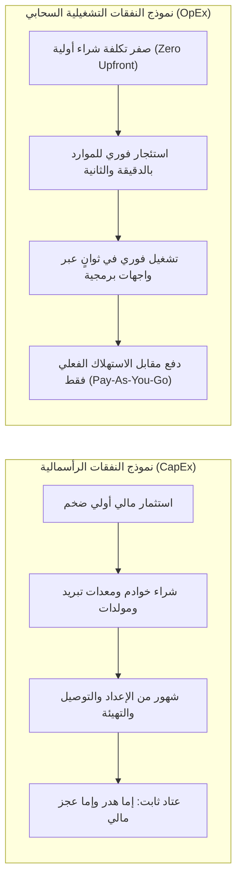
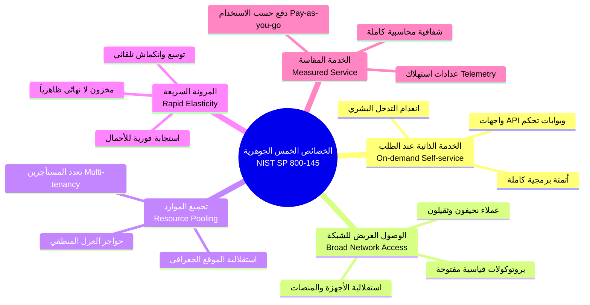
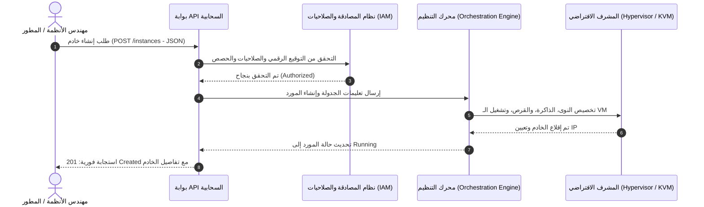
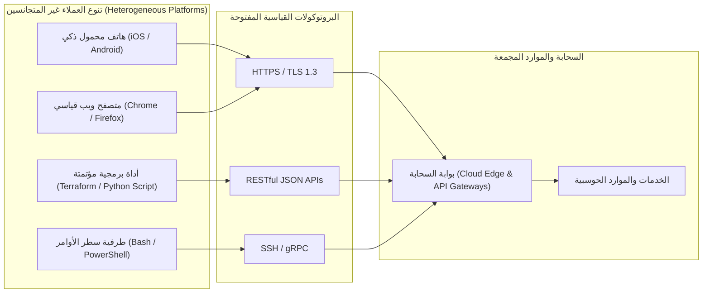
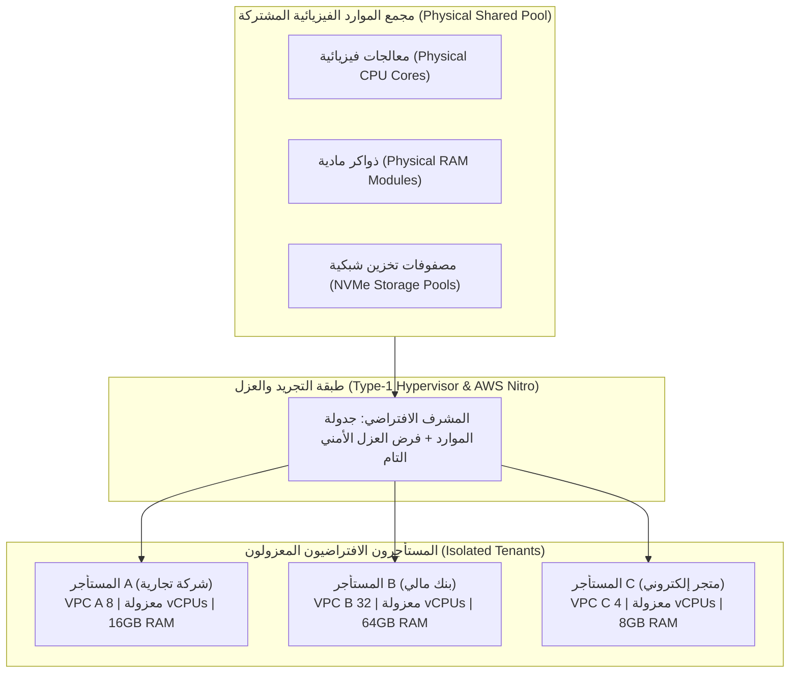
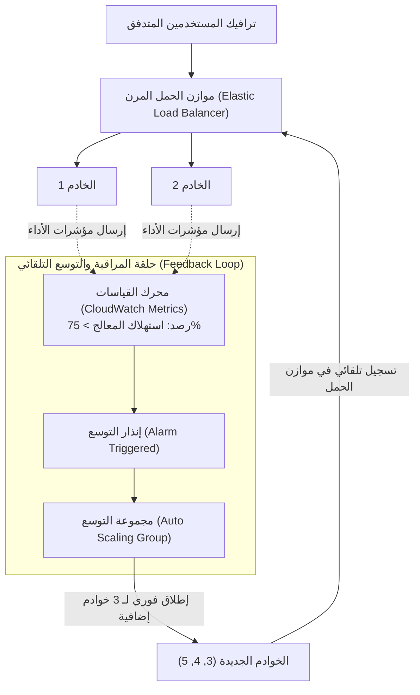
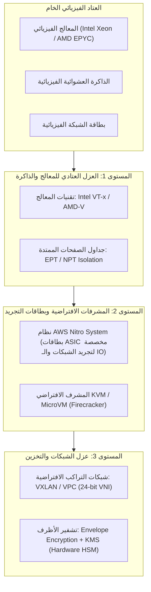
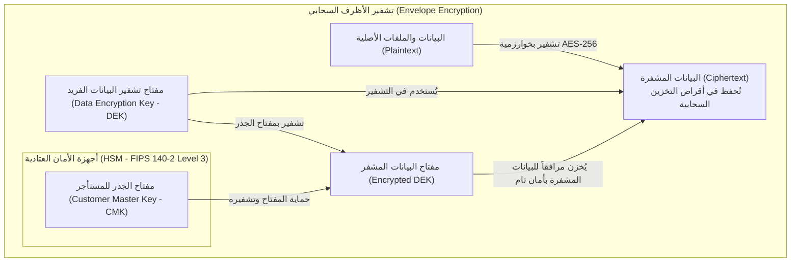
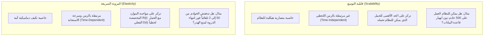
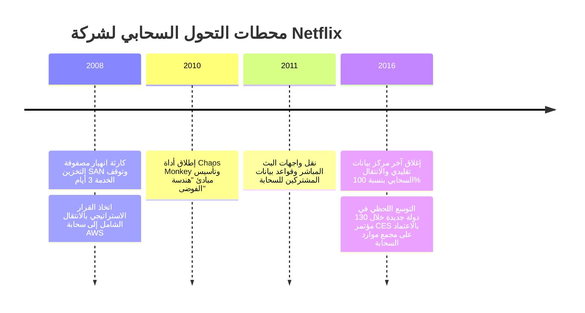

# أساسيات الحوسبة السحابية (Cloud Computing Foundations)
## المرجع الأكاديمي الشامل: المفاهيم، الخصائص الجوهرية، والمعماريات الهندسية

---

## 1. المقدمة الاستراتيجية والسيناريو الافتتاحي (Opening Scenario & Context)

### 1.1 سيناريو الانهيار: ليلة الجمعة السوداء في متجر "نوفا تك" (NovaTech)
في تمام الساعة 11:59 من مساء ليلة الجمعة السوداء (Black Friday)، كان مهندسو البنية التحتية في متجر الإلكترونيات الصاعد "نوفا تك" يراقبون شاشات مركز العمليات بارتياح ظاهري. قبل شهرين كاملين من هذا الموسم، استثمرت الشركة مبلغ 250,000 دولار أمريكي في شراء خمسة خوادم فيزيائية عملاقة (Enterprise Rack Servers) ووحدات تخزين مصفوفية (SAN)، وجرى تركيبها وربطها بجهد مضنٍ داخل مركز البيانات الخاص بالشركة، مع افتراض أن هذه القوة الحاسوبية الهائلة ستستوعب خمسة أضعاف المعدل المعتاد لزوار الموقع.

مع دقات منتصف الليل، أُطلقت الحملة التسويقية الكبرى عبر وسائل التواصل الاجتماعي. في غضون 40 ثانية فقط، تدفق أكثر من 300,000 متسوق متزامن نحو الصفحة الرئيسية. 

وهنا بدأت الكارثة الهندسية:
1. قفز معدل استهلاك الذاكرة والمعالجات إلى 100% خلال ثوانٍ معدودة.
2. اختنقت طوابير طلبات بروتوكول نقل النص الفائق (HTTP Request Queues).
3. تجاوزت قواعد البيانات حد الاتصالات المسموح به (Connection Pool Exhaustion)، وبدأت أقراص التخزين تعاني من اختناق عمليات القراءة والكتابة (I/O Bottleneck).
4. بدأت خوادم الويب بالانهيار التتابعي (Cascading Failure) خادماً تلو الآخر، وظهرت لجميع المشترين رسالة الخطأ الشهيرة: `504 Gateway Timeout`.

امتد الانهيار لسبع ساعات متواصلة حتى فجر اليوم التالي؛ عجز خلالها الفريق الهندسي عن فعل أي شيء، فلا يمكن شراء وتركيب خوادم جديدة وتوصيل كابلاتها وبرمجتها في بضع ساعات. وكانت النتيجة خسارة مباشرة بلغت 1.8 مليون دولار في المبيعات الفائتة، وانهياراً حاداً في سمعة العلامة التجارية، فضلاً عن حقيقة مفجعة كشفتها تقارير ما بعد الحادثة: طوال الـ 360 يوماً الأخرى من السنة، تعمل تلك الخوادم التي كلفت ربع مليون دولار بنسبة استهلاك لا تتجاوز 12% فقط، ما يعني هدراً مالياً وطاقياً مستمراً!


### 1.2 المشكلة الهندسية والاقتصادية التأسيسية
يطرح هذا السيناريو المعضلة الجوهرية التي واجهت صناعة تقنية المعلومات لعقود:
* **معضلة التوفير الزائد (Over-provisioning):** حجز وشراء عتاد فيزيائي ضخم لمواجهة أحمال الذروة النادرة، مما يؤدي إلى تجميد رؤوس أموال ضخمة وهدر هائل في الطاقة والتبريد والمساحات الأرضية طوال فترات الركود.
* **معضلة نقص التوفير (Under-provisioning):** تقليص حجم العتاد لخفض التكاليف، مما يؤدي حتماً إلى انهيار الأنظمة وخسارة العملاء عند حدوث أي طفرة غير متوقعة في حركة البيانات.

كيف يمكن للمؤسسات والمهندسين الحصول على قدرات حاسوبية غير محدودة ظاهرياً، تُطلب وتُطلق خلال ثوانٍ معدودة وبنقرة زر واحدة أو سطر كود، ويُدفع مقابلها بدقة متناهية وفق الاستهلاك الفعلي دون شراء أي مسمار فيزيائي واحد؟

هذا التساؤل الهندسي والاقتصادي هو المنطلق الحقيقي لنشأة وثورة **الحوسبة السحابية (Cloud Computing)**.

### 1.3 خارطة طريق المحاضرة (Lecture Roadmap)
خلال هذا المرجع الأكاديمي، سيتعلم الطالب ويفكك هندسياً المحاور التالية:
1. **التأصيل النظري والاقتصادي:** الفروق الجوهرية بين الإنفاق الرأسمالي (CapEx) والإنفاق التشغيلي (OpEx)، وتفكيك التعريف المعياري المعتمد للحوسبة السحابية وفق وثيقة **NIST SP 800-145**.
2. **التشريح الهندسي للخصائص الخمس الأساسية:** تفكيك الخصائص الخمس وفق منظومة المحاور العشرة لمنصة SECOD.
3. **آليات العمل الداخلية والتدفق الخفي (Under the Hood):** استكشاف تقنيات المحاكاة الافتراضية، المشرفات الافتراضية (Hypervisors)، الحاويات متناهية الصغر (MicroVMs)، شبكات التراكب البرمجية (VXLAN/VPC)، وأنظمة القياس اللحظي (Telemetry Fabric).
4. **جداول المقارنة المعيارية:** التمييز القاطع بين المرونة (Elasticity) وقابلية التوسع (Scalability) بنماذج رياضية، والمقارنة مع الاستضافة التقليدية ومعايير ISO/IEC 17788.
5. **دراسات الحالة الصناعية الموثقة:** تحليل انتقال Netflix الشامل إلى AWS وصمود منصة Shopify أمام مليارات الدولارات في الجمعة السوداء.
6. **مختبر كشف الخداع السحابي (Cloud Washing Lab):** تدريب عملي لتشخيص وكشف الخدع التسويقية لشركات الاستضافة التقليدية.

---

## 2. التأصيل النظري والمفاهيم التأسيسية (Theoretical Foundations)

### 2.1 التحول الاقتصادي الهندسي: CapEx مقابل OpEx
لا يمكن فهم الدافع المعماري للحوسبة السحابية بمعزل عن النماذج المالية التي تحكم قطاع التكنولوجيا:

1. **النفقات الرأسمالية (Capital Expenditures - CapEx):**
   * هي الأموال التي تستثمرها المؤسسة مقدماً لشراء أصول فيزيائية ثابتة طويلة الأجل.
   * في مراكز البيانات التقليدية، تشمل CapEx: شراء الخوادم الفيزيائية، محولات الشبكة (Switches)، وحدات توجيه المسار (Routers)، كابلات الألياف الضوئية، أنظمة التبريد المركزي (HVAC)، مولدات الكهرباء الاحتياطية (Generators)، وأنظمة مكافحة الحرائق، بالإضافة إلى تراخيص البرمجيات المؤبدة.
   * **التحديات الهندسية لـ CapEx:** دورة شراء وبناء بطيئة تستغرق شهوراً (Procurement Lead Time)، تقادم سريع للعتاد (Depreciation) خلال 3 إلى 5 سنوات، وصعوبة بالغة في التنبؤ باحتياجات النمو المستقبلية.

2. **النفقات التشغيلية (Operational Expenditures - OpEx):**
   * هي التكاليف اليومية المستمرة واللازمة لتشغيل الأعمال وإدارة الخدمات.
   * في نموذج الحوسبة السحابية، يتحول الإنفاق التقني بالكامل تقريباً إلى OpEx؛ حيث لا تشتري المؤسسة خوادم، بل تدفع فاتورة شهرية مرنة مقابل ساعات المعالجة، وحجم التخزين، والبيانات المنقولة التي استهلكتها بالفعل خلال تلك الفترة (Pay-as-you-go).
   * **المزايا الهندسية لـ OpEx:** مرونة مالية تامة، تحرير رؤوس الأموال للابتكار البرمجي، القضاء على مخاطر الاستثمار في عتاد غير مستغل، وتوافق خطي مباشر بين تكلفة البنية التحتية ونمو الأعمال الفعلي.



### 2.2 التعريف المعياري المعتمد (NIST SP 800-145)
في خضم الثورة التقنية، أصدر **المعهد الوطني الأمريكي للمعايير والتقنية (NIST - National Institute of Standards and Technology)** الوثيقة المرجعية التاريخية **SP 800-145** (أعدها Peter Mell و Timothy Grance)، والتي باتت المرجع الهندسي والقانوني الأول للحوسبة السحابية حول العالم.

#### النص المعياري الحرفي (NIST SP 800-145):
> *"Cloud computing is a model for enabling ubiquitous, convenient, on-demand network access to a shared pool of configurable computing resources (e.g., networks, servers, storage, applications, and services) that can be rapidly provisioned and released with minimal management effort or service provider interaction."*

#### الترجمة التقنية الدقيقة المعتمدة:
> *"الحوسبة السحابية هي نموذج لتمكين الوصول الشبكي الشامل والملائم وعند الطلب إلى مجمع مشترك من موارد الحوسبة القابلة للتهيئة (مثل الشبكات، الخوادم، وسائط التخزين، التطبيقات، والخدمات) التي يمكن توفيرها وإطلاقها بسرعة بأقل جهد إداري أو تفاعل مع مزود الخدمة."*

### 2.3 التفكيك اللفظي والوظيفي لتعريف NIST
يتألف هذا التعريف المكثف من أربع ركائز هندسية متكاملة لا بد من توافرها مجتمعة:
1. **الوصول الشبكي الشامل والملائم وعند الطلب (Ubiquitous, Convenient, On-Demand Network Access):**
   * إمكانية وصول المستخدم إلى موارده الحاسوبية في أي وقت ومن أي مكان عبر الشبكة دون حواجز مادية أو بروتوكولية معقدة.
2. **مجمع مشترك من موارد الحوسبة القابلة للتهيئة (Shared Pool of Configurable Computing Resources):**
   * دمج الموارد الفيزيائية (معالجات، ذواكر، أقراص تخزين، مسارات شبكية) في خزان افتراضي موحد ومرن يمكن تقسيمه وإعادة تشكيله برمجياً لتلبية مختلف الاحتياجات.
3. **التوفير السريع والإطلاق الفوري (Rapidly Provisioned and Released):**
   * سرعة فائقة في منح الموارد للمستخدم وسرعة مماثلة في تحريرها وإرجاعها للمجمع المشترك فور انتهاء الحاجة، بحيث تقاس فترات التوفير بالثواني أو الدقائق وليس بالأسابيع.
4. **أدنى جهد إداري أو تفاعل بشري (Minimal Management Effort or Service Provider Interaction):**
   * الأتمتة البرمجية الكاملة للعمليات؛ بحيث يُستبعد العامل البشري التقليدي (مهندسو الدعم، تذاكر المساعدة، الاتصالات الهاتفية) تماماً من مسار توفير وإدارة الموارد.

> [!NOTE]
> تتألف معمارية NIST للحوسبة السحابية من ثلاثة أركان رئيسية:
> 1. **الخصائص الجوهرية الخمس (5 Essential Characteristics):** وهي محور دراستنا المعمقة في هذه المحاضرة.
> 2. **نماذج الخدمة الثلاث (3 Service Models):** البرمجيات كخدمة (SaaS)، المنصة كخدمة (PaaS)، والبنية التحتية كخدمة (IaaS).
> 3. **نماذج النشر الأربعة (4 Deployment Models):** السحابة العامة (Public)، الخاصة (Private)، الهجينة (Hybrid)، والمجتمعية (Community).

---

## 3. الشرح التقني المتعمق للخصائص الجوهرية الخمس (Deep Technical Explanations)
وفق منظومة المحاور العشرة لمنصة SECOD التعليمية (10-Point Technical Framework):



---

### الخاصية الأولى: الخدمة الذاتية عند الطلب (On-Demand Self-Service)

#### 1. التعريف الأكاديمي الدقيق (Definition)
وفق نص NIST الرسمي: *"قدرة المستهلك على توفير إمكانيات الحوسبة من جانب واحد وبصورة آلية، مثل وقت المعالجة وتخزين الشبكة، حسب الحاجة دون اشتراط أي تفاعل بشري مع مزود الخدمة السحابية."*

#### 2. الهدف والمشكلة الهندسية (Purpose)
* **المشكلة السابقة:** في البيئات التقليدية، كان طلب خادم افتراضي جديد أو ترقية مساحة تخزين يتطلب رفع تذكرة دعم فني (IT Helpdesk Ticket)، مروراً بسلسلة موافقات إدارية، ثم قيام مهندس الأنظمة يدوياً بتثبيت النظام وتهيئته، وهي عملية تستغرق عادة ما بين 3 إلى 15 يوماً عمل.
* **الهدف الهندسي:** القضاء التام على زمن الانتظار والاختناقات الإدارية عبر منح المطور والمهندس سلطة تحكم برمجية مباشرة ومطلقة في استدعاء الموارد وإدارتها لحظياً.

#### 3. آلية العمل الداخلية والمنطق الخفي (Internal Mechanism)
تعتمد الخدمة الذاتية على تحويل البنية التحتية الفيزيائية إلى برمجيات يمكن التحكم بها عبر طبقة مجردة للتحكم (Control Plane). عندما يقوم المستخدم بطلب مورد، لا يذهب الطلب إلى موظف بشري، بل إلى محرك تنظيم وإدارة العمليات السحابية (Cloud Orchestrator) عبر استدعاء واجهة برمجة تطبيقات آمنة (RESTful API Call). يتولى المحرك التحقق من صلاحيات المستخدم (Authentication & Authorization عبر IAM)، والتحقق من الحصة المتاحة للحساب (Quota Check)، ثم توجيه أوامر آلية للمشرفات الافتراضية لحجز النوى والذاكرة وتوليد المورد خلال ثوانٍ.

#### 4. المكونات والتشريح المعماري (Components & Architecture)
1. **واجهات التفاعل الطرفية (Interaction Interfaces):**
   * بوابات الويب الرسومية (Cloud Management Web Consoles).
   * واجهات سطر الأوامر (Command-Line Interfaces - CLI).
   * حزم تطوير البرمجيات (Software Development Kits - SDKs) بمختلف لغات البرمجة.
2. **بوابة واجهات التطبيقات (API Gateway):** نقطة الدخول المركزية الموحدة لاستقبال الطلبات وتوثيقها وفلترتها.
3. **طبقة الهوية والوصول (Identity and Access Management - IAM):** للتحقق من هوية الطالب والصلاحيات الدقيقة الممنوحة له (RBAC / ABAC).
4. **محرك الأتمتة والتنظيم (Cloud Orchestrator):** مثل OpenStack Nova أو AWS internal hypervisor orchestrators، وهو المسؤول عن جدولة إنشاء الموارد وتوزيعها.

#### 5. مسار التنفيذ خطوة بخطوة (How It Works: Step-by-Step)
1. يرسل المهندس أمراً لإنشاء خادم افتراضي بمواصفات محددة (مثلاً عبر كتابة سطر أوامر `aws ec2 run-instances` أو عبر Terraform).
2. يصل الطلب بصيغة حمولة JSON مشفرة عبر بروتوكول HTTPS إلى بوابة الـ API.
3. تفحص طبقة IAM التوقيع الرقمي وصلاحيات المفتاح البرمجي (Access Keys) وسياسات الأمان المرفقة.
4. يفحص محرك الفوترة والتحكم بالحصص (Quota Service) ما إذا كان الحساب يملك الرصيد والحصة المسموحة لإنشاء هذا المورد.
5. يمرر محرك التنظيم (Orchestrator) الطلب إلى خوارزمية الجدولة (Scheduler) التي تفحص العقد الفيزيائية وتختار الخادم المادي الأنسب الذي يحتوي على موارد شاغرة مطابقة للطلب.
6. يُرسل أمر تشغيل برمجياً إلى المشرف الافتراضي (Hypervisor) على ذلك الخادم المادي لإنشاء الآلة الافتراضية وتخصيص الذاكرة وربط القرص التخزيني وواجهة الشبكة الافتراضية (vNIC).
7. تُعاد رسالة نجاح `201 Created` متضمنة المعرف الفريد للآلة (Instance ID) وعنوان الـ IP المخصص لها في غضون 10 إلى 30 ثانية.



#### 6. مثال تطبيقي تعليمي متدرج (Practical Example)
* **المستوى البسيط (المبتدئ):** يسجل المطور دخوله إلى لوحة تحكم السحابة الرسومية، يضغط على زر "Create Instance"، يحدد نظام Ubuntu وذاكرة 4GB، ثم ينقر "Launch". يعمل الخادم خلال 25 ثانية دون محادثة أي موظف.
* **المستوى المتقدم (البنية التحتية ككود - Infrastructure as Code):** يكتب المهندس ملف تهيئة باستخدام أداة **Terraform**:
```hcl
# مثال على الخدمة الذاتية المؤتمتة باستخدام كود Terraform
resource "aws_instance" "web_server" {
  ami           = "ami-0c55b159cbfafe1f0"
  instance_type = "t3.medium"

  tags = {
    Name        = "SecodProductionWebServer"
    Environment = "Production"
  }
}
```
بمجرد تنفيذ أمر `terraform apply -auto-approve`، تستدعي الأداة واجهات الـ API مباشرة ويتم إنشاء وتجهيز الخادم آلياً بالكامل.

#### 7. التطبيق في بيئات الإنتاج الصناعية المعاصرة (Real-World Application)
تعتمد خطوط نشر البرمجيات المؤتمتة بالكامل (CI/CD Pipelines) في منصات مثل GitHub Actions و GitLab CI على الخدمة الذاتية عند الطلب؛ حيث يقوم كود الاختبار تلقائياً عند كل عملية دمج برمجية (Git Push) بطلب إنشاء 20 خادماً افتراضياً معزولاً لتشغيل الاختبارات المكثفة، ثم حذف تلك الخوادم تلقائياً فور انتهاء الاختبارات دون أي تدخل بشري.

#### 8. المزايا ونقاط القوة مقابل القيود والعيوب (Advantages & Limitations)
* **المزايا:**
  * تقليص زمن طرح المنتجات في السوق (Time-to-Market) من شهور إلى دقائق.
  * تمكين المطورين من التجربة والابتكار السريع بدون حواجز بيروقراطية.
* **القيود والمخاطر:**
  * **الانفلات المالي السحابي (Cloud Sprawl):** قد يقوم المهندسون بإنشاء موارد ضخمة ونسيان إيقافها، مما يولد فواتير مالية فلكية غير متوقعة إذا غابت ضوابط الحوكمة والأتمتة المالية (FinOps).
  * مخاطر أمنية ناتجة عن تهيئة خاطئة للموارد ينفذها مستخدم غير خبير دون مراجعة فريق الأمان.

#### 9. الأخطاء الشائعة والالتباسات الفكرية (Common Mistakes & Pitfalls)
* **الخلط بين واجهة الويب والخدمة الذاتية:** يعتقد البعض أن وجود لوحة تحكم على موقع الاستضافة يعني بالضرورة "خدمة ذاتية عند الطلب"؛ إذا كان نقرك على زر شراء خادم VPS ينتج عنه تذكرة معلقة في الخلفية تنتظر موظفاً ليقوم بالتفعيل اليدوي بعد ساعتين، فهذه **ليست** خدمة ذاتية سحابية.

#### 10. المفاهيم الشقيقة والاعتماديات (Related Concepts)
* البنية التحتية ككود (Infrastructure as Code - IaC).
* إدارة الوصول والهوية (IAM) وسياسات التحكم القائم على الدور (RBAC).

---

### الخاصية الثانية: الوصول العريض للشبكة (Broad Network Access)

#### 1. التعريف الأكاديمي الدقيق (Definition)
وفق نص NIST الرسمي: *"إتاحة الإمكانيات والخدمات السحابية عبر الشبكة، وإمكانية الوصول إليها من خلال آليات وبروتوكولات قياسية تعزز الاستخدام من قبل منصات العملاء غير المتجانسة، سواء كانت خفيفة أو ثقيلة (مثل الهواتف المحمولة، الأجهزة اللوحية، الحواسيب المحمولة، ومحطات العمل)."*

#### 2. الهدف والمشكلة الهندسية (Purpose)
* **المشكلة السابقة:** كانت التطبيقات المؤسسية التقليدية تشترط الاتصال من داخل الشبكة المحلية للشركة (LAN)، أو تتطلب تثبيت برمجيات عميلة احتكارية ثقيلة ومعقدة تعمل حصراً على نظام تشغيل واحد (مثل تطبيقات Windows Client القديمة)، مما يجعل العمل عن بُعد أو إدارة الأنظمة من أجهزة حديثة أمراً مستحيلاً ومكلفاً أمنياً.
* **الهدف الهندسي:** تحقيق استقلالية تامة للمنصة والعتاد (Platform & Device Independence)، وإتاحة استهلاك وإدارة الموارد السحابية من أي مكان في العالم باستخدام معايير الإنترنت القياسية المفتوحة.

#### 3. آلية العمل الداخلية والمنطق الخفي (Internal Mechanism)
تعتمد هذه الخاصية على فصل طبقة العرض والواجهة عن طبقة منطق التطبيق والبيانات، وبناء جميع الخدمات على بروتوكولات الإنترنت الموحدة (RFC Standards). تُعرّض الموارد السحابية واجهات برمجة معتمدة على معمارية التمثيل المقيد للحالة (RESTful APIs) وتستخدم بروتوكولات مثل HTTP/1.1، HTTP/2، و HTTP/3 المشفرة عبر أحدث طبقات أمان النقل (TLS 1.3). هذا التجريد يجعل السحابة غير مكترثة بنوع العتاد أو نظام التشغيل الذي يتصل بها؛ فكل ما يحتاجه الجهاز العميل هو القدرة على إرسال حزم IP وتفسير نصوص JSON أو صفحات HTML القياسية.

#### 4. المكونات والتشريح المعماري (Components & Architecture)
1. **العملاء غير المتجانسين (Heterogeneous Clients):**
   * **العملاء النحيفون (Thin Clients):** أجهزة محدودة المعالجة مثل متصفحات الويب، تطبيقات الهواتف الذكية، وأجهزة إنترنت الأشياء (IoT Sensors).
   * **العملاء الثقيلون (Thick/Fat Clients):** محطات العمل المتطورة، أجهزة الحواسيب المحمولة المجهزة ببيئات تطوير وأدوات سطر أوامر، وخوادم أتمتة البنية التحتية.
2. **البروتوكولات المعيارية (Standard Protocols):** TCP/IP, HTTPS, WebSockets, gRPC, SSH.
3. **شبكات توصيل المحتوى وحواف التوزيع (Content Delivery Networks - CDN & Edge Locations):** تسريع الوصول العالمي عبر توفير نقاط تواجد قريبة جغرافياً من المستخدمين لتقليل زمن التأخير (Latency).



#### 5. مسار التنفيذ خطوة بخطوة (How It Works: Step-by-Step)
1. يقرر مهندس إدارة خادم سحابي وهو خارج مكتبه مستخدماً هاتفه الذكي.
2. يفتح تطبيق إدارة السحابة (أو متصفح سفاري أو كروم).
3. يرسل الهاتف طلب مصافحة أمنية عبر الإنترنت باستخدام بروتوكول TLS 1.3.
4. يمر الطلب عبر شبكات الاتصال العامة دون الحاجة إلى شبكات فيزيائية خاصة مخصصة.
5. تستقبل بوابة حافة السحابة (Edge Gateway) الاستدعاء المعياري، تفك تشفيره، وتنفذ الإجراء المطلوب (مثل إعادة تشغيل الخادم).
6. تُعاد النتيجة إلى شاشة الهاتف كاستجابة فورية منسقة ببيانات خفيفة الوزن.

#### 6. مثال تطبيقي تعليمي متدرج (Practical Example)
* **المستوى البسيط:** فتح بريد شركتك السحابي (مثل Gmail أو Microsoft 365) من متصفح حاسوبك المكتبي في العمل بنظام Linux، ثم متابعة نفس الرسائل من هاتفك الذكي بنظام Android، ثم الرد عليها من جهاز iPad اللوحي بنظام iPadOS؛ التجربة متطابقة والبيانات متزامنة والوصول مستمر من أي منصة.
* **المستوى المتقدم:** إدارة مجموعة خوادم Kubernetes سحابية عبر طرفية هاتف محمول باستخدام أداة `kubectl` عبر استدعاءات REST مشفرة مع خادم الـ API الرئيسي للمجموعة عبر الإنترنت.

#### 7. التطبيق في بيئات الإنتاج الصناعية المعاصرة (Real-World Application)
تعتمد شركات مثل **Cloudflare** و **AWS CloudFront** على نشر مئات نقاط التواجد (PoPs) في كبرى مدن العالم لتوفير وصول شبكي عريض فائق السرعة، بحيث يمكن لتطبيق تجارة إلكترونية استيعاب ملايين الزيارات المتزامنة القادمة من مختلف بقاع الأرض سواء كانت متصلة عبر شبكات الجيل الخامس (5G)، أو الألياف الضوئية، أو حتى اتصالات الأقمار الصناعية منخفضة المدار مثل Starlink.

#### 8. المزايا ونقاط القوة مقابل القيود والعيوب (Advantages & Limitations)
* **المزايا:** مرونة مطلقة للشركات، تمكين سياسات العمل من أي مكان (Work from Anywhere)، وسهولة دمج وتكامل الأنظمة المختلفة عبر واجهات API مفتوحة.
* **القيود والمخاطر:**
  * اتساع مساحة الهجوم السيبراني (Expanded Attack Surface)؛ فإتاحة الواجهات عبر الإنترنت العام تجعلها هدفاً مستمراً لهجمات حجب الخدمة الموزعة (DDoS)، وهجمات تخمين كلمات المرور (Brute Force)، ومحاولات استغلال ثغرات الـ API.
  * الاعتماد الكامل على جودة واستقرار شبكة الإنترنت العامة.

#### 9. الأخطاء الشائعة والالتباسات الفكرية (Common Mistakes & Pitfalls)
* **الاعتقاد بأن الوصول الشبكي العريض يعني التخلي عن الأمان:** يخلط البعض بين "الوصول العريض المفتوح عبر بروتوكولات قياسية" وبين "إهمال التشفير وحماية الموارد". الوصول العريض يعني توحيد طرق الاتصال، ولكنه يفرض في المقابل تطبيق نموذج **انعدام الثقة (Zero Trust Architecture)** والتشفير الإلزامي لكافة البيانات أثناء النقل (Encryption in Transit).

#### 10. المفاهيم الشقيقة والاعتماديات (Related Concepts)
* واجهات برمجة التطبيقات التمثيلية (RESTful APIs).
* نموذج انعدام الثقة (Zero Trust Architecture).
* شبكات توصيل المحتوى (CDNs) وشبكات الحافة (Edge Computing).

---

### الخاصية الثالثة: تجميع الموارد (Resource Pooling)

#### 1. التعريف الأكاديمي الدقيق (Definition)
وفق نص NIST الرسمي: *"تجميع الموارد الحوسبية لمزود الخدمة لخدمة عدة مستهلكين باستخدام نموذج متعدد المستأجرين (Multi-tenant model)، مع تخصيص وإعادة تخصيص الموارد الفيزيائية والافتراضية ديناميكياً وفق طلب المستهلك. ويكون هناك شعور باستقلالية الموقع الجغرافي، بحيث لا يملك العميل تحكماً أو معرفة بالموقع الدقيق للعتاد المادي، وإن كان قادراً على تحديد الموقع في مستوى تجريدي أعلى (مثل الدولة، الولاية، أو مركز البيانات)."*

#### 2. الهدف والمشكلة الهندسية (Purpose)
* **المشكلة السابقة:** في مراكز البيانات التقليدية المخصصة (Dedicated Hosting)، يُخصص لكل عميل أو تطبيق خادم فيزيائي مستقل. وبما أن معظم التطبيقات تستخدم في المتوسط بين 5% إلى 15% فقط من قدرة المعالج والذاكرة، فإن أكثر من 85% من سعة العتاد، والكهرباء، والمساحة تذهب هدراً دون أي فائدة.
* **الهدف الهندسي:** تحقيق وفورات الحجم الاقتصادية القصوى (Economies of Scale) ورفع كفاءة استغلال العتاد الفيزيائي إلى أكثر من 80-90% عن طريق دمج جميع الخوادم في مجمع موارد مشترك يتغذى منه مئات الآلاف من المستخدمين بالتوازي دون أن يشعر أي منهم بوجود الآخر.

#### 3. آلية العمل الداخلية والمنطق الخفي (Internal Mechanism)
يعتمد تجميع الموارد على تقنيات **المحاكاة الافتراضية (Virtualization)** المتقدمة ونموذج **تعدد المستأجرين (Multi-tenancy)**. يقوم المشرف الافتراضي (Hypervisor) باعتراض وصول البرمجيات المباشر إلى العتاد، وتوليد طبقة تجريد منطقية تقسم المعالج الفيزيائي (Physical Cores) إلى معالجات افتراضية (vCPUs)، وتقسم الذاكرة العشوائية إلى صفحات افتراضية مخصصة، وتقسم أقراص التخزين الشبكية الضخمة إلى كتل تخزين افتراضية معزولة تماماً. وتتولى خوارزميات الجدولة تخصيص هذه الموارد للمستأجرين وتعديلها لحظياً بحسب الطلب.

#### 4. المكونات والتشريح المعماري (Components & Architecture)
1. **العتاد الفيزيائي الخام (Physical Hardware Pool):** آلاف الخوادم الفيزيائية المصفوفة في رفوف، ومصفوفات التخزين المتطورة، ومحولات الشبكة فائقة السرعة.
2. **طبقة المحاكاة الافتراضية والتجريد (Hypervisor / Abstraction Layer):** المشرفات المباشرة (Type-1 Bare-Metal Hypervisors) مثل KVM و AWS Nitro.
3. **طبقة العزل المنطقي وتعدد المستأجرين (Multi-tenancy Isolation Fabric):**
   * **عزل الحوسبة والذاكرة:** حماية جداول الصفحات الممتدة (Extended Page Tables - EPT) في المعالجات لمنع تسرب الذاكرة.
   * **عزل الشبكات:** عزل حركة البيانات عبر تقنيات مثل VXLAN وتخصيص شبكات سحابية افتراضية مستقلة (VPC) لكل مستأجر.
   * **عزل التخزين والتشفير:** فصل كتل التخزين وتشفير البيانات بمفاتيح خاصة ومستقلة لكل مستأجر عبر أنظمة إدارة المفاتيح (KMS).



#### 5. مسار التنفيذ خطوة بخطوة (How It Works: Step-by-Step)
1. يمتلك مزود السحابة في مركز بيانات معين 1,000 خادم فيزيائي، يضم كل منها 128 نواة معالجة و1 تيرابايت من الذاكرة العشوائية.
2. تُسجل هذه الموارد في مجمع موارد منطقي مركزي تديره برمجيات السحابة.
3. يطلب المستأجر (أ) خادماً بـ 4 معالجات و16GB رام؛ يقتطع المحرك هذا الجزء من خادم فيزيائي معين ويشغله.
4. يطلب المستأجر (ب) خادماً بـ 8 معالجات و32GB رام؛ يقتطع المحرك هذا الجزء من نفس الخادم الفيزيائي المجاور للمستأجر (أ).
5. يعمل الخادمان الافتراضيان على نفس اللوحة الأم ونفس المعالج الفيزيائي، ولكن بفضل ميزات حماية المعالج (Hardware virtualization features)، يعيش كل خادم في فقاعة معزولة تماماً لا يمكنه فيها حتى معرفة وجود جاره، ناهيك عن التجسس على بياناته أو قراءة ذاكرته.
6. إذا أوقف المستأجر (أ) خادمه، يتم تنظيف الذاكرة ومسحها فوراً بأصفار فيزيائية (Zeroing out memory)، وتُعاد الموارد إلى المجمع لتكون جاهزة للمستأجر (ج).

#### 6. مثال تطبيقي تعليمي متدرج (Practical Example)
* **المثال التشبيهي الواقعي:** تخيل مجمعاً سكنياً فاخراً (مجمع الموارد)؛ تتشارك جميع الشقق في الأساسات الخرسانية، وشبكة المياه الرئيسية، ومصادر الكهرباء، والمصاعد (العتاد المشترك ووفورات الحجم). ومع ذلك، تمتلك كل شقة باباً فولاذياً مصفحاً بمفتاح فريد وجدراناً عازلة للصوت تمنع أي ساكن من رؤية أو سماع ما يدور داخل شقة جاره (العزل وتعدد المستأجرين).
* **المثال التقني السحابي:** خدمة التخزين السحابي **Amazon S3**؛ حيث يتم حفظ ملفات ملايين الشركات حول العالم فوق نفس محركات الأقراص الصلبة العملاقة، ولكن بفضل سياسات الصلاحيات المشددة ونظم التشفير المتقدمة، لا يمكن لأي شركة الوصول لملفات شركة أخرى.

#### 7. التطبيق في بيئات الإنتاج الصناعية المعاصرة (Real-World Application)
تعتمد أنظمة الحاويات الحديثة مثل **Kubernetes** على هذا المفهوم على مستوى نظام التشغيل؛ حيث يتم تجميع خوادم سحابية متعددة في عنقود واحد (Cluster Pool)، وتقوم خوارزمية الجدولة بتوزيع آلاف الحاويات البرمجية (Containers) التابعة لأقسام مختلفة عبر هذا المجمع مع تحديد حصص استهلاك قاسية (Resource Quotas: CPU and Memory Limits) تمنع أي تطبيق من التهام موارد التطبيقات الأخرى.

#### 8. المزايا ونقاط القوة مقابل القيود والعيوب (Advantages & Limitations)
* **المزايا:**
  * خفض التكلفة المالية بنسبة تفوق 70% مقارنة بالعتاد المخصص.
  * استدامة بيئية فائقة وتوفير هائل في الطاقة الكهربائية وانبعاثات الكربون لمراكز البيانات.
* **القيود والمخاطر:**
  * **مشكلة الجار المزعج (Noisy Neighbor Effect):** إذا لم تكن ضوابط العزل المادية متقدمة، قد يقوم أحد المستأجرين على نفس الخادم الفيزيائي بتوليد حمل شبكي أو عمليات إدخال وإخراج (I/O) مكثفة تؤثر سلباً على أداء المستأجرين الآخرين.
  * المخاوف الأمنية المتعلقة بثغرات الهروب من الآلة الافتراضية (Hypervisor Escape Vulnerabilities) أو الثغرات القائمة على المعالجات (مثل Meltdown و Spectre).

#### 9. الأخطاء الشائعة والالتباسات الفكرية (Common Mistakes & Pitfalls)
* **الخلط بين استقلالية الموقع الجغرافي وعدم الاكتراث بالسيادة:** تفيد خاصية NIST بأن العميل لا يعرف بدقة "في أي رف أو خادم فيزيائي تقع بياناته" (Location Independence)، لكن هذا **لا يعني** أن العميل يجهل الدولة أو المنطقة الجغرافية؛ إذ تتيح السحابة دائماً للعميل اختيار الإقليم الجغرافي (Region) لضمان الامتثال لقوانين حماية البيانات والسيادة الرقمية (مثل GDPR واللوائح الوطنية).

#### 10. المفاهيم الشقيقة والاعتماديات (Related Concepts)
* تعدد المستأجرين (Multi-tenancy Architecture).
* المشرفات الافتراضية (Bare-Metal Hypervisors) ونظام AWS Nitro.
* شبكات التراكب المعزولة (VXLAN Overlay Networks).

---

### الخاصية الرابعة: المرونة السريعة (Rapid Elasticity)

#### 1. التعريف الأكاديمي الدقيق (Definition)
وفق نص NIST الرسمي: *"إمكانية توفير القدرات وإطلاقها بمرونة، وفي بعض الحالات بصورة تلقائية، للتوسع السريع نحو الخارج (Outward) أو الداخل (Inward) بما يتناسب طردياً مع حجم الطلب. وبالنسبة للمستهلك، غالباً ما تبدو القدرات المتاحة للتوفير كأنها مخزون غير محدود ويمكن الحصول عليها بأي كمية وفي أي وقت."*

#### 2. الهدف والمشكلة الهندسية (Purpose)
* **المشكلة السابقة:** تباين الأحمال عبر الزمن؛ فالأنظمة تعاني من قمم حادة (Peaks) تتطلب موارد ضخمة، وفترات خمول (Valleys) تظل فيها الموارد معطلة. في البنى التقليدية، يؤدي هذا إما إلى انقطاع الخدمة أثناء القمم أو إلى هدر مالي أثناء فترات الخمول.
* **الهدف الهندسي:** مواءمة الموارد المخصصة للنظام مع منحنى الطلب اللحظي تلقائياً وبأقصى سرعة ممكنة، بحيث يتوسع النظام ذاتياً عند هجوم الترافيك وينكمش ذاتياً عند هدوئه لمنع الهدر المالي وانقطاع الخدمة.

#### 3. آلية العمل الداخلية والمنطق الخفي (Internal Mechanism)
تعمل المرونة السريعة عبر حلقة تغذية راجعة مغلقة (Closed-Loop Feedback Control System) مؤتمتة بالكامل:
1. تقوم وكلاء المراقبة بجمع مؤشرات الأداء الحيوية (CPU, RAM, Request Count, Queue Depth) كل ثانية وتمريرها لمحرك المقاييس.
2. يقارن محرك السياسات هذه المؤشرات بعتبات محددة مسبقاً (Thresholds) أو نماذج تنبؤية.
3. عند كسر العتبة، يُطلق المحرك إشارة فورية لمجموعات التوسع التلقائي (Auto Scaling Groups) لاستدعاء خوادم جديدة وتوزيعها عبر موازن الحمل (Load Balancer).
4. عند هبوط الترافيك، يُطلق المحرك إشارة التراجع لإنهاء الخوادم الزائدة بعد تفريغ اتصالاتها بأمان (Connection Draining).

#### 4. المكونات والتشريح المعماري (Components & Architecture)
1. **مجموعات التوسع التلقائي (Auto Scaling Groups - ASG):** الإطار المنطقي الذي يحدد الحد الأدنى والأقصى والمستهدف لعدد الخوادم.
2. **محرك المقاييس والمراقبة اللحظية (Monitoring Engine):** مثل Amazon CloudWatch أو Datadog.
3. **موازن الأحمال (Elastic Load Balancer - ELB):** توزيع الاتصالات الواردة بالتساوي بين الخوادم الحالية وإضافة الخوادم الجديدة تلقائياً إلى مسار الحركة فور اجتيازها فحص الجاهزية (Health Check).
4. **سياسات التوسع (Scaling Policies):**
   * التوسع المعتمد على الأهداف (Target Tracking): الحفاظ على معدل استهلاك معالج 60%.
   * التوسع المتدرج (Step Scaling): إضافة خوادم بنسب تتوافق مع حدة ارتفاع الترافيك.
   * التوسع التنبؤي (Predictive Scaling): استشعار القمم المتوقعة عبر خوارزميات التعلم الآلي قبل حدوثها.



#### 5. مسار التنفيذ خطوة بخطوة (How It Works: Step-by-Step)
1. يعمل تطبيق ويب على خادمين افتراضيين في حالة الحمل المعتاد (استهلاك المعالج 35%).
2. تبدأ حملة إعلانية، وتتدفق 50,000 زيارة جديدة في دقيقة واحدة.
3. يرتفع استهلاك المعالجات إلى 85%؛ يستشعر محرك المراقبة هذا التجاوز الذي يستمر لأكثر من 60 ثانية.
4. يُطلق محرك المراقبة حدث إنذار (Alarm) إلى مجموعة التوسع التلقائي.
5. تستدعي مجموعة التوسع واجهة API لتشغيل ثلاثة خوادم افتراضية إضافية متطابقة عبر صورة النظام المعدة مسبقاً (Golden AMI).
6. تقلع الخوادم الجديدة، ويقوم موازن الحمل بإجراء فحوصات السلامة (Health Checks)؛ فور اجتياز الفحص (Status: Healthy)، يبدأ موازن الحمل بتوجيه جزء من الزيارات للخوادم الجديدة فوراً.
7. ينخفض متوسط استهلاك المعالجات عبر الخوادم الخمسة إلى 48%، وتستقر الخدمة دون إسقاط أي طلب واحد.
8. بعد ساعتين، تنتهي الحملة ويهبط الترافيك؛ يستشعر المحرك هبوط الاستهلاك دون 25% لمدة 10 دقائق، فيقوم بإنهاء الخوادم الثلاثة الإضافية وإيقاف فوترتها وتعود المجموعة إلى خادمين فقط.

#### 6. مثال تطبيقي تعليمي متدرج (Practical Example)
* **المستوى البسيط:** خادم موقع إخباري يعمل بقدرة متواضعة، وعند وقوع حدث عالمي مفاجئ يتدفق ملايين القراء، فيتضاعف عدد الخوادم من 2 إلى 20 خادماً تلقائياً في 3 دقائق، ثم يعود إلى 2 خادم في منتصف الليل.
* **المستوى المتقدم (Serverless Autoscaling):** خدمة مثل **AWS Lambda**؛ حيث لا توجد خوادم مدارة أساساً، بل يتم تشغيل حاويات متناهية الصغر (MicroVMs) لتنفيذ دالة برمجية لكل طلب منفرد، وتتوسع الخدمة من 0 طلب إلى 20,000 طلب متزامن في أجزاء من الثانية، وتتوقف وتصبح التكلفة صفراً تماماً فور توقف الطلبات.

#### 7. التطبيق في بيئات الإنتاج الصناعية المعاصرة (Real-World Application)
خلال عروض الجمعة السوداء لعام 2023، تعاملت منصة **Shopify** مع ذروة بلغت 32 مليون طلب في الدقيقة الواحدة. وبفضل المرونة السريعة المعتمدة على محركات الحاويات المرنة (GKE)، استوعبت المنصة هذه العاصفة بمرونة تامة ونسبة إتاحة 99.999%، ثم أعادت تحرير آلاف العقد الحاسوبية بعد انتهاء موسم التخفيضات فوراً دون تحمل تكاليفها طوال العام.

#### 8. المزايا ونقاط القوة مقابل القيود والعيوب (Advantages & Limitations)
* **المزايا:**
  * القضاء على انقطاع الخدمات بسبب طفرات الزيارات المفاجئة.
  * تحسين الكفاءة المالية لأقصى حد بالدفع فقط للموارد أثناء فترات الاحتياج الفعلي.
* **القيود والمخاطر:**
  * **زمن الإقلاع البارد (Cold Start Latency):** تحتاج الآلات الافتراضية التقليدية ما بين دقيقة إلى 3 دقائق لتدخل الخدمة فعلياً، مما يفرض استخدام تقنيات توسع تنبؤي أو التوجه نحو MicroVMs للتغلب على هذه الفجوة.
  * مخاطر التوسع غير المنضبط الناتج عن هجمات الحرمان من الخدمة (DDoS)، مما يستدعي وضع حدود قصوى قاطعة (Hard Limits) لمنع تضخم التكاليف.

#### 9. الأخطاء الشائعة والالتباسات الفكرية (Common Mistakes & Pitfalls)
* **الخلط بين المرونة (Elasticity) وقابلية التوسع (Scalability):** يظن غالبية الطلاب أنهما مصطلح واحد؛ والتفريق العلمي القاطع بينهما هو أن "قابلية التوسع" قدرة معمارية هيكلية للنظام على تحمل الزيادة، بينما "المرونة" هي التكيف الذاتي اللحظي مع الصعود والهبوط عبر الزمن (راجع جدول المقارنة الرياضية في القسم 5).

#### 10. المفاهيم الشقيقة والاعتماديات (Related Concepts)
* قابلية التوسع الأفقي (Horizontal Scaling / Scale-out) والرأسي (Vertical Scaling / Scale-up).
* موازنات الأحمال المرنة (Elastic Load Balancers).
* الحوسبة اللحظية الخالية من الخوادم (Serverless Architecture).

---

### الخاصية الخامسة: الخدمة المقاسة (Measured Service)

#### 1. التعريف الأكاديمي الدقيق (Definition)
وفق نص NIST الرسمي: *"تحكم الأنظمة السحابية وتحسينها لاستخدام الموارد تلقائياً من خلال الاستفادة من إمكانية القياس والمراقبة (Metering Capability) على مستوى من التجريد يتناسب مع نوع الخدمة (مثل مساحة التخزين، طاقة المعالجة، عرض النطاق الترددي للشبكة، وحسابات المستخدمين النشطة). كما يمكن مراقبة استخدام الموارد والتحكم فيه وإعداد التقارير عنه، مما يوفر الشفافية لكل من مزود الخدمة والمستهلك للخدمة المستخدمة."*

#### 2. الهدف والمشكلة الهندسية (Purpose)
* **المشكلة السابقة:** كانت عقود الاستضافة التقليدية تعتمد على مبالغ مقطوعة وثابتة (Flat Rates) تُدفع مقدماً شهرياً أو سنوياً سواء استهلكت الشركة 1% أو 99% من قدرة الخادم، مع غياب شبه كامل للشفافية وتفاصيل استهلاك المكونات الدقيقة.
* **الهدف الهندسي:** تحويل تقنية المعلومات إلى خدمة مرافق عامة شبيهة بعدادات الكهرباء والماء (Utility Computing)؛ بحيث يخضع كل جزء من الثانية وكل بايت ينقل عبر الشبكة للمراقبة والقياس الدقيق والشفاف، لتتحقق عدالة التسعير التام والمحاسبة وفق الاستهلاك الفعلي (Pay-As-You-Go).

#### 3. آلية العمل الداخلية والمنطق الخفي (Internal Mechanism)
تعتمد الخدمة المقاسة على نسيج قياسي مدمج عميقاً في طبقات النظام (Telemetry Fabric):
1. تسجل العقد البرمجية والمشرفات الافتراضية كل عملية استهلاك في صورة سجلات أحداث قياسية لحظية (Telemetry Metering Events).
2. تُدفع هذه الأحداث إلى محرك تجميع القياسات السحابية (Aggregation Engine).
3. يقوم محرك الفوترة والتسعير (Rating & Billing Engine) بضرب الكميات المستهلكة في تعرفة الوحدة الزمنية المحددة بدقة أجزاء الثانية.
4. تُعرض البيانات لحظياً في لوحة تحكم المستهلك عبر واجهات موحدة تتيح وضع تنبيهات ميزانية تلقائية (Budget Alerts) وإجراءات قطع آلية.

#### 4. المكونات والتشريح المعماري (Components & Architecture)
1. **وكلاء القياس ومجسات العتاد (Telemetry Agents & Hardware Probes):** جمع بيانات الاستهلاك من المشرف، ومحولات الشبكة، ومصفوفات الأقراص.
2. **محرك تجميع البيانات (Data Ingestion Pipeline):** استيعاب مليارات السجلات القياسية في الثانية دون التأثير على أداء النظام (مثل Apache Kafka أو Kinesis).
3. **محرك الفوترة والتقييم (Rating Engine):** تحويل وحدات الاستهلاك التقنية الخام إلى قيم مالية دقيقة وفق نموذج التسعير المعتمد.
4. **لوحات الشفافية والمراقبة (Dashboards & FinOps Tools):** واجهات تعرض الرسوم البيانية لتوزيع التكاليف وتنبؤات الفاتورة الشهرية.


#### 5. مسار التنفيذ خطوة بخطوة (How It Works: Step-by-Step)
1. يشغل المستخدم دالة سحابية (Serverless Function) لمعالجة صورة تم رفعها للموقع.
2. تحجز الدالة 512 ميجابايت من الذاكرة وتعمل لمدة 124 مللي ثانية، وتقوم بتنزيل ملف بحجم 2 ميجابايت وحفظ صورة معالجة بحجم 500 كيلوبايت في وحدة التخزين.
3. ترصد المشرفات الافتراضية هذه الأحداث وتوثقها:
   * مدة التنفيذ الدقيقة: $124 \text{ ms}$.
   * حجم الذاكرة: $512 \text{ MB}$.
   * مساحة التخزين المضافة: $500 \text{ KB}$.
4. يجمع محرك الفوترة هذه الوحدات ويحاسب المستخدم بدقة على حاصل ضرب الملي ثانية في سعة الذاكرة المستهلكة ($GB\cdot s$).
5. تضاف القيمة المالية المحسوبة (والتي تمثل أجزاءً من السنت) فوراً إلى رصيد استهلاك الحساب للشهر الجاري بشفافية تامة.

#### 6. مثال تطبيقي تعليمي متدرج (Practical Example)
* **المثال التشبيهي:** عداد المياه في منزلك؛ لا تشتري محطة المياه بالكامل، ولا تدفع مبلغاً ثابتاً إذا سافرت وتركت المنزل شهراً كاملاً، بل يدور العداد فقط عند فتح الصنبور، وتدفع في نهاية الشهر مقابل عدد الأمتار المكعبة التي استهلكتها بالفعل.
* **المثال التقني المعياري:** وحدات القياس الفعلية في الحوسبة السحابية:
  * **الحوسبة (Compute):** الحساب بالثانية لمثيلات EC2، أو بالمللي ثانية لـ AWS Lambda.
  * **التخزين (Storage):** الحساب بـ (Gigabyte-Month)؛ أي تكلفة تخزين 1 جيجابايت لمدة شهر كامل في Amazon S3.
  * **الشبكة (Data Transfer):** حركة خروج البيانات من السحابة إلى الإنترنت (Egress Traffic) تُحسب بدقة لكل جيجابايت يغادر مركز البيانات.

#### 7. التطبيق في بيئات الإنتاج الصناعية المعاصرة (Real-World Application)
ظهور وتطور ممارسة وهندسة **إدارة العمليات المالية السحابية (FinOps - Cloud Financial Operations)**، وتأسيس مواصفات مفتوحة المصدر مثل مواصفة **FOCUS (FinOps Open Cost and Usage Specification)** المعتمدة من مؤسسة Linux، لتوحيد صيغ فواتير ومقاييس السحابة وتمكين الشركات الكبرى من مراقبة تكلفة كل سطر كود وكل فريق عمل على حدة وبدقة متناهية.

#### 8. المزايا ونقاط القوة مقابل القيود والعيوب (Advantages & Limitations)
* **المزايا:**
  * شفافية كاملة تمكن الشركات من ربط تكلفة البنية التحتية مباشرة بالإيرادات.
  * انعدام التكلفة الثابتة للمشاريع الناشئة التي تبدأ بميزانيات صفرية تقريباً.
* **القيود والمخاطر:**
  * **مفاجأة الفاتورة (Bill Shock):** قد يؤدي خطأ برمجي بسيط (مثل حلقة تكرارية لا نهائية Infinite Loop تستدعي واجهات برمجة مدفوعة، أو ترك قواعد بيانات تجريبية ضخمة تعمل دون استخدام) إلى تراكم فاتورة بمئات الآلاف من الدولارات في نهاية الشهر إن لم توضع ضوابط وأسقف للميزانية.

#### 9. الأخطاء الشائعة والالتباسات الفكرية (Common Mistakes & Pitfalls)
* **افتراض أن نقل البيانات مجاني في جميع الاتجاهات:** من أكبر الأخطاء التي يقع فيها المهندسون هو عدم إدراك أن معظم مزودي السحابة يجعلون حركة البيانات القادمة إلى السحابة مجانية (Ingress: Free)، بينما يفرضون رسوماً دقيقة ومحسوبة على كل جيجابايت يخرج من السحابة إلى الإنترنت (Egress Data Transfer Fees)، أو يتحرك بين مناطق التوفر المختلفة (Cross-AZ Data Transfer).

#### 10. المفاهيم الشقيقة والاعتماديات (Related Concepts)
* هندسة العمليات المالية السحابية (FinOps).
* قياس استهلاك الشبكات وخروج البيانات (Egress Traffic Metering).
* مراقبة القياسات عن بُعد (Telemetry & Observability).

---

## 4. آليات العمل الداخلية والتدفق (Internal Mechanisms & Data Flow)

### 4.1 طبقات العزل المنطقي والفيزيائي (Isolation Layers: Under the Hood)
كيف يضمن مهندسو السحابة ألا يتمكن مستأجر خبيث أو مخترق من القفز من خادمه الافتراضي للوصول إلى ذاكرة أو بيانات خوادم المستأجرين الآخرين المتواجدين معه على نفس العتاد الفيزيائي؟



#### 1. عزل المعالجة والذاكرة (Compute & Memory Isolation):
* **تقنيات المعالج العتادية (Hardware-Assisted Virtualization):** تستخدم المعالجات الحديثة تقنيات مثل Intel VT-x و AMD-V لتوفير وضعين تشغيليين منفصلين للمعالج: الوضع الجذر (VMX Root Operation) الذي يعمل فيه المشرف الافتراضي، والوضع غير الجذر (VMX Non-Root Operation) الذي تعمل فيه أنظمة تشغيل الضيوف (Guest VMs).
* **جداول الصفحات الممتدة (Extended Page Tables - EPT):** تمنع أي آلة افتراضية من الوصول إلى مساحات الذاكرة الفيزيائية المخصصة لآلة أخرى؛ حيث يترجم المعالج عناوين الذاكرة للآلة الافتراضية (Guest Physical Address) إلى عناوين فيزيائية حقيقية (Host Physical Address) عبر خريطة معزولة ومحمية بالعتاد، وإذا حاولت أي آلة قراءة بايت خارج جدولها، يقوم المعالج فوراً بإسقاط العملية وتوليد اعتراض عتادي (Hardware Page Fault Trap).
* **معمارية AWS Nitro System:** أحدثت شركة أمازون ثورة هندسية بنقل كافة وظائف المحاكاة الافتراضية، وإدارة الشبكات، والتحكم بالأقراص التخزينية، والأمان بعيداً عن المعالج الرئيسي إلى بطاقات عتادية مخصصة (Custom ASIC Cards)، مما منح الآلات الافتراضية وصولاً يقارب 100% من أداء العتاد الفيزيائي، مع توفير عزل فيزيائي شبه مطلق يستحيل اختراقه برمجياً.
* **الحاويات متناهية الصغر (MicroVMs - Firecracker):** تقنية مفتوحة المصدر طورتها أمازون بلغة Rust، توفر أمان وعزل الآلات الافتراضية الكامل بالاعتماد على وحدة KVM لنواة لينكس، ولكن مع تقليص وقت الإقلاع إلى 5 مللي ثانية فقط واستهلاك ذاكرة يقل عن 5 ميجابايت للآلة الواحدة، وهي التقنية المشغلة لبيئات الحوسبة اللحظية AWS Lambda و Fargate.

#### 2. عزل الشبكات الافتراضية (Software-Defined Network Isolation):
* **بروتوكول شبكات التراكب VXLAN (RFC 7348):** في الشبكات التقليدية القديمة، كان عزل الشبكات المحلية الافتراضية (VLAN) مقيداً بمعرف 12-bit لا يتيح سوى 4,096 شبكة كحد أقصى، وهو رقم عاجز تماماً عن خدمة سحابة تضم ملايين العملاء.
* يعتمد العزل السحابي الحديث على تقنية **VXLAN (Virtual eXtensible Local Area Network)**؛ حيث يتم تغليف إطارات الطبقة الثانية (Layer-2 Ethernet Frames) داخل حزم الطبقة الرابعة (Layer-4 UDP Packets) عبر شبكة الطبقة الثالثة (Layer-3 IP Network).
* يمتلك بروتوكول VXLAN معرّف شبكة افتراضياً فريداً (**VNI - VXLAN Network Identifier**) بطول **24-bit**، مما يتيح إنشاء **16,777,216 شبكة افتراضية معزولة تماماً** داخل نفس البنية المادية. يتيح ذلك لكل مستأجر امتلاك شبكة خاصة افتراضية بالكامل (**Virtual Private Cloud - VPC**) مع نطاقات عناوين IP متطابقة ومتداخلة (مثل `10.0.0.0/16`) دون أن يحدث أي تصادم أو تسرب للحزم بين مستأجر وآخر.

#### 3. عزل وسائط التخزين وتشفير الأظرف (Storage Isolation & Envelope Encryption):
* **عزل الكتل التخزينية:** في وسائط التخزين الشبكية (SAN / NVMe-oF)، يتم عزل وحدات التخزين المنطقية (LUNs) أو أقراص الكتل الافتراضية (EBS Volumes) بحيث يتم توجيه طلبات القراءة والكتابة حصراً عبر قنوات افتراضية مؤمنة مخصصة لمعرف المستأجر المعتمد.
* **تشفير الأظرف (Envelope Encryption):**
  1. لحماية البيانات الساكنة (Data at Rest)، يتم تشفير كل كتلة تخزينية أو ملف بمفتاح تشفير بيانات فريد خاص به (**Data Encryption Key - DEK**) باستخدام خوارزمية AES-256 المتطورة.
  2. لا يُخزن هذا المفتاح بصيغة نصية واضحة بجوار البيانات، بل يتم تشفيره بدوره باستخدام مفتاح تشفير الجذر الرئيسي الخاص بالمستأجر (**Key Encryption Key - KEK / Customer Master Key**).
  3. يتم إنشاء مفاتيح الجذر وتخزينها واستخدامها حصراً داخل أجهزة أمان عتادية بالغة التحصين ومقاومة للتلاعب المادي (**Hardware Security Modules - HSMs**) متوافقة مع معيار **FIPS 140-2/3 Level 3**.
  4. بهذه الآلية، حتى لو استطاع شخص الوصول المادي المباشر لمحركات الأقراص الصلبة داخل مركز بيانات السحابة، فلن يجد سوى كتل بيانات عشوائية مشفرة يستحيل فكها رياضياً دون الوصول لمفتاح الـ HSM الخاص بالعميل.



---

## 5. جداول المقارنة المعيارية (Comparison Matrices)

### 5.1 السحابة الحقيقية مقابل الاستضافة التقليدية (Cloud vs Traditional Hosting)

| وجه المقارنة المعماري | السحابة الحقيقية المعتمدة (Genuine Cloud) | الاستضافة التقليدية والمشتركة (Shared/Dedicated/VPS) |
|:---|:---|:---|
| **توفير الموارد (Provisioning)** | آلي ولحظي بالكامل عبر الـ APIs في غضون ثوانٍ (خدمة ذاتية عند الطلب). | يدوي أو شبه يدوي يتطلب تذاكر دعم فني وتدخلاً بشرياً يستغرق ساعات أو أياماً. |
| **ديناميكية التوسع (Scaling)** | مرونة سريعة صعوداً وهبوطاً (Auto-scaling) تتكيف مع منحنى الحمل آنياً. | ترقية يدوية تتطلب تغيير الخطة، نقل البيانات، وغالباً توقفاً في الخدمة (Downtime). |
| **نموذج التكلفة والفوترة** | نفقات تشغيلية (OpEx) بدفع دقيق حسب الاستهلاك الفعلي (بالثانية/الجيجابايت). | اشتراك ثابت ومقطوع شهرياً أو سنوياً بغض النظر عن الاستهلاك الفعلي. |
| **بنية تجميع الموارد** | عتاد افتراضي مجمع ديناميكياً مع استقلالية جغرافية وعزل منطقي صارم. | عتاد فيزيائي مخصص أو مقسم تقسيمات افتراضية صلبة وثابتة على خادم بعينه. |
| **طرق الإدارة والتحكم** | واجهات برمجية قياسية (REST APIs, CLI, SDKs) متوافقة مع فلسفة (IaC). | لوحات تحكم ويب مقيدة أو وصول يدوي عبر بروتوكولات احتكارية وبرامج ثابتة. |
| **الصيانة وتحديث العتاد** | مسؤولية مزود السحابة بالكامل وتتم دون انقطاع عبر تقنية الترحيل الحي (Live Migration). | مسؤولية العميل أو تتطلب نوافذ صيانة معلنة تؤدي لانقطاع الخدمة عن المستخدمين. |

---

### 5.2 التمييز الرياضي والمعماري: المرونة (Elasticity) مقابل قابلية التوسع (Scalability)
استناداً إلى الورقة البحثية التأسيسية لـ **Herbst, Kounev, & Reussner (2013)** المنشورة في مؤتمر *ICAC*:



#### التوصيف الرياضي لحالات عدم التوافق السحابي:
إذا افترضنا أن $D(t)$ هو الطلب الحقيقي على الموارد في اللحظة الزمنية $t$، وأن $R(t)$ هو حجم الموارد المخصصة فعلياً للنظام في نفس اللحظة $t$:

1. **حالة التوفير الزائد المهدِر (Over-provisioning):**
   $$R(t) > D(t)$$
   * **معادلة الهدر المالي والعتادي:**
     $$\text{Overprovisioning Waste } W(t) = R(t) - D(t)$$
   * **الأثر:** زيادة في التكاليف التشغيلية (OpEx) بنسبة قد تصل إلى 80% دون أي عائد تقني.

2. **حالة نقص التوفير الكارثي (Under-provisioning):**
   $$R(t) < D(t)$$
   * **معادلة العجز الحوسبي:**
     $$\text{Underprovisioning Shortage } S(t) = D(t) - R(t)$$
   * **الأثر:** تدهور حاد في زمن الاستجابة، خرق اتفاقيات مستوى الخدمة (SLA Violations)، وإسقاط اتصالات المستخدمين وانهيار النظام.

| وجه المقارنة | قابلية التوسع (Scalability) | المرونة السريعة (Rapid Elasticity) |
|:---|:---|:---|
| **طبيعة المفهوم** | قدرة هندسية بنائية لاستيعاب كميات أكبر من العمل بإضافة موارد. | سرعة ودرجة التكيف الآلي اللحظي مع تقلبات الحمل صعوداً وهبوطاً. |
| **الاعتماد على الزمن** | **غير مرتبطة بالزمن (Time-Independent):** لا يهم كم استغرقت الإضافة. | **حرجة زمنياً (Time-Critical):** تُقاس بالثواني والدقائق (زمن التوفير $\tau$). |
| **طريقة الإجراء** | غالباً يدوية ومخططة مسبقاً (إضافة خوادم بتدخل المهندسين). | مؤتمتة وتلقائية بالكامل (Auto-scaling عبر سياسات المراقبة). |
| **الاتجاه الديناميكي** | تركز تقليدياً على التوسع صعوداً للأعلى والنمو المستمر. | تركز بالتساوي على التوسع للخارج (Scale-out) والانكماش للداخل (Scale-in). |
| **المعيار الهندسي** | الحد الأقصى لسعة المعالجة (Throughput / Max Load Capacity). | دقة تطابق منحنى الموارد $R(t)$ مع منحنى الطلب $D(t)$ اللحظي. |

---

### 5.3 المقارنة المعيارية: NIST SP 800-145 مقابل ISO/IEC 17788:2014

| البند المعياري | معيار المعهد الأمريكي NIST SP 800-145 | المعيار الدولي الموحد ISO/IEC 17788:2014 |
|:---|:---:|:---:|
| **جهة الإصدار الرسمية** | National Institute of Standards and Technology (USA) | ISO / IEC بالتعاون مع ITU-T (التوصية Y.3500) |
| **سنة الاعتماد الأساسية** | 2011 | 2014 |
| **عدد الخصائص الأساسية** | **5 خصائص أساسية** | **6 خصائص أساسية** |
| **معالجة تعدد المستأجرين** | مدمجة كآلية تقنية فرعية داخل خاصية "تجميع الموارد". | **مفردة كخاصية سادسة مستقلة وقائمة بذاتها (Multi-tenancy).** |
| **تسمية خاصية المرونة** | المرونة السريعة (*Rapid elasticity*). | المرونة وقابلية التوسع (*Scalability and elasticity*). |
| **الفلسفة والتركيز الهندسي** | التركيز على النموذج التشغيلي وسرعة التوفير والأتمتة. | التركيز الصارم على حواجز العزل الأمني، المصطلحات، والحوكمة الدولية. |

#### لماذا أفرد معيار ISO/IEC خاصية مستقلة لتعدد المستأجرين (Multi-tenancy)؟
أكد خبراء المنظمة الدولية للتوحيد القياسي (ISO) أن تجميع الموارد الفيزيائية (*Resource Pooling*) قد يتحقق من الناحية النظرية في بيئة تخدم عميلاً واحداً ضخماً داخل مؤسسة واحدة دون وجود حواجز أمنية مشددة، بينما **تعدد المستأجرين (Multi-tenancy)** يفرض التزاماً معمارياً وقانونياً صارماً بإنشاء حواجز عزل منطقية وأمنية يستحيل اختراقها تضمن حماية خصوصية البيانات واستقلاليتها التامة بين حسابات العملاء المتنافسين الذين يتشاركون نفس البنية التحتية.

---

## 6. دراسات الحالة والتطبيقات الصناعية (Case Studies & Industry Applications)

### 6.1 دراسة حالة نيتفليكس (Netflix): الانتقال المعماري الكامل إلى السحابة
* **الشركة:** نيتفليكس (Netflix) — عملاق البث التدفقي الرقمي العالمي.
* **الحادثة المحفزة (أغسطس 2008):**
  تعرضت شركة Netflix لكارثة تقنية مدمرة داخل مركز بياناتها الفيزيائي الخاص؛ حيث تعرضت مصفوفة تخزين رئيسية شبكية (SAN - Storage Area Network) لعطل ميكانيكي مفاجئ أدى إلى تلف ملفات قاعدة البيانات المركزية للشركة بالكامل. تسبب هذا العطل في شلل تام لعمليات شحن أقراص الـ DVD للمشتركين لمدة 3 أيام متواصلة، وكلف الشركة ملايين الدولارات وهزة ثقة كبرى لدى المستثمرين.
* **القرار المعماري التاريخي:**
  قررت الإدارة الهندسية في Netflix إغلاق كافة مراكز البيانات المملوكة لها بصورة نهائية، والانتقال بنسبة 100% إلى البنية التحتية السحابية لشركة **Amazon Web Services (AWS)**، في رحلة معمارية وهندسية امتدت لثماني سنوات واكتملت بنجاح مطلع عام 2016.
* **التطبيق الحي للخصائص الخمس في بيئة الإنتاج:**
  1. **المرونة السريعة (Rapid Elasticity):** يرتفع استهلاك المشاهدين حول العالم بشكل حاد كل مساء في ساعات الذروة (بين 7 و11 مساءً). تستخدم Netflix المرونة السريعة لتشغيل عشرات الآلاف من مثيلات الخوادم الافتراضية عبر خدمات التوسع التلقائي لمواكبة الذروة، ثم تطفئها تلقائياً بعد منتصف الليل لوقف احتساب التكلفة.
  2. **تجميع الموارد والانتشار العالمي (Resource Pooling):** في يناير 2016، أعلنت Netflix إطلاق خدمتها في 130 دولة جديدة في لحظة واحدة خلال مؤتمر CES؛ لم تكن الشركة بحاجة لشراء سيرفر واحد أو استئجار عقار في تلك الدول، بل اعتمدت على مجمع الموارد العالمي لمراكز بيانات AWS المنتشرة حول الكوكب.
  3. **الخدمة المقاسة واقتصاديات OpEx:** تخلصت الشركة من التزامات تجميد مئات الملايين في أصول عتادية تفقد قيمتها سنوياً، واستبدلت ذلك بنفقات تشغيلية مرنة تدفع فيها مقابل ساعات الحوسبة وسعة تخزين الأفلام على خدمة Amazon S3.
* **ابتكار هندسة الفوضى (Chaos Engineering):**
  للتأكد من صمود النظام في بيئة سحابية متعددة المستأجرين، ابتكر مهندسو Netflix أداة برمجية شهيرة تُدعى **Chaos Monkey**، وهي أداة تعمل عشوائياً داخل بيئة الإنتاج الحقيقية لتقوم بإيقاف خوادم افتراضية وحذف موارد دون سابق إنذار، وذلك لتدريب التطبيق على التعافي الذاتي الفوري وضمان عدم تأثر تجربة المستخدم بأي عطل في أي خادم مفرد.



---

### 6.2 دراسة حالة شوبيفاي (Shopify): الصمود أمام عواصف التخفيضات الكبرى
* **الشركة:** شوبيفاي (Shopify) — المنصة الداعمة لأكثر من مليوني متجر إلكتروني حول العالم.
* **التحدي الهندسي (Black Friday / Cyber Monday - BFCM):**
  يمثل موسم عروض نهاية نوفمبر ذروة استثنائية تجارية وتقنية؛ حيث يتضاعف ترافيك الشراء المتزامن وعمليات الكتابة اللحظية على قواعد البيانات وعمليات الدفع الإلكتروني بنسب تفوق الأيام العادية بعشرات الأضعاف خلال ثوانٍ معدودة.
* **الحل المعماري السحابي:**
  تعتمد Shopify على سحابة **Google Cloud Platform (GCP)** وتقنية محركات حاويات كوبرنتس (**GKE - Google Kubernetes Engine**).
* **إحصائيات الأداء السحابي الموثقة (BFCM 2023):**
  * معالجة مبيعات تجارية تجاوزت **9.3 مليار دولار** في عطلة نهاية أسبوع واحدة.
  * استيعاب ذروة استعلامات بلغت أكثر من **32 مليون طلب في الدقيقة** عبر طبقة التطبيقات.
  * التعامل مع مئات الملايين من الطلبات في الدقيقة على شبكات الحافة (Edge Tier).
  * تحقيق نسبة تشغيل وإتاحة كاملة بلغت **99.999%** دون أي انقطاع.
* **المقارنة مع النموذج التقليدي:**
  لو أن Shopify اعتمدت على مراكز بيانات فيزيائية، لاضطرت لشراء مئات الآلاف من الخوادم الإضافية لتغطية ذروة هذه الأيام الأربعة فقط، ولظلت أكثر من **85% إلى 90%** من تلك الخوادم تعمل دون أي فائدة طوال الـ 361 يوماً المتبقية من العام، ما كان سيكبد الشركة خسائر فادحة ويعرضها للإفلاس.

---

### 6.3 الأدوات المعاصرة في بيئات الإنتاج الحقيقية
تترجم الخصائص الخمس في سوق العمل الهندسي اليوم عبر حزمة أدوات قياسية يعتمد عليها مهندسو الـ DevOps والأمن السيبراني:

1. **أدوات الخدمة الذاتية (Self-service):**
   * **Terraform / OpenTofu:** لغة توصيفية موحدة لإنشاء وتدمير البنى التحتية السحابية عبر سطور كود (IaC) دون استخدام الفأرة.
2. **أدوات الوصول العريض (Broad Network Access):**
   * **Envoy Proxy / Kong API Gateway:** بوابات برمجية فائقة الأداء لإدارة التوجيه وتأمين الاتصالات عبر بروتوكولات gRPC و HTTP/3 و TLS 1.3.
3. **أدوات تجميع الموارد (Resource Pooling):**
   * **Kubernetes (K8s):** النظام القياسي لإدارة وتوزيع مجمعات الحاويات المشتركة وفرض العزل المنطقي وتحديد سقف الموارد.
4. **أدوات المرونة السريعة (Rapid Elasticity):**
   * **KEDA (Kubernetes Event-driven Autoscaling):** محرك توسع متقدم يقوم بزيادة وخفض الحاويات بناءً على أحداث حقيقية مثل عدد الرسائل في طابور Kafka أو ترافيك الويب.
5. **أدوات الخدمة المقاسة (Measured Service):**
   * **OpenTelemetry & Prometheus:** جمع مقاييس الأداء واستهلاك العتاد اللحظي وتصديرها لمنصات المراقبة والفوترة السحابية.

---

### 6.4 الجدل التقني المعاصر: استعادة الخوادم (Cloud Repatriation Debate)
هل السحابة دائماً هي الحل الأرخص والأمثل لكل الشركات وفي كل الظروف؟

في عامي 2022 و2023، أثار **ديفيد هاينماير هانسون (DHH)**، الشريك المؤسس لشركة **37signals** (المطورة لتطبيقي Basecamp و HEY)، جدلاً تقنياً عالمياً واسعاً عندما أعلن خروج شركته بالكامل من سحابتي AWS و Google Cloud، وشراء خوادم فيزيائية من شركة Dell وتركيبها في مراكز استضافة مستأجرة (Colocation) مع إدارة البنية عبر أداتهم مفتوحة المصدر **Kamal**.

* **الأرقام المالية الموثقة:** وثقت شركة 37signals توفير أكثر من **3.2 مليون دولار سنوياً** بعد مغادرة السحابة وشراء خوادمها الخاصة.
* **التحليل الأكاديمي والهندسي للمفاضلة:**
  * **متى تكون السحابة العامة خياراً مثالياً لا بديل عنه؟**
    * الشركات الناشئة والمشاريع في طور النمو السريع.
    * التطبيقات ذات الأحمال المتقلبة وغير المتوقعة (مثل المتاجر الإلكترونية، منصات البث، ألعاب الفيديو أونلاين).
    * الشركات التي تفتقر لميزانيات استثمارية أولية (انعدام CapEx) أو التي لا تملك فرق هندسية متخصصة في صيانة العتاد والتبريد والشبكات الفيزيائية.
    * التطبيقات العالمية التي تتطلب تواجداً جغرافياً فورياً في عشرات الدول.
  * **متى تبرر الشركات العودة للخوادم الخاصة (Cloud Repatriation)؟**
    * التطبيقات ذات الأحمال المستقرة والمتوقعة تماماً على مدار العام (Steady-State Workloads).
    * الأنظمة الضخمة المستهلكة بشكل مكثف جداً للشبكات وحركة خروج البيانات (حيث تصبح رسوم الـ Egress السحابية باهظة ومكلفة جداً).
    * الشركات الكبرى التي تمتلك سيولة مالية ضخمة (CapEx) وفرق عمليات داخلية ذات كفاءة هندسية عالية قادرة على استخراج أقصى كفاءة من العتاد الفيزيائي.
* **الخلاصة للطلاب:** السحابة ليست "عقيدة جامدة" أو "دواءً سحرياً مجانياً"، بل هي نموذج تشغيلي ومعماري يمنحك السرعة والمرونة وقابلية التوسع الفورية، وقرار استخدامها هو موازنة هندسية واقتصادية تتطلب حساب **التكلفة الكلية للملكية (TCO - Total Cost of Ownership)**.

---

## 7. الأخطاء الشائعة والمفاهيم المغلوطة ومختبر كشف الخداع السحابي (Common Pitfalls & Cloud Washing)

### 7.1 أبرز المفاهيم المغلوطة وتصحيحها الأكاديمي

#### 1. الخلط بين قابلية التوسع (Scalability) والمرونة (Elasticity):
* **المفهوم الخاطئ:** "المرونة وقابلية التوسع هما نفس الشيء، فكلاهما يعني إضافة خوادم عند زيادة الضغط."
* **التصحيح العلمي:** قابلية التوسع هي **القدرة المعمارية الهيكلية** على قبول موارد إضافية للتعامل مع حمل أكبر دون اختناق، وهي غير مرتبطة بالزمن وتتم غالباً يدوياً بتدخل بشري. أما المرونة فهي **التكيف الآلي اللحظي المقترن بالزمن** الذي يطابق الموارد مع الحمل صعوداً وهبوطاً ويضمن انكماش النظام فور هبوط الترافيك لوقف الفوترة.

#### 2. الخلط بين السحابة والمحاكاة الافتراضية (Virtualization vs Cloud):
* **المفهوم الخاطئ:** "طالما أننا نستخدم برنامج VMware أو Hyper-V وننشئ آلات افتراضية، فنحن نمتلك حوسبة سحابية داخل شركتنا."
* **التصحيح العلمي:** المحاكاة الافتراضية هي مجرد **تقنية تمكينية** لتجزئة العتاد؛ ولكن إذا كان إنشاء الخادم الافتراضي يتطلب طلباً يدوياً أو تذكرة دعم فني، ولا يتوسع تلقائياً، ولا يقاس استهلاكه بدقة، فهو مجرد **بيئة افتراضية تقليدية (Virtual Data Center)** وليس حوسبة سحابية بمعايير NIST.

#### 3. وهم انعدام التكلفة والتوفير التلقائي:
* **المفهوم الخاطئ:** "الانتقال إلى السحابة سيخفض دائماً فاتورة تقنية المعلومات بنسبة 50% تلقائياً دون أي جهد إضافي."
* **التصحيح العلمي:** السحابة توفر التكلفة فقط إذا صُممت التطبيقات بأسلوب معماري مرن يستغل ميزات الإيقاف الذاتي والتوسع التلقائي؛ أما نقل التطبيقات القديمة المتجانسة (Monolithic Apps) كما هي دون تعديل (Lift-and-Shift) وتشغيل خوادم عملاقة تعمل 24/7 دون مرونة، فغالباً ما يؤدي إلى فواتير سحابية تفوق تكلفة مركز البيانات الخاص بأضعاف مضاعفة.

#### 4. الخلط بين استقلالية الموقع والجهل بالسيادة الجغرافية:
* **المفهوم الخاطئ:** "بما أن تجميع الموارد يعني Location Independence، فإن بياناتنا في السحابة تدور في الفضاء دون موقع محدد ولا يمكن معرفة مكانها."
* **التصحيح العلمي:** استقلالية الموقع تعني عدم معرفتك بالرف الفيزيائي أو الخادم المادي المحدد، ولكن كل مزودي السحابة يمنحون العميل حق الاختيار القاطع للمنطقة الجغرافية (Region) والدولة التي تستقر فيها البيانات لضمان الامتثال الصارم للقوانين الوطنية وسيادة البيانات.

---

### 7.2 مصفوفة كشف الخداع السحابي (Cloud Washing Detection Matrix)
**الخداع السحابي (Cloud Washing):** هو الممارسة التسويقية التي تلجأ إليها شركات الاستضافة التقليدية وموردو البرمجيات القديمة، حيث يقومون بإعادة تغليف خدمات قديمة (مثل استضافة الـ VPS الثابتة أو الاستضافة المشتركة) ووضع كلمة "سحابة" (Cloud) في إعلاناتها دون أن تستوفي الخصائص الجوهرية الخمس لمعيار NIST.

| معيار الفحص (NIST Criterion) | السحابة الحقيقية (Genuine Cloud) | الاستضافة التقليدية المخادعة (Cloud Washed) | سؤال الفحص الهندسي للتحقق (The Acid Test) |
|:---|:---|:---|:---|
| **1. الخدمة الذاتية عند الطلب** | واجهات API وأدوات سطر أوامر تنشئ المورد في ثوانٍ تلقائياً. | تذكرة دعم، عقد ورقي، أو انتظار ساعات لموظف المبيعات ليفعل الخادم. | هل يمكنك كتابة سكربت طرفي ينشئ الخادم ويحذفه خلال 60 ثانية في منتصف الليل؟ |
| **2. الوصول العريض للشبكة** | بروتوكولات قياسية مفتوحة تدعم كافة الأجهزة وتتيح تكاملاً كاملاً. | برمجيات عميلة احتكارية خاصة، أو إجبار على الاتصال عبر شبكة محددة فقط. | هل تستطيع إدارة ومراقبة البنية عبر واجهات REST أو متصفح هاتف ذكي؟ |
| **3. تجميع الموارد** | مجمع افتراضي عالمي مشترك مع عزل منطقي وأمني متعدد المستأجرين. | حجز خادم فيزيائي معين بعنوان محدد مسبقاً وعزل فيزيائي صلب غير مرن. | هل يُعاد تخصيص الموارد وتوزيعها ديناميكياً بين عدة مناطق توفر عند الحاجة؟ |
| **4. المرونة السريعة** | توسع وانكماش تلقائي صعوداً وهبوطاً في ثوانٍ بحسب تقلبات الحمل. | ترقية يدوية للخطة تستغرق وقتاً وتتطلب إيقاف الخادم وتوقيع عقد جديد. | إذا قفزت الزيارات فجأة لعشرة أضعاف، هل يتضاعف عدد الخوادم تلقائياً ثم ينكمش؟ |
| **5. الخدمة المقاسة** | فوترة دقيقة بالثانية والمللي ثانية وفق الاستهلاك الفعلي للموارد. | اشتراك شهري أو سنوي مقطوع وثابت تدفعه كاملاً حتى لو أطفأت الخادم. | إذا أغلقت خادمك تماماً بعد نصف ساعة من تشغيله، هل تدفع ثمن النصف ساعة فقط؟ |

---

### 7.3 مختبر كشف الخداع السحابي (Cloud Washing Detective Lab)
قم بتحليل السيناريوهات التقنية التالية بصفتك مهندس استشارات سحابية:

#### 🧪 السيناريو التطبيقي الأول: شركة استضافة "سريع ويب"
* **العرض التجاري:** تعلن شركة استضافة محلية عن إطلاق "الخادم السحابي الخارق" مقابل 20 دولاراً شهرياً. عند قيامك بالاشتراك وتجربة الخدمة، لاحظت التالي:
  1. بعد الدفع، ظهرت لك رسالة: "تم استلام طلبك، سيقوم فريق الدعم الفني بتجهيز خادمك وإرسال بيانات تسجيل الدخول عبر البريد خلال ساعتين عمل".
  2. الخادم يمتلك مواصفات ثابتة: 2 معالج و 4 جيجابايت رام. عندما يرتفع الحمل ويتجاوز المعالج 95%، يتعطل الموقع ولا توجد أي وسيلة لإضافة موارد إلا بإرسال بريد إلكتروني لترقية الباقة للخطة التالية ودفع فارق السعر يدوياً.
  3. يتم احتساب مبلغ 20 دولاراً في بداية كل شهر سواء كان الخادم مشغلاً أو مطفأً.
* **الحكم والتشخيص الهندسي:** **خدمة مخادعة سحابياً (Cloud Washed)** وليست حوسبة سحابية حقيقية؛ لأنها تنتهك صراحة ثلاث خصائص جوهرية:
  * تفتقر لـ **الخدمة الذاتية عند الطلب** (تعتمد على موظف دعم لتجهيز الخادم).
  * تفتقر لـ **المرونة السريعة** (لا يوجد توسع وانكماش تلقائي لحظي).
  * تفتقر لـ **الخدمة المقاسة** (اشتراك شهري ثابت غير مرتبط بالاستهلاك الفعلي بالدقيقة والثانية).

#### 🧪 السيناريو التطبيقي الثاني: قاعدة بيانات "داتافلو" المدارة
* **العرض التجاري:** خدمة قواعد بيانات مدارة عبر الإنترنت. تتيح للمطورين عبر سطر الأوامر (CLI) طلب إنشاء قاعدة بيانات PostgreSQL عبر استدعاء API واحد. تبدأ الخدمة بقاعدة بيانات متواضعة، وعندما تتدفق استعلامات القراءة بكثافة، يقوم النظام آلياً بتشغيل نُسخ قراءة إضافية (Read Replicas) لتوزيع الحمل، ثم إغلاقها فور هبوط الترافيك. وتصدر الفاتورة الشهرية موثقة بعدد الاستعلامات بالمليون وحجم الجيجابايت المستهلكة بدقة.
* **الحكم والتشخيص الهندسي:** **حوسبة سحابية حقيقية وأصيلة (Genuine Cloud)**؛ لأنها تستوفي الخصائص الخمس لمعيار NIST بالكامل وبكفاءة عالية.

---

## 8. الخلاصات الذهبية ونقاط التذكر (Executive Summary & Key Takeaways)

> [!IMPORTANT]
> ### القواعد الذهبية لمهندس السحابة والأمن السيبراني:
> 1. **السحابة ليست خوادم مجانية أو سحرية:** بل هي مراكز بيانات لشركات أخرى تُدار ببرمجيات أتمتة فائقة التعقيد.
> 2. **ثنائية CapEx و OpEx:** الحوسبة السحابية تحول التكاليف التكنولوجية من نفقات رأسمالية ثقيلة مسبقة الدفع إلى نفقات تشغيلية يومية مرنة تتبع استهلاكك الفعلي بدقة.
> 3. **معيار NIST SP 800-145 هو المرجع الدستوري:** لا يمكن إطلاق مسمى "حوسبة سحابية" على أي حل تقني ما لم يستوفِ الخصائص الجوهرية الخمس مجتمعة (الخدمة الذاتية، الوصول العريض، تجميع الموارد، المرونة السريعة، والخدمة المقاسة).
> 4. **المرونة $\neq$ قابلية التوسع:** قابلية التوسع (Scalability) هي القدرة الهيكلية على النمو وتتحقق غالباً يدوياً، بينما المرونة (Elasticity) هي التكيف التلقائي اللحظي مع منحنى الحمل صعوداً وهبوطاً لتقليل الهدر ومنع انقطاع الخدمة.
> 5. **الأمان مسؤولية مشتركة ومبنية على العزل المنطقي:** تجميع الموارد بنموذج تعدد المستأجرين (Multi-tenancy) يعتمد على تقنيات عزل هندسية صارمة بالمعالجات (EPT)، الشبكات (VXLAN)، والتخزين (Envelope Encryption و KMS).
> 6. **احذر الخداع السحابي (Cloud Washing):** لا تغرك الشعارات التسويقية؛ استخدم مصفوفة الفحص المعتمدة واختبر وجود الـ APIs، المرونة التلقائية، والدفع بالاستهلاك الفعلي.

---

## 9. أسئلة المراجعة والتفكير النقدي (Review & Critical Thinking Questions)

### أ. أسئلة مفاهيمية واستيعابية (Conceptual Questions)
1. **اشرح باختصار كيف تساهم خاصية "الخدمة الذاتية عند الطلب" (On-demand self-service) في تسريع وتيرة طرح المنتجات البرمجية (Time-to-Market) للمشاريع الناشئة؟**
2. **قارن بين تعريف معيار NIST SP 800-145 ومعيار ISO/IEC 17788:2014 فيما يتعلق بمسألة "تعدد المستأجرين" (Multi-tenancy)؟ وما هو المبرر الهندسي الذي دفع ISO لإفرادها كخاصية سادسة مستقلة؟**
3. **ما هي المخاطر الأمنية والاقتصادية التي قد تنتج عن تمكين خاصية "المرونة السريعة" دون وضع حدود قصوى (Hard Limits) لمجموعات التوسع التلقائي؟**

### ب. أسئلة تحليلية وتطبيقية متقدمة (Analytical & Applied Questions)
4. **تطبيق رياضي لمعادلات هيربست (Herbst et al.):**  
   يمتلك متجر إلكتروني نظاماً حوسبياً يخضع لمنحنى طلب $D(t)$. في فترة الظهيرة كان الطلب الفعلي يتطلب قدرة معالجة $D(t_1) = 16 \text{ vCPUs}$، ولكن النظام كان مخصصاً له عتاد ثابت $R(t_1) = 64 \text{ vCPUs}$. وفي فترة المساء قفز الطلب إلى $D(t_2) = 120 \text{ vCPUs}$ بينما ظل العتاد ثابتاً عند $R(t_2) = 64 \text{ vCPUs}$.  
   * **المطلوب:** احسب قيمة الهدر $W(t_1)$ في فترة الظهيرة، وقيمة العجز $S(t_2)$ في فترة المساء، واشرح الأثر التقني والمالي المترتب على كلتا الحالتين مبيناً كيف كانت خاصية "المرونة السريعة" ستتغلب على هذه المشكلة.
5. **دراسة حالة تشخيصية لمؤسسة مالية:**  
   طلب منك أحد البنوك تقديم استشارة هندسية لنقل نظام معالجة الحوالات المالية إلى السحابة. عبرت إدارة أمن المعلومات في البنك عن قلقها البالغ من خاصية "تجميع الموارد" (Resource Pooling) وتشارك نفس الخوادم الفيزيائية مع شركات أخرى.  
   * **المطلوب:** اكتب مذكرة تقنية تشرح فيها لمدير أمن البنك آليات العزل الثلاث المعتمدة في السحابة (عزل الذاكرة بالمعالجات EPT، عزل الشبكات بـ VXLAN/VPC، وعزل التخزين بتشفير الأظرف عبر الـ KMS والـ HSMs)، موضحاً كيف تمنع هذه الطبقات أي تسرب للبيانات.

---

## 10. المراجع والمصادر الأكاديمية (References & Further Reading)

1. **Mell, P., & Grance, T. (2011).** *The NIST Definition of Cloud Computing*. National Institute of Standards and Technology (NIST), Special Publication 800-145, Computer Security Division, Information Technology Laboratory.  
   - الرابط المرجعي الرسمي: [https://csrc.nist.gov/publications/detail/sp/800-145/final](https://csrc.nist.gov/publications/detail/sp/800-145/final)
2. **ISO/IEC & ITU-T. (2014).** *Information technology — Cloud computing — Overview and vocabulary*. ISO/IEC 17788:2014 / ITU-T Recommendation Y.3500, International Organization for Standardization.  
   - الرابط القياسي: [https://www.iso.org/standard/60544.html](https://www.iso.org/standard/60544.html)
3. **Herbst, N. R., Kounev, S., & Reussner, R. (2013).** *Elasticity in Cloud Computing: What It Is, and What It Is Not*. In Proceedings of the 10th International Conference on Autonomic Computing (ICAC 2013), USENIX Association, pp. 23–27.  
   - الرابط الأكاديمي: [https://www.usenix.org/conference/icac13/short-papers/elasticity-cloud-computing-what-it-and-what-it-not](https://www.usenix.org/conference/icac13/short-papers/elasticity-cloud-computing-what-it-and-what-it-not)
4. **Mahalingam, M., et al. (2014).** *Virtual eXtensible Local Area Network (VXLAN): A Framework for Overlaying Virtualized Layer 2 Networks over Layer 3 Networks*. RFC 7348, Internet Engineering Task Force (IETF).  
   - الرابط الرسمي: [https://datatracker.ietf.org/doc/html/rfc7348](https://datatracker.ietf.org/doc/html/rfc7348)
5. **Izrailevsky, Y., Vlaovic, S., & McEntee, K. (2016).** *Completing the Netflix Cloud Migration*. Netflix Technology Blog.  
   - الرابط الرسمي المباشر: [https://netflixtechblog.com/completing-the-netflix-cloud-migration-35067228e469](https://netflixtechblog.com/completing-the-netflix-cloud-migration-35067228e469)
6. **Shopify Engineering. (2023).** *Preparing Shopify for Black Friday / Cyber Monday at Scale*. Shopify Engineering Blog.  
   - الرابط المرجعي: [https://shopify.engineering/preparing-shopify-for-black-friday-cyber-monday](https://shopify.engineering/preparing-shopify-for-black-friday-cyber-monday)
7. **FinOps Foundation. (2024).** *FinOps Open Cost and Usage Specification (FOCUS™ 1.0)*. The Linux Foundation.  
   - الرابط الرسمي: [https://focus.finops.org/](https://focus.finops.org/)

---

<!-- SECOD_TASK_HANDOFF_START -->
### 📋 بطاقة تسليم المهمة (Task Handoff Block)

- **معرف المهمة (Task ID):** `SEC-TEST-LEC01-03-CONTENT`
- **اسم الوكيل الحالي (Current Agent):** `academic-writer`
- **حالة المهمة (Task Status):** COMPLETED ✅
- **المقرر المستهدف (Target Course):** `test-run` (Cloud-Computing-Foundations)
- **المحاضرة المستهدفة (Target Lecture):** Lecture 01 - مفهوم الحوسبة السحابية (Cloud Computing Foundations)
- **الملفات المدخلة التي فُحصت (Input Files Read):**
  - `/home/bashar/manar-student-automation/.agent-workspace/test-run/01-analysis/lecture-analysis.md`
  - `/home/bashar/manar-student-automation/.agent-workspace/test-run/02-research/research-report.md`
  - `/home/bashar/manar-student-automation/.agent-workspace/test-run/00-source/mock-sample.txt`
  - `/home/bashar/manar-student-automation/.agents/agents/academic-writer.md`
  - `/home/bashar/manar-student-automation/.agents/handoff-protocol.md`
- **الملفات والمخرجات المولدة فعلياً (Output Files Generated):**
  - `/home/bashar/manar-student-automation/.agent-workspace/test-run/03-content/lecture-content.md`
- **ملخص العمل المنجز (Completed Work Summary):**
  - صياغة المحتوى الأكاديمي الشامل والعميق للمحاضرة الأولى في أساسيات الحوسبة السحابية وفق المعايير الأكاديمية الصارمة لمنصة SECOD.
  - الالتزام التام بالهيكل الإلزامي ذي الأقسام العشرة دون أي اختصار مخل أو تلخيص سطحي.
  - كتابة سيناريو افتتاحي واقعي ومثير (أزمة متجر NovaTech ليلة Black Friday) لبيان معضلة مراكز البيانات التقليدية بين التوفير الزائد والتوفير الناقص.
  - التأصيل النظري لنموذجي CapEx و OpEx وتفكيك التعريف المعياري المعتمد لـ NIST SP 800-145 وظيفياً ولفظياً.
  - التفكيك الهندسي المعمق للخصائص الخمس الأساسية وفق إطار المحاور العشرة لـ SECOD (التعريف، الهدف، الميكانيزم الداخلي، المكونات، التنفيذ خطوة بخطوة بمخططات تسلسلية وانسيابية، الأمثلة المتدرجة، التطبيق الصناعي المعاصر، المزايا والقيود، الأخطاء الشائعة، والمفاهيم الشقيقة).
  - تفكيك الآليات الداخلية الخفية لطبقات العزل: المعالجة والذاكرة (VT-x, EPT, AWS Nitro, MicroVMs / Firecracker)، الشبكات الافتراضية (VXLAN, RFC 7348 ومعرف 24-bit VNI لـ 16 مليون شبكة VPC)، والتخزين (Envelope Encryption و KMS مدعوماً بـ HSMs).
  - بناء جداول مقارنة معيارية شاملة: مقارنة السحابة الحقيقية بالاستضافة التقليدية، التفريق الرياضي بين المرونة وقابلية التوسع (دراسة Herbst et al.) بنماذج الهدر والعجز، ومقارنة NIST مع ISO/IEC 17788:2014 مع تبيان سبب إفراد الأخيرة لخاصية Multi-tenancy المستقلة.
  - تضمين دراستي حالة واقعيتين موثقتين من بيئات الإنتاج الفعلية: قصة انتقال Netflix التاريخي بعد كارثة SAN 2008 وابتكار Chaos Monkey، وصمود منصة Shopify أمام مبيعات بقيمة 9.3 مليار دولار و32 مليون طلب/دقيقة في BFCM، بالإضافة لتحليل الجدل المعاصر لاستعادة الخوادم (Cloud Repatriation) وتجربة 37signals (DHH).
  - تفكيك المفاهيم المغلوطة وبناء مصفوفة تشخيصية لكشف الخداع السحابي (Cloud Washing) مع مختبر عملي تفاعلي مدعوم بسيناريوهات فحص هندسية.
  - وضع خلاصات ذهبية تنفيذية وبنك أسئلة مراجعة وتفكير نقدي مفاهيمي وتطبيقي وفق مستويات بلوم.
  - توثيق كافة المراجع والمصادر الرسمية المعتمدة بروابطها الحقيقية.
- **المسائل غير المحلولة أو العالقة (Unresolved Issues / Pending Questions):**
  - لا توجد أي مسائل عالقة؛ المحتوى الأكاديمي مكتمل بنسبة 100% وجاهز للتسليم إلى وكيل التصميم التعليمي (`instructional-designer`).
- **التحذيرات وملاحظات المخاطر (Warnings & Risk Notes):**
  - يُرجى من وكيل التصميم التعليمي (`instructional-designer`) مراعاة الحفاظ على دقة المخططات التدفقية والتسلسلية (Mermaid Diagrams) وجداول المقارنة الغنية عند تحويل هذا المحتوى إلى مخطط الوحدة التعليمية وهيكلة الأنشطة التفاعلية.
- **الوكيل التالي المستلم (Next Agent):** `instructional-designer`
- **التحقق من معايير القبول (Acceptance Criteria Checklist):**
  - [x] الالتزام بالهيكل الإلزامي ذي الأقسام العشرة لملف lecture-content.md.
  - [x] تفكيك الخصائص الخمس وفق منظومة المحاور العشرة لمنصة SECOD.
  - [x] إدماج كافة نتائج البحث المرجعي وحقائق NIST و ISO ودراسة Herbst ودراسات حالة Netflix و Shopify.
  - [x] بناء مصفوفة كشف الخداع السحابي ومختبر التمارين التشخيصية.
  - [x] توفير التوثيق المرجعي الأكاديمي الكامل دون اختلاق أو هلوسة.
  - [x] إرفاق بطاقة تسليم المهمة في ختام الملف.
  - [x] حفظ الملف في المسار المحدد: `.agent-workspace/test-run/03-content/lecture-content.md`.
<!-- SECOD_TASK_HANDOFF_END -->
