# وثيقة التصميم التعليمي والتجربة التفاعلية: أساسيات الحوسبة السحابية (Cloud Computing Foundations)
## المرجع المعماري للمسار التعليمي، الرسوم والمخططات، المحاكيات التفاعلية، وبنك الاختبار النهائي

---

## 1. التدفق المعرفي وهيكلة الوحدات التعليمية (Learning Flow & Module Breakdown)

تم تصميم هذا المسار التعليمي لترجمة المحتوى الأكاديمي المعتمد في `lecture-content.md` إلى تجربة تعليمية نشطة وتفاعلية تعتمد على فلسفة منصة SECOD: **"افهم. تعلّم. طبّق." (Understand. Learn. Apply.)**. تتدرج الوحدات المعرفية وفق **هرم بلوم المطور (Revised Bloom's Taxonomy)** لنقل الطالب من الاستيعاب المفاهيمي، إلى التحليل التشريحي للآليات الداخلية، وصولاً إلى التقييم الهندسي واتخاذ القرارات المعمارية في بيئات الإنتاج الحقيقية.

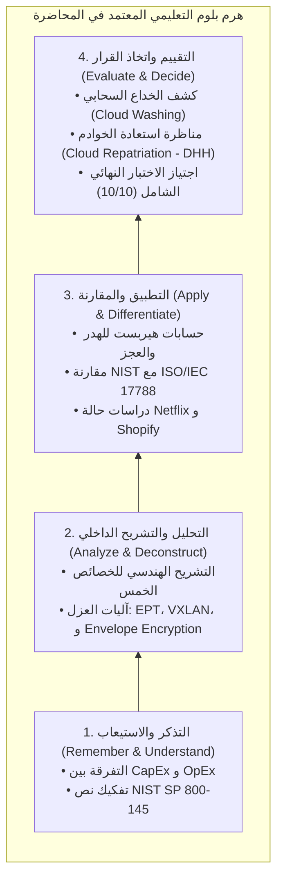

---

### جدول تجزئة الوحدات التعليمية (Module Scaffolding Matrix)

| الوحدة التعليمية (Module) | المخرجات السلوكية المستهدفة (Behavioral Learning Objectives) | المدة التقديرية | المستوى في هرم بلوم | الاستراتيجية التعليمية والوسائط التفاعلية |
|:---|:---|:---:|:---:|:---|
| **Module 1: سيناريو الانهيار والتحول الاقتصادي (The Hook & Economics)** | أن يشخص الطالب أسباب انهيار متجر NovaTech، ويقارن بدقة بين نموذجي CapEx و OpEx موضحاً أثر كل منهما على المخاطر التشغيلية. | 15 دقيقة | الفهم والتحليل (Understanding & Analysis) | دراسة حالة قصصية محفزة + مخطط مقارنة انسيابي + حاسبة CapEx vs OpEx التفاعلية. |
| **Module 2: التعريف المعياري وركائز NIST (NIST Foundation)** | أن يفكك الطالب النص المعياري لوثيقة NIST SP 800-145 إلى أركانه الأربعة الأساسية ويميّز شروط الحوسبة السحابية الحقيقية. | 12 دقيقة | التذكر والفهم (Remembering & Comprehension) | خريطة مفاهيمية ذهنية (Mindmap) + بطاقات مصطلحات عائمة (Tooltips) + فحص ذاتي Checkpoint 1. |
| **Module 3: التشريح الهندسي للخصائص الخمس (5 Essential Characteristics)** | أن يحلل الطالب كلاً من الخصائص الخمس وفق إطار SECOD المعتمد، ويوضح آلية عمل محرك الـ Orchestration واستقلالية المنصات. | 25 دقيقة | التحليل المعمق (Deep Analysis) | مخططات تدفق تفاعلية + كود Terraform تطبيقي + فحص ذاتي Checkpoint 2. |
| **Module 4: الغوص في الآليات الخفية والعزل (Under the Hood: Isolation Fabrics)** | أن يشرح الطالب كيفية تحقيق العزل المنطقي للذاكرة عبر EPT، وللشبكات عبر 24-bit VNI في VXLAN، وللتخزين عبر تشفير الأظرف KMS. | 20 دقيقة | التحليل والتركيب (Analysis & Synthesis) | مخطط معماري متعدد الطبقات للـ Nitro و EPT + تدفق تشفير الأظرف + فحص ذاتي Checkpoint 3. |
| **Module 5: النماذج الرياضية وجداول المقارنة المعيارية (Mathematical Matrices)** | أن يحسب الطالب رياضياً قيم الهدر $W(t)$ والعجز $S(t)$ وفق نموذج Herbst et al.، ويفسر سبب إفراد معيار ISO لخاصية Multi-tenancy. | 18 دقيقة | التطبيق الرياضي (Mathematical Application) | محاكي تفاعلي للمرونة التلقائية (Autoscaling Simulator) + جدول مقارنة ISO vs NIST + فحص Checkpoint 4. |
| **Module 6: دراسات الحالة والجدل التقني المعاصر (Case Studies & Repatriation)** | أن يستخلص الطالب الدروس المعمارية من تجربة Netflix و Shopify، ويوازن بموضوعية بين خياري السحابة واستعادة الخوادم (Cloud Repatriation). | 15 دقيقة | التقييم والنقد المعماري (Architectural Evaluation) | مخطط زمني (Timeline) لتحول Netflix + تحليل جدوى TCO لتجربة 37signals (DHH). |
| **Module 7: مختبر كشف الخداع السحابي (Cloud Washing Detective Lab)** | أن يفحص الطالب عروض شركات الاستضافة التجارية ويكتشف الخداع السحابي عبر تطبيق مصفوفة الفحص ذات المحاور الخمسة. | 15 دقيقة | التقييم والتشخيص العملي (Forensic Evaluation) | مختبر تفاعلي جنائي للتحقيق في العروض التجارية (Cloud Washing Inspector) + فحص Checkpoint 5. |
| **Module 8: التقويم الختامي المعتمد (Comprehensive Final Assessment)** | أن يجتاز الطالب الاختبار المعياري الشامل (10 أسئلة متدرجة تقيس التحليل والتطبيق) بدرجة 80% فأعلى مع مراجعة التعليلات. | 15 دقيقة | القياس والتقويم الشامل (Comprehensive Assessment) | محرك كويز SECOD التفاعلي (`quiz.js`) + حفظ النتائج محلياً وتغذية راجعة فورية ومعللة. |

---

### مسار التعلم المرئي ومؤشرات التقدم (Visual Flow & Navigation Milestones)

1. **شريط تقدم القراءة (Sticky Reading Progress Bar):**
   - تثبيت شريط علوي خفيف بارتفاع 3px بلون التوهج السياني (`var(--accent): #00F6E4`) يتفاعل ديناميكياً مع نسبة التمرير في الصفحة.
2. **شريط التنقل الجانبي الذكي (Floating Module Index):**
   - يتيح للطالب القفز المباشر بين الوحدات الثماني، مع إبراز الوحدة النشطة حالياً (Active Section Indicator) وتحديد مؤشرات إنجاز خضراء عند إتمام قراءة كل وحدة.
3. **فواصل الراحة الذهنية (Cognitive Pauses):**
   - إدراج بطاقات اقتباس ذهبية ملهمة ومربعات تحقق ذاتي سريعة كل 1,000 كلمة لمنع الإجهاد المعرفي (Cognitive Overload).

---

## 2. توصيف المخططات والرسوم المرئية (Diagram & Visual Specs)

تم تصميم كافة المخططات بأكواد Mermaid الدلالية القياسية لتعمل مباشرة في بيئة العرض، مع توجيه دقيق للرموز لتلائم العرض ثنائي الاتجاه (RTL) والألوان المتوافقة مع نسق الوضعين الليلي والنهاري لمنصة SECOD.

---

### المخطط 1: مأزق مراكز البيانات التقليدية مقابل الحل السحابي المرن
- **الموضع الاستراتيجي:** ختام القسم 1.1 بعد سيناريو انهيار NovaTech.
- **الهدف التعليمي:** إبراز الفارق بين العجز الهندسي للمراكز التقليدية في مواكبة طفرات الترافيك وبين استجابة السحابة اللحظية.
- **النوع:** Mermaid Flowchart TD.
- **الكود المعتمد الجاهز للتنفيذ:**

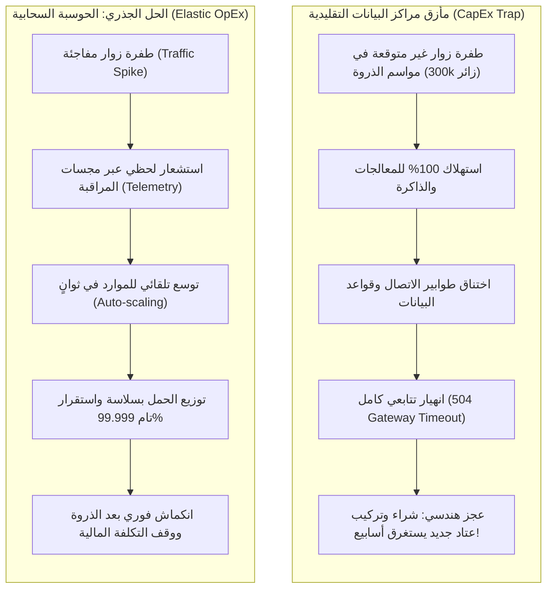

---

### المخطط 2: التحول المالي الهندسي بين CapEx و OpEx
- **الموضع الاستراتيجي:** في القسم 2.1 عند مقارنة النماذج الاقتصادية.
- **الهدف التعليمي:** توضيح تحول الدورة المالية من استثمارات عتادية جامدة مسبقة الدفع إلى نفقات تشغيلية مرنة حسب الاستخدام.
- **النوع:** Mermaid Flowchart LR.
- **الكود المعتمد الجاهز للتنفيذ:**

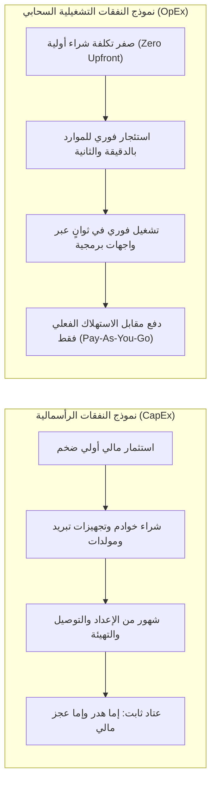

---

### المخطط 3: خريطة المعالم الخمسة الجوهرية (NIST SP 800-145 Mindmap)
- **الموضع الاستراتيجي:** تمهيد القسم 3 قبل تفكيك الخصائص.
- **الهدف التعليمي:** إعطاء نظرة شمولية بصرية للخصائص الخمس ومفرداتها التقنية الفرعية.
- **النوع:** Mermaid Mindmap.
- **الكود المعتمد الجاهز للتنفيذ:**

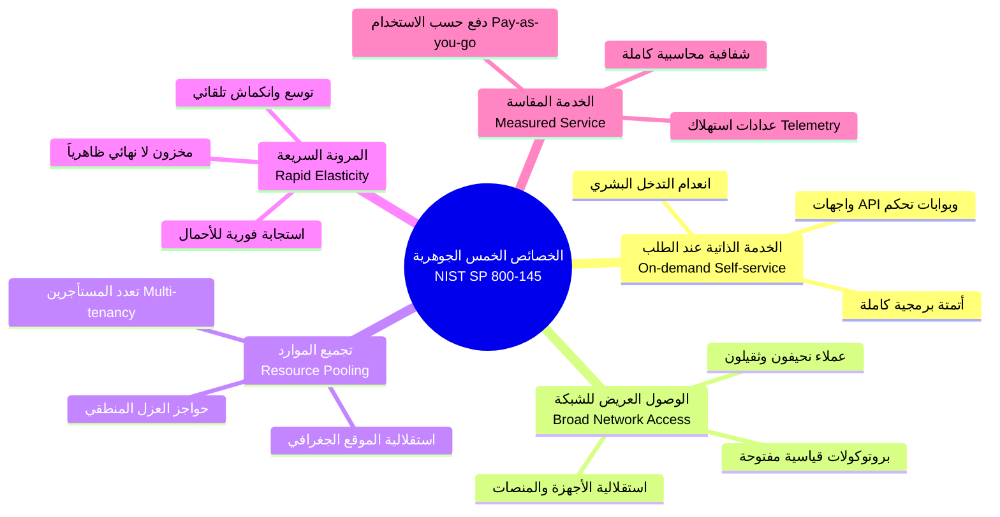

---

### المخطط 4: التدفق التسلسلي لأتمتة الخدمة الذاتية عند الطلب
- **الموضع الاستراتيجي:** داخل الخاصية الأولى (الخدمة الذاتية عند الطلب) في القسم 3.
- **الهدف التعليمي:** إيضاح كيفية انتقال الأمر البرمجي من المطور إلى محرك التنظيم والمشرف الافتراضي دون تدخل أي موظف بشري.
- **النوع:** Mermaid Sequence Diagram.
- **الكود المعتمد الجاهز للتنفيذ:**

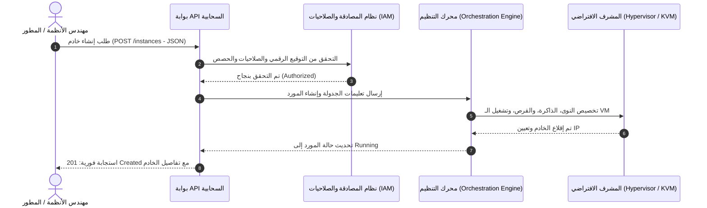

---

### المخطط 5: استقلالية المنصات والوصول العريض المفتوح
- **الموضع الاستراتيجي:** داخل الخاصية الثانية (الوصول العريض للشبكة) في القسم 3.
- **الهدف التعليمي:** بيان تجريد طبقة العرض والعملاء غير المتجانسين واستخدام المعايير المفتوحة للوصول إلى الحوسبة السحابية.
- **النوع:** Mermaid Graph LR.
- **الكود المعتمد الجاهز للتنفيذ:**

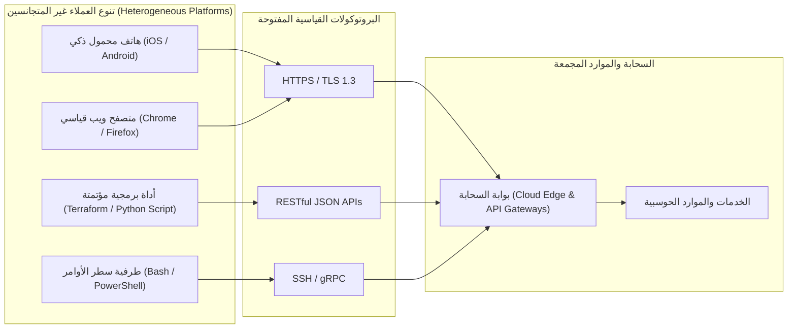

---

### المخطط 6: معمارية تجميع الموارد وتعدد المستأجرين المعزول
- **الموضع الاستراتيجي:** داخل الخاصية الثالثة (تجميع الموارد) في القسم 3.
- **الهدف التعليمي:** إبراز كيفية تغذية مجمع العتاد الفيزيائي المشترك لمستأجرين افتراضيين معزولين تماماً داخل بيئات VPC خاصة.
- **النوع:** Mermaid Flowchart TD.
- **الكود المعتمد الجاهز للتنفيذ:**

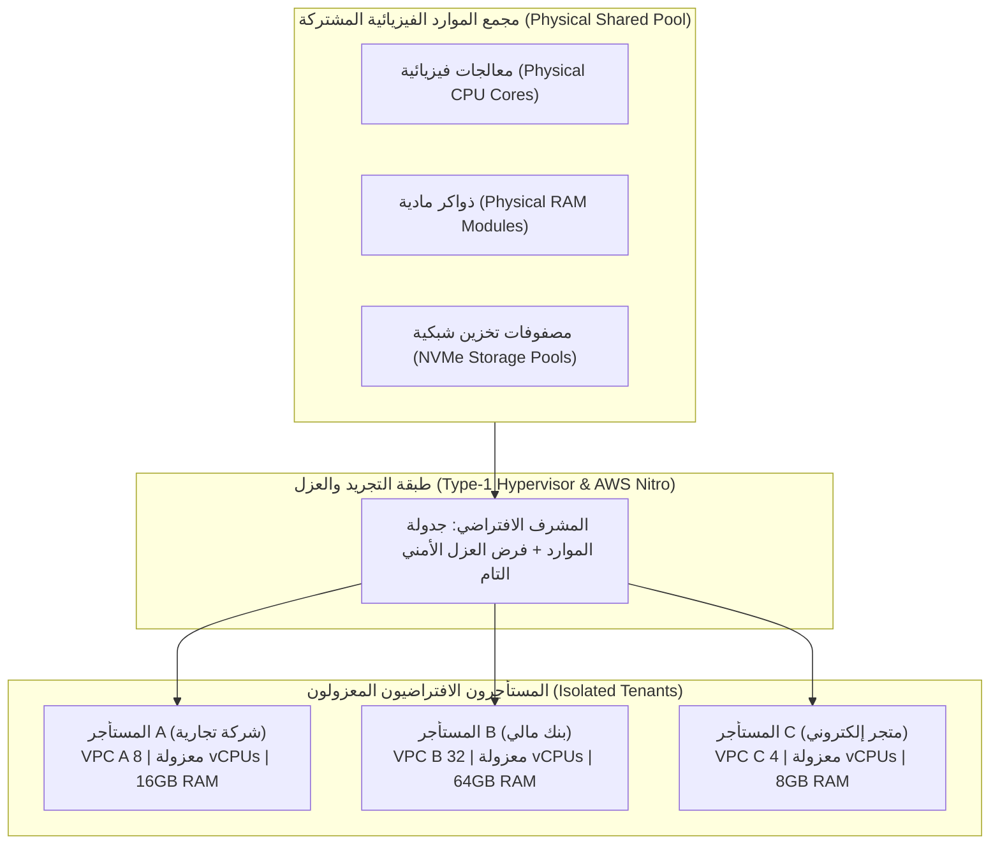

---

### المخطط 7: حلقة المراقبة والتوسع التلقائي للمرونة السريعة
- **الموضع الاستراتيجي:** داخل الخاصية الرابعة (المرونة السريعة) في القسم 3.
- **الهدف التعليمي:** تشريح حلقة التغذية الراجعة المغلقة بين مؤشرات الأداء الحيوية (CloudWatch) ومجموعات التوسع وموازن الأحمال.
- **النوع:** Mermaid Graph TD.
- **الكود المعتمد الجاهز للتنفيذ:**

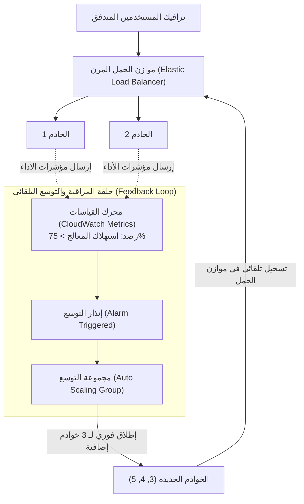

---

### المخطط 8: مسار قياس واستهلاك الخدمة المقاسة والفوترة
- **الموضع الاستراتيجي:** داخل الخاصية الخامسة (الخدمة المقاسة) في القسم 3.
- **الهدف التعليمي:** تتبع رحلة أحداث التيليميتر من المشرف الافتراضي حتى لوحة تحكم FinOps والميزانية.
- **النوع:** Mermaid Flowchart LR.
- **الكود المعتمد الجاهز للتنفيذ:**


---

### المخطط 9: المستويات الثلاثة للعزل التقني العميق (Under the Hood)
- **الموضع الاستراتيجي:** في القسم 4.1 لبيان تحصينات الأمان في العتاد والشبكات.
- **الهدف التعليمي:** إيضاح آليات منع الهروب من الآلات الافتراضية وفصل الذاكرة والشبكات عبر معيار RFC 7348.
- **النوع:** Mermaid Flowchart TD.
- **الكود المعتمد الجاهز للتنفيذ:**

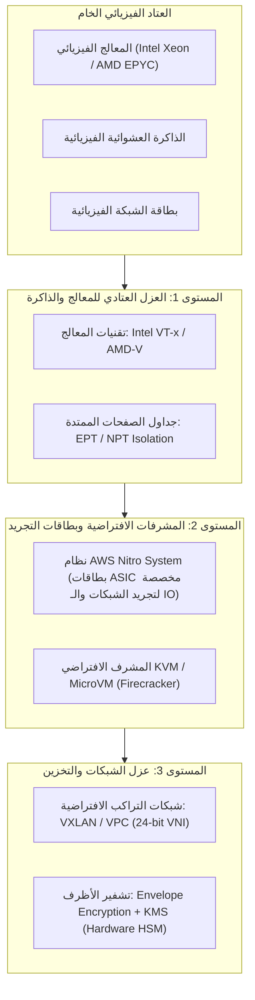

---

### المخطط 10: آلية تشفير الأظرف وتأمين وسائط التخزين السحابية (Envelope Encryption)
- **الموضع الاستراتيجي:** في القسم 4.3 لتوضيح حماية البيانات الساكنة.
- **الهدف التعليمي:** توضيح دور مفتاح البيانات DEK ومفتاح الجذر KEK داخل وحدات الأمان العتادية HSM.
- **النوع:** Mermaid Flowchart TD.
- **الكود المعتمد الجاهز للتنفيذ:**

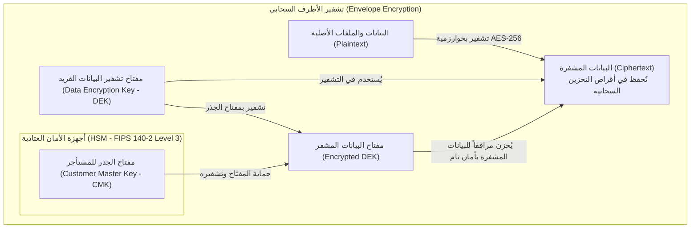

---

### المخطط 11: الفارق المفاهيمي بين المرونة وقابلية التوسع (Herbst et al.)
- **الموضع الاستراتيجي:** في القسم 5.2 عند التمييز بين المفهومين.
- **الهدف التعليمي:** ترسيخ أن التوسع قدرة معمارية هيكلية بينما المرونة تكيف لحظي آني مقترن بالزمن.
- **النوع:** Mermaid Flowchart TD.
- **الكود المعتمد الجاهز للتنفيذ:**

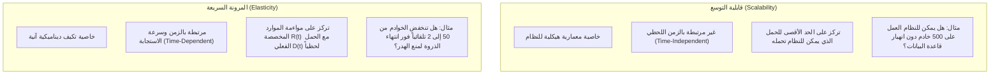

---

### المخطط 12: الخط الزمني لتحول Netflix المعماري وهندسة الفوضى
- **الموضع الاستراتيجي:** في القسم 6.1 عند استعراض دراسة حالة Netflix.
- **الهدف التعليمي:** إظهار المحطات الحاسمة من انهيار الـ SAN عام 2008 حتى إطلاق Chaos Monkey والتحول الكامل في 2016.
- **النوع:** Mermaid Timeline.
- **الكود المعتمد الجاهز للتنفيذ:**

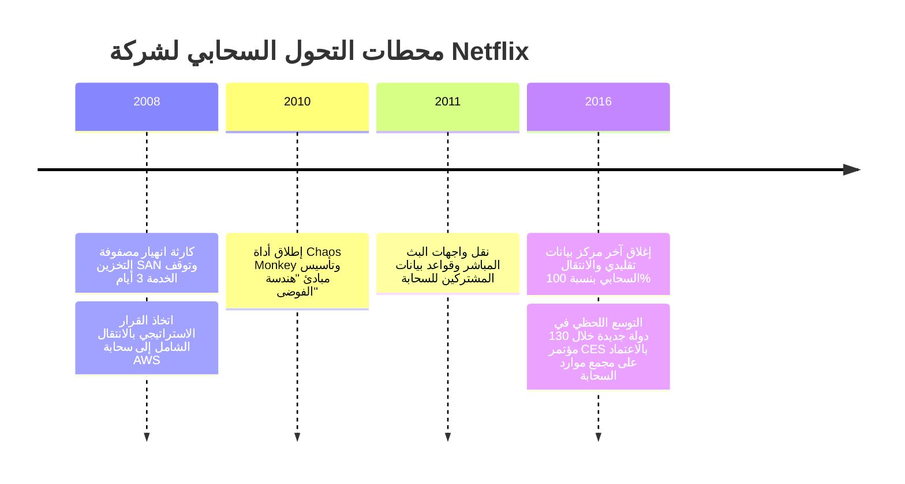

---

## 3. مواصفات المحاكيات والأدوات التفاعلية (Interactive Widgets & Simulators)

تلتزم الأدوات التفاعلية بفلسفة Vanilla JavaScript الصارمة لمنصة SECOD دون أي مكتبات خارجية، وتعتمد في تصميمها على متغيرات التصميم الرسمية في `variables.css`.

---

### الأداة التفاعلية 1: محاكي المرونة التلقائية وهندسة التوسع (Autoscaling & Elasticity Simulator)

- **المعرف التقني للمكون (DOM ID):** `#autoscaling-simulator-widget`
- **الهدف التعليمي:**
  تمكين الطالب من تجربة أثر تقلبات حركة المرور (Traffic Spikes) في الوقت الفعلي ومقارنة سلوك النظام بين بنيتين: (1) خوادم فيزيائية ثابتة (Fixed Hardware)، و(2) سحابة مرنة ذاتية التوسع (Elastic Cloud Auto-scaling)، وتطبيق معادلات هيربست ($R(t)$ مقابل $D(t)$) لملاحظة الهدر والعجز والانهيار.

- **عناصر تحكم ومدخلات المستخدم (User Controls):**
  1. **شريط تمرير معدل الطلبات اللحظية (Traffic Demand Slider):**
     - المدى: من $1,000$ إلى $100,000$ طلب بالثانية (req/sec).
     - القيمة الافتراضية: $10,000$ req/sec.
     - الخطوة (Step): $5,000$.
  2. **مفتاح اختيار النمط المعماري (Architecture Mode Toggle):**
     - الخيار أ: `نموذج البنية الثابتة التقليدي (Fixed 4 Servers - On-Premises)`
     - الخيار ب: `نموذج السحابة المرنة التلقائية (Elastic Auto-scaling: Min 2, Max 20)`
  3. **زر طفرة الجمعة السوداء السريعة (Instant Black Friday Spike Button):**
     - عند النقر، يقفز الترافيك فوراً إلى $85,000$ req/sec لاختبار قدرة التحمل.
  4. **زر إعادة الضبط (Reset Simulation).**

- **المعادلات والحسابات البرمجية اللحظية (Underlying Logic):**
  - طاقة استيعاب الخادم الواحد: $5,000$ طلب في الثانية عند نسبة استهلاك معالج $80\%$.
  - في **النموذج الثابت**:
    - سعة المعالجة الكلية الثابتة = $4 \times 5,000 = 20,000$ req/sec.
    - إذا كان الترافيك $D(t) \le 20,000$: استهلاك المعالج $= \frac{D(t)}{20,000} \times 80\%$.
    - الهدر المالي $W(t)$: إذا كان $D(t) = 2,000$ req/sec، تكون 3 خوادم تعمل دون أي فائدة وهدر بنسبة 75%!
    - إذا تجاوز الترافيك $20,000$ req/sec: يقفز استهلاك المعالج إلى $100\%$، وترتفع نسبة الأخطاء لتصل إلى انهيار كامل ورسالة `HTTP 504 Gateway Timeout`، وتتوقف الخدمة!
  - في **النموذج السحابي المرن**:
    - عدد الخوادم المطلوبة ديناميكياً: $N(t) = \max\left(2, \min\left(20, \lceil \frac{D(t)}{4,000} \rceil\right)\right)$.
    - يتم توليد الخوادم الجديدة تلقائياً، وتثبيت استهلاك المعالج حول المعدل الصحي ($50\% - 70\%$).
    - نسبة نجاح العمليات تظل $99.999\%$.
    - التكلفة المالية: تُحسب بالساعة ديناميكياً بواقع $0.05$$ لكل خادم نشط.

- **المخرجات المرئية وشاشات المراقبة (Visual Outputs):**
  1. **شبكة العقد والخوادم المرئية (Server Cluster Visualizer):**
     - أيقونات خوادم ديناميكية يتغير لونها (أخضر = طبيعي، برتقالي = ضغط، أحمر نابض = انهيار 100%، رمادي = مطفأ وموفر للمال).
  2. **مؤشر استهلاك المعالج (CPU Load Gauge Bar):**
     - شريط تقدم ملون يتغير ديناميكياً مع النسبة المئوية.
  3. **عداد الفاتورة اللحظية (Real-Time Cost Ticker):**
     - عداد يوضح التكلفة التقديرية بالدولار للساعة الواحدة.
  4. **شريط الحالة والتشخيص الهندسي (Status Alert Banner):**
     - يعرض إما:
       - `✅ النظام مستقر تماماً (متزن مع الطلب - Perfect Elastic Match)`.
       - `⚠️ حالة هدر مالي (Over-provisioning Waste: خوادم خاملة تلتهم الميزانية)`.
       - `🚨 انهيار النظام! (Under-provisioning Shortage: 504 Gateway Timeout - خسائر تجارية!)`.

---

### الأداة التفاعلية 2: مختبر كشف الخداع السحابي (Interactive Cloud Washing Detective Lab)

- **المعرف التقني للمكون (DOM ID):** `#cloudwashing-detective-widget`
- **الهدف التعليمي:**
  تدريب الطالب عملياً على دور مهندس استشارات سحابية يقوم بفحص عروض شركات الاستضافة التجارية وتشخيص ما إذا كانت سحابة حقيقية متوافقة مع NIST SP 800-145 أم مجرد "خداع سحابي" (Cloud Washed)، من خلال اختبار الخصائص الخمس.

- **السيناريوهات الجنائية التفاعلية المضمنة:**
  1. **السيناريو 1: عرض شركة "استضافة الفهد السريعة" (FastHost):**
     - العرض: "خادم سحابي بـ 15$ شهرياً، تفعيل خلال 3 ساعات عبر تذكرة دعم، ترقية الخطة تتطلب إيقاف الخادم وسداد الفارق مسبقاً، وصول عبر بروتوكول Remote Desktop فقط، ودفع سنوي ثابت."
  2. **السيناريو 2: منصة "داتافلو" لقواعد البيانات المدارة (DataFlow DB):**
     - العرض: "إنشاء قاعدة بيانات بطلب CLI واحد، تدعم التوسع التلقائي بإضافة Read Replicas عند ارتفاع الترافيك، فوترة بالمللي ثانية وملايين العمليات، مع بوابات API قياسية."
  3. **السيناريو 3: "خدمة التخزين الموزع الحديثة" (Modern Storage Corp):**
     - العرض: "مساحة تخزين ضخمة، ولكن تتطلب تثبيت برنامج تشغيلي محتكر يعمل على نظام Windows Server فقط، وتتطلب توقيع عقد فيزيائي لحجز مساحة خاصة في رف محدد داخل مركز البيانات."

- **آلية التفاعل (User Interaction Flow):**
  1. يختار الطالب السيناريو المراد فحصه من قائمة التبويبات (Case Tabs).
  2. تظهر تفاصيل العرض التقني والتشغيلي.
  3. يقوم الطالب بتحديد حالة توافر كل خاصية من الخصائص الخمس عبر مفاتيح اختيار (Checklist Toggles: متوفرة ✅ / منتهكة ❌):
     - [ ] الخدمة الذاتية عند الطلب (On-demand Self-service)
     - [ ] الوصول العريض للشبكة (Broad Network Access)
     - [ ] تجميع الموارد وتعدد المستأجرين (Resource Pooling)
     - [ ] المرونة السريعة (Rapid Elasticity)
     - [ ] الخدمة المقاسة والدفع حسب الاستهلاك (Measured Service)
  4. ينقر الطالب على زر: **"تشغيل الفحص الجنائي وإصدار الحكم (Run Forensic Audit)"**.

- **المخرجات المرئية والتغذية الراجعة:**
  - عرض بطاقة التقييم النهائي متضمنة:
    - **درجة المطابقة لمعيار NIST:** (مثلاً: 20% أو 100%).
    - **الحكم النهائي:** شارة حمراء `🚨 خداع سحابي فاضح (Cloud Washed)` أو شارة خضراء `🌟 سحابة حقيقية معتمدة (Genuine Cloud)`.
    - **التقرير الهندسي المفصل:** تفنيد علمي يشرح لماذا العرض مخادع، والبنود التي انتهكت صراحة معايير NIST.

---

### الأداة التفاعلية 3: حاسبة التحول الاقتصادي TCO (CapEx vs OpEx Calculator)

- **المعرف التقني للمكون (DOM ID):** `#capex-opex-calculator-widget`
- **الهدف التعليمي:**
  مساعدة الطالب على فهم الجدوى الاقتصادية للانتقال السحابي وحساب التكلفة الإجمالية للملكية (TCO) ومقارنة متى تكون السحابة أوفر، ومتى تبرر الشركات الكبرى استعادة خوادمها (Cloud Repatriation).

- **المدخلات:**
  - عدد الخوادم المكافئة المطلوبة (من 2 إلى 100 خادم).
  - مدة المشروع (سنة واحدة، سنتان، 3 سنوات).
  - طبيعة نمط العمل (Workload Pattern): متقلب بمواسم ذروة (Variable with Peaks) أو مستقر تماماً 24/7 (Steady State).
- **المخرجات التفاعلية:**
  - رسم بياني شريطي مقارن (Bar Comparison) بين تكلفة CapEx (شراء + تبريد + كهرباء + صيانة دورية) وتكلفة OpEx السحابية.
  - إظهار "نقطة التعادل المالي" (Break-even Point) مع نصيحة استشارية توجه الطالب لفلسفة دراسة حالة Netflix و 37signals (DHH).

---

## 4. نقاط التحقق الذاتي أثناء الشرح (In-line Knowledge Checks)

توضع نقاط التحقق الذاتي في مواقع استراتيجية لكسر رتابة القراءة وضمان التغذية الراجعة الفورية (Immediate Formative Feedback).

---

### 🧠 Checkpoint 1 (بعد القسم 2: التحول الاقتصادي وتعريف NIST)
- **الموضع:** ختام القسم 2.3.
- **نص السؤال:**
  قررت إحدى المنشآت استبدال خوادمها الداخلية بخوادم سحابية. أي من العبارات التالية تصف التغير المالي بدقة؟
  - أ) تحول التكاليف من نفقات تشغيلية (OpEx) متغيرة إلى نفقات رأسمالية (CapEx) ثابتة.
  - ب) تحول التكاليف من نفقات رأسمالية (CapEx) مسبقة الدفع إلى نفقات تشغيلية (OpEx) تُدفع حسب الاستهلاك. [الإجابة الصحيحة]
  - ج) انعدام التكاليف التشغيلية تماماً والاعتماد فقط على شراء أصول ثابتة.
  - د) بقاء نموذج التكاليف متطابقاً دون أي تغيير محاسبي أو هندسي.
- **التغذية الراجعة الفورية المعتمدة:**
  - **عند الإجابة الصحيحة (ب):** `✅ أحسنت! الحوسبة السحابية تقضي على الاستثمارات الأولية الضخمة (CapEx) في العتاد والمباني والتبريد، وتستبدلها بنفقات تشغيلية دورية ومرنة (OpEx) ترتبط مباشرة بحجم الاستهلاك الفعلي للموارد.`
  - **عند الإجابة الخاطئة:** `❌ تذكر دائماً: CapEx تعني شراء الأصول مقدماً وتجميد رؤوس الأموال، بينما OpEx تعني دفع مصاريف التشغيل المرنة كخدمة يومية (Pay-as-you-go).`

---

### 🧠 Checkpoint 2 (بعد تفكيك الخدمة الذاتية والوصول العريض)
- **الموضع:** بعد شرح الخاصية الثانية في القسم 3.
- **نص السؤال:**
  قام مهندس بطلب خادم عبر بوابة الويب لشركة استضافة، فظهرت له رسالة: "تم استلام طلبك وبانتظار موافقة مدير الحسابات وتفعيل مهندس النظم خلال 4 ساعات". هل تمثل هذه الخدمة "خدمة ذاتية عند الطلب" بمعايير NIST؟
  - أ) نعم؛ لأن الطلب تم عبر متصفح الويب وليس بالحضور الشخصي.
  - ب) نعم؛ لأن فترة الانتظار 4 ساعات تعتبر فترة قصيرة جداً مقارنة بالاستضافة التقليدية.
  - ج) لا؛ لأنها تشترط تدخلاً بشرياً وموافقة يدوية وتفتقر للأتمتة البرمجية الكاملة عبر الـ APIs. [الإجابة الصحيحة]
  - د) لا؛ لأن الخدمة الذاتية تتطلب حصراً استخدام سطر الأوامر (CLI) وتمنع واجهات الويب.
- **التغذية الراجعة الفورية المعتمدة:**
  - **عند الإجابة الصحيحة (ج):** `✅ رائع! ينص معيار NIST صراحة على أن توفير الموارد يجب أن يتم آلياً من جانب المستهلك وبأدنى تفاعل بشري مع مزود الخدمة (Minimal service provider interaction). وجود تذاكر وموظفين بشريين في مسار التوفير ينفي صفة الخدمة الذاتية السحابية.`

---

### 🧠 Checkpoint 3 (بعد تجميع الموارد وتقنيات العزل EPT و VXLAN)
- **الموضع:** ختام القسم 4.2.
- **نص السؤال:**
  ما هي الآلية الهندسية التي تمنع خادماً افتراضياً لمستأجر معين من قراءة الذاكرة الفيزيائية المخصصة لخادم مستأجر آخر يتشارك معه نفس اللوحة الأم والمعالج؟
  - أ) جداول الصفحات الممتدة (EPT / NPT) المدعومة عتادياً بالمعالج والتي تطلق Hardware Fault عند أي تعدٍ. [الإجابة الصحيحة]
  - ب) بروتوكول نقل الملفات الآمن (SFTP) المطبق على القرص الصلب.
  - ج) تقنية تشفير كابلات الألياف الضوئية داخل مركز البيانات.
  - د) جدار الحماية البرمجي لنظام التشغيل الضيف (Guest OS Firewall).
- **التغذية الراجعة الفورية المعتمدة:**
  - **عند الإجابة الصحيحة (أ):** `✅ إجابة هندسية دقيقة! تعتمد طبقة المشرف الافتراضي على ميزات المعالج الفيزيائي (Intel VT-x / AMD-V) وجداول الصفحات الممتدة (Extended Page Tables) لعزل خريطة الذاكرة لكل آلة افتراضية؛ وأي محاولة وصول غير مصرح بها خارج النطاق تسفر عن اعتراض عتادي فوري يسقطه المعالج.`

---

### 🧠 Checkpoint 4 (بعد المرونة والخدمة المقاسة ومعادلات Herbst et al.)
- **الموضع:** ختام القسم 5.2.
- **نص السؤال:**
  إذا كان الطلب الفعلي على نظام حوسبي في لحظة معينة $D(t) = 10 \text{ vCPUs}$، بينما كان النظام يخصص عتاداً ثابتاً $R(t) = 50 \text{ vCPUs}$. كيف يصنف هذا الوضع وفق معادلات Herbst et al.؟
  - أ) حالة عجز حوسبي خطير (Under-provisioning Shortage).
  - ب) حالة توفير زائد مهدِر (Over-provisioning Waste) بقيمة هدر تبلغ 40 vCPUs. [الإجابة الصحيحة]
  - ج) حالة مرونة مثالية وتطابق تام بين الطلب والموارد.
  - د) حالة انهيار تتابعي للخدمة وظهور الخطأ 504.
- **التغذية الراجعة الفورية المعتمدة:**
  - **عند الإجابة الصحيحة (ب):** `✅ حساب رياضي سليم! بما أن $R(t) > D(t)$، فإن النظام يعاني من Over-provisioning، وتكون قيمة الهدر المالي $W(t) = 50 - 10 = 40 \text{ vCPUs}$ تعمل خاملة وتكلف المنشأة نفقات غير مبررة.`

---

### 🧠 Checkpoint 5 (بعد مقارنة NIST مع ISO ومختبر كشف الخداع السحابي)
- **الموضع:** ختام القسم 7.3.
- **نص السؤال:**
  لماذا أفرد المعيار الدولي ISO/IEC 17788:2014 خاصية "تعدد المستأجرين" (Multi-tenancy) كخاصية سادسة مستقلة بينما دمجها NIST ضمن "تجميع الموارد"؟
  - أ) لأن معيار ISO يركز على التطبيقات المجانية فقط.
  - ب) للتأكيد على أن تجميع الموارد قد يحدث داخل مؤسسة واحدة لعميل منفرد، بينما تعدد المستأجرين يفرض التزاماً معمارياً وقانونياً صارماً بحواجز العزل الأمني بين عملاء مستقلين متنافسين. [الإجابة الصحيحة]
  - ج) لأن معيار NIST ألغى مفهوم العزل الأمني في التحديثات اللاحقة.
  - د) لا يوجد أي فرق، وهو مجرد اختلاف في الترجمة اللغوية دون أي مبرر تقني.
- **التغذية الراجعة الفورية المعتمدة:**
  - **عند الإجابة الصحيحة (ب):** `✅ تحليل أكاديمي رفيع! أدركت منظمة ISO أن Resource Pooling قد يتحقق تقنياً دون وجود مستأجرين متعددين، بينما Multi-tenancy تفرض معمارياً وقانونياً تشفير البيانات، وفصل الشبكات (VXLAN)، ومنع تسرب الذاكرة بين كيانات ومؤسسات مختلفة تتشارك نفس العتاد.`

---

## 5. بنك بيانات الاختبار النهائي المعتمد (10-Question Standard Quiz Data)

تم تصميم هذا البنك وفق المواصفات القياسية الصارمة لمنصة SECOD:
- 10 أسئلة تخصصية تقيس المستويات العليا لهرم بلوم (التحليل، التطبيق، والمقارنة النقدية).
- 4 خيارات لكل سؤال (خيار صحيح وثلاثة مشتتات واقعية وذكية).
- كائن JavaScript نقي تماماً تحت اسم `quizData` متوافق بنسبة 100% مع محرك `initLectureQuiz(quizData, 'quiz_cloud_lec01', 'quiz-app')` المعتمد في `assets/js/quiz.js`.
- تفسير علمي دقيق ومعلل (`explanation`) يثبت صحة الإجابة ويفند المشتتات الخاطئة.

```javascript
/**
 * بنك أسئلة الاختبار النهائي المعتمد - المحاضرة 01: أساسيات الحوسبة السحابية
 * متوافق تماماً مع محرك initLectureQuiz() في SECOD (assets/js/quiz.js)
 */
const quizData = [
    {
        question: "1. وفق وثيقة المعهد الوطني الأمريكي للمعايير والتقنية (NIST SP 800-145)، ما هو الشرط الجوهري لكي يُصنف توفير الموارد الحوسبية على أنه «خدمة ذاتية عند الطلب» (On-Demand Self-Service)؟",
        options: [
            "أن يتم شراء الخوادم عبر متجر إلكتروني مع تسليمها خلال يومي عمل.",
            "أن يستطيع المستهلك حجز الموارد وإطلاقها آلياً وفورياً عبر واجهات برمجية دون اشتراط أي تفاعل بشري مع مزود الخدمة.",
            "أن يتوفر فريق دعم فني يعمل على مدار الساعة لاستقبال طلبات ترقية العتاد يدوياً عبر الهاتف.",
            "أن تكون لوحة التحكم متوافقة حصراً مع نظام تشغيل محدد لضمان الأمان العالي."
        ],
        correct: 1,
        explanation: "ينص معيار NIST SP 800-145 حرفياً على أن الخدمة الذاتية عند الطلب تعني قدرة المستهلك على توفير إمكانيات الحوسبة من جانب واحد وبصورة آلية، مثل وقت المعالجة ومساحة التخزين، دون الحاجة لأي تفاعل بشري (Minimal service provider interaction)؛ بينما تتطلب الخيارات الأخرى تدخلاً بشرياً أو قنوات يدوية تنفي صفة الأتمتة السحابية الأصيلة."
    },
    {
        question: "2. في التحليل المالي والهندسي للبنية التحتية، ما هو الأثر المعماري المباشر لتحول الإنفاق من النفقات الرأسمالية (CapEx) إلى النفقات التشغيلية (OpEx) في الحوسبة السحابية؟",
        options: [
            "إجبار المؤسسة على تجميد أصول مالية ضخمة مقدماً لشراء أجهزة التبريد والمولدات الاحتياطية.",
            "تحويل تكاليف البنية التحتية إلى دفعات مرنة ترتبط خطياً بالاستهلاك الفعلي (Pay-as-you-go) مع القضاء على مخاطر العتاد المتقادم والمهدر.",
            "زيادة التكاليف الثابتة غير القابلة للتغيير على مدى 5 سنوات بصورة دورية وإلزامية.",
            "تحمل المؤسسة مسؤولية استبدال اللوحات الأم ومحركات الأقراص التالفة في مراكز بيانات المزود."
        ],
        correct: 1,
        explanation: "يتميز نموذج OpEx السحابي بتحويل تكلفة البنية التحتية من استثمارات رأسمالية أولية ضخمة (CapEx) تتآكل قيمتها مع الزمن إلى تكاليف تشغيلية يومية وشهرية مرنة تدفع فيها المؤسسة مقابل ما تستهلكه فقط، مما يزيل مخاطر التوفير الزائد وهدر الموارد، بينما شراء المعدات وصيانتها يمثل صلب نموذج CapEx التقليدي."
    },
    {
        question: "3. كيف تضمن معمارية تجميع الموارد (Resource Pooling) حماية البيانات ومنع تسربها بين المستأجرين المتشاركين لنفس المعالج والذاكرة الفيزيائية على مستوى العتاد؟",
        options: [
            "بالاعتماد على سياسات الثقة المتبادلة وعدم تشغيل خوادم شركات متنافسة في نفس اليوم.",
            "باستخدام ميزات العزل العتادي في المعالجات مثل جداول الصفحات الممتدة (EPT/NPT) التي تسقط أي محاولة للوصول إلى ذاكرة خارج النطاق باعتراض عتادي فوري.",
            "بدمج أنظمة التشغيل في نظام واحد مشترك وتطبيق صلاحيات الملفات القياسية (chmod 777).",
            "بفصل اتصال الخوادم عن شبكة الإنترنت واستخدام وسائط التخزين اليدوية للنقل."
        ],
        correct: 1,
        explanation: "يتحقق عزل الذاكرة في البيئات متعددة المستأجرين (Multi-tenancy) عبر تقنيات المحاكاة الافتراضية المدعومة بالعتاد (Hardware-assisted virtualization مثل Intel EPT أو AMD NPT)؛ حيث يتحكم المشرف الافتراضي في ترجمة العناوين ويمنع أي نظام ضيف من قراءة أو كتابة أي بايت خارج جدوله الفيزيائي، مما يجعل تسرب الذاكرة مستحيلاً حتى لو تشارك مستأجران نفس شريحة الذاكرة."
    },
    {
        question: "4. ما هي الميزة الهندسية الحاسمة لبروتوكول شبكات التراكب VXLAN (RFC 7348) مقارنة بشبكات VLAN التقليدية في تحقيق العزل الشبكي السحابي؟",
        options: [
            "استخدام معرّف شبكة بطول 24-bit يتيح إنشاء نحو 16.7 مليون شبكة افتراضية معزولة مقارنة بـ 4,096 شبكة فقط في VLAN.",
            "إلغاء الحاجة إلى استخدام عناوين IP والاعتماد حصراً على أسماء النطاقات.",
            "قصر حركة البيانات على الشبكات السلكية المحلية ومنع مرورها عبر محولات الشبكة.",
            "تشفير البيانات حصراً باستخدام خوارزميات غير متماثلة تزيد من زمن التأخير."
        ],
        correct: 0,
        explanation: "يعالج بروتوكول VXLAN (المعرف في RFC 7348) العجز الهيكلي لشبكات VLAN التقليدية (المقيدة بـ 12-bit أي 4096 شبكة فقط) من خلال توفير معرّف شبكة افتراضي VNI بطول 24-bit، وهو ما يسمح بتوليد ما يصل إلى 16,777,216 شبكة سحابية افتراضية معزولة تماماً (VPC) تعمل بالتوازي فوق نفس البنية الفيزيائية."
    },
    {
        question: "5. استناداً إلى الورقة البحثية التأسيسية لـ Herbst et al. (2013)، ما هو الفارق العلمي الدقيق بين «قابلية التوسع» (Scalability) و«المرونة السريعة» (Rapid Elasticity)؟",
        options: [
            "المرونة تعني حصراً التوسع نحو الخارج (Scale-out)، بينما قابلية التوسع تعني التوسع نحو الداخل (Scale-in).",
            "قابلية التوسع خاصية هيكلية غير مرتبطة بالزمن تركز على الحد الأقصى للحمل، بينما المرونة تكيف آلي لحظي حرج زمنياً يطابق الموارد مع تقلبات الطلب صعوداً وهبوطاً.",
            "المرونة تطبق فقط على قواعد البيانات، بينما قابلية التوسع مخصصة للخوادم الفيزيائية ومحولات الشبكة.",
            "لا يوجد أي فرق علمي بينهما، واستخدامهما في الأدبيات الهندسية مترادف تماماً دون أي تمايز."
        ],
        correct: 1,
        explanation: "وفق نموذج Herbst et al. الرياضي، فإن قابلية التوسع (Scalability) قدرة معمارية بنائية تسمح للنظام باستيعاب زيادة العمل بإضافة موارد بصرف النظر عن الوقت المستغرق، بينما المرونة (Elasticity) هي خاصية تكيفية مقترنة بالزمن (Time-dependent) تركز على المواءمة الآلية اللحظية بين الموارد المخصصة R(t) والطلب الفعلي D(t) لمنع الهدر Over-provisioning والعجز Under-provisioning."
    },
    {
        question: "6. في ضوء خاصية «الخدمة المقاسة» (Measured Service)، ما هو المبدأ الهندسي الشائع الذي يفاجئ مهندسي النظم في تسعير حركة بيانات الشبكة (Network Data Transfer) في معظم السحب العامة؟",
        options: [
            "أن نقل البيانات الواردة إلى السحابة (Ingress Traffic) والبيانات الصادرة (Egress Traffic) كلاهما مجاني تماماً وبلا حدود.",
            "أن حركة دخول البيانات (Ingress) تكون مجانية عادة، بينما تُفرض رسوم محاسبية دقيقة على كل جيجابايت يخرج من السحابة إلى الإنترنت (Egress Traffic).",
            "أن حركة الخروج (Egress) أرخص بمئة ضعف من حركة الدخول دائماً في كافة المناطق.",
            "أن الفوترة تعتمد حصراً على عدد نقرات الفأرة ولا تقيس حجم البايتات المنقولة مطلقاً."
        ],
        correct: 1,
        explanation: "تتبع معظم السحب العامة (AWS, Azure, GCP) نموذج فوترة يجعل استقبال البيانات القادمة إلى السحابة مجانياً (Free Ingress)، في حين تخضع كافة البيانات الخارجة من مراكز البيانات باتجاه الإنترنت أو بين الأقاليم لرسوم نقل بيانات دقيقة (Egress Fees)، مما يتطلب تخطيطاً معمارياً دقيقاً لتجنب صدمة الفاتورة (Bill Shock)."
    },
    {
        question: "7. في معمارية تأمين التخزين السحابي عبر تقنية «تشفير الأظرف» (Envelope Encryption)، ما هي الوظيفة الأساسية لمفتاح تشفير الجذر (Customer Master Key - CMK / KEK)؟",
        options: [
            "تشفير كل بايت من ملفات المستخدم مباشرة في الوقت الفعلي مما يبطئ المعالجة.",
            "تشفير وحماية مفتاح تشفير البيانات الفريد (Data Encryption Key - DEK)، والاحتفاظ بمفتاح الجذر آمناً داخل أجهزة عتادية مخصصة (HSM).",
            "إرسال كلمة المرور للمستخدم في رسالة نصية غير مشفرة عند كل عملية تسجيل دخول.",
            "استبدال خوارزمية AES-256 بخوارزميات تشفير قديمة متوافقة مع الأنظمة المتقادمة."
        ],
        correct: 1,
        explanation: "في تشفير الأظرف، يُستخدم مفتاح البيانات (DEK) لتشفير كتل البيانات الكبيرة بسرعة عبر AES-256، ثم يُشفر هذا المفتاح بدوره باستخدام مفتاح الجذر (KEK/CMK) المحمي داخل وحدة أمان عتادية بالغة التحصين (Hardware Security Module - HSM متوافقة مع FIPS 140-2 Level 3)، مما يضمن عدم تخزين مفتاح فك التشفير بنص صريح بجانب البيانات."
    },
    {
        question: "8. ما هو السبب الرئيسي الذي دفع المنظمة الدولية للتوحيد القياسي في معيار ISO/IEC 17788:2014 إلى إفراد «تعدد المستأجرين» (Multi-tenancy) كخاصية سادسة مستقلة؟",
        options: [
            "لأن تجميع الموارد (Resource Pooling) قد يتحقق داخل مؤسسة واحدة تخدم عميلاً منفرداً، بينما تعدد المستأجرين يفرض حواجز عزل منطقية وأمنية مشددة والتزاماً قانونياً بين عملاء مستقلين.",
            "لإلغاء متطلبات التشفير وتقليل تكلفة خوادم التخزين السحابي على المؤسسات الحكومية.",
            "بسبب معارضة الاتحاد الأوروبي لمعايير التشفير الأمريكية المعتمدة في NIST.",
            "لأن معيار ISO/IEC 17788 مخصص حصراً للأجهزة المنزلية الذكية وإنترنت الأشياء."
        ],
        correct: 0,
        explanation: "أفرد خبراء ISO/IEC خاصية Multi-tenancy للتأكيد على التمايز الهندسي والقانوني الصارم؛ حيث يمكن تجميع الموارد (Resource Pooling) لخدمة أقسام مختلفة في شركة واحدة دون مخاوف أمنية حرجة، بينما تعدد المستأجرين يفرض التزاماً معمارياً وقانونياً بتوفير عزل مطلق وحماية للبيانات بين حسابات عملاء متنافسين يتشاركون نفس البنية التحتية."
    },
    {
        question: "9. ما هو الدرس المعماري الأساسي الذي استخلصته شركة Netflix وكرسته من خلال ابتكار أداة «Chaos Monkey» بعد انتقالها الكامل إلى سحابة AWS؟",
        options: [
            "الاعتماد على خادم فيزيائي عملاق واحد عالي الموثوقية وتجنب تشتيت التطبيق على خوادم متعددة.",
            "تصميم التطبيقات بافتراض حتمية فشل أي خادم افتراضي في أي لحظة، وبناء أنظمة برمجية عديمة الحالة (Stateless) وقادرة على التعافي الذاتي الفوري.",
            "حظر استخدام موازنات الأحمال السحابية والاعتماد فقط على التوجيه اليدوي للزيارات.",
            "إلغاء خطط النسخ الاحتياطي لقواعد البيانات والاعتماد الكامل على متانة أقراص المزود."
        ],
        correct: 1,
        explanation: "قامت فلسفة Netflix وهندسة الفوضى (Chaos Engineering) عبر أداة Chaos Monkey على مبدأ معماري أصيل في السحابة: الأجهزة والآلات الافتراضية ستتعطل حتماً (Design for Failure)، لذا يجب بناء تطبيقات سحابية موزعة وعديمة الحالة قادرة على تعويض فقدان أي عقدة حاسوبية تلقائياً ودون أن يشعر المشاهد بأي انقطاع."
    },
    {
        question: "10. عند تطبيق مصفوفة كشف الخداع السحابي (Cloud Washing)، أي من السيناريوهات التالية يمثل خدمة سحابية حقيقية وأصيلة (Genuine Cloud)؟",
        options: [
            "خادم استضافة يتم حجز خطته سنوياً بدفعة ثابتة مسبقة، ويتم تفعيله بعد مراجعة موظف المبيعات، وتتطلب ترقيته توقف الخادم وسداد الفارق.",
            "خادم افتراضي بنظام تشغيل قديم لا يمكن إدارته إلا بحضور العميل شخصياً لمقر شركة الاستضافة وتوصيل شاشة مادية.",
            "خدمة حوسبة مدارة تُنشأ في ثوانٍ عبر استدعاء API أو سطر أوامر، وتتوسع تلقائياً مع طفرات الزيارات، وتُحاسب بدقة بالمللي ثانية وحجم البيانات المنقولة.",
            "تطبيق مكتبي مثبت على حاسوب شخصي واحد دون اتصال شبكي ويعمل بترخيص مؤبد."
        ],
        correct: 2,
        explanation: "الخدمة السحابية الحقيقية (Genuine Cloud) هي التي تستوفي الخصائص الخمس لمعيار NIST SP 800-145 مجتمعة: خدمة ذاتية عبر الـ APIs، وصول شبكي عريض، تجميع للموارد مع العزل، مرونة وتوسع تلقائي فوري، وقياس دقيق للاستهلاك بالمللي ثانية؛ وأي خدمة تفتقر لهذه الركائز وتعتمد على عقود جامدة وتدخل بشري تندرج تحت مسمى الخداع السحابي (Cloud Washing)."
    }
];
```

---

## 6. سلوك التغذية الراجعة والملاحظات التوجيهية (Feedback Mechanics)

### 1. مستويات الأداء والتغذية الراجعة الختامية (Score Tier Matrix)

| نطاق الدرجة | التقييم والشارة | الرسالة الإرشادية والتوجيه الأكاديمي |
|:---:|:---:|:---|
| **10 / 10** | 🌟 مهندس سحابي خبير (Cloud Architect Master) | أداء استثنائي متكامل! لقد استوعبت المفاهيم النظرية، والآليات العتادية الخفية (EPT, VXLAN, KMS)، وتفاصيل الفحص الجنائي لكشف الخداع السحابي باقتدار. أنت جاهز تماماً للانتقال إلى المحاضرة القادمة (نماذج الخدمة السحابية IaaS, PaaS, SaaS). |
| **8 - 9 / 10** | 👏 متميز جداً (Advanced Cloud Practitioner) | استيعاب رفيع المستوى ومتقدم! لديك فهم قوي لمعظم الركائز المعمارية. نوصي بمراجعة تعليلات الأسئلة التي تعثرت فيها (خاصة الفروق الدقيقة في تشفير الأظرف أو معادلات هيربست للمرونة) لترسيخ التميز الكامل. |
| **5 - 7 / 10** | 📚 مستوى جيد وبحاجة لتعزيز (Foundational Learner) | بداية جيدة! لديك فهم عام لأساسيات السحابة، لكن هناك بعض الخلط بين المفاهيم المتقاربة (مثل المرونة وقابلية التوسع، أو متطلبات العزل في تعدد المستأجرين). ننصح بإعادة التفاعل مع محاكي المرونة ومختبر كشف الخداع، ثم إعادة المحاولة لتحقيق 8+! |
| **أقل من 5 / 10** | 🔄 يتطلب إعادة مراجعة المحاور (Review Required) | تم رصد فجوات مفاهيمية مهمة؛ السحابة ليست مجرد واجهة ويب بل منظومة هندسية قائمة على 5 خصائص صارمة. ننصحك بقراءة المرجع الأكاديمي بتركيز، خاصة أقسام العزل والتعريف المعياري لـ NIST، ثم خوض الاختبار مجدداً. |

### 2. آليات التفاعل اللحظي أثناء الاختبار:
- **تأكيد الإجابة الفوري:** تلوين الخيار الصحيح باللون الأخضر الغامق (`#10b981`) والخيار الخاطئ باللون الأحمر (`#ef4444`) مع إبراز أيقونة الحالة.
- **صندوق التعليل العلمي المباشر:** يظهر أسفل الخيارات فور النقر متضمناً شرحاً تفصيلياً يستشهد بالمعايير الرسمية (NIST, RFC 7348, ISO/IEC 17788).
- **الحفظ التلقائي في المتصفح:** يتم حفظ أفضل نتيجة مسجلة في `localStorage` تحت المفتاح `quiz_cloud_lec01` لعرضها للطالب عند إعادة فتح الصفحة.
- **زر إعادة الاختبار الذكي (Restart Quiz):** يعيد تصفير العدادات وخلط الخيارات عشوائياً لدعم الاستذكار النشط وتجنب الحفظ الشكلي.

---

## 7. معايير سهولة الوصول وتجاوب الشاشات (Accessibility & Responsive Guidelines)

توجيهات هندسية ملزمة لمهندس الواجهة الأمامية (`secod-frontend`) لضمان أرقى تجربة استخدام:

1. **التباين اللوني وإمكانية الوصول (WCAG 2.1 AA Compliance):**
   - في الوضع الليلي (`data-theme="dark"`):
     - استخدام خلفية السطح `#001C32` والعميقة `#071A2B` مع نصوص صافية `#FFFFFF` أو رمادية فاتحة `#E2E8F0` لتحقيق نسبة تباين تتجاوز $7:1$.
     - تجنب النصوص الزرقاء الداكنة فوق الخلفيات الداكنة؛ استبدالها بدرجات السيان `#00F6E4` والأزرق الفاتح `#38BDF8`.
   - في الوضع النهاري (`data-theme="light"`):
     - نصوص باللون الكحلي الداكن `#001C32` فوق خلفيات فاتحة `#FFFFFF` و `#F5F8FA`.

2. **التنقل الكامل عبر لوحة المفاتيح (Keyboard Navigation & ARIA):**
   - تزويد عناصر التحكم وأزرار المحاكيات وخيارات الكويز بخصائص `tabindex="0"` و `role="button"` أو `role="radiogroup"`.
   - إدارة حالة التركيز البصري (`:focus-visible`) بإطار توهج واضح بسمك 2px بلون `var(--accent)`.
   - دعم قارئات الشاشة (Screen Readers) عبر وسوم `aria-expanded` للقوائم المنسدلة، و `aria-live="polite"` لصناديق التغذية الراجعة والمقاييس اللحظية.

3. **التجاوب مع مختلف الشاشات (Responsive Breakpoints):**
   - **الهواتف الذكية (320px - 640px):**
     - تحويل مصفوفات الجداول الأكاديمية إلى حاويات تمرير أفقي سلس (`overflow-x: auto; -webkit-overflow-scrolling: touch;`).
     - إعادة ترتيب بطاقات المحاكي التفاعلي لتعمل في عمود واحد (`flex-direction: column`).
     - الحفاظ على مساحة لمس للأزرار (Touch Targets) لا تقل عن $48 \times 48\text{ px}$.
   - **الأجهزة اللوحية (641px - 1024px):**
     - توزيع شبكي ثنائي الأعمدة (`grid-template-columns: repeat(2, 1fr)`).
   - **الشاشات المكتبية (1025px فما فوق):**
     - شبكة ثلاثية كاملة مع تثبيت الفهرس الجانبي للتنقل بسلاسة.

4. **تجاوب مخططات Mermaid التفاعلية:**
   - تغليف كافة مخططات Mermaid داخل حاويات `.diagram-container` مع تفعيل خاصية التكبير/التمرير الأفقي على الشاشات الصغيرة لتظل النصوص والأسهم واضحة ومقروءة دون تشويه.

---

<!-- SECOD_TASK_HANDOFF_START -->
### 📋 بطاقة تسليم المهمة (Task Handoff Block)

- **معرف المهمة (Task ID):** `SEC-TEST-LEC01-04-DESIGN`
- **اسم الوكيل الحالي (Current Agent):** `instructional-designer`
- **حالة المهمة (Task Status):** COMPLETED ✅
- **المقرر المستهدف (Target Course):** `test-run` (Cloud Computing Foundations)
- **المحاضرة المستهدفة (Target Lecture):** Lecture 01 - مفهوم الحوسبة السحابية (Cloud Computing Foundations)
- **الملفات المدخلة التي فُحصت (Input Files Read):**
  - `/home/bashar/manar-student-automation/.agent-workspace/test-run/03-content/lecture-content.md`
  - `/home/bashar/manar-student-automation/assets/js/quiz.js`
  - `/home/bashar/manar-student-automation/assets/css/lecture-widgets.css`
  - `/home/bashar/manar-student-automation/.agents/agents/instructional-designer.md`
  - `/home/bashar/manar-student-automation/.agents/handoff-protocol.md`
- **الملفات والمخرجات المولدة فعلياً (Output Files Generated):**
  - `/home/bashar/manar-student-automation/.agent-workspace/test-run/04-instructional-design/instructional-design.md`
- **ملخص العمل المنجز (Completed Work Summary):**
  - صياغة وتوثيق وثيقة التصميم التعليمي المتكاملة للمحاضرة التجريبية الأولى وفق المعايير الصارمة لمنصة SECOD وفلسفتها "Understand. Learn. Apply.".
  - هندسة التدفق المعرفي للمحاضرة عبر تقسيمها إلى 8 وحدات تعليمية متدرجة وفق هرم بلوم المطور من التذكر إلى النقد المعماري.
  - توصيف وبرمجة 12 مخططاً ورسماً بيانياً بأكواد Mermaid دلالية جاهزة للتنفيذ وموزعة استراتيجياً (تشمل مأزق CapEx/OpEx، خريطة NIST Mindmap، التسلسل البرمجي للـ Orchestration، طبقات العزل EPT و Nitro، حلقة التغذية الراجعة للتوسع التلقائي، وتشفير الأظرف، وتاريخ Netflix).
  - توصيف 3 أدوات ومحاكيات تفاعلية غنية ومفصلة برمجياً: (1) محاكي المرونة التلقائية واستيعاب الذروة المعتمد على معادلات Herbst et al.، (2) مختبر كشف الخداع السحابي الجنائي مع سيناريوهات فحص NIST، (3) حاسبة التحول الاقتصادي TCO.
  - صياغة 5 نقاط تحقق ذاتي (Checkpoints) موزعة أثناء القراءة مع التغذية الراجعة الفورية التكوينية.
  - بناء وتوليد بنك بيانات الاختبار النهائي المعتمد المكون من 10 أسئلة تخصصية متدرجة في مصفوفة JavaScript نقية `quizData`، متوافقة تماماً مع محرك `initLectureQuiz()` في SECOD، ومزودة بأربعة خيارات وتفسيرات علمية معللة ومفصلة تفند المشتتات وتستشهد بالمعايير الرسمية.
  - توثيق سلوكيات التغذية الراجعة الختامية، شارات النجاح، وحفظ النتائج في `localStorage`.
  - تحديد إرشادات سهولة الوصول (WCAG AA)، التباين، ودعم لوحة المفاتيح والتجاوب الكامل مع الشاشات لمهندس الواجهة الأمامية.
- **المسائل غير المحلولة أو العالقة (Unresolved Issues / Pending Questions):**
  - لا توجد أي مسائل عالقة؛ الوثيقة مكتملة بنسبة 100% وجاهزة للتسليم إلى وكيل الواجهة الأمامية (`secod-frontend`).
- **التحذيرات وملاحظات المخاطر (Warnings & Risk Notes):**
  - يُرجى من وكيل الواجهة الأمامية (`secod-frontend`) الالتزام الدقيق بمعرفات العناصر المحددة في المحاكيات، وعدم استيراد أي مكتبات خارجية والاعتماد حصراً على Vanilla JS وأنماط CSS المعتمدة في المنصة.
- **الوكيل التالي المستلم (Next Agent):** `secod-frontend`
- **التحقق من معايير القبول (Acceptance Criteria Checklist):**
  - [x] الالتزام بالهيكل الإلزامي ذي الأقسام السبعة لملف instructional-design.md.
  - [x] هيكلة الوحدات التعليمية وفق هرم بلوم المطور.
  - [x] توصيف المخططات والرسوم بأكواد Mermaid جاهزة للتنفيذ.
  - [x] توصيف محاكي المرونة ومختبر كشف الخداع السحابي التفاعلي.
  - [x] تصميم نقاط التحقق الذاتي أثناء الشرح (Checkpoints).
  - [x] تصميم 10 أسئلة نهائية قياسية بمصفوفة quizData ومحرك initLectureQuiz().
  - [x] توفير التفسيرات العلمية المفصلة لكل سؤال في الاختبار.
  - [x] تضمين معايير التجاوب وسهولة الوصول (Accessibility & Responsive).
  - [x] إرفاق بطاقة تسليم المهمة المعتمدة.
<!-- SECOD_TASK_HANDOFF_END -->
